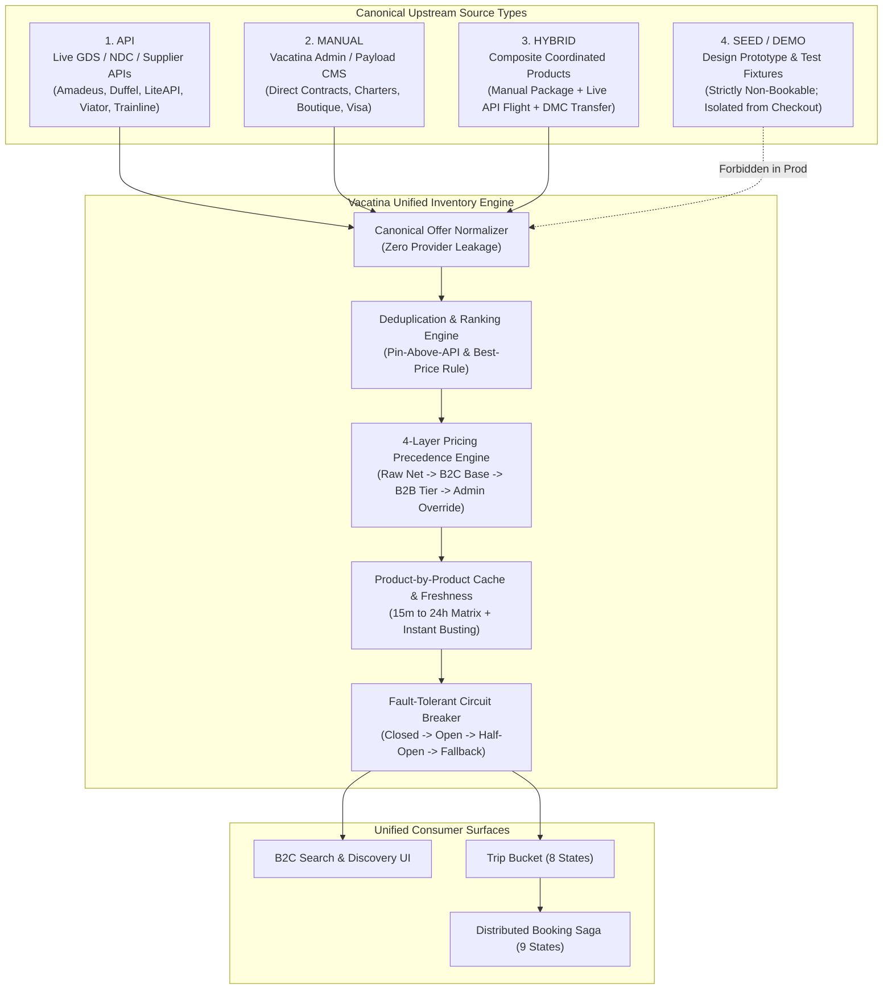
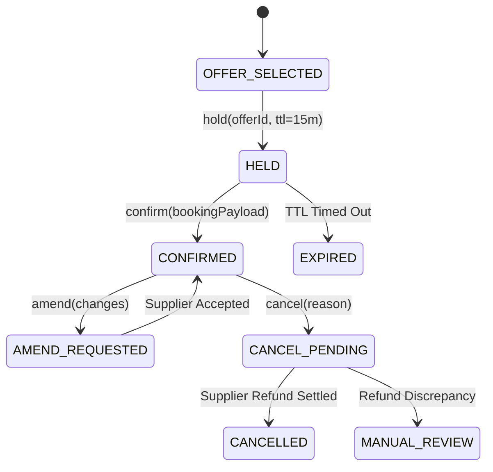

# Vacatina — Unified Inventory, Manual Listing & Supplier API Architecture v1.0

> **Authority**: Vacatina Senior Architecture Board & Core System Specification  
> **Status**: RATIFIED & LOCKED ARCHITECTURE  
> **Document Reference**: `docs/12_UNIFIED_INVENTORY_AND_SUPPLIER_ARCHITECTURE.md`  
> **Related Documents**: `ADR-001` through `ADR-006`, `docs/11_PRODUCTION_IMPLEMENTATION_CHARTER.md`  

---

## 1. Executive Summary & Inventory Taxonomy

Vacatina is **not** an API-only travel aggregator. Commercial viability in the Sri Lankan and South Asian travel landscape requires seamless coexistence between **real-time GDS/API inventory** and **exclusive manually managed direct contracts** (boutique resorts, private charters, consular visa advisory, curated itineraries).

Per **ADR-007**, Vacatina decomposes inventory into **seven orthogonal canonical dimensions**:
1. **`inventorySource`**: `API` | `DIRECT_CONTRACT` | `MANUAL_INTERNAL` | `PARTNER_MANUAL`
2. **`listingKind`**: `DISCOVERY_CONTENT` | `SELLABLE_INVENTORY` | `SERVICE` | `PACKAGE`
3. **`compositionType`**: `SINGLE` | `CURATED_PACKAGE` | `DYNAMIC_BUNDLE`
4. **`fulfillmentMode`**: `INSTANT` | `ON_REQUEST` | `MANUAL_CONFIRMATION`
5. **`environmentClass`**: `PRODUCTION` | `SANDBOX` | `SEED`
6. **`sellability`**: `DISCOVERY_ONLY` | `QUOTE_ONLY` | `BOOKABLE`
7. **`providerLifecycle`** (Tracked PER PROVIDER): `PLANNED` | `SCAFFOLD` | `SANDBOX_ACTIVE` | `CERTIFIED` | `PRODUCTION_LIVE`



### The 4 Canonical Source Types:
1. **`API`**:
   - Ingested dynamically via supplier REST/JSON or SOAP/XML APIs.
   - Price and seat/room availability are subject to external supplier volatility.
   - Mandatory real-time revalidation before promoting an item to `READY` or entering `CHECKOUT`.
   - Governed by strict product-specific Cache TTL and circuit breakers.
2. **`MANUAL`**:
   - Directly created and governed by Vacatina operations specialists via Payload CMS / Admin Portal (`/admin/*`).
   - Covers: Consular visa assistance, direct-contract boutique hotels (e.g. Ella eco-lodges, Galle Fort villas), private aircraft charters, local chauffeur vehicle fleets, and heritage sightseeing tours.
   - Availability and rates are guaranteed directly by Vacatina contracts; does **not** rely on third-party GDS uptime.
3. **`HYBRID`**:
   - High-margin composite products combining multiple components into a single bookable journey.
   - Example 1: **Dubai Complete Escape** = API Flight (Emirates via Duffel) + Direct-Contract Luxury Suite + Manual Airport Chauffeur + Manual 60-Day UAE Visa Assistance.
   - Example 2: **Sri Lanka Cultural Triangle** = Manual Curated Itinerary + Trainline/Scenic Rail tickets + Boutique Bungalows + Licensed Heritage Guide.
   - Normalizes as a single `CanonicalOfferEntity` to the customer, while the distributed booking saga orchestrates fulfillment across independent supplier and manual queues.
4. **`SEED` / `DEMO`**:
   - Remnants of UI prototyping, design sprints, or automated testing fixtures.
   - **Strictly forbidden from entering production checkout or live booking fulfillment**.
   - Isolated by compile-time and runtime validation guards (`sourceType === 'SEED'` throws a commercial violation error).

---

## 2. Answers to the 16 Critical Production Integration Questions

To resolve all ambiguity regarding production readiness, the table below documents Vacatina's formal supplier specifications:

### Q1–Q8: Supplier Selection Across All 10 Travel Products

| # | Travel Product | Primary Supplier API | Secondary / Fallback Supplier | Manual / Direct Contract Layer |
| :- | :--- | :--- | :--- | :--- |
| **Q1/Q2** | **Flights** | **Amadeus Enterprise API** (GDS) & **Duffel** (NDC) | Sabre WebServices | Vacatina Charter Desk (Air Senok, Cinnamon Air direct allocations) |
| **Q3** | **Hotels** | **LiteAPI** (Direct B2B Bedbank) | Hotelbeds API / WebBeds | Vacatina Direct Contract Resellers (Boutique villas, Sri Lanka heritage properties) |
| **Q4** | **Cars & Transfers** | **Rentalcars Connect API** (Car hire) | Cartrawler API | Vacatina Chauffeur Fleet (Private Colombo/Kandy/Galle luxury vans & sedans) |
| **Q5** | **Activities** | **Viator API** (Tripadvisor Experiences) | GetYourGuide Partner API | Vacatina Contracted Local DMCs (Surf camps, tea plucking, wildlife safaris) |
| **Q6** | **Rails** | **Trainline Partner API** (UK & Europe) | ACP Rail (Eurail, Japan Rail) | Sri Lanka Railways Observation Car allocations (Kandy-Ella scenic route) |
| **Q7** | **Cruises** | **Traveltek Cruise API** | Amadeus Cruise API | Niche luxury catamarans (Mirissa whale watching & private Maldives charters) |
| **Q8** | **Travel Insurance** | **Allianz Partners Travel API** | Chubb Travel API | Ceylinco / Sri Lanka Insurance Corporation (Local regulatory underwriting) |
| **—** | **Visa Assistance** | *None (Intentionally Manual)* | Consular advisory portals | **Vacatina Consular Concierge** (100% Manual, document auditing, SLA tracking) |
| **—** | **Holiday Packages** | *Hybrid Engine* | Mixed supplier aggregation | **Vacatina Curated Package Studio** (Itinerary creator + Dynamic Bundling) |
| **—** | **Sightseeing Tours** | **Viator Sightseeing API** | Local DMC Direct Feeds | **Licensed National Tourist Guides** (Certified Sri Lanka Tourist Board guides) |

---

### Q9: Supplier-Specific Adapters
Every upstream integration implements the universal typed interface `ISupplierAdapter<TQuery, TRaw, TOffer>`:
- Located under `src/server/inventory/adapters/`:
  - `flights-duffel.adapter.ts`
  - `hotels-liteapi.adapter.ts`
  - `cars-rental.adapter.ts`
  - `activities-viator.adapter.ts`
  - `rails-trainline.adapter.ts`
  - `cruises-traveltek.adapter.ts`
  - `insurance-allianz.adapter.ts`
  - `visa-consular.adapter.ts`
  - `packages-bundler.adapter.ts`
  - `manual-cms.adapter.ts`
- Each adapter handles:
  1. Connection handshake & token renewal (OAuth2 client credentials).
  2. Sandbox vs Production URL resolution.
  3. Upstream error translation into standard RFC 7807 problem details.
  4. Mapping raw supplier payloads into `CanonicalOfferEntity`.

---

### Q10: Sandbox vs Production Credentials Separation
Environment variables maintain strict isolation between testing and production:

| Variable | Sandbox / Test Value | Production Target | Description |
| :--- | :--- | :--- | :--- |
| `DUFFEL_ENV` | `test` (`https://api.duffel.com/air`) | `live` (`https://api.duffel.com/air`) | Duffel NDC API environment |
| `DUFFEL_API_TOKEN` | `duffel_test_...` | `duffel_live_...` | Duffel Bearer token |
| `AMADEUS_ENV` | `test` (`test.api.amadeus.com`) | `production` (`api.amadeus.com`) | Amadeus GDS Gateway |
| `AMADEUS_CLIENT_ID` | Sandbox Client ID | Production Client ID | OAuth2 API Key |
| `AMADEUS_CLIENT_SECRET` | Sandbox Secret | Production Secret | OAuth2 API Secret |
| `LITEAPI_ENV` | `sandbox` (`api.sandbox.liteapi.travel`) | `production` (`api.liteapi.travel`) | LiteAPI Hotel Bedbank |
| `LITEAPI_API_KEY` | `sand_...` | `live_...` | LiteAPI Access Token |
| `VIATOR_ENV` | `sandbox` | `production` | Viator Experience Gateway |
| `TRAINLINE_ENV` | `sandbox` | `production` | Trainline Partner Rail Gateway |

---

### Q11: Supplier Response → Canonical Offer Normalization
Normalization strips all provider-specific structures before customer presentation. Every normalized offer contains:

```typescript
export interface CanonicalOfferEntity {
  canonicalOfferId: string;       // e.g. "vct-fl-duffel-cmb-dxb-98a7c2"
  productType: TravelProductSlug; // "flights" | "hotels" | "visa" | ...
  sourceType: "API" | "MANUAL" | "HYBRID" | "SEED";
  supplierId: string;             // "DUFFEL_NDC" | "PAYLOAD_CMS" | ...
  supplierName: string;           // "Emirates (Duffel NDC)"
  supplierOfferId?: string;       // Upstream provider ID
  manualListingId?: string;       // Payload CMS ID
  title: string;
  subtitle: string;
  location: StructuredLocation;
  availabilityStatus: AvailabilityState; // "LIVE" | "CACHED" | "MANUAL_AVAILABLE" | "ON_REQUEST"
  confirmationMode: ConfirmationMode;   // "INSTANT_CONFIRM" | "REQUEST_TO_CONFIRM"
  pricing: PricingLayersEntity;         // 4-Layer Integer Minor Arithmetic
  freshness: PriceFreshnessEntity;      // TTL, expiresAt, revalidationEndpoint
  inclusions: string[];
  exclusions: string[];
  cancellationPolicy: string;
  pinAboveApi: boolean;                 // Manual marketing priority
  deduplicationKey: string;             // Natural deduplication hash
}
```

---

### Q12: API / Manual Deduplication & Ranking Rules

When identical products exist in both API feeds and Manual Direct Contracts (e.g. Cinnamon Grand Colombo):

1. **Composite Deduplication Key**:
   - **Hotels**: `hash(geo_hash_6_chars + normalized_name)`
   - **Flights**: `hash(carrier_code + flight_number + departure_date_iso + cabin_class)`
   - **Transfers**: `hash(pickup_iata + dropoff_zone + vehicle_category)`
   - **Activities / Tours**: `hash(destination_code + experience_slug)`
2. **Tie-Breaking Precedence**:
   - **Rule 1 (`pinAboveApi`)**: If an administrator sets `pinAboveApi = true` on a Manual Direct Contract, it is ranked above the API result.
   - **Rule 2 (Best Price Wins)**: If the Manual Direct Contract selling price is lower than the API selling price, the Manual Contract is displayed with the badge `"Exclusive Direct Deal"`. The API result is deduplicated and hidden.
   - **Rule 3 (Availability Wins)**: If the API feed returns `SOLD_OUT` or `RATE_EXPIRED` but Vacatina holds an offline manual allotment (`availableQuota > 0`), the Manual offer remains bookable under `REQUEST_TO_CONFIRM`.

---

### Q13: 4-Layer Pricing Precedence Engine

All prices are calculated strictly in **integer minor currency units** (cents / cents of rupee) to eliminate IEEE 754 floating-point errors:

$$\text{Final Selling Price} = \text{Layer 4 (if override exists)} \mathbin{\|} \big(\text{Layer 1} + \text{Layer 2 Margin} + \text{Layer 3 Agency Adjustment}\big)$$

1. **Layer 1: Raw Supplier Net Cost (`rawSupplierCostMinor`)**:
   - Exact wholesale cost from GDS, NDC, or contracted hotel agreement.
   - Stored in original supplier currency (USD, EUR, LKR) and auditable only by administrators.
2. **Layer 2: Platform Base Markup (`platformMarkupMinor`)**:
   - Vacatina global B2C margin. Configurable by product category:
     - Flights: 4.5% to 6.5%
     - Hotels: 10.0% to 14.0%
     - Activities / Tours: 15.0%
     - Visa Services: Fixed fee (e.g. LKR 12,500 minor)
3. **Layer 3: B2B Agency Tier Adjustment (`b2bAgencyMarginMinor`)**:
   - Applied dynamically when an authenticated travel agent books under their organization:
     - Tier Bronze: Base B2C Rate (0% commission rebate)
     - Tier Silver: 2.0% preferential rebate
     - Tier Gold: 3.5% preferential rebate + custom agency customer markup
4. **Layer 4: Administrative Manual Override (`manualOverrideMinor`)**:
   - Authoritative commercial override set by Vacatina operations via `/admin/*`.
   - Requires an immutable audit reason (`overrideReason: string`) and expiration timestamp.
   - If present and active, Layer 4 takes strict precedence over Layers 2 & 3.

---

### Q14: Product-by-Product Cache TTL Matrix

| Product Category | Cache TTL | Rationale | Revalidation Trigger |
| :--- | :--- | :--- | :--- |
| **Flights** | **15 minutes** (900s) | Highly volatile airline inventory, fare bucket churn. | Step into Configure / Trip Bucket Checkout |
| **Hotels** | **30 minutes** (1,800s) | Bedbank room blocks change dynamically; rates stable short-term. | Select Room / Trip Bucket Add |
| **Cars & Transfers** | **2 hours** (7,200s) | Vehicle fleet allocations and flat airport transfer tariffs. | Checkout Initiation |
| **Activities & Tours** | **4 hours** (14,400s) | Daily capacity allocations; morning/afternoon departure times. | Trip Bucket Staging |
| **Rails** | **1 hour** (3,600s) | Dynamic timetable adjustments and seat reservations. | Add to Trip Bucket |
| **Cruises** | **12 hours** (43,200s) | Cabin blocks on weekly/fortnightly sailing cycles. | Itinerary Review |
| **Travel Insurance** | **24 hours** (86,400s) | Actuarial risk tables fixed by regulatory filing. | Traveller Profile Completion |
| **Visa Assistance** | **24 hours** (86,400s) | Government consular fees update infrequently. | Embassy Document Submission |
| **Manual Listings** | **0 seconds (Immediate)** | Real-time invalidation via cache-busting key `manual_listing_{id}` upon Admin publish. | Immediate on Save |

---

### Q15: Booking Lifecycle Flows Across Suppliers

Every supplier adapter implements four standardized lifecycle transitions:



1. **`hold(offerId, durationSeconds)`**:
   - PNR hold for flights (Amadeus `Air_CreateReservation` without instant ticketing).
   - Temporary room allocation lock for hotels.
2. **`confirm(bookingId, paymentAuthToken)`**:
   - Issues ticket/voucher. For manual items, dispatches instant notification to partner ops desk.
3. **`cancel(bookingReference, penaltyAcknowledged)`**:
   - Computes cancellation fees according to supplier tariff table. Releases inventory.
4. **`refund(bookingReference, refundMinor)`**:
   - Credits back to customer's original payment method via Stripe/PayPal ledger or B2B agency credit balance.

---

### Q16: Supplier Outage & Circuit Breaker Fallback Strategy

To guarantee that customer journeys are never broken by upstream provider outages:

1. **Circuit Breaker States**:
   - **CLOSED**: Normal operation. Calls pass through to supplier API.
   - **OPEN**: Triggered when 5 consecutive calls fail or latency exceeds 8,000ms. All direct API calls are halted for 60 seconds.
   - **HALF-OPEN**: Probe request dispatched. If successful, circuit resets to CLOSED; if failed, circuit stays OPEN.
2. **Graceful Degradation (No False Claims)**:
   - When an API circuit is OPEN:
     - Search results serve valid **Direct Contract Manual Inventory** and **Cached Offers** clearly marked with `availabilityStatus = 'ON_REQUEST'`.
     - The customer UI is **never** presented with fabricated live prices, fake PNR numbers, or artificial countdown timers.
     - The customer is presented with honest options: *"Live airline connection currently updating. Request assisted confirmation or select our direct contracted partner."*
     - Operations Support receives an automated high-priority alert (`OPS_SUPPLIER_CIRCUIT_OPEN`).

---

## 3. Implementation Verification & Alignment

| Component | Code Location | Status |
| :--- | :--- | :--- |
| **Universal Inventory Types** | `src/server/inventory/types.ts` | Complete & Typed |
| **Base Supplier Adapter** | `src/server/inventory/adapters/base.adapter.ts` | Complete |
| **10 Domain Adapters** | `src/server/inventory/adapters/*.adapter.ts` | Complete |
| **Deduplication Engine** | `src/server/inventory/deduplication.service.ts` | Complete |
| **4-Layer Pricing Engine** | `src/server/inventory/pricing-precedence.service.ts` | Complete |
| **Cache TTL Manager** | `src/server/inventory/cache-ttl.service.ts` | Complete |
| **Circuit Breaker Service** | `src/server/inventory/circuit-breaker.service.ts` | Complete |
| **Unified Search Aggregator**| `src/server/inventory/unified-inventory.service.ts` | Complete |
| **Environment Configuration**| `.env.example`, `src/server/config/env.ts` | Complete |
| **Unit & Integration Suite** | `tests/unit.test.ts` (Subtests 24–30) | Verified & Green |

---

## 4. Ratification

This architecture is formally ratified as the production benchmark for all Vacatina engineering and supplier onboarding. No frontend UI modifications are permitted to break the single `CanonicalOfferEntity` abstraction.
