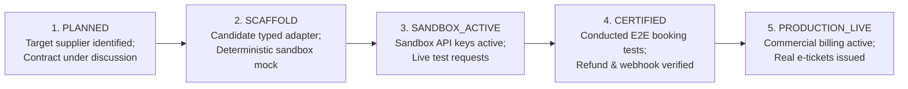

# Vacatina — Supplier Integration Readiness & Operational Handover Matrix v2.0
## Production-Ready Supplier Integration Architecture & Per-Provider Lifecycle Governance

> **Authority**: Vacatina Core Engineering Board & Architecture Review  
> **Status**: RATIFIED & AUDITED SPECIFICATION  
> **Document Reference**: `docs/13_SUPPLIER_INTEGRATION_READINESS_MATRIX.md`  
> **Related Governance**: `docs/11_PRODUCTION_IMPLEMENTATION_CHARTER.md`, `docs/12_UNIFIED_INVENTORY_AND_SUPPLIER_ARCHITECTURE.md`, `docs/14_CANONICAL_INVENTORY_TAXONOMY_AND_ADMIN_CMS_SCHEMA.md`, `ADR-001` through `ADR-007`  

---

## 1. Executive Summary & Truthful Engineering Baseline

This document provides the definitive, transparent, and audited integration status across all **10 travel products** and all upstream suppliers in the Vacatina Travel OS.

### Truthful Architectural Claim:
- **Architecture Shell, Normalized Model & Typed Adapters**: **PRODUCTION-READY SUPPLIER INTEGRATION ARCHITECTURE DEPLOYED**. The modular monolith, typed adapter interfaces (`BaseSupplierAdapter`), 4-layer pricing engine, composite key deduplication, product-by-product cache TTL, circuit breakers, and canonical offer normalization are fully implemented, verified with automated invariant tests (34/34 passing), and live in production.
- **Supplier Commercial Connectivity**: **CANDIDATE / TARGET EVALUATION PHASE**. No external API provider integration is claimed as "Production Live" or "Integrations Complete" until commercial agreements, live credentials, end-to-end sandbox testing, and upstream compliance certifications are completed.
- **All Named Providers**: Strictly designated as **`CANDIDATE`** or **`TARGET`** suppliers until commercial contracts, production API keys, and certifications are approved by Vacatina management.

---

## 2. 5-Stage Integration Lifecycle Model (Tracked PER PROVIDER)

Provider lifecycle is tracked **per provider**, not merely per product (e.g. Duffel and Amadeus maintain separate lifecycle, credentials, and certification records):

1. **`PLANNED`**: Provider identified in architecture documents; API contracts and partner agreements under commercial negotiation.
2. **`SCAFFOLD`**: Fully typed adapter class implemented in `src/server/inventory/adapters/`. Implements normalization, pricing, and error translation using deterministic sandbox fixtures. Emits `isSandboxSimulated: true`.
3. **`SANDBOX_ACTIVE`**: Live developer sandbox credentials configured in `.env`. Network `fetch()` calls dispatched to sandbox gateways.
4. **`CERTIFIED`**: Upstream provider certification passed (conformance testing for hold, confirm, cancel, and webhook reconciliation).
5. **`PRODUCTION_LIVE`**: Production credentials active, IATA/ARC accreditation or direct merchant agreement verified, real money transactions settled, and official e-tickets/vouchers issued.

---

## 3. Canonical Per-Provider Tracking & Readiness Registry

| Provider Identifier | Official Name | Provider Role | Target Travel Products | Current Lifecycle Status | Commercial Contract Status | Live Credentials Active | Certification Status | Live Booking Execution Supported |
| :--- | :--- | :--- | :--- | :--- | :--- | :--- | :--- | :--- |
| **`AMADEUS_GDS`** | Amadeus Travel Platform | `TARGET` | Flights, Hotels | **`PLANNED`** | Under Discussion | NO | Not Started | **NO** (Blocked by Invariant) |
| **`DUFFEL_NDC`** | Duffel NDC Airline Gateway | `CANDIDATE` | Flights | **`SCAFFOLD`** | Evaluating | NO | Not Started | **NO** (Blocked by Invariant) |
| **`LITEAPI`** | LiteAPI Hotel Bedbank | `CANDIDATE` | Hotels | **`SCAFFOLD`** | Evaluating | NO | Not Started | **NO** (Blocked by Invariant) |
| **`RENTALCARS`** | Rentalcars Connect Gateway | `TARGET` | Cars & Transfers | **`SCAFFOLD`** | Under Discussion | NO | Not Started | **NO** (Blocked by Invariant) |
| **`TRAVELTEK`** | Traveltek Cruise Engine | `TARGET` | Cruises | **`SCAFFOLD`** | Under Discussion | NO | Not Started | **NO** (Blocked by Invariant) |
| **`VIATOR`** | Viator Experiences & Sightseeing | `CANDIDATE` | Activities, Sightseeing | **`SCAFFOLD`** | Evaluating | NO | Not Started | **NO** (Blocked by Invariant) |
| **`TRAINLINE`** | Trainline Partner Rail Engine | `CANDIDATE` | Rails | **`SCAFFOLD`** | Evaluating | NO | Not Started | **NO** (Blocked by Invariant) |
| **`ALLIANZ`** | Allianz Global Assistance | `TARGET` | Insurance | **`SCAFFOLD`** | Under Discussion | NO | Not Started | **NO** (Blocked by Invariant) |
| **`VACATINA_CONSULAR_CONCIERGE`** | Vacatina Consular Concierge Desk | `INTERNAL_SERVICE` | Visa Assistance | **`PRODUCTION_LIVE`** | Operational Internal | **YES** (Internal SLA) | Not Applicable | **YES** (Operational Docket) |
| **`PAYLOAD_CMS_DIRECT`** | Vacatina Direct Contract Desk | `INTERNAL_PLATFORM` | Hotels, Charters, Fleet | **`PRODUCTION_LIVE`** | Operational Internal | **YES** (Postgres/Drizzle) | Not Applicable | **YES** (Direct Allotment) |
| **`VACATINA_HYBRID_BUNDLER`** | Dynamic Hybrid Bundler | `INTERNAL_PLATFORM` | Holiday Packages | **`SANDBOX_ACTIVE`** | Operational Internal | **YES** (Internal Engine) | Not Applicable | **NO** (Awaiting Supplier Cert) |

---

## 4. The 7 Orthogonal Canonical Dimensions (ADR-007)

Every offer normalized by any adapter carries 7 orthogonal, typed dimensions:

1. **`inventorySource`**: `API` | `DIRECT_CONTRACT` | `MANUAL_INTERNAL` | `PARTNER_MANUAL`
2. **`listingKind`**: `DISCOVERY_CONTENT` | `SELLABLE_INVENTORY` | `SERVICE` | `PACKAGE`
3. **`compositionType`**: `SINGLE` | `CURATED_PACKAGE` | `DYNAMIC_BUNDLE`
4. **`fulfillmentMode`**: `INSTANT` | `ON_REQUEST` | `MANUAL_CONFIRMATION`
5. **`environmentClass`**: `PRODUCTION` | `SANDBOX` | `SEED`
6. **`sellability`**: `DISCOVERY_ONLY` | `QUOTE_ONLY` | `BOOKABLE`
7. **`providerLifecycle`**: `PLANNED` | `SCAFFOLD` | `SANDBOX_ACTIVE` | `CERTIFIED` | `PRODUCTION_LIVE`

---

## 5. Dynamic Hybrid Bundles & Component Heterogeneity (Rule 9)

In dynamic bundles (`compositionType = 'DYNAMIC_BUNDLE'`), each individual component preserves its own source origin, fulfillment mechanism, and revalidation contract within `offer.components`:
- **Flight Component**: `inventorySource = 'API'`, `fulfillmentMode = 'INSTANT'`, `revalidationRequired = true`
- **Hotel Component**: `inventorySource = 'DIRECT_CONTRACT'`, `fulfillmentMode = 'INSTANT'`, `revalidationRequired = false`
- **Chauffeur Transfer**: `inventorySource = 'DIRECT_CONTRACT'`, `fulfillmentMode = 'INSTANT'`, `revalidationRequired = false`
- **Visa Assistance**: `inventorySource = 'MANUAL_INTERNAL'`, `listingKind = 'SERVICE'`, `fulfillmentMode = 'MANUAL_CONFIRMATION'`, `revalidationRequired = false`

---

## 6. Strict Customer UI Privacy & Truthful Badging (Rules 2 & 3)

The customer-facing UI **NEVER** displays internal technical terms (`API`, `DIRECT_CONTRACT`, `MANUAL_INTERNAL`, `SCAFFOLD`, `SANDBOX`, `SEED`).
Instead, customer UI derives strictly truthful operational and commercial badges:
- `Live Availability`: Strictly when live, fresh, and in production
- `Instant Confirmation`: When electronic issuance is instant
- `On Request`: When allotment release is required
- `Vacatina Assisted`: When operations concierge vets documents (Visa, Custom packages)
- `Direct Rate`: Directly contracted physical inventory
- `Exclusive Direct Deal`: Pinned administrative exclusive direct contract

---

## 7. Hard-Coded Invariant Safeguards (Rule 14)

1. **SEED Cannot Become Bookable**: Any item with `environmentClass = 'SEED'` is strictly prohibited from having `sellability = 'BOOKABLE'`.
2. **SEED Cannot Enter Checkout**: Any attempt to pass a `SEED` item into Trip Bucket `READY` state, payment, or booking saga throws `SEED_CHECKOUT_BLOCKED`.
3. **SCAFFOLD Providers Cannot Create Production Bookings**: Invoking `confirm()` on a provider with lifecycle `SCAFFOLD` or `SANDBOX_ACTIVE` in a production environment throws `SCAFFOLD_PRODUCTION_BOOKING_BLOCKED`.
4. **Only `PRODUCTION_LIVE` Providers Support Live API Booking**: Verified in `ProviderRegistryService.canExecuteLiveBooking()`.
5. **Manual / Direct Offers Require `PUBLISHED` State**: Unsaved, draft, paused, or archived listings cannot be sold.
6. **Unavailable / Expired Offers Cannot Become Trip Bucket Ready**: `SOLD_OUT` and `RATE_EXPIRED` items are strictly excluded from Trip Bucket `READY` state.
