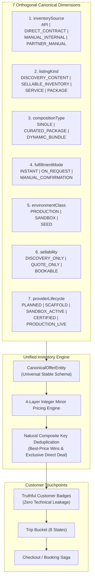

# Vacatina — Canonical Inventory Taxonomy & Admin Manual CMS Schema v2.0
## Orthogonal 7-Dimension Inventory Model & Payload CMS / PostgreSQL Schema

> **Authority**: Vacatina Core Engineering Board & Architecture Review  
> **Status**: RATIFIED & LOCKED SPECIFICATION  
> **Document Reference**: `docs/14_CANONICAL_INVENTORY_TAXONOMY_AND_ADMIN_CMS_SCHEMA.md`  
> **Related Architecture**: `docs/11_PRODUCTION_IMPLEMENTATION_CHARTER.md`, `docs/12_UNIFIED_INVENTORY_AND_SUPPLIER_ARCHITECTURE.md`, `docs/13_SUPPLIER_INTEGRATION_READINESS_MATRIX.md`, `ADR-001` through `ADR-007`  

---

## 1. The 7 Orthogonal Canonical Inventory Dimensions (ADR-007)

To eliminate technical conflation across the frontend, backend, and database layers, Vacatina formally ratifies **seven orthogonal, typed dimensions** governing every product and offer:



### The 7 Dimensions Defined:

1. **`inventorySource`**:
   - `API`: Live external supplier/GDS/NDC/Bedbank (Amadeus, Duffel, LiteAPI, Viator, Trainline).
   - `DIRECT_CONTRACT`: Directly negotiated commercial contract managed in Admin/Payload CMS.
   - `MANUAL_INTERNAL`: Internal operational workflow executed by Vacatina operations staff (e.g. Consular Concierge).
   - `PARTNER_MANUAL`: External travel partner managing inventory via Vacatina Extranet.
2. **`listingKind`**:
   - `DISCOVERY_CONTENT`: Marketing cards, destination inspiration, teasers (never directly bookable).
   - `SELLABLE_INVENTORY`: Physical inventory (seats, rooms, vehicles, berths).
   - `SERVICE`: Human/operational service (visa assistance, concierge, airport escort).
   - `PACKAGE`: Structured multi-day holiday packages.
3. **`compositionType`**:
   - `SINGLE`: Standalone individual product (one flight or one room).
   - `CURATED_PACKAGE`: Fixed multi-day itinerary pre-assembled by Vacatina.
   - `DYNAMIC_BUNDLE`: Algorithmic or user-assembled multi-product bundle (e.g. flight + hotel + transfer).
4. **`fulfillmentMode`**:
   - `INSTANT`: Instant electronic issuance upon payment.
   - `ON_REQUEST`: Requires supplier / allotment allocation before final confirmation.
   - `MANUAL_CONFIRMATION`: Requires manual human document check and consular/concierge review.
5. **`environmentClass`**:
   - `PRODUCTION`: Live commercial environment.
   - `SANDBOX`: Safe test/simulated environment.
   - `SEED`: Prototype accelerator / demo data, strictly isolated from checkout.
6. **`sellability`**:
   - `DISCOVERY_ONLY`: Non-purchasable informational teaser; click prefills real search.
   - `QUOTE_ONLY`: Requires agent quotation before checkout.
   - `BOOKABLE`: Directly purchasable online through Vacatina checkout.
7. **`providerLifecycle`** (Tracked PER PROVIDER):
   - `PLANNED` | `SCAFFOLD` | `SANDBOX_ACTIVE` | `CERTIFIED` | `PRODUCTION_LIVE`.

---

## 2. Customer-Facing Truth Rule: Badging vs Technical Privacy

Customer-facing UI **NEVER** displays internal technical terms (`API`, `DIRECT_CONTRACT`, `MANUAL_INTERNAL`, `SCAFFOLD`, `SANDBOX`, `SEED`).
Instead, customer UI derives strictly truthful operational and commercial badges:
- `Live Availability`: Strictly when live, fresh, and in production.
- `Instant Confirmation`: When electronic issuance is instant.
- `On Request`: When allotment release is required.
- `Vacatina Assisted`: When operations concierge vets documents (Visa, Custom packages).
- `Direct Rate`: Directly contracted physical inventory.
- `Exclusive Direct Deal`: Pinned administrative exclusive direct contract.

---

## 3. Dynamic Bundles & Component Heterogeneity (Rule 9)

In dynamic bundles (`compositionType = 'DYNAMIC_BUNDLE'`), each individual component preserves its own source origin, fulfillment mechanism, and revalidation contract within `offer.components`:
- **Flight Component**: `inventorySource = 'API'`, `fulfillmentMode = 'INSTANT'`, `revalidationRequired = true`
- **Hotel Component**: `inventorySource = 'DIRECT_CONTRACT'`, `fulfillmentMode = 'INSTANT'`, `revalidationRequired = false`
- **Chauffeur Transfer**: `inventorySource = 'DIRECT_CONTRACT'`, `fulfillmentMode = 'INSTANT'`, `revalidationRequired = false`
- **Visa Assistance**: `inventorySource = 'MANUAL_INTERNAL'`, `listingKind = 'SERVICE'`, `fulfillmentMode = 'MANUAL_CONFIRMATION'`, `revalidationRequired = false`

---

## 4. Admin Manual CMS Schema Specification (Payload CMS / PostgreSQL)

Direct Contract and Manual Listings are persisted in PostgreSQL via Drizzle ORM and managed through Payload CMS collections:

```typescript
export type ManualListingStatus = 'DRAFT' | 'IN_REVIEW' | 'PUBLISHED' | 'PAUSED' | 'ARCHIVED';

export interface ManualListingEntity {
  id: UUID;
  organizationId?: UUID;
  productType: string;

  // 7 Orthogonal Dimensions (ADR-007)
  inventorySource: 'DIRECT_CONTRACT' | 'MANUAL_INTERNAL' | 'PARTNER_MANUAL';
  listingKind: 'SELLABLE_INVENTORY' | 'SERVICE' | 'PACKAGE';
  compositionType: 'SINGLE' | 'CURATED_PACKAGE' | 'DYNAMIC_BUNDLE';
  fulfillmentMode: 'INSTANT' | 'ON_REQUEST' | 'MANUAL_CONFIRMATION';
  environmentClass: 'PRODUCTION' | 'SANDBOX' | 'SEED';
  sellability: 'DISCOVERY_ONLY' | 'QUOTE_ONLY' | 'BOOKABLE';

  // Commercial & Partner Relations
  partnerSupplierId: string;
  partnerName: string;
  contractReference: string;
  title: string;
  subtitle: string;
  description: string;

  // Geographic Taxonomy
  destinationCity: string;
  destinationCountry: string;
  destinationCountryCode: string; // ISO 3166-1 alpha-2
  latitude?: number;
  longitude?: number;

  // Commercial Economics (Integer Minor Units)
  contractedNetCostMinor: number;
  costCurrency: string;
  platformMarkupPercent: number;
  manualOverridePriceMinor?: number;
  overrideReason?: string;
  sellingPriceMinor: number;
  sellingCurrency: string;

  // Allotment & Availability Controls
  availableQuota: number;
  isUnlimitedQuota: boolean;
  blackoutDates: string[]; // ISO YYYY-MM-DD
  minimumNoticeHours: number;
  validFrom: ISODateString;
  validUntil: ISODateString;

  // Operational Policies
  confirmationMode: 'INSTANT_CONFIRM' | 'REQUEST_TO_CONFIRM' | 'ASSISTED_SERVICE';
  inclusions: string[];
  exclusions: string[];
  cancellationPolicy: string;
  termsReference: string;

  // Media & Merchandising
  heroImageUrl: string;
  galleryImageUrls: string[];
  isFeatured: boolean;
  pinAboveApi: boolean;
  isB2BVisible: boolean;
  isB2CVisible: boolean;

  // Lifecycle & Audit
  status: ManualListingStatus;
  publishedByUserId?: UUID;
  publishedAt?: ISODateString;
  createdAt: ISODateString;
  updatedAt: ISODateString;
}

export interface ManualListingAuditLogEntity {
  id: UUID;
  listingId: UUID;
  actorUserId: UUID;
  action: 'CREATED' | 'UPDATED' | 'PUBLISHED' | 'PAUSED' | 'ARCHIVED' | 'PRICE_OVERRIDDEN';
  changeSummary: string;
  previousStateSnapshot?: Record<string, unknown>;
  newStateSnapshot: Record<string, unknown>;
  createdAt: ISODateString;
}
```

---

## 5. Automated Invariant Safeguards (Rule 14)

The architecture is safeguarded by strict automated invariants verified by tests:
1. `SEED` data cannot have `sellability = 'BOOKABLE'` (throws `SEED_CANNOT_BE_BOOKABLE`).
2. `SEED` data cannot enter checkout or payment (throws `SEED_CHECKOUT_BLOCKED`).
3. `SCAFFOLD` providers cannot execute production bookings (throws `SCAFFOLD_PRODUCTION_BOOKING_BLOCKED`).
4. Only `PRODUCTION_LIVE` providers can execute live bookings.
5. Manual/direct contract offers require `status: 'PUBLISHED'` to be bookable.
6. `SOLD_OUT` or `RATE_EXPIRED` items cannot transition to Trip Bucket `READY` state.
7. Customer UI badge validator statically confirms 0 technical taxonomy leakage.
