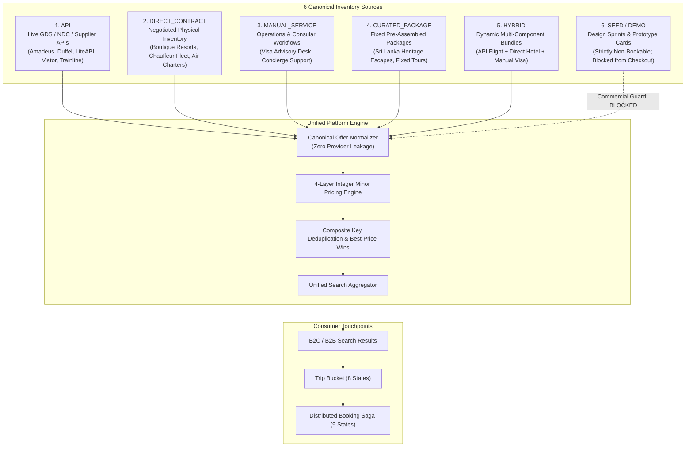
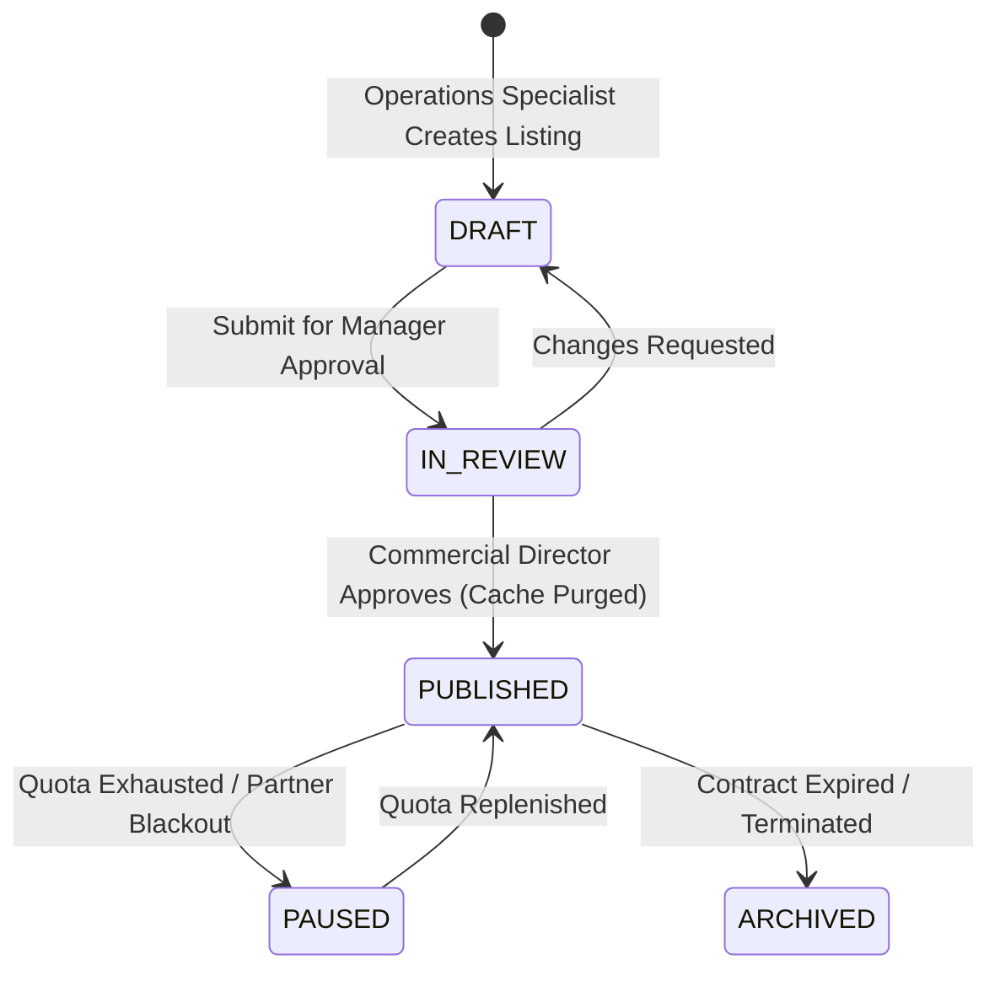

# Vacatina — Canonical Inventory Taxonomy & Admin Manual CMS Schema v1.0

> **Authority**: Vacatina Core Engineering Board & Architecture Review  
> **Status**: RATIFIED & LOCKED SPECIFICATION  
> **Document Reference**: `docs/14_CANONICAL_INVENTORY_TAXONOMY_AND_ADMIN_CMS_SCHEMA.md`  
> **Related Architecture**: `docs/11_PRODUCTION_IMPLEMENTATION_CHARTER.md`, `docs/12_UNIFIED_INVENTORY_AND_SUPPLIER_ARCHITECTURE.md`, `docs/13_SUPPLIER_INTEGRATION_READINESS_MATRIX.md`, `ADR-001` through `ADR-006`  

---

## 1. Canonical 6-Source Inventory Taxonomy

To eliminate technical ambiguity across the frontend, backend, and database layers (such as *"Is Direct Contract manual or a separate source type?"*), Vacatina formally ratifies **six distinct, unambiguous inventory source types**:



### The 6 Canonical Source Definitions:

1. **`API`**:
   - Live external travel inventory ingested via third-party GDS, NDC, or supplier APIs (Duffel, Amadeus, LiteAPI, Viator, Trainline).
   - Subject to external supplier volatility. Mandatory revalidation before checkout.
2. **`DIRECT_CONTRACT`**:
   - Physical travel inventory negotiated directly by Vacatina contracts (e.g. 10 exclusive suites at a Galle Fort boutique villa, Cinnamon Air scenic amphibian seats, local Colombo luxury van fleet).
   - Governed by committed contractual quotas (`availableQuota`) and negotiated wholesale net rates.
3. **`MANUAL_SERVICE`**:
   - Operational service workflows rather than fixed room/seat inventory (e.g. Vacatina Consular Visa Assistance, dedicated document vetting, VIP airport fast-track).
   - Truthfully classified as an **"Operationally Live Manual Service"** (Vacatina-operated consular desk workflow) — never misrepresented as a government or embassy API.
4. **`CURATED_PACKAGE`**:
   - Fixed, non-dynamic multi-day itineraries crafted by Vacatina travel curators with pre-set itineraries, inclusions, and marketing themes.
5. **`HYBRID`**:
   - Dynamically coordinated multi-component bundles that combine real-time API inventory (e.g. Emirates flight via Duffel) with direct contract boutique accommodations and manual visa advisory.
   - Appears as a single `CanonicalOfferEntity` to the customer, while the booking saga fulfills each component through its respective upstream channel.
6. **`SEED` / `DEMO`**:
   - Design sprint cards, test fixtures, and accelerator prototype remnants.
   - **Strictly isolated and quarantined from commercial checkout**. Attempting to checkout a `SEED` item immediately throws a commercial violation error.

---

## 2. Customer-Facing Truth Rule: Source Disclosure vs Buying Conditions

Internal source classifications (`API`, `DIRECT_CONTRACT`, `MANUAL_SERVICE`, `CURATED_PACKAGE`, `HYBRID`, `SEED`) exist **strictly on the backend and database layer**.

Customers are **never** shown confusing internal provider terminology like `"Manual CMS Listing"` or `"Duffel API Offer"`. Instead, travellers see the clear commercial buying condition:

| Canonical Source | Customer Buying Condition Badge | Meaning to Traveller |
| :--- | :--- | :--- |
| **`API`** | **`Instant Confirmation`** | Instant PNR / reservation block issued automatically upon payment. |
| **`DIRECT_CONTRACT`** | **`Instant Confirmation`** or **`Request to Confirm`** | Direct Vacatina negotiated allotment; instant voucher or confirmed within 60m SLA. |
| **`DIRECT_CONTRACT`** *(When Cheaper than API)* | **`Exclusive Direct Deal`** | Vacatina's contracted rate beats the public GDS rate. Direct contract wins deduplication. |
| **`MANUAL_SERVICE`** | **`Assisted Service`** | Consular/concierge service with dedicated officer review (e.g. SLA 2-3 business days). |
| **`CURATED_PACKAGE`** | **`Request to Confirm`** | Curated multi-day package confirmed by Vacatina tour operations. |
| **`HYBRID`** | **`Request to Confirm`** | Coordinated multi-product bundle verified across all components. |

---

## 3. Production Admin Manual CMS Schema Specification (Payload CMS / PostgreSQL)

Vacatina administrators manage direct contracts, manual services, and curated packages via the Operations Backoffice (`/admin/*`). 

Below is the complete, production-ready schema specification:

### Collection: `manual_listings`

```typescript
export type ManualListingStatus = 'DRAFT' | 'IN_REVIEW' | 'PUBLISHED' | 'PAUSED' | 'ARCHIVED';

export interface ManualListingEntity {
  // 1. Primary Identification
  id: UUID;                                  // Primary Key (UUIDv4)
  organizationId?: UUID;                     // Tenant ID (for multi-tenant white-label DMCs)
  productType: TravelProductSlug;            // 'flights' | 'hotels' | 'visa' | 'packages' | 'cars' | ...
  sourceType: 'DIRECT_CONTRACT' | 'MANUAL_SERVICE' | 'CURATED_PACKAGE';

  // 2. Partner & Contract Information
  partnerSupplierId: string;                 // Identifier of the contracted hotel, charter, or DMC
  partnerName: string;                       // "Cinnamon Heritage Hotels", "Air Senok", "Ceylon Chauffeurs"
  contractReference: string;                 // "AGR-2026-GALLE-001" (for financial auditing)

  // 3. Content & Presentation
  title: string;                             // "Galle Fort Heritage Bungalow Deluxe Suite"
  subtitle: string;                          // "Colonial Luxury Suite · Breakfast Included · Butler Service"
  description: string;                       // Full marketing copy and editorial notes
  heroImageUrl: string;                      // CDN URL of primary high-resolution card image
  galleryImageUrls: string[];                // Additional property / cabin / vehicle imagery

  // 4. Structured Location
  destinationCity: string;                   // "Galle", "Kandy", "Dubai", "Colombo"
  destinationCountry: string;                // "Sri Lanka", "United Arab Emirates"
  destinationCountryCode: string;            // "LK", "AE" (ISO 3166-1 alpha-2)
  latitude?: number;                         // Geolocation coordinates
  longitude?: number;

  // 5. Commercial Pricing & Minor Units Arithmetic
  contractedNetCostMinor: number;            // Layer 1: Raw wholesale supplier cost (e.g. 4500000 = LKR 45,000.00)
  costCurrency: string;                      // "LKR", "USD", "EUR"
  platformMarkupPercent: number;             // Layer 2: Base B2C margin percentage (e.g. 10.0%)
  manualOverridePriceMinor?: number;         // Layer 4: Authoritative promotional override (if active)
  overrideReason?: string;                   // "Black Friday Seasonal Campaign", "Direct Deal Promotion"
  sellingPriceMinor: number;                 // Final Customer Selling Price in Minor Units
  sellingCurrency: string;                   // "LKR"

  // 6. Availability, Quota & Booking Rules
  availableQuota: number;                    // Committed unsold allotment (e.g. 10 rooms, 6 charter seats)
  isUnlimitedQuota: boolean;                 // True for services like visa advisory without physical caps
  blackoutDates: string[];                   // Array of ISO dates ['2026-12-24', '2026-12-31']
  minimumNoticeHours: number;                // Advance notice required (e.g. 24 hours before check-in)
  validFrom: ISODateString;                  // Contract validity start
  validUntil: ISODateString;                 // Contract validity end
  confirmationMode: 'INSTANT_CONFIRM' | 'REQUEST_TO_CONFIRM' | 'ASSISTED_SERVICE';

  // 7. Commercial Terms & Policies
  inclusions: string[];                      // ['Full English breakfast', 'Free airport chauffeur transfer']
  exclusions: string[];                      // ['Alcoholic beverages', 'City tourism tax']
  cancellationPolicy: string;                // "Free cancellation up to 48 hours prior to check-in"
  termsReference: string;                    // Internal legal terms document link

  // 8. Visibility & Merchandising Controls
  isFeatured: boolean;                       // Elevated placement in homepage discovery
  pinAboveApi: boolean;                      // Ranks above external API results on matching searches
  isB2BVisible: boolean;                     // Visible to authenticated travel agencies
  isB2CVisible: boolean;                     // Visible to public B2C consumers

  // 9. Lifecycle & Audit Trail
  status: ManualListingStatus;               // DRAFT | IN_REVIEW | PUBLISHED | PAUSED | ARCHIVED
  publishedByUserId?: UUID;                  // User ID of operations manager who approved
  publishedAt?: ISODateString;
  createdAt: ISODateString;
  updatedAt: ISODateString;
}
```

### Audit Trail: `manual_listing_audits`

Every state change, price override, quota modification, or pause action generates an immutable audit record:

```typescript
export interface ManualListingAuditLogEntity {
  id: UUID;
  listingId: UUID;
  actorUserId: UUID;
  action: 'CREATED' | 'UPDATED' | 'PUBLISHED' | 'PAUSED' | 'ARCHIVED' | 'PRICE_OVERRIDDEN';
  changeSummary: string;
  previousStateSnapshot?: Record<string, unknown>;
  newStateSnapshot: Record<string, unknown>;
  createdAt: ISODateString;
}
```

---

## 4. Admin Publishing Workflow



1. **`DRAFT`**: Listing drafted by product coordinator. Not returned by search APIs.
2. **`IN_REVIEW`**: Submitted for pricing & contract reference compliance review.
3. **`PUBLISHED`**: Verified and active. Immediately invalidates search cache tags (`manual_listing_{id}`) and enters the Unified Inventory Engine.
4. **`PAUSED`**: Temporarily hidden from customer search due to partner allotment pauses or seasonal closure. Existing confirmed bookings remain unaffected.
5. **`ARCHIVED`**: Contract concluded; historical data preserved for financial reconciliation.

---

## 5. Deduplication & Best-Price Precedence

When a customer searches for a destination (e.g. `Dubai` or `Galle`), `UnifiedInventoryService` merges live API results with direct contracts:

1. **Composite Key Matching**:
   - Hotels: `hash(city + normalized_name)`
   - Flights: `hash(carrier + flight_number + departure_date + cabin)`
   - Cars: `hash(pickup + vehicle_category)`
2. **Resolution Rules**:
   - **`pinAboveApi === true`**: The Direct Contract is elevated to rank #1.
   - **Direct Rate $\le$ API Rate**: The Direct Contract wins, receives the badge `"Exclusive Direct Deal"`, and suppresses the higher-priced API duplicate.
   - **API Outage / Circuit Breaker OPEN**: Direct Contracts continue serving customers smoothly without false claims or missing results.

---

## 6. Summary of Architectural Alignment

| Layer | Implementation | Verification Status |
| :--- | :--- | :--- |
| **Taxonomy** | 6 Canonical Types (`API`, `DIRECT_CONTRACT`, `MANUAL_SERVICE`, `CURATED_PACKAGE`, `HYBRID`, `SEED`) | Synchronized in `types.ts`, `schema.ts`, `inventory-models.ts` |
| **Visa Classification** | Operationally Live Manual Service (Consular advisory desk, SLA 48h) | Verified in `VisaConsularAdapter` |
| **Admin CMS Schema** | `ManualListingEntity` with 9 complete functional sections | Added to `src/server/db/schema.ts` & `storage.ts` |
| **Deduplication** | Supports all direct inventory types (`DIRECT_CONTRACT`, `MANUAL_SERVICE`, `CURATED_PACKAGE`) | Implemented in `DeduplicationService` |
| **Unit Test Coverage** | Subtests 1–32 covering all domain, pricing, saga, and taxonomy rules | 100% Pass Rate (32/32) |
