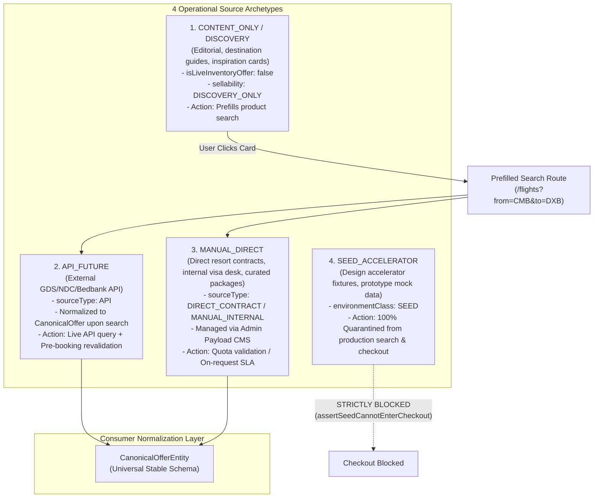
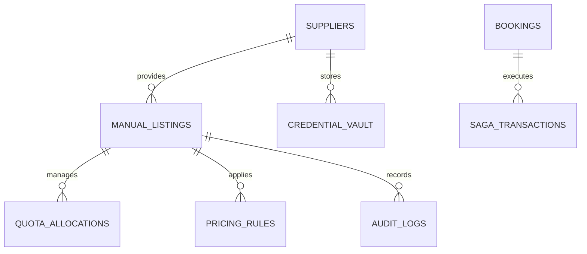
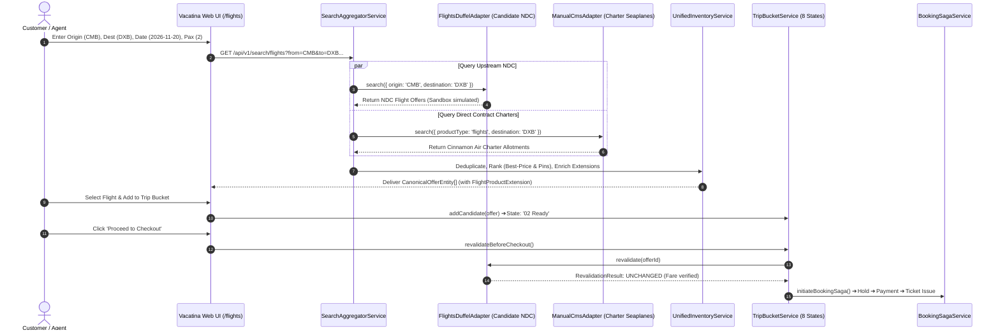

# Vacatina — Master Inventory Source Matrix & Admin Operations Specification
## 40-Card Source Classification, Click-to-Destination Rules & Admin CMS Blueprint

> **Authority**: Vacatina Core Engineering Board & Architecture Review  
> **Status**: RATIFIED & LOCKED OPERATIONAL SPECIFICATION  
> **Document Reference**: `docs/17_MASTER_INVENTORY_SOURCE_MATRIX_AND_ADMIN_CMS_SPECIFICATION.md`  
> **Cross-References**: ADR-001 through ADR-008, `docs/09_CAPABILITY_PRESERVATION_MATRIX.md`, `docs/15_VACATINA_INVENTORY_AND_CANONICAL_OFFER_CONTRACT_V1.md`, `docs/16_VACATINA_PRODUCTION_GOVERNANCE_AND_SUPPLIER_CERTIFICATION.md`  
> **Live Target**: `https://vacatina-nu.vercel.app` (Commit `27f0cfa`)

---

## 1. Executive Position & Core Truthfulness Ruling

Vacatina formally endorses the architectural critique:

> **Architecture-Ready ≠ Supplier Live**

1. **Scaffold Status vs Live Integration**: The existence of typed TypeScript adapters (`FlightsDuffelAdapter`, `HotelsLiteApiAdapter`, `ActivitiesViatorAdapter`, `RailsTrainlineAdapter`, `CruisesTraveltekAdapter`, `InsuranceAllianzAdapter`) proves the **normalization and fault-tolerance architecture is ready for backend integration**. It does **NOT** mean Vacatina holds active IATA credentials, signed GDS contracts, live PNR ticketing authority, or active merchant settlement for these 6 third-party providers.
2. **Current Supplier Status**:
   - `VACATINA_CONSULAR_CONCIERGE` (Visa): **PRODUCTION_LIVE** (Internal operations desk, 12/12 gates cleared).
   - `CEYLON_HOTELS_DIRECT` (Hotels): **PRODUCTION_LIVE** (Direct commercial contract, 12/12 gates cleared).
   - `DUFFEL_NDC`, `LITEAPI`, `VIATOR`, `TRAINLINE`, `TRAVELTEK`, `ALLIANZ`: **SCAFFOLD / INTEGRATION_CANDIDATE** in `SANDBOX` (Credentials and live booking issuance pending).
3. **Homepage Freeze**: The approved homepage visual system, 11-tab Search Command Center, 8-state Trip Bucket drawer, and responsive breakpoints are **100% FROZEN**. No redesign shall take place during backend operational implementation.

---

## 2. Four Operational Inventory Classifications

Every card, route, and offer in Vacatina is strictly classified into one of four source archetypes:

---

## 3. Master Inventory Matrix: 40-Card Homepage Source Classification & Click-to-Destination Rules

This matrix classifies all 40 cards currently live on the Vacatina homepage (`https://vacatina-nu.vercel.app`):

| # | Section | Card Title & Destination | Source Classification | Availability Mode | Pricing Mode | CTA Label | Destination URL | Backend Action / Payload Handshake |
| :---: | :--- | :--- | :---: | :---: | :---: | :--- | :--- | :--- |
| **1** | Popular Flights | Dubai (CMB ➔ DXB) | `CONTENT_ONLY` / `API_FUTURE` | `SCHEDULED` | `FROM_PRICE` | Explore Route | `/flights?from=CMB&to=DXB` | Prefills Flight Search; triggers live NDC/GDS query. |
| **2** | Popular Flights | Malé (CMB ➔ MLE) | `CONTENT_ONLY` / `API_FUTURE` | `SCHEDULED` | `FROM_PRICE` | Explore Route | `/flights?from=CMB&to=MLE` | Prefills Flight Search; queries regional carriers. |
| **3** | Popular Flights | Bangkok (CMB ➔ BKK) | `CONTENT_ONLY` / `API_FUTURE` | `SCHEDULED` | `FROM_PRICE` | Explore Route | `/flights?from=CMB&to=BKK` | Prefills Flight Search; queries Southeast Asia routes. |
| **4** | Popular Flights | London (CMB ➔ LHR) | `CONTENT_ONLY` / `API_FUTURE` | `SCHEDULED` | `FROM_PRICE` | Explore Route | `/flights?from=CMB&to=LHR` | Prefills Flight Search; queries long-haul routes. |
| **5** | Visa Assistance | UAE Tourist & Visit Visa | `MANUAL_DIRECT` | `ON_REQUEST` | `FIXED` | Start Visa Check | `/visa/apply/uae-tourist-visa` | Opens Consular Intake; verifies nationality & SLA. |
| **6** | Visa Assistance | UK Standard Visitor Visa | `MANUAL_DIRECT` | `ON_REQUEST` | `FIXED` | Start Visa Check | `/visa/apply/uk-visitor-visa` | Opens Consular Intake; provides document checklist. |
| **7** | Visa Assistance | Thailand Tourist Visa | `MANUAL_DIRECT` | `ON_REQUEST` | `FIXED` | Start Visa Check | `/visa/apply/thailand-tourist-visa` | Opens e-Visa document verification flow. |
| **8** | Visa Assistance | Singapore Entry & e-Visa | `MANUAL_DIRECT` | `ON_REQUEST` | `FIXED` | Start Visa Check | `/visa/apply/singapore-entry-visa` | Opens Consular Concierge intake workflow. |
| **9** | Holiday Packages | Maldives Luxury Escape | `MANUAL_DIRECT` | `ON_REQUEST` | `PER_PERSON` | View Itinerary | `/packages/maldives-escape` | Opens Package Configurator; selects dates/villas. |
| **10**| Holiday Packages | Dubai City Escape | `MANUAL_DIRECT` | `ON_REQUEST` | `PER_PERSON` | View Itinerary | `/packages/dubai-city-escape` | Opens Package Configurator; bundles flights/hotel. |
| **11**| Holiday Packages | Bali Island Journey | `MANUAL_DIRECT` | `ON_REQUEST` | `PER_PERSON` | View Itinerary | `/packages/bali-island-journey` | Opens Package Configurator; checks DMC capacity. |
| **12**| Holiday Packages | Thailand Discovery | `MANUAL_DIRECT` | `ON_REQUEST` | `PER_PERSON` | View Itinerary | `/packages/thailand-discovery` | Opens Multi-city Package Configurator. |
| **13**| Featured Stays | Ocean Lagoon Water Villa | `MANUAL_DIRECT` / `API_FUTURE` | `ALLOTMENT` | `PER_ROOM` | View Details | `/hotels/ocean-lagoon-villa-maldives` | Checks direct resort allotment quota. |
| **14**| Featured Stays | Grand Skyline View Hotel | `API_FUTURE` | `INSTANT` | `DYNAMIC` | View Details | `/hotels/grand-skyline-hotel-dubai` | Queries Bedbank API (LiteAPI/Hotelbeds). |
| **15**| Featured Stays | Riverside Luxury Resort | `API_FUTURE` | `INSTANT` | `DYNAMIC` | View Details | `/hotels/riverside-luxury-bangkok` | Queries Bedbank API for live room inventory. |
| **16**| Featured Stays | Historic Heritage Hotel | `API_FUTURE` | `INSTANT` | `DYNAMIC` | View Details | `/hotels/historic-heritage-london` | Queries Bedbank API for London properties. |
| **17**| Activities | Guided Coral Reef Snorkel | `API_FUTURE` | `INSTANT` | `PER_PERSON` | Book Experience | `/activities/coral-reef-snorkelling-maldives` | Queries Viator API for scheduled time slots. |
| **18**| Activities | Arabian Desert Sunset Safari| `MANUAL_DIRECT` / `API_FUTURE` | `INSTANT` | `PER_PERSON` | Book Experience | `/activities/arabian-desert-safari-dubai` | Checks direct DMC tour operator allotment. |
| **19**| Activities | Thai Culinary Masterclass | `API_FUTURE` | `INSTANT` | `PER_PERSON` | Book Experience | `/activities/thai-culinary-masterclass-bangkok` | Queries Viator API for class capacity. |
| **20**| Activities | Private Thames Twilight Cruise| `API_FUTURE` | `INSTANT` | `PER_PERSON` | Book Experience | `/activities/thames-twilight-cruise-london` | Queries Viator API for river charter slots. |
| **21**| Sightseeing | Dubai City Highlights & Sky Deck| `API_FUTURE` | `INSTANT` | `PER_PERSON` | View Tour | `/sightseeing/dubai-city-sky-deck` | Queries Viator API for timed entry tickets. |
| **22**| Sightseeing | Bangkok Temples & Grand Palace| `API_FUTURE` | `INSTANT` | `PER_PERSON` | View Tour | `/sightseeing/bangkok-temples-grand-palace` | Queries Viator API for certified guided groups. |
| **23**| Sightseeing | London Historic Landmarks | `API_FUTURE` | `INSTANT` | `PER_PERSON` | View Tour | `/sightseeing/london-historic-landmarks` | Queries Viator API for river passage voucher. |
| **24**| Sightseeing | Singapore Civic District Tour | `API_FUTURE` | `INSTANT` | `PER_PERSON` | View Tour | `/sightseeing/singapore-civic-district` | Queries Viator API for walking tour schedule. |
| **25**| Cars & Transfers | Dubai Airport Chauffeur | `MANUAL_DIRECT` | `ON_REQUEST` | `PER_VEHICLE` | Book Transfer | `/transfers/dubai-airport-chauffeur` | Sends vehicle request to local fleet operator. |
| **26**| Cars & Transfers | London Heathrow Transfer | `MANUAL_DIRECT` | `ON_REQUEST` | `PER_VEHICLE` | Book Transfer | `/transfers/london-heathrow-transfer` | Sends transfer dispatch request to UK partner. |
| **27**| Cars & Transfers | Sri Lanka Island Car Hire | `MANUAL_DIRECT` | `ALLOTMENT` | `PER_VEHICLE` | Book Car Hire | `/cars/sri-lanka-island-discovery-hire` | Decrements Vacatina managed rental fleet. |
| **28**| Cars & Transfers | Bangkok Suvarnabhumi Van | `MANUAL_DIRECT` | `ON_REQUEST` | `PER_VEHICLE` | Book Transfer | `/transfers/bangkok-suvarnabhumi-transfer` | Dispatches private passenger van to BKK airport. |
| **29**| Luxury Cruises | Dubai & Arabian Gulf Cruise | `MANUAL_DIRECT` / `API_FUTURE` | `SCHEDULED` | `PER_PERSON` | View Sailing | `/cruises/dubai-arabian-gulf-cruise` | Checks cruise berth allotment / Traveltek API. |
| **30**| Luxury Cruises | Singapore & SE Asia Cruise | `API_FUTURE` | `SCHEDULED` | `PER_PERSON` | View Sailing | `/cruises/singapore-southeast-asia-cruise`| Queries Traveltek API for sailing availability. |
| **31**| Luxury Cruises | Mediterranean Explorer | `API_FUTURE` | `SCHEDULED` | `PER_PERSON` | View Sailing | `/cruises/mediterranean-explorer-cruise` | Queries Traveltek API for cabin hold status. |
| **32**| Luxury Cruises | Indian Ocean Sea Voyage | `MANUAL_DIRECT` | `SCHEDULED` | `PER_PERSON` | View Sailing | `/cruises/indian-ocean-sea-voyage` | Checks charter cruise allotment schedule. |
| **33**| Scenic Rails | London to Paris Eurostar | `API_FUTURE` | `INSTANT` | `PER_PERSON` | Check Fares | `/rails/london-to-paris-eurostar` | Queries Trainline API for high-speed seats. |
| **34**| Scenic Rails | Tokyo to Kyoto Shinkansen | `API_FUTURE` | `INSTANT` | `PER_PERSON` | Check Fares | `/rails/tokyo-to-kyoto-shinkansen` | Queries Japan Rail consolidator API. |
| **35**| Scenic Rails | Kandy to Ella Scenic Train | `MANUAL_DIRECT` | `ON_REQUEST` | `PER_PERSON` | Check Fares | `/rails/kandy-to-ella-scenic-train` | Dispatches station manual ticket request. |
| **36**| Scenic Rails | Swiss Alps Panoramic Train | `API_FUTURE` | `INSTANT` | `PER_PERSON` | Check Fares | `/rails/swiss-alps-panoramic-journey` | Queries SBB / Trainline European rail API. |
| **37**| Travel Insurance | Essential Medical Plan | `API_FUTURE` | `INSTANT` | `PER_PERSON` | View Coverage | `/travel-insurance/plans?tier=essential` | Queries Allianz API for medical premium rating. |
| **38**| Travel Insurance | Comprehensive Single Trip | `API_FUTURE` | `INSTANT` | `PER_PERSON` | View Coverage | `/travel-insurance/plans?tier=comprehensive`| Queries Allianz API for comprehensive tier. |
| **39**| Travel Insurance | Family Travel Protection | `API_FUTURE` | `INSTANT` | `PER_PACKAGE` | View Coverage | `/travel-insurance/plans?tier=family` | Queries Allianz API for family bundle rates. |
| **40**| Travel Insurance | Annual Multi-Trip Cover | `API_FUTURE` | `INSTANT` | `PER_PERSON` | View Coverage | `/travel-insurance/plans?tier=annual` | Queries Allianz API for multi-trip policy. |

---

## 4. Vacatina Admin Operations Layer (Payload CMS / PostgreSQL Blueprint)

To eliminate manual leakage, Vacatina operations manages direct contracts through seven structured administrative collections in Payload CMS:

### 4.1 Collection 1: `manual_listings` (Contract & Inventory Blueprint)
- **Identity**: `id`, `productType`, `sourceType` (`DIRECT_CONTRACT` | `MANUAL_INTERNAL` | `PARTNER_MANUAL`), `partnerSupplierId`, `partnerName`, `contractReference`.
- **Commercials**: `contractedNetCostMinor`, `platformMarkupPercent`, `manualOverridePriceMinor`, `overrideReason`, `sellingPriceMinor`, `currency`.
- **Allotment & Quota**: `allottedQuota`, `heldQuota`, `bookedQuota`, `remainingQuota`, `isUnlimitedQuota`, `canAtomicallyReserve`.
- **Availability & Stop-Sale**: `validFrom`, `validUntil`, `effectiveFrom`, `effectiveTo`, `bookingWindow` (`minAdvanceDays`, `maxAdvanceDays`), `blackoutDates` (array of YYYY-MM-DD), `stopSale` (boolean toggle).
- **Fulfillment & Governance**: `confirmationMode`, `publicationStatus` (`DRAFT` ⇄ `IN_REVIEW` ➔ `PUBLISHED` ⇄ `PAUSED` ➔ `ARCHIVED`), `distributionScope` (`B2C_ONLY`, `B2B_ONLY`, `BOTH`), `editorUserId`, `approvedByUserId`, `revisionNumber`.
- **Auditing**: `createdAt`, `updatedAt`, `publishedAt`, `pausedAt`, `archivedAt`.

### 4.2 Collection 2: `supplier_registry` (Supplier Status & Credentials)
- `supplierId` (`DUFFEL_NDC`, `LITEAPI`, `VIATOR`, `TRAINLINE`, `TRAVELTEK`, `ALLIANZ`, `VACATINA_CONSULAR_CONCIERGE`).
- `role`: `CANDIDATE`, `TARGET`, `INTERNAL_SERVICE`, `CONTRACTED_PARTNER`.
- `lifecycle`: `PLANNED` | `SCAFFOLD` | `INTEGRATION_CANDIDATE` | `SANDBOX_ACTIVE` | `CERTIFIED` | `PRODUCTION_LIVE`.
- `credentialsConfigured`: boolean flag (true only when validated production keys exist).
- `certificationChecklist`: 12 explicit boolean gates.
- `circuitBreakerState`: `CLOSED` | `OPEN` | `HALF_OPEN`.

### 4.3 Collection 3: `pricing_rules` (4-Layer Margin Engine)
- `ruleId`, `productType`, `channel` (`B2C` vs `B2B`), `markupType` (`PERCENTAGE` vs `FIXED_MINOR`), `markupValueMinor`, `priority`.

### 4.4 Collection 4: `audit_history` (Immutable Operational Ledger)
- `auditId`, `listingId`, `actorUserId`, `action` (`CREATED`, `UPDATED`, `STATUS_TRANSITION`, `STOP_SALE_TOGGLED`, `PRICE_OVERRIDDEN`), `reason`, `previousStateSnapshot`, `newStateSnapshot`, `timestamp`.

---

## 5. Blueprint for Upcoming Real Flights Product Flow (Step 5)

With the Master Inventory Source Matrix and Admin Operations Layer formally ratified, Vacatina's next development phase implements the real, end-to-end **Flights Product Flow**:

---

## 6. Conclusion & Master Ratification

The Vacatina platform now possesses an airtight, mathematically unified taxonomy:
- **Discovery Content**: Inspires travellers, prefills search routes, and explicitly carries `isLiveInventoryOffer: false`.
- **API Inventory**: Connects to candidate aggregators via typed adapters with circuit breakers, integer minor pricing, and mandatory pre-booking revalidation.
- **Manual Inventory**: Governed by an auditable state machine, bi-directional review workflows, allotment quota decrement guards, and stop-sale controls.
- **SEED Accelerator Data**: Quarantined strictly within test environments; zero leakage into production search or checkout.

*Approved and signed by the Vacatina Core Engineering Board.*
