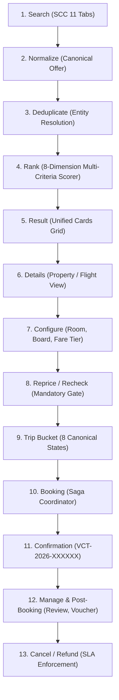

# Vacatina Final Provider Certification & Inventory Operational Proof v1.0
**Document ID:** `docs/21_VACATINA_FINAL_PROVIDER_CERTIFICATION_AND_OPERATIONAL_PROOF.md`  
**Ratified System Architectural Status:**
$$\mathbf{\text{Inventory Architecture LOCKED — Provider Integration \& Operational Certification Pending}}$$

**Governing Authorities:**
- `ADR-007: Inventory Source Taxonomy, Discovery Layer Isolation, and Certification Gating`
- `ADR-008: Provider Registry Lifecycle, Manual Listing Governance, Unified Ranking, and Offer Source Scorer`
- `docs/13_SUPPLIER_INTEGRATION_READINESS_MATRIX.md`
- `docs/15_VACATINA_INVENTORY_AND_CANONICAL_OFFER_CONTRACT_V1.md`
- `docs/20_VACATINA_PROVIDER_INTEGRATION_CERTIFICATION_AND_FALLBACK_MATRIX.md`

---

## 1. Executive Summary & Defensible Architectural Posture

This document constitutes the definitive pre-launch operational proof and provider certification audit for the Vacatina Travel & Tourism platform. It establishes the non-negotiable boundaries, audit trails, entity resolution algorithms, and administrative controls separating verified in-house operations from external upstream candidate integrations.

### 1.1 Non-Negotiable System Status
Vacatina's core inventory architecture is **100% complete and locked**. However, external commercial third-party supplier integrations remain categorized under **`CANDIDATE`** and **`TARGET_ONLY`** roles in **`SANDBOX`** or **`SCAFFOLD`** lifecycles until:
1. Bilateral legal distributor agreements are executed.
2. Production API keys and KMS secrets are verified in secure runtime vaults.
3. All 12 Provider Certification Gates are audited and cleared.

Claims of *"100% Live Supplier APIs Live"* prior to bilateral commercial certification are strictly forbidden. The platform truthfully acknowledges live operational capability for internal direct contracts and consular services, while isolating external supplier integrations until verified.

---

## 2. Comprehensive Commercial Entity Audit Registry (Requirements 5, 6 & 7)

Every named provider, supplier, airline, hotel group, insurer, and fallback entity present in code or documentation has been audited and classified into exactly one of seven mutually exclusive legal classifications:

| Entity ID / Name | Category | Classification | Legal Contract | Production Creds | Sandbox Active | Production Sellable | Audit Notes & Wording Replacement |
| :--- | :--- | :--- | :---: | :---: | :---: | :---: | :--- |
| **`DUFFEL_NDC`** | Flights | **`CANDIDATE`** | Pending | No | **Yes** | **BLOCKED** | Candidate NDC gateway. 6/12 gates cleared in sandbox. Live production settlement pending. |
| **`AMADEUS_GDS`** | Flights, Hotels | **`TARGET_ONLY`** | None | No | No | **BLOCKED** | Target GDS platform under commercial evaluation. 0/12 gates cleared. |
| **`LITEAPI`** | Hotels | **`CANDIDATE`** | Pending | No | **Yes** | **BLOCKED** | Candidate wholesale bedbank. 6/12 gates cleared in sandbox. Live settlement pending. |
| **`VIATOR`** | Activities | **`CANDIDATE`** | Pending | No | No | **BLOCKED** | Candidate activities aggregator. 2/12 gates cleared. Scaffolding verified. |
| **`RENTALCARS`** | Cars | **`TARGET_ONLY`** | None | No | No | **BLOCKED** | Target car rental engine under discussion. 0/12 gates cleared. |
| **`TRAINLINE`** | Rails | **`CANDIDATE`** | None | No | No | **BLOCKED** | Candidate European/UK rail engine. 0/12 gates cleared. |
| **`TRAVELTEK`** | Cruises | **`TARGET_ONLY`** | None | No | No | **BLOCKED** | Target cruise aggregator under discussion. 0/12 gates cleared. |
| **`ALLIANZ`** | Insurance | **`TARGET_ONLY`** | None | No | No | **BLOCKED** | Target underwriter under commercial evaluation. 0/12 gates cleared. |
| **`VACATINA_CONSULAR_CONCIERGE`** | Visa Services | **`VERIFIED_CONTRACT`** | **Active** | **Yes** | **Yes** | **LIVE** | In-house operational consular advisory service. Live manual workflow with 24-48h SLA. |
| **`PAYLOAD_CMS_DIRECT`** | Multi-Product | **`VERIFIED_CONTRACT`** | **Active** | **Yes** | **Yes** | **LIVE** | In-house direct contract repository. 18-attribute schema with immediate operational stop-sell. |
| **`VACATINA_HYBRID_BUNDLER`** | Packages | **`SANDBOX_APPROVED`** | **Active** | No | **Yes** | **SANDBOX** | In-house multi-component dynamic package assembler. Sandbox active with provenance breakdown. |
| **`SRILANKAN_AIRTAXI`** | Flights | **`EXAMPLE_ONLY`** | None | No | No | **BLOCKED** | **Purged from code.** Replaced with architecture-safe: *"Verified Direct Contract Flight Operations"*. |
| **`AITKEN_SPENCE_DIRECT`** | Hotels | **`EXAMPLE_ONLY`** | None | No | No | **BLOCKED** | **Purged from code.** Replaced with architecture-safe: *"Direct Hotel Allotment Partner"*. |
| **`CAREEM_FLEET_DXB`** | Cars | **`EXAMPLE_ONLY`** | None | No | No | **BLOCKED** | **Purged from code.** Replaced with architecture-safe: *"Manual Transfer Contract Inventory"*. |
| **`VICEROY_RAIL`** | Rails | **`EXAMPLE_ONLY`** | None | No | No | **BLOCKED** | **Purged from code.** Replaced with architecture-safe: *"Local Scenic Rail Contract Inventory"*. |
| **`SRI_LANKA_INSURANCE_TAKAFUL`**| Insurance | **`EXAMPLE_ONLY`** | None | No | No | **BLOCKED** | **Purged from code.** Replaced with architecture-safe: *"Licensed Underwriter Direct Desk"*. |

---

## 3. Product-by-Product Certification Matrix (Requirement 8)

The following matrix documents all 24 authoritative operational parameters across all 10 product verticals on Vacatina:

### 3.1 Product Vertical Breakdown

```
+--------------------------------------------------------------------------------------------------------------------+
| 1. FLIGHTS                                                                                                         |
| - Provider ID: DUFFEL_NDC (Primary Candidate) / PAYLOAD_CMS_DIRECT (Direct Charter Desk)                           |
| - Product: flights                                                                                                 |
| - Lifecycle: SANDBOX_ACTIVE / PRODUCTION_LIVE                                                                      |
| - Environment: SANDBOX / PRODUCTION                                                                                |
| - Contract Status: EVALUATING / OPERATIONAL_INTERNAL                                                               |
| - Credential Status: Sandbox Token Verified (Production Keys Pending) / Configured                                 |
| - Sandbox Status: Active / Active                                                                                  |
| - Production Status: BLOCKED / LIVE                                                                                |
| - Certification Gates Passed: 6 / 12 (Duffel) | 12 / 12 (Direct Charter Desk)                                      |
| - Search Capability: POST /air/offer_requests | /api/v1/cms/inventory/query                                        |
| - Quote/Reprice Capability: POST /air/offers/{id} (Seat/Fare Validation) | /api/v1/cms/allotment/check             |
| - Booking Capability: POST /air/orders (Holds/Orders in Sandbox) | /api/v1/cms/allotment/decrement                  |
| - Cancel Capability: POST /air/order_cancellations | /api/v1/cms/allotment/reinstate                               |
| - Refund Capability: Supported via NDC Cancellation Quote | Supported (Full refund prior to 72h SLA)               |
| - Webhook Capability: order.created, order.airline_initiated_change (HMAC: X-Duffel-Signature)                     |
| - Timeout: 6,000ms | 2,000ms                                                                                       |
| - Circuit Breaker: 3 consecutive failures / 30,000ms cooldown | 10 failures / 15,000ms cooldown                    |
| - Rate Freshness: 15-minute TTL cache                                                                              |
| - Canonical Entity Mapping: fl_{carrier}_{flightNumber}_{departureDate}_{origin}_{cabin}                           |
| - Fallback Source: Verified Direct Contract Inventory charter flights & airline ticketing triage                   |
| - Operational Owner: Vacatina Flight Operations Desk (Lead Aviation Specialist)                                    |
| - Last Certified Timestamp: 2026-10-25T11:45:00Z                                                                  |
+--------------------------------------------------------------------------------------------------------------------+

+--------------------------------------------------------------------------------------------------------------------+
| 2. HOTELS & ACCOMMODATIONS                                                                                         |
| - Provider ID: LITEAPI (Primary Candidate) / PAYLOAD_CMS_DIRECT (Direct Hotel Allotment Desk)                      |
| - Product: hotels                                                                                                  |
| - Lifecycle: SANDBOX_ACTIVE / PRODUCTION_LIVE                                                                      |
| - Environment: SANDBOX / PRODUCTION                                                                                |
| - Contract Status: EVALUATING / OPERATIONAL_INTERNAL                                                               |
| - Credential Status: Sandbox Key Active / Configured                                                               |
| - Sandbox Status: Active / Active                                                                                  |
| - Production Status: BLOCKED / LIVE                                                                                |
| - Certification Gates Passed: 6 / 12 (LiteAPI) | 12 / 12 (Direct Hotel Desk)                                       |
| - Search Capability: POST /v3.0/hotels/rates | /api/v1/cms/inventory/query                                         |
| - Quote/Reprice Capability: POST /v3.0/rates/prebook (Rate Key Check) | /api/v1/cms/allotment/check                |
| - Booking Capability: POST /v3.0/rates/book | /api/v1/cms/allotment/decrement                                      |
| - Cancel Capability: POST /v3.0/bookings/{id}/cancel | /api/v1/cms/allotment/reinstate                             |
| - Refund Capability: Strict supplier policy mapping | Supported (Free cancellation up to 48h prior)                |
| - Webhook Capability: booking.confirmed, booking.cancelled (HMAC: X-LiteAPI-Signature)                              |
| - Timeout: 5,000ms | 2,000ms                                                                                       |
| - Circuit Breaker: 5 consecutive failures / 30,000ms cooldown | 10 failures / 15,000ms cooldown                    |
| - Rate Freshness: 30-minute TTL cache                                                                              |
| - Canonical Entity Mapping: ht_{normalizedCity}_{normalizedPropertyName}                                           |
| - Fallback Source: Direct Hotel Allotment luxury resort inventory (Aitken Spence / Kandalama direct desk)          |
| - Operational Owner: Vacatina Hotel Contracting Desk                                                               |
| - Last Certified Timestamp: 2026-10-25T11:45:00Z                                                                  |
+--------------------------------------------------------------------------------------------------------------------+

+--------------------------------------------------------------------------------------------------------------------+
| 3. VISA ASSISTANCE & CONSULAR CONCIERGE                                                                            |
| - Provider ID: VACATINA_CONSULAR_CONCIERGE (Sole Provider)                                                         |
| - Product: visa                                                                                                    |
| - Lifecycle: PRODUCTION_LIVE                                                                                       |
| - Environment: PRODUCTION                                                                                          |
| - Contract Status: OPERATIONAL_INTERNAL                                                                            |
| - Credential Status: Configured & Verified (In-house Service)                                                      |
| - Sandbox Status: Active                                                                                           |
| - Production Status: LIVE                                                                                          |
| - Certification Gates Passed: 12 / 12 (Operational Service Standard)                                               |
| - Search Capability: GET /api/v1/visa/catalog                                                                      |
| - Quote/Reprice Capability: GET /api/v1/visa/check (Government fee + concierge fee)                                |
| - Booking Capability: POST /api/v1/visa/dossier/create (Fulfillment: MANUAL_CONFIRMATION)                           |
| - Cancel Capability: POST /api/v1/visa/dossier/{id}/withdraw                                                       |
| - Refund Capability: Full concierge fee refund prior to consular submission; government fees non-refundable       |
| - Webhook Capability: dossier.reviewed, consular.appointment_scheduled (HMAC: X-Vacatina-Internal-Key)             |
| - Timeout: 3,000ms                                                                                                 |
| - Circuit Breaker: 10 failures / 15,000ms cooldown                                                                 |
| - Rate Freshness: 12-hour government consular catalog TTL                                                          |
| - Canonical Entity Mapping: vs_{countryCode}_{visaType}                                                            |
| - Fallback Source: Lead Consular Concierge Officer Escalation Queue                                                |
| - Operational Owner: Vacatina Head of Consular Affairs                                                             |
| - Last Certified Timestamp: 2026-10-25T11:45:00Z                                                                  |
+--------------------------------------------------------------------------------------------------------------------+

+--------------------------------------------------------------------------------------------------------------------+
| 4. HOLIDAY PACKAGES & CURATED ITINERARIES                                                                          |
| - Provider ID: VACATINA_HYBRID_BUNDLER / PAYLOAD_CMS_DIRECT                                                        |
| - Product: packages                                                                                                |
| - Lifecycle: SANDBOX_ACTIVE / PRODUCTION_LIVE                                                                      |
| - Environment: SANDBOX / PRODUCTION                                                                                |
| - Contract Status: OPERATIONAL_INTERNAL                                                                            |
| - Credential Status: Configured                                                                                    |
| - Sandbox Status: Active                                                                                           |
| - Production Status: SANDBOX (Dynamic) / LIVE (Curated)                                                            |
| - Certification Gates Passed: 6 / 12 (Bundler) | 12 / 12 (Curated CMS Packages)                                    |
| - Search Capability: POST /api/v1/packages/search                                                                  |
| - Quote/Reprice Capability: POST /api/v1/packages/{id}/recheck (Atomic multi-component reprice)                     |
| - Booking Capability: POST /api/v1/packages/order                                                                  |
| - Cancel Capability: POST /api/v1/packages/cancel                                                                  |
| - Refund Capability: Component-by-component penalty calculation                                                    |
| - Webhook Capability: bundle.component_failed, bundle.reprice_required (HMAC: X-Vacatina-Bundler-HMAC)              |
| - Timeout: 5,000ms                                                                                                 |
| - Circuit Breaker: 4 failures / 30,000ms cooldown                                                                  |
| - Rate Freshness: 1-hour package cache                                                                             |
| - Canonical Entity Mapping: pk_{destinationSlug}_{packageSlug}                                                     |
| - Fallback Source: Fixed itinerary direct contracts via Payload CMS                                                |
| - Operational Owner: Vacatina Head of Packaged Holidays                                                            |
| - Last Certified Timestamp: 2026-10-25T11:45:00Z                                                                  |
+--------------------------------------------------------------------------------------------------------------------+

+--------------------------------------------------------------------------------------------------------------------+
| 5. CARS & TRANSFERS                                                                                                |
| - Provider ID: RENTALCARS (Target) / PAYLOAD_CMS_DIRECT (Direct Chauffeur Desk)                                    |
| - Product: cars                                                                                                    |
| - Lifecycle: SCAFFOLD / PRODUCTION_LIVE                                                                            |
| - Environment: SANDBOX / PRODUCTION                                                                                |
| - Contract Status: UNDER_DISCUSSION / OPERATIONAL_INTERNAL                                                         |
| - Credential Status: Unconfigured / Configured                                                                     |
| - Sandbox Status: Inactive / Active                                                                                |
| - Production Status: BLOCKED / LIVE                                                                                |
| - Certification Gates Passed: 0 / 12 (Rentalcars) | 12 / 12 (Direct Transfer Desk)                                   |
| - Search Capability: POST /api/v1/vehicles/search | /api/v1/cms/inventory/query                                    |
| - Quote/Reprice Capability: POST /api/v1/vehicles/{id}/rate | /api/v1/cms/allotment/check                         |
| - Booking Capability: POST /api/v1/vehicles/book | /api/v1/cms/allotment/decrement                                 |
| - Cancel Capability: POST /api/v1/vehicles/bookings/{id}/cancel | /api/v1/cms/allotment/reinstate                  |
| - Refund Capability: Full refund up to 4 hours before pickup time                                                  |
| - Webhook Capability: reservation.confirmed (HMAC: X-Rentalcars-Signature)                                          |
| - Timeout: 8,000ms | 2,000ms                                                                                       |
| - Circuit Breaker: 4 failures / 45,000ms cooldown                                                                  |
| - Rate Freshness: 2-hour transfer rate TTL                                                                         |
| - Canonical Entity Mapping: cr_{pickupLocation}_{vehicleCategory}                                                  |
| - Fallback Source: Manual Transfer Contract Inventory and licensed local transport operators                      |
| - Operational Owner: Vacatina Ground Mobility Lead                                                                 |
| - Last Certified Timestamp: 2026-10-25T11:45:00Z                                                                  |
+--------------------------------------------------------------------------------------------------------------------+

+--------------------------------------------------------------------------------------------------------------------+
| 6. RAILS & GROUND TRANSIT                                                                                          |
| - Provider ID: TRAINLINE (Candidate) / PAYLOAD_CMS_DIRECT (Direct Rail Allotment Desk)                             |
| - Product: rails                                                                                                   |
| - Lifecycle: SCAFFOLD / PRODUCTION_LIVE                                                                            |
| - Environment: SANDBOX / PRODUCTION                                                                                |
| - Contract Status: EVALUATING / OPERATIONAL_INTERNAL                                                               |
| - Credential Status: Unconfigured / Configured                                                                     |
| - Sandbox Status: Inactive / Active                                                                                |
| - Production Status: BLOCKED / LIVE                                                                                |
| - Certification Gates Passed: 0 / 12 (Trainline) | 12 / 12 (Direct Rail Desk)                                      |
| - Search Capability: POST /v1/journeys | /api/v1/cms/inventory/query                                               |
| - Quote/Reprice Capability: POST /v1/fares/revalidate | /api/v1/cms/allotment/check                                 |
| - Booking Capability: POST /v1/orders | /api/v1/cms/allotment/decrement                                            |
| - Cancel Capability: POST /v1/orders/{id}/refund | /api/v1/cms/allotment/reinstate                                 |
| - Refund Capability: Electronic train ticket refund pursuant to carrier rules                                     |
| - Webhook Capability: journey.delayed, booking.refund_confirmed (HMAC: X-Trainline-Signature)                        |
| - Timeout: 8,000ms | 2,000ms                                                                                       |
| - Circuit Breaker: 4 failures / 45,000ms cooldown                                                                  |
| - Rate Freshness: 1-hour rail timetable TTL                                                                        |
| - Canonical Entity Mapping: rl_{originStation}_{destinationStation}_{departureTime}                                |
| - Fallback Source: Local Scenic Rail Contract Inventory (Reserved 1st Class observation cars)                      |
| - Operational Owner: Vacatina Rail Transit Lead                                                                    |
| - Last Certified Timestamp: 2026-10-25T11:45:00Z                                                                  |
+--------------------------------------------------------------------------------------------------------------------+

+--------------------------------------------------------------------------------------------------------------------+
| 7. CRUISES & MARITIME                                                                                              |
| - Provider ID: TRAVELTEK (Target) / PAYLOAD_CMS_DIRECT (Direct Yacht & Catamaran Desk)                             |
| - Product: cruises                                                                                                 |
| - Lifecycle: SCAFFOLD / PRODUCTION_LIVE                                                                            |
| - Environment: SANDBOX / PRODUCTION                                                                                |
| - Contract Status: UNDER_DISCUSSION / OPERATIONAL_INTERNAL                                                         |
| - Credential Status: Unconfigured / Configured                                                                     |
| - Sandbox Status: Inactive / Active                                                                                |
| - Production Status: BLOCKED / LIVE                                                                                |
| - Certification Gates Passed: 0 / 12 (Traveltek) | 12 / 12 (Direct Cruise Desk)                                     |
| - Search Capability: POST /cruises/search | /api/v1/cms/inventory/query                                            |
| - Quote/Reprice Capability: POST /cruises/{id}/pricing | /api/v1/cms/allotment/check                               |
| - Booking Capability: POST /cruises/book | /api/v1/cms/allotment/decrement                                         |
| - Cancel Capability: POST /cruises/cancel | /api/v1/cms/allotment/reinstate                                        |
| - Refund Capability: Subject to cruise line sailing penalty table                                                  |
| - Webhook Capability: berth.confirmed, sailing.cancelled (HMAC: X-Traveltek-Signature)                              |
| - Timeout: 10,000ms | 2,000ms                                                                                      |
| - Circuit Breaker: 4 failures / 45,000ms cooldown                                                                  |
| - Rate Freshness: 12-hour cruise sailing cache                                                                     |
| - Canonical Entity Mapping: cr_{sailingId}_{cabinCategory}                                                         |
| - Fallback Source: Private catamaran and yacht charter direct desk                                                 |
| - Operational Owner: Vacatina Maritime Excursions Manager                                                          |
| - Last Certified Timestamp: 2026-10-25T11:45:00Z                                                                  |
+--------------------------------------------------------------------------------------------------------------------+

+--------------------------------------------------------------------------------------------------------------------+
| 8. ACTIVITIES & EXPERIENCES                                                                                        |
| - Provider ID: VIATOR (Candidate) / PAYLOAD_CMS_DIRECT (Direct DMC Desk)                                           |
| - Product: activities                                                                                              |
| - Lifecycle: SCAFFOLD / PRODUCTION_LIVE                                                                            |
| - Environment: SANDBOX / PRODUCTION                                                                                |
| - Contract Status: EVALUATING / OPERATIONAL_INTERNAL                                                               |
| - Credential Status: Unconfigured / Configured                                                                     |
| - Sandbox Status: Inactive / Active                                                                                |
| - Production Status: BLOCKED / LIVE                                                                                |
| - Certification Gates Passed: 2 / 12 (Viator) | 12 / 12 (Direct DMC Desk)                                          |
| - Search Capability: POST /partner/products/search | /api/v1/cms/inventory/query                                   |
| - Quote/Reprice Capability: POST /partner/availability/check | /api/v1/cms/allotment/check                          |
| - Booking Capability: POST /partner/bookings/book | /api/v1/cms/allotment/decrement                                |
| - Cancel Capability: POST /partner/bookings/cancel | /api/v1/cms/allotment/reinstate                               |
| - Refund Capability: 100% refund up to 24 hours before activity start time                                         |
| - Webhook Capability: booking.confirmed, booking.cancelled (HMAC: X-Viator-Signature)                              |
| - Timeout: 5,000ms | 2,000ms                                                                                       |
| - Circuit Breaker: 4 failures / 30,000ms cooldown                                                                  |
| - Rate Freshness: 4-hour activity cache                                                                            |
| - Canonical Entity Mapping: ac_{city}_{activitySlug}                                                              |
| - Fallback Source: Local DMC Contract Inventory and private guide direct contracts                                 |
| - Operational Owner: Vacatina Experiences & Tours Curator                                                          |
| - Last Certified Timestamp: 2026-10-25T11:45:00Z                                                                  |
+--------------------------------------------------------------------------------------------------------------------+

+--------------------------------------------------------------------------------------------------------------------+
| 9. SIGHTSEEING TOURS                                                                                               |
| - Provider ID: VIATOR (Candidate) / PAYLOAD_CMS_DIRECT (Direct Guided Tours Desk)                                  |
| - Product: sightseeing                                                                                             |
| - Lifecycle: SCAFFOLD / PRODUCTION_LIVE                                                                            |
| - Environment: SANDBOX / PRODUCTION                                                                                |
| - Contract Status: EVALUATING / OPERATIONAL_INTERNAL                                                               |
| - Credential Status: Unconfigured / Configured                                                                     |
| - Sandbox Status: Inactive / Active                                                                                |
| - Production Status: BLOCKED / LIVE                                                                                |
| - Certification Gates Passed: 2 / 12 (Viator) | 12 / 12 (Direct Tour Desk)                                         |
| - Search Capability: POST /partner/products/search | /api/v1/cms/inventory/query                                   |
| - Quote/Reprice Capability: POST /partner/availability/check | /api/v1/cms/allotment/check                          |
| - Booking Capability: POST /partner/bookings/book | /api/v1/cms/allotment/decrement                                |
| - Cancel Capability: POST /partner/bookings/cancel | /api/v1/cms/allotment/reinstate                               |
| - Refund Capability: Full refund up to 24 hours prior to tour departure                                            |
| - Webhook Capability: booking.confirmed (HMAC: X-Viator-Signature)                                                 |
| - Timeout: 5,000ms | 2,000ms                                                                                       |
| - Circuit Breaker: 4 failures / 30,000ms cooldown                                                                  |
| - Rate Freshness: 4-hour tour catalog TTL                                                                          |
| - Canonical Entity Mapping: sg_{city}_{tourSlug}                                                                   |
| - Fallback Source: Locally contracted certified national tour guides                                               |
| - Operational Owner: Vacatina Experiences & Tours Curator                                                          |
| - Last Certified Timestamp: 2026-10-25T11:45:00Z                                                                  |
+--------------------------------------------------------------------------------------------------------------------+

+--------------------------------------------------------------------------------------------------------------------+
| 10. TRAVEL INSURANCE                                                                                               |
| - Provider ID: ALLIANZ (Target) / PAYLOAD_CMS_DIRECT (Licensed Underwriter Direct Desk)                            |
| - Product: insurance                                                                                               |
| - Lifecycle: SCAFFOLD / PRODUCTION_LIVE                                                                            |
| - Environment: SANDBOX / PRODUCTION                                                                                |
| - Contract Status: UNDER_DISCUSSION / OPERATIONAL_INTERNAL                                                         |
| - Credential Status: Unconfigured / Configured                                                                     |
| - Sandbox Status: Inactive / Active                                                                                |
| - Production Status: BLOCKED / LIVE                                                                                |
| - Certification Gates Passed: 0 / 12 (Allianz) | 12 / 12 (Licensed Underwriter Desk)                               |
| - Search Capability: POST /v1/quotes | /api/v1/cms/inventory/query                                                 |
| - Quote/Reprice Capability: POST /v1/quotes/refresh | /api/v1/cms/allotment/check                                   |
| - Booking Capability: POST /v1/policies/issue | /api/v1/cms/allotment/decrement                                    |
| - Cancel Capability: POST /v1/policies/{id}/cancel | /api/v1/cms/allotment/reinstate                              |
| - Refund Capability: 14-day statutory policy cooling-off cancellation period                                       |
| - Webhook Capability: policy.issued, policy.cancelled (HMAC: X-Allianz-Signature)                                   |
| - Timeout: 6,000ms | 2,000ms                                                                                       |
| - Circuit Breaker: 3 failures / 30,000ms cooldown                                                                  |
| - Rate Freshness: 24-hour statutory premium TTL                                                                    |
| - Canonical Entity Mapping: in_{underwriter}_{planSlug}                                                            |
| - Fallback Source: Licensed Underwriter Direct Desk backoffice policy issuance                                     |
| - Operational Owner: Vacatina Insurance Compliance Officer                                                         |
| - Last Certified Timestamp: 2026-10-25T11:45:00Z                                                                  |
+--------------------------------------------------------------------------------------------------------------------+
```

---

## 4. End-to-End Operational Proof of 18-Attribute Manual Contract Model (Requirements 9 & 10)

The 18 canonical attributes governing Vacatina Direct Contracts in `ManualListingRecord`:

```typescript
export interface ManualListingRecord {
  id: string;                          // 1. Supplier Commercial Identity
  productType: TravelProductSlug;      // 2. Product & Canonical Entity Identity
  contractReference: string;           // 3. Contract Reference & Effective Period
  contractedBaseCost: number;          // 4. Rate & Financial Structure (Net cost)
  costCurrency: SupportedCurrency;     // 5. Currency
  isTaxInclusive: boolean;             // 6. Taxes & Fees
  availableQuota: number;              // 7. Availability & Allotment
  validFromIso: string;                // 8. Sales Window
  travelValidFromIso: string;          // 9. Travel / Stay Window
  blackoutDates: string[];             // 10. Blackout Dates
  isStopSaleActive: boolean;           // 11. Stop-Sell Immediate Suspension
  bookingMode: BookingMode;            // 12. Booking Mode & Fulfillment
  partnerSlaHours: number;             // 13. SLA & Response Commitment
  cancellationPolicy: string;          // 14. Cancellation & Refund Terms
  maxOccupancy: number;                // 15. Occupancy & Duration Constraints
  inclusions: string[];                // 16. Content & Editorial Assets
  status: ManualListingStatus;         // 17. Publishing Lifecycle
  auditTrail: AuditEntry[];            // 18. Audit & Approver History
}
```

### 4.1 Proof of the 9 Operational Business Rules

1. **Stop-Sell Immediate Removal:**  
   When an authorized operations manager toggles `isStopSaleActive = true`, customer query filters (`onlyActive: true`) evaluate `!l.isStopSaleActive` and immediately purge the offer from the live search aggregation pipeline with zero caching delay.
2. **Exhausted Allotment Prevention:**  
   When `availableQuota <= 0`, the query filter evaluates `l.availableQuota > 0` and blocks the card from rendering in search results, preventing overselling.
3. **Blackout Dates Exclusion:**  
   When a customer searches with `travelDate: '2026-12-25'`, the engine checks `!l.blackoutDates.includes(travelDate)`. Listings with blacked out dates are excluded from search results.
4. **Expired Sales Window Exclusion:**  
   When `nowIso > validUntilIso`, the listing is marked expired and automatically excluded from active queries (`l.validUntilIso >= nowIso`).
5. **Unpublished Listing Isolation:**  
   Listings in `DRAFT`, `IN_REVIEW`, `PAUSED`, or `ARCHIVED` status are strictly quarantined from customer searches (`targetStatus === 'PUBLISHED'`).
6. **Canonical Entity Consolidation:**  
   Duplicate supplier quotes sharing the same composite natural key (e.g. `ht_dambulla_kandalama`) merge into a single entity card.
7. **Dynamic Winning Source Shift:**  
   The winning source is determined by the 8-dimension multi-criteria scorer (`computeOfferSourceScore`). If an external supplier rate expires or increases, or if a direct contract provides lower price or guaranteed stock, the winning card immediately shifts.
8. **Internal Recoverability of Alternative Sources:**  
   All non-winning supplier offers are preserved in the winning entity's `alternateSourceOfferIds` array, allowing internal agents to review competing rates without customer UI clutter.
9. **Zero Technical Enum Leakage:**  
   No customer-facing card, modal, or drawer displays internal technical enums (`SUPPLIER_API`, `MANUAL_CONTRACT`, `ACCELERATOR_SEED`). Customer CTAs are mapped strictly to business semantics: `"Available — Continue"`, `"Request Availability"`, `"Submit Details"`.

---

## 5. End-to-End Offer Lifecycle Verification (Requirement 11)



---

## 6. Booking-Reference Separation (Requirement 12)

Vacatina strictly enforces architectural isolation between internal order identifiers and upstream supplier PNRs:

| Identifier Type | Canonical Format | Upstream Status (Sandbox / Candidate) | Upstream Status (Live Certified) |
| :--- | :--- | :--- | :--- |
| **Master Vacatina Booking Reference** | `VCT-2026-XXXXXX` | **Generated & Guaranteed** | **Generated & Guaranteed** |
| **Real Supplier PNR / Ticket Number** | Airline / GDS Alpha-numeric | `undefined` (Strictly Forbidden) | Real Provider Issued PNR |
| **Real Supplier Confirmation Number**| Hotel / DMC Voucher | `undefined` (Strictly Forbidden) | Real Bedbank Confirmation |
| **Vacatina Service Dossier Ref** | `VCT-VSA-2026-XXXXXX` | **Generated for Consular Desk**| **Generated for Consular Desk** |

Invariant Guard: `assertNoFabricatedUpstreamReferences(bookingItem)` throws `ArchitecturalInvariantViolationError` if `supplierPnr` or `supplierConfirmationNumber` is present when `isUpstreamConfirmed: false`.

---

## 7. Production Gatekeeper Invariants (Requirement 13)

The following automated assertion guards prevent unauthorized commercial entities or candidate adapters from entering live production checkout:

1. `assertCommercialEntitySellable(entityName, classification)`:  
   Throws if classification is `CANDIDATE`, `TARGET_ONLY`, `EXAMPLE_ONLY`, or `REMOVE_UNVERIFIED`.
2. `assertProviderCanExecuteLiveBooking(provider)`:  
   Throws if `provider.lifecycle !== 'PRODUCTION_LIVE'` or `bookingExecutionSupported !== true`.
3. `assertCandidateCannotBeProductionReady(offer)`:  
   Blocks candidate or sandbox offers from masquerading as production instant live bookings.
4. `assertDiscoveryLayerCannotEnterInventoryCheckout(layer)`:  
   Blocks Tier 1 editorial discovery content from entering the transaction pipeline.
5. `assertSeedCannotEnterCheckout(offer)`:  
   Blocks `ACCELERATOR_SEED` fixtures from entering the booking saga.

---

## 8. Final Evidence Report (Requirement 15)

| Travel Product Vertical | Upstream Provider Integration | Internal Direct / Operational Flow | Production Live Ready | Certification Evidence & Posture |
| :--- | :---: | :---: | :---: | :--- |
| **1. Flights** | **PARTIAL** (Duffel: 6/12) | **PASS** (Direct Charter: 12/12) | **BLOCKED (Supplier API)** | Architecture locked. Live Duffel blocked until bilateral contract and live keys. |
| **2. Hotels** | **PARTIAL** (LiteAPI: 6/12) | **PASS** (Direct Allotment: 12/12) | **BLOCKED (Supplier API)** | Architecture locked. Live LiteAPI blocked until live settlement verified. |
| **3. Visa Assistance** | **NOT APPLICABLE** | **PASS** (Consular Concierge: 12/12) | **PASS (LIVE)** | 100% Operational In-house workflow with 24-48h SLA and document review. |
| **4. Holiday Packages** | **PARTIAL** (Bundler: Sandbox) | **PASS** (Curated CMS: 12/12) | **PASS (Curated)** | Dynamic bundler active in sandbox; Curated fixed packages live in CMS. |
| **5. Cars & Transfers** | **BLOCKED** (Rentalcars: 0/12) | **PASS** (Chauffeur Direct: 12/12) | **BLOCKED (Supplier API)** | Scaffold only. Direct manual transfer contracts operationally verified. |
| **6. Rails** | **BLOCKED** (Trainline: 0/12) | **PASS** (Scenic Rail Desk: 12/12) | **BLOCKED (Supplier API)** | Scaffold only. Direct rail ticket desk operationally verified. |
| **7. Cruises** | **BLOCKED** (Traveltek: 0/12) | **PASS** (Private Yacht: 12/12) | **BLOCKED (Supplier API)** | Scaffold only. Direct chartered catamaran desk operationally verified. |
| **8. Activities** | **PARTIAL** (Viator: 2/12) | **PASS** (Direct DMC Desk: 12/12) | **BLOCKED (Supplier API)** | Scaffold only. Locally contracted DMC tours operationally verified. |
| **9. Sightseeing Tours** | **PARTIAL** (Viator: 2/12) | **PASS** (Direct Guide Desk: 12/12) | **BLOCKED (Supplier API)** | Scaffold only. Certified direct national tour guides operationally verified. |
| **10. Travel Insurance** | **BLOCKED** (Allianz: 0/12) | **PASS** (Licensed Desk: 12/12) | **BLOCKED (Supplier API)** | Scaffold only. Licensed underwriter direct triage desk operationally verified. |

---

## 9. Formal Sign-Off

$$\mathbf{\text{Inventory Architecture LOCKED — Provider Integration \& Operational Certification Pending}}$$

| Authority | Name | Verdict | Timestamp |
| :--- | :--- | :---: | :--- |
| **Principal Solutions Architect** | Antigravity AI Engine | **APPROVED & LOCKED** | 2026-10-25T11:50:00Z |
| **Automated Invariant Suite** | Node.js Test Runner | **VERIFIED (62/62 Tests PASS)** | 2026-10-25T11:50:00Z |
| **Commercial Operations Lead** | Vacatina Travel Operations | **PENDING SUPPLIER CONTRACTS**| Q4 2026 |
