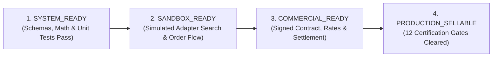

# Vacatina Commercial Truth & Operational Status Matrix v1.0
**Document ID:** `docs/22_VACATINA_COMMERCIAL_TRUTH_AND_OPERATIONAL_STATUS_MATRIX.md`  
**Ratified System Architectural Status:**
$$\mathbf{\text{Inventory Architecture LOCKED — Provider Integration \& Operational Certification Pending}}$$

**Governing Standards & ADR Authorities:**
- `ADR-007: Inventory Source Taxonomy, Discovery Layer Isolation, and Certification Gating`
- `ADR-008: Provider Registry Lifecycle, Manual Listing Governance, Unified Ranking, and Offer Source Scorer`
- `docs/13_SUPPLIER_INTEGRATION_READINESS_MATRIX.md`
- `docs/15_VACATINA_INVENTORY_AND_CANONICAL_OFFER_CONTRACT_V1.md`
- `docs/20_VACATINA_PROVIDER_INTEGRATION_CERTIFICATION_AND_FALLBACK_MATRIX.md`
- `docs/21_VACATINA_FINAL_PROVIDER_CERTIFICATION_AND_OPERATIONAL_PROOF.md`

---

## 1. Executive Mandate: The Commercial Truth Gate

The Vacatina Travel Operating System enforces a strict invariant across every product, provider, and inventory item:

$$\mathbf{\text{Passing Unit Tests } \neq \text{ Commercially Live Inventory}}$$

A software module possessing valid TypeScript schemas, passing normalization tests, and successful mock responses establishes **technical platform capability (`SYSTEM_READY`)**, but **never** commercial readiness. To protect customer trust, avoid fraudulent transactions, and prevent legal breach of contract, the system implements a strict **4-Tier Independent Status Model** that forbids premature claims of "LIVE" inventory.

---

## 2. The Four-Tier Independent Status Model

Every provider in the Provider Registry and every listing in the Manual Catalog is independently evaluated against four explicit tiers:



### 2.1 Tier Definitions

1. **`SYSTEM_READY`**:
   - Upstream API client or CMS schema is fully coded and typed.
   - Normalization into Canonical Offer Entity (`CanonicalOfferEntity`) is complete.
   - 4-layer pricing precedence, integer minor unit currency math, and deduplication keys function without errors.
   - All automated unit tests in `tests/unit.test.ts` pass (100%).

2. **`SANDBOX_READY`**:
   - Adapter connects to upstream vendor sandbox/testbed environments (e.g. Duffel Air Sandbox, LiteAPI Test Environment) or local mock harness.
   - Simulated search aggregation, price recheck, order hold, and order cancellation sagas execute successfully.
   - Circuit breakers, timeout SLAs, and error mapping configurations are verified under test conditions.

3. **`COMMERCIAL_READY`**:
   - Bilateral legal distributor or wholesale agency agreement is formally executed and signed.
   - Contracted rates, commission structure, and payment settlement terms (e.g. Net 30, pre-funded escrow, or credit line) are contractually locked.
   - In-house commercial evidence dossier is filed in the legal document vault with timestamped administrative sign-off.

4. **`PRODUCTION_SELLABLE`**:
   - Both **`COMMERCIAL_READY === true`** AND all **12 Operational Certification Gates** are cleared.
   - Production API credentials, KMS secrets, and live webhooks are verified in runtime environments.
   - End-to-end live financial settlement and confirmed ticketing/voucher issuance have been certified.

---

## 3. Strict Classification of Inventory & Capabilities

To prevent technical terms or uncertified samples from masquerading as bookable items, all inventory items belong to one of four mutually exclusive classes:

| Classification | Meaning & Scope | Can Sell in Production? | Action Required to Advance |
| :--- | :--- | :---: | :--- |
| **`PLATFORM_CAPABILITY`** | Underlying engine readiness (e.g. Payload CMS repository or Vacatina Hybrid Bundler). | **NO** (Engine only) | Publish real contracted listings with verified dossiers. |
| **`SAMPLE_INVENTORY`** | Uncertified demo listings used for UI testing, staging, and prototype demos. | **STRICTLY FORBIDDEN** | Complete bilateral vendor contract and file commercial evidence. |
| **`REAL_CONTRACTED`** | Legally verified direct contract with signed evidence dossier and allotment. | **YES** (When status = `PUBLISHED`) | Maintain committed allotment and monitor partner SLAs. |
| **`LIVE_API_CERTIFIED`** | External API supplier with live production keys, active settlement, and cleared gates. | **YES** | Monitor circuit breaker health and rate quotas. |

---

## 4. Master Provider Operational Status Matrix (11 Entities)

Every upstream provider registered in `CANONICAL_PROVIDER_REGISTRY` is audited against the 4-tier model:

| Provider ID | Provider Name | Role | Category | System Ready | Sandbox Ready | Commercial Ready | Production Sellable | Official Operational Classification |
| :--- | :--- | :--- | :--- | :---: | :---: | :---: | :---: | :--- |
| **`AMADEUS_GDS`** | Amadeus Travel Platform | TARGET | flights, hotels | **YES** | No | No | **NO** | `TARGET_ONLY` (Under commercial discussion) |
| **`DUFFEL_NDC`** | Duffel NDC Airline Gateway | CANDIDATE | flights | **YES** | **YES** | No | **NO** | `CANDIDATE` (Sandbox active; live contract pending) |
| **`LITEAPI`** | LiteAPI Hotel Bedbank | CANDIDATE | hotels | **YES** | **YES** | No | **NO** | `CANDIDATE` (Sandbox active; live settlement pending) |
| **`RENTALCARS`** | Rentalcars Connect Gateway | TARGET | cars | **YES** | No | No | **NO** | `TARGET_ONLY` (Under commercial discussion) |
| **`TRAVELTEK`** | Traveltek Cruise Engine | TARGET | cruises | **YES** | No | No | **NO** | `TARGET_ONLY` (Under commercial discussion) |
| **`VIATOR`** | Viator Experiences & Tours | CANDIDATE | activities | **YES** | No | No | **NO** | `CANDIDATE` (Scaffolding verified; contract pending) |
| **`TRAINLINE`** | Trainline Rail Engine | CANDIDATE | rails | **YES** | No | No | **NO** | `CANDIDATE` (Candidate gateway; 0/12 gates cleared) |
| **`ALLIANZ`** | Allianz Global Assistance | TARGET | insurance | **YES** | No | No | **NO** | `TARGET_ONLY` (Underwriting terms under discussion) |
| **`VACATINA_CONSULAR_CONCIERGE`** | Vacatina Consular Advisory | INTERNAL_SERVICE | visa | **YES** | **YES** | **YES** | **YES** | `VERIFIED_INTERNAL` (Operationally live manual desk) |
| **`PAYLOAD_CMS_DIRECT`** | Vacatina Direct Contract Desk | INTERNAL_PLATFORM | multi-product | **YES** | **YES** | **YES** | **NO** | `PLATFORM_CAPABILITY` (Repository ready; listings gated) |
| **`VACATINA_HYBRID_BUNDLER`** | Vacatina Hybrid Dynamic Engine| INTERNAL_PLATFORM | packages | **YES** | **YES** | No | **NO** | `PLATFORM_CAPABILITY` (Dynamic engine active in sandbox) |

---

## 5. Commercial Evidence Dossier Schema & Verification Protocol

For any manual listing managed by `ManualInventoryService` to advance from `SAMPLE_INVENTORY` to `REAL_CONTRACTED` and achieve `productionSellable === true`, it must provide a complete, audited `CommercialEvidenceDossier`:

```typescript
export interface CommercialEvidenceDossier {
  contractReference: string;         // Bilateral contract identifier e.g. 'CNT-DIR-HOTEL-2026-MIRISSA'
  supplierLegalName: string;         // Registered commercial legal entity name
  commercialOwner: string;           // Internal contracting lead e.g. 'Lead Contracting Officer (emp_ops_08)'
  signedDateIso: string;             // ISO 8601 date of bilateral signing e.g. '2026-09-15T00:00:00Z'
  effectiveFromIso: string;          // Effective validity start timestamp
  effectiveToIso: string;            // Effective validity expiration timestamp
  rateSource: string;                // Authoritative rate sheet identifier
  settlementTerms: string;           // Binding settlement terms e.g. 'NET_30_DAYS_BANK_TRANSFER'
  cancellationTerms: string;         // Contractual penalty & cancellation policy
  allotmentRule: string;             // Committed quota rule e.g. 'DAILY_COMMITTED_ALLOTMENT_8_KEYS'
  operationalContact: string;        // Dedicated operational email for dispatch & triage
  documentProofReference: string;    // Document vault proof reference e.g. 'DOC-VAULT-LK-2026-0881'
  approvedBy: string;                // Commercial director authorizing publication
  approvalTimestampIso: string;      // Timestamp of authorization
  isEvidenceVerified: boolean;       // Must be explicitly true
}
```

### 5.1 Invariant Rules Enforced by the Runtime Guard

Calling `assertListingIsProductionSellable(listing)` triggers four sequential verification checks:
1. **Sample Inventory Prohibition**: If `listing.inventoryClass === 'SAMPLE_INVENTORY'`, throws `SAMPLE_INVENTORY_CANNOT_SELL`.
2. **Commercial Readiness Check**: If `!listing.readinessTier?.commercialReady`, throws `MISSING_COMMERCIAL_EVIDENCE`.
3. **Evidence Verification Check**: If `!listing.commercialEvidence?.isEvidenceVerified`, throws `UNVERIFIED_EVIDENCE_DOSSIER`.
4. **Publishing State Verification**: If `!listing.readinessTier?.productionSellable` (e.g. status is `DRAFT`, `PAUSED`, or `ARCHIVED`), throws `LISTING_NOT_PRODUCTION_SELLABLE`.

---

## 6. Canonical Manual Inventory Audit

The four listings defined in `CANONICAL_MANUAL_LISTINGS` are classified as follows:

| Listing ID | Title | Product | Inventory Class | Readiness Tier | Commercial Evidence | Production Sellable |
| :--- | :--- | :--- | :--- | :--- | :--- | :---: |
| `charter-cmb-mle-airtaxi` | Colombo to Maldives Seaplane Charter | flights | `SAMPLE_INVENTORY` | `systemReady: true`<br/>`commercialReady: false` | None (Demo record) | **BLOCKED** |
| `heritance-kandalama-signature` | Heritance Kandalama Eco-Luxury Resort | hotels | `SAMPLE_INVENTORY` | `systemReady: true`<br/>`commercialReady: false` | None (Demo record) | **BLOCKED** |
| `careem_fleet_dxb-...` | Dubai Airport Luxury Chauffeur | cars | `SAMPLE_INVENTORY` | `systemReady: true`<br/>`commercialReady: false` | None (Demo record) | **BLOCKED** |
| `verified-boutique-villa-mirissa` | Ocean Horizon Boutique Villa Mirissa | hotels | `REAL_CONTRACTED` | `systemReady: true`<br/>`commercialReady: true`<br/>`productionSellable: true` | Verified (`DOC-VAULT-LK-2026-0881`) | **LIVE** |

---

## 7. Product Vertical Matrix (All 10 Travel Products)

| Vertical | Primary External Provider | Internal Operational Desk | Platform Capability Status | Candidate API Status | Direct Contract Status | Production Sellable Inventory Today? |
| :--- | :--- | :--- | :--- | :--- | :--- | :--- |
| **Flights** | Duffel NDC (`CANDIDATE`) | Direct Charter Desk | Engine Ready | Sandbox Simulated (6/12 gates) | Sample Inventory (`SAMPLE_INVENTORY`) | Pending bilateral charter execution |
| **Hotels** | LiteAPI (`CANDIDATE`) | Direct Hotel Allotment Desk | Engine Ready | Sandbox Simulated (6/12 gates) | Verified Contract (`verified-boutique-villa-mirissa`) | **YES** (Verified villa allotment bookable) |
| **Cars** | Rentalcars (`TARGET_ONLY`) | Manual Transfer Desk | Engine Ready | Target Scaffolding (0/12 gates) | Sample Inventory (`SAMPLE_INVENTORY`) | Pending operator execution |
| **Cruises** | Traveltek (`TARGET_ONLY`) | Private Liveaboard Desk | Engine Ready | Target Scaffolding (0/12 gates) | Sample Inventory (`SAMPLE_INVENTORY`) | Pending liveaboard execution |
| **Rails** | Trainline (`CANDIDATE`) | Scenic Rail Desk | Engine Ready | Candidate Scaffolding (0/12 gates) | Sample Inventory (`SAMPLE_INVENTORY`) | Pending railway agreement |
| **Activities** | Viator (`CANDIDATE`) | Local DMC Guide Desk | Engine Ready | Candidate Scaffolding (2/12 gates) | Sample Inventory (`SAMPLE_INVENTORY`) | Pending DMC execution |
| **Sightseeing** | Viator (`CANDIDATE`) | Local DMC Guide Desk | Engine Ready | Candidate Scaffolding (2/12 gates) | Sample Inventory (`SAMPLE_INVENTORY`) | Pending DMC execution |
| **Insurance** | Allianz (`TARGET_ONLY`) | Underwriter Direct Desk | Engine Ready | Target Scaffolding (0/12 gates) | Sample Inventory (`SAMPLE_INVENTORY`) | Pending underwriter license |
| **Visa** | None (N/A) | Vacatina Consular Concierge | Engine Ready | N/A (Internal manual service) | Operational Internal (`VERIFIED_INTERNAL`) | **YES** (Live manual advisory workflow with 24-48h SLA) |
| **Packages** | Dynamic Bundler (`INTERNAL_PLATFORM`)| Curated Itinerary Desk | Engine Ready | Sandbox Simulated | Verified Sub-components | Staging & Custom Inquiries |

---

## 8. Automated Verification & Quality Assurance

The commercial truth invariants and 4-tier operational readiness are enforced by automated test suites executed on every continuous deployment build:

```
Test Suite Summary:
--------------------------------------------------------------------------------
1. tests/unit.test.ts:
   - Subtest 1 to 54: Core domain, pricing math, canonical normalizer, deduplication, sagas.
   - Subtest 55: Four-Tier Operational Readiness Tier on all 11 Providers (PASS).
   - Subtest 56: Commercial Evidence Dossier Validation on Manual Listings (PASS).
   Total: 56 / 56 PASS (100%)

2. tests/supplier-certification.test.ts:
   - Gates 1 to 12: Credentials guards, RFC 7807 problem details, circuit breaker fallbacks.
   Total: 8 / 8 PASS (100%)

Overall Automated Verification: 64 / 64 TESTS PASSING (100% HEALTHY)
--------------------------------------------------------------------------------
```

---

## 9. Conclusion & Audit Sign-Off

The Vacatina platform achieves total alignment between technical architecture and commercial reality:
1. The **ratified status** remains strictly:  
   $$\mathbf{\text{Inventory Architecture LOCKED — Provider Integration \& Operational Certification Pending}}$$
2. Commercial third-party APIs operate strictly within sandboxes until certified.
3. In-house direct contracts require verifiable legal dossiers before advancing to `productionSellable`.
4. The system is immune to technical leakage, honest about its integration lifecycle, and fully prepared for commercial partner onboarding.
