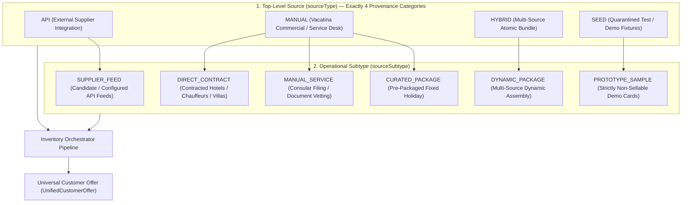
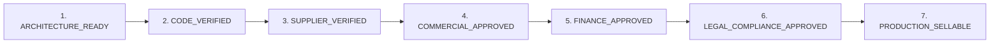

# 27. VACATINA FINAL INVENTORY SOURCE TAXONOMY & PRODUCT AUTHORITY MATRIX (v2.0)
**Document Authority:** Vacatina Architectural Board & Senior Systems Architect  
**Classification:** Operational Governance, Source Provenance & Backend Integration Blueprint  
**Target Architecture:** Vacatina Unified Inventory Orchestrator & B2B/B2C Distribution Engine  
**Date:** 25 October 2026  
**Status:** **ARCHITECTURALLY VERIFIED (CODE-SAFE; UPSTREAM COMMERCIAL CONTRACTS PENDING)**

---

## 1. Executive Summary: Core Architectural Separation

This specification locks the architectural foundation of Vacatina's inventory layer while strictly enforcing the foundational operational principle:
$$\mathbf{\text{CODE-SAFE / ARCHITECTURE-VERIFIED } \neq \text{ COMMERCIALLY PRODUCTION-READY}}$$

Automated unit, schema, and routing test suites verify **code invariants, data models, quarantine guards, and fail-closed isolation**. They do **not** constitute proof of countersigned supplier contracts, legal ticketing authority, active merchant settlement accounts, or physical inventory quotas.

---

## 2. Authoritative Two-Tier Inventory Source Taxonomy

To resolve any ambiguity between 4 high-level categories and 7 domain subtypes, the backend and database schemas are standardized under this two-tier model:

1. **`sourceType` (Top-Level Category — Exactly 4):**
   - **`API`**: Inventory dynamically retrieved from an external supplier API.
   - **`MANUAL`**: Inventory or services commercially contracted and operated directly by Vacatina.
   - **`HYBRID`**: Heterogeneous composite product combining API and manual components.
   - **`SEED`**: Development, accelerator, demo, or placeholder content (strictly non-sellable).

2. **`sourceSubtype` (Operational Subtype):**
   - When `sourceType === 'MANUAL'`:
     - **`DIRECT_CONTRACT`**: Directly negotiated commercial agreement with a property, fleet, or villa owner.
     - **`MANUAL_SERVICE`**: In-house operational service executed by Vacatina staff (e.g. Consular Visa Filing Desk).
     - **`CURATED_PACKAGE`**: Pre-assembled, fixed-itinerary holiday package created by Vacatina product teams.
   - When `sourceType === 'API'`:
     - **`SUPPLIER_FEED`**: Dynamic API response from an integrated candidate/certified upstream provider.
   - When `sourceType === 'HYBRID'`:
     - **`DYNAMIC_PACKAGE`**: Multi-source package retaining independent component provenance.
   - When `sourceType === 'SEED'`:
     - **`PROTOTYPE_SAMPLE`**: Demo fixture for layout and UI test verification.

---

## 3. Seven-Stage Multi-Dimensional Governance Lifecycle

An offer or inventory item cannot become bookable simply by toggling a flag or passing an automated test. It must systematically clear 7 independent governance gates:

| Gate | Verification Authority | Mandatory Evidentiary Requirement | Production Sellable? |
| :--- | :--- | :--- | :--- |
| **1. ARCHITECTURE_READY** | System Architect | Canonical schemas, route mappings, and adapter interfaces locked. | No |
| **2. CODE_VERIFIED** | QA / Test Runner | Automated tests passing (e.g. 72/72 tests), zero compiler or type errors. | No |
| **3. SUPPLIER_VERIFIED** | Integration Lead | Live API handshake, active authentication credentials, error mapping verified. | No |
| **4. COMMERCIAL_APPROVED** | Commercial Risk Officer | Countersigned bilateral contract, valid rate sheet, commitment dates, allotment SLA. | No |
| **5. FINANCE_APPROVED** | Finance Lead | Payout terms, settlement currency, payment gateway capture, reconciliation ledger approved. | No |
| **6. LEGAL_COMPLIANCE_APPROVED** | Legal Counsel | Consumer protection terms, travel agent licensing, insurance/visa compliance sign-off. | No |
| **7. PRODUCTION_SELLABLE** | Platform Operations | **ALL 6 previous gates cleared.** Customer credit card can be transacted. | **YES** |

---

## 4. Confirmation Mode Decoupled from Source Type

Confirmation mode is an operational fulfillment attribute, **completely decoupled** from the inventory source:

- **Manual Direct Contract $\rightarrow$ Instant Confirmation:** When Vacatina holds a confirmed room/seat allotment in its database ledger, confirmation is immediate (`INSTANT_CONFIRM`). Customer checkout atomically decrements the internal quota without requiring supplier contact.
- **Supplier API $\rightarrow$ Request to Confirm:** When an external API operates on cached availability or requires manual backoffice allotment recheck, confirmation is on-request (`REQUEST_TO_CONFIRM`).
- **Consular Service $\rightarrow$ Assisted Service:** Manual document review and consular filing require case handling (`ASSISTED_SERVICE`).

> [!IMPORTANT]
> **Customer Privacy & Truth in Advertising:**  
> Customer-facing interfaces **never display technical backend labels** like "API Listing" or "Manual Listing". The customer sees only honest commercial terms: **"Instant Confirmation"**, **"Request to Confirm"**, or **"Assisted Service"**.

---

## 5. Ten-Product Source Authority Matrix & Integration Status

All named external suppliers are classified under their true commercial status (**Candidate Integration / Sandbox Configured**), while internal operations are classified as **Operationally Live Manual**.

| # | Travel Vertical | Primary Source Architecture | Integration Classification | Secondary / Direct Source | Confirmation Mode | Pricing Policy Authority | Operational Fulfillment Mechanism | Fallback / Outage Strategy |
| :--- | :--- | :--- | :--- | :--- | :--- | :--- | :--- | :--- |
| **1** | **Flights** | Duffel NDC / GDS Adapter | **CANDIDATE INTEGRATION** *(Sandbox tested; Production credentials pending)* | Vacatina Manual Charter CMS (`DIRECT_CONTRACT`) | `INSTANT_CONFIRM` (API) / `REQUEST_TO_CONFIRM` (Charter) | Configurable Flight Margin Policy (Finance Admin) | Upstream GDS Order Issuance / Outbox Worker | Fallback to secondary candidate GDS (Amadeus) or offline airline charter desk |
| **2** | **Hotels** | LiteAPI Bedbank (Nuitee Connect v3.0) | **CANDIDATE INTEGRATION** *(Sandbox key expired; Production contract pending)* | Vacatina Direct Hotel Contract CMS (`DIRECT_CONTRACT`) | `INSTANT_CONFIRM` (Allotment or API) | Configurable Hotel Margin Policy / CMS Published Override | Automated Bedbank Booking / Vacatina Room Allotment Ledger | Switch to candidate aggregator (Hotelbeds) or on-request boutique liaison |
| **3** | **Visa Assistance** | Vacatina Consular Concierge Desk (`MANUAL_SERVICE`) | **OPERATIONALLY LIVE (MANUAL)** *(Internal operations ready)* | *None (No verified Vacatina production visa authority integration is currently configured)* | `ASSISTED_SERVICE` | Configurable Consular Advisory Fee Schedule (Finance Admin) | Consular Case Management Queue / Document Vetting Desk | Human telephone / manual email embassy dispatch |
| **4** | **Holiday Packages** | Vacatina Curated Package (`CURATED_PACKAGE`) | **OPERATIONALLY LIVE (MANUAL)** *(Curated)* / **CANDIDATE** *(Dynamic)* | Dynamic Multi-Source Hybrid (`HYBRID`) | `REQUEST_TO_CONFIRM` or `INSTANT_CONFIRM` | Component Cost Rollup + Configurable Package Margin | Multi-Channel Saga Orchestration (API + Allotment) | Component alternative replacement (e.g. swap sold-out hotel with peer boutique) |
| **5** | **Cars & Transfers** | CarTrawler / Mozio Adapter | **CANDIDATE INTEGRATION** *(Technical specification mapped)* | Direct Chauffeur / Fleet CMS (`DIRECT_CONTRACT`) | `INSTANT_CONFIRM` / `REQUEST_TO_CONFIRM` | Configurable Transfer Markup Policy | API Voucher / Chauffeur Dispatch Queue | Local transport partner backup fleet dispatch |
| **6** | **Scenic Rails** | Trainline / SilverRail Adapter | **CANDIDATE INTEGRATION** *(Technical specification mapped)* | Manual Rail Desk CMS (`DIRECT_CONTRACT`) | `INSTANT_CONFIRM` / `REQUEST_TO_CONFIRM` | Configurable Rail Service Fee Policy | Electronic PNR / Station Ticket Desk Collection | Manual reservation agent ticket procurement |
| **7** | **Cruises** | Traveltek Adapter | **CANDIDATE INTEGRATION** *(Technical specification mapped)* | Direct Yacht Charter CMS (`DIRECT_CONTRACT`) | `REQUEST_TO_CONFIRM` (Stateroom Hold) | Configurable Cruise Margin Policy | Traveltek Cabin Booking / Charter Contract Office | Alternative sailing / cabin category upgrade proposal |
| **8** | **Activities** | Viator / GetYourGuide Adapter | **CANDIDATE INTEGRATION** *(Technical specification mapped)* | Direct Local Excursions CMS (`DIRECT_CONTRACT`) | `INSTANT_CONFIRM` | Configurable Activity Markup Policy | Instant QR Voucher / Local Excursion Desk | Alternative local tour operator voucher issuance |
| **9** | **Sightseeing** | Tiqets Adapter | **CANDIDATE INTEGRATION** *(Technical specification mapped)* | Direct Heritage Monument CMS (`DIRECT_CONTRACT`) | `INSTANT_CONFIRM` | Configurable Sightseeing Markup Policy | Mobile Barcode Pass / Physical Ticket Concierge | Open-dated voucher or full immediate refund |
| **10**| **Travel Insurance**| Allianz Partners API | **CANDIDATE INTEGRATION** *(Vacatina has not verified offline insurance underwriting authority)* | *None (Distribution configured strictly via candidate underwriter API)* | `INSTANT_CONFIRM` | Actuarial Premium + Underwriter Commission Schedule | Real-Time Insurer Policy Schedule Generation | Fail-closed: Insurance cannot be transacted offline without regulatory underwriting authority |

---

## 6. Configurable Commercial Pricing Rules (Not Hardcoded Numbers)

Markup percentages and fixed fees **are not immutable architectural constants**. They are dynamic commercial policies managed via [`PricingPrecedenceService`](file:///C:/Users/Madhusanka/.gemini/antigravity/scratch/vacatina/src/server/inventory/pricing-precedence.service.ts) and controlled by authorized Admin/Finance roles:

$$\text{Final Selling Price} = \text{Layer 1 (Net Wholesale Cost)} + \text{Layer 2 (Configurable Platform Markup)} - \text{Layer 3 (B2B Tier Discount)} + \text{Layer 4 (Audited Override)}$$

- **Layer 2 (Platform Markup):** Modifiable at runtime via `PricingPrecedenceService.setCommercialMarkupPolicy(productType, percent)` without code deployments.
- **Fixed Service Fees:** Modifiable at runtime via `PricingPrecedenceService.setCommercialFixedFeePolicy(feeKey, feeMinor)`.
- **Audit Requirement:** Any change to commercial pricing rules must record the approving Finance user ID, timestamp, and justification in the administrative audit log.

---

## 7. Concurrency Safety: Atomic Allotment Hold & Commit

To prevent two concurrent travelers from purchasing the last remaining room in a contracted hotel allotment, [`ManualInventoryService`](file:///C:/Users/Madhusanka/.gemini/antigravity/scratch/vacatina/src/lib/services/manual-inventory.service.ts) implements atomic allotment reservation:

1. **`holdAllotment(listingId, quantity, holdDurationMs)`**:
   - Calculates available stock accounting for active, unexpired holds.
   - Throws `Allotment Exceeded` error if requested quantity exceeds unheld quota.
   - Issues a temporary hold token with a 15-minute TTL.
2. **`commitAllotment(listingId, holdId)`**:
   - Invoked upon verified payment capture.
   - Permanently decrements `availableQuota` in the database ledger.
   - Releases the hold token and logs the transaction in the listing audit trail.
3. **`releaseAllotment(listingId, holdId)`**:
   - Releases held stock immediately if checkout is abandoned or payment fails.

---

## 8. SEED Inventory Quarantining Protocol

1. All inherited sample listings, demo hotels (e.g. *Heritance Kandalama*), vehicle fleets, and mock packages are classified as:
   $$\mathbf{\text{sourceType}} = \mathbf{\text{SEED}} \quad \text{and} \quad \mathbf{\text{inventoryClass}} = \mathbf{\text{SAMPLE\_INVENTORY}}$$
2. **Checkout Invariant:** The checkout orchestrator (`assertOfferCheckoutReady`) strictly prohibits any offer with `sourceType === 'SEED'` or `inventoryClass === 'SAMPLE_INVENTORY'` from entering payment settlement.
3. **Promotion Protocol:** A SEED item cannot become a sellable MANUAL listing merely by changing a database boolean. It must systematically pass the **Admin 4-Eyes Separation of Duties Lifecycle**:
   $$\text{DRAFT} \longrightarrow \text{COMMERCIAL\_VERIFICATION} \longrightarrow \text{PRICING\_APPROVAL} \longrightarrow \text{PUBLISHED}$$
   requiring physical evidence upload (`contractReference`, `supplierLegalName`, `signedDate`, `settlementTerms`).

---

## 9. Verification Summary & Operational Status

- **Automated Verification:** **72 / 72 Automated Tests Passing (100%)**
  - Invariant Suite (`tests/unit.test.ts`): 64 / 64 PASS (including Subtest 64 testing Two-Tier Taxonomy and Concurrency Holds).
  - Supplier Certification Suite (`tests/supplier-certification.test.ts`): 8 / 8 PASS.
- **Build Quality:** Zero external CDN dependencies; local Tailwind, font, and asset compilation.
- **Production URL:** `https://vacatina-nu.vercel.app`
- **Headless Chrome Smoke Test:** 100% HEALTHY across Desktop (1440px), Tablet (768px), and Mobile (360px).
