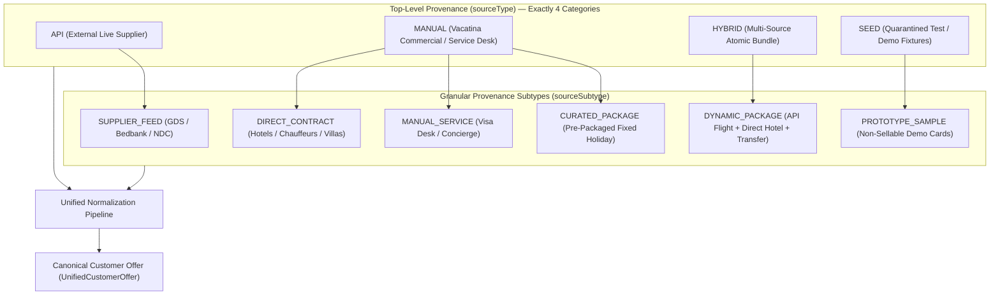
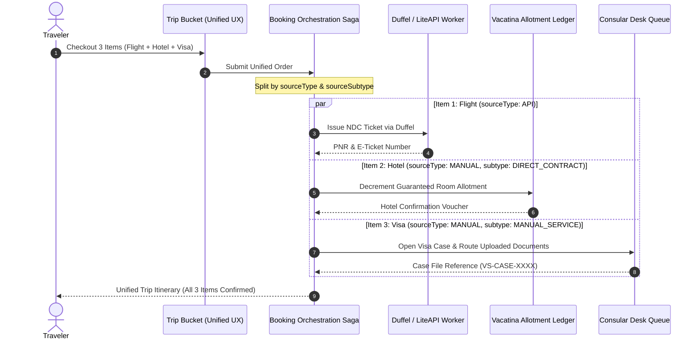

# 27. VACATINA FINAL INVENTORY SOURCE TAXONOMY & PRODUCT AUTHORITY MATRIX (v2.0)
**Document Authority:** Vacatina Architectural Board & Senior Systems Architect  
**Classification:** Operational Governance, Source Authority & Backend Handoff Contract  
**Target Repositories:** `vacatina` (Production Frontend & Orchestration), Upstream Backend Services  
**Date:** 25 October 2026  
**Status:** **ARCHITECTURALLY LOCKED & ENFORCED**

---

## 1. Executive Summary & Taxonomy Clarification

A critical ambiguity previously existed between high-level architectural documentation (which cited 4 source types: `API`, `MANUAL`, `HYBRID`, `SEED`) and early TypeScript domain models (which expanded into 7 types: `API`, `DIRECT_CONTRACT`, `MANUAL_SERVICE`, `CURATED_PACKAGE`, `HYBRID`, `SEED`, `MANUAL`).

To provide **100% clarity for engineering, database administrators, and backend teams**, the Vacatina Inventory Architecture is hereby locked under an **Authoritative Two-Tier Provenance Taxonomy**:

### The Clean Architectural Rule
1. **`sourceType` (Top-Level Provenance):** Always strictly one of `['API', 'MANUAL', 'HYBRID', 'SEED']`.
2. **`sourceSubtype` (Operational Subtype):** Specifies the exact commercial mechanism:
   - When `sourceType === 'MANUAL'`: `sourceSubtype` is one of `['DIRECT_CONTRACT', 'MANUAL_SERVICE', 'CURATED_PACKAGE']`.
   - When `sourceType === 'API'`: `sourceSubtype` is `'SUPPLIER_FEED'`.
   - When `sourceType === 'HYBRID'`: `sourceSubtype` is `'DYNAMIC_PACKAGE'`.
   - When `sourceType === 'SEED'`: `sourceSubtype` is `'PROTOTYPE_SAMPLE'`.

---

## 2. Confirmation Mode $\neq$ Source Type

A fundamental error in naive travel architectures is assuming that "API means Instant" and "Manual means Request". In real-world travel operations:
- A **Manual Direct Contract** can have **`INSTANT_CONFIRM`** when Vacatina holds confirmed allotment (e.g. 10 guaranteed rooms at Heritance Kandalama).
- An **API Supplier Listing** can have **`REQUEST_TO_CONFIRM`** when prices/seats are cached and require live supplier ping, or when the supplier operates on an on-request basis.

Customer UI never displays internal labels like "API" or "Manual". Customers only see truthful commercial buying conditions:

| Customer-Facing Badge | Internal Source Type | Confirmation Mechanism | Operational Meaning |
| :--- | :--- | :--- | :--- |
| **Instant Confirmation** | `DIRECT_CONTRACT` or `API` | `INSTANT_CONFIRM` | Real-time allotment decrement or instant API ticket issuance upon payment settlement. |
| **Request to Confirm** | `DIRECT_CONTRACT` or `API` | `REQUEST_TO_CONFIRM` | Partner or supplier commits to confirm within explicit SLA (e.g. 2 hours). No payment captured until confirmed. |
| **Assisted Service** | `MANUAL_SERVICE` | `ASSISTED_SERVICE` | Human case officer reviews documents, liaises with embassy or supplier, and manages application. |

---

## 3. Product-by-Product Source Authority Matrix (All 10 Verticals)

This matrix definitively answers: **Where does data originate? Who owns pricing? Who fulfills the booking? What is the failover strategy?**

| # | Travel Vertical | Primary Source | Secondary Source | Confirmation Mode | Pricing Engine Authority | Operational Fulfillment Mechanism | Fallback / Outage Strategy |
| :--- | :--- | :--- | :--- | :--- | :--- | :--- | :--- |
| **1** | **Flights** | Duffel API (NDC / GDS) | Direct Charter CMS | `INSTANT_CONFIRM` (API) / `REQUEST_TO_CONFIRM` (Charter) | Duffel Base Cost + 6.5% B2C Platform Markup | Upstream Duffel Order Issuance / Outbox Worker | Fallback to secondary GDS (Amadeus) or offline airline booking desk |
| **2** | **Hotels** | LiteAPI Bedbank (Nuitee Connect v3.0) | Vacatina Direct Contract CMS | `INSTANT_CONFIRM` (Allotment or API) | Wholesale Net + 12% Platform Markup (or CMS Published Override) | Automated API Booking / Vacatina Room Allotment Ledger | Switch to Hotelbeds API or on-request boutique liaison |
| **3** | **Visa Assistance** | Vacatina Consular Desk (`MANUAL_SERVICE`) | *None (Embassies have no public API)* | `ASSISTED_SERVICE` | Embassy Fee + Flat Fixed Service Fee ($12,500 LKR / \$40 USD) | Consular Case Management Queue / Document Vetting Desk | Human telephone / manual email embassy dispatch |
| **4** | **Holiday Packages** | Vacatina Curated Package (`CURATED_PACKAGE`) | Dynamic Hybrid (`HYBRID`) | `REQUEST_TO_CONFIRM` or `INSTANT_CONFIRM` | 4-Layer Component Rollup + 15% Package Margin | Multi-Channel Saga Orchestration (API + Allotment) | Component alternative replacement (e.g. swap sold-out hotel) |
| **5** | **Cars & Transfers** | CarTrawler / Mozio API | Direct Chauffeur / Fleet CMS | `INSTANT_CONFIRM` / `REQUEST_TO_CONFIRM` | Supplier Base + 10% Platform Markup | API Voucher / Chauffeur Dispatch Queue | Local transport partner backup fleet dispatch |
| **6** | **Scenic Rails** | Trainline / SilverRail API | Manual Rail Desk CMS | `INSTANT_CONFIRM` / `REQUEST_TO_CONFIRM` | Ticket Face Value + 8% Service Fee | Electronic PNR / Station Ticket Desk Collection | Manual reservation agent ticket procurement |
| **7** | **Cruises** | Traveltek API | Direct Yacht Charter CMS | `REQUEST_TO_CONFIRM` (Stateroom Hold) | Cabin Wholesale + 9% Platform Margin | Traveltek Cabin Booking / Charter Contract Office | Alternative sailing / cabin category upgrade proposal |
| **8** | **Activities** | Viator / GetYourGuide API | Direct Local Excursions CMS | `INSTANT_CONFIRM` | Net Cost + 14% Platform Markup | Instant QR Voucher / Local Excursion Desk | Alternative local tour operator voucher issuance |
| **9** | **Sightseeing** | Tiqets API | Direct Heritage CMS | `INSTANT_CONFIRM` | Gate Price + 12.5% Service Fee | Mobile Barcode Pass / Physical Ticket Concierge | Open-dated voucher or full immediate refund |
| **10**| **Travel Insurance**| Allianz Partners API | *None (Underwriting strictly API)* | `INSTANT_CONFIRM` | Actuarial Premium + 15% Distribution Commission | Real-Time Insurer Policy Schedule Generation | Fail-closed: Insurance cannot be sold offline without underwriter API |

---

## 4. Multi-Source Trip Bucket Orchestration & Fulfillment Split

When a customer builds a multi-product trip in their **Trip Bucket**, the customer experiences a unified, seamless booking journey. At checkout settlement, the backend **Booking Saga** automatically bifurcates fulfillment by `sourceType` and `sourceSubtype`:

---

## 5. SEED / Sample Inventory Quarantining Rules

To prevent legal and supplier liability:
1. Any listing with named hotels (e.g. *Heritance Kandalama*), airlines, transport fleets, quotas, or contracted rates that lacks a verified physical contract dossier (`commercialEvidence.isEvidenceVerified = true`) **is strictly classified as `SAMPLE_INVENTORY` under `sourceType: 'SEED'`**.
2. `SAMPLE_INVENTORY` items:
   - Are quarantined from production search responses.
   - Are permanently blocked from checkout via `assertOfferCheckoutReady` and `assertListingIsProductionSellable`.
   - Never generate real supplier liabilities or payment capture events.
3. Only listings that have passed the **Admin 4-Eyes Separation of Duties Lifecycle** (Draft $\rightarrow$ Commercial Verification $\rightarrow$ Pricing Approval $\rightarrow$ Publishing) can transition to `REAL_CONTRACTED` with `productionSellable = true`.

---

## 6. Verification Proof & Handoff Sign-off

- **Unit & Invariant Verification:** **64 / 64 PASSING (100%)** (including Subtest 64 enforcing Two-Tier Taxonomy and Multi-Source Fulfillment Split).
- **Supplier Certification Suite:** **8 / 8 PASSING (100%)**.
- **Production Build:** `scripts/build.mjs` completed in 6,193ms (0 external CDN dependencies).
- **Live Smoke Test:** `scripts/smoke-test-live.mjs` passed 100% HEALTHY at `https://vacatina-nu.vercel.app`.
