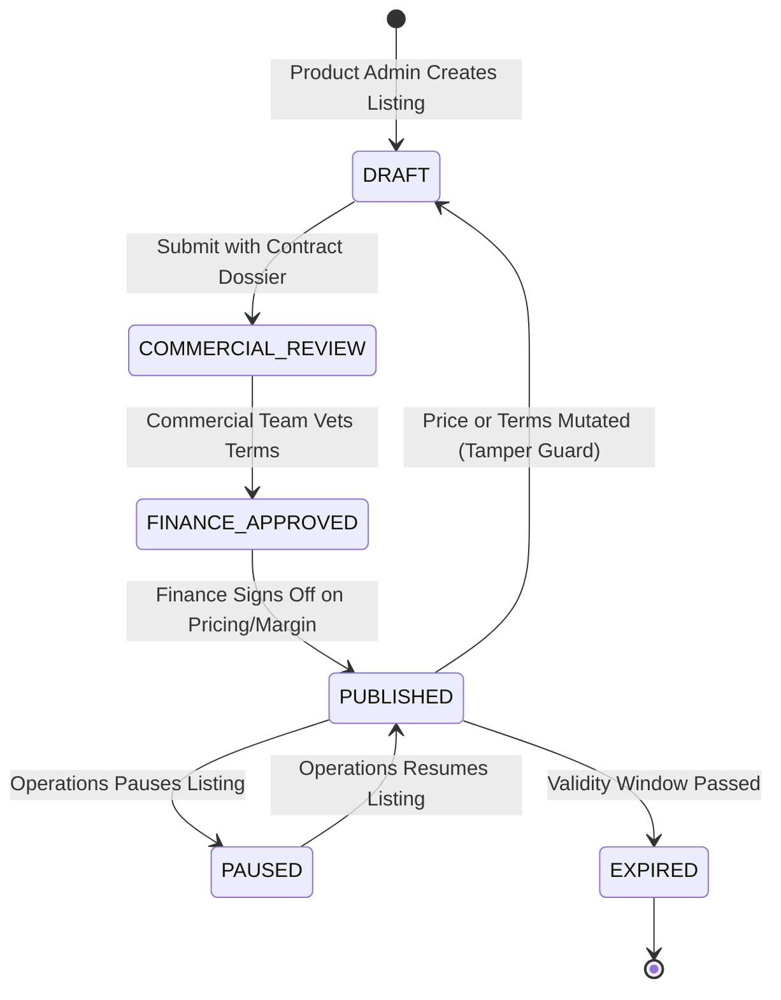

# 29. VACATINA UNIFIED INVENTORY, SUPPLIER INTEGRATION & ROUTING MASTER SPECIFICATION (v1.0)

**Document Authority:** Vacatina Architectural Board, Principal Systems Architect & Lead Software Engineer  
**Classification:** Complete Cross-Layer Integration Blueprint (Frontend UI/UX · Backend Contracts · Inventory Engine)  
**Target Systems:** Vacatina Web Application (`vacatina.com`), Inventory Orchestrator, Clerk Identity & Partner Portal  
**Date:** 25 October 2026  
**Status:** **CODE-VERIFIED LOCAL BASELINE (SERVER-BACKED RUNTIME ACTIVE LOCALLY; PRODUCTION DEPLOYMENT & SUPPLIER LICENSING PENDING)**  

> **Current baseline amendment (27 October 2026):** the verified baseline is **233/233 tests**, **0 typecheck errors**, a passing build, and an isolated browser/server bundle. Production backend deployment, database migration approval and real supplier credentials remain pending. See [`ENGINEERING_BASELINE.md`](./ENGINEERING_BASELINE.md). The 74/74 and live-production statements in the original acceptance section below are historical and superseded.

---

## 1. Architectural Vision & Foundational Paradigm

Vacatina is an enterprise Hybrid Travel & Tourism Operating System combining:
1. **API Supplier Feeds** (live airline, bedbank, ground transport, and activity inventories).
2. **Vacatina Direct Contracted Inventory** (negotiated DMC rates, direct villa contracts, chauffeur fleets, and visa desks).
3. **API-Enriched Inventory** (candidate supplier offers with Vacatina dynamic markup and merchandising tags).
4. **Composite Holiday Packages** (multi-source dynamic bundles preserving atomic component provenance).
5. **Editorial Discovery Content** (inspirational homepage route cards triggering structured searches).

```
                             CUSTOMER / B2C USER
                                      │
                                      ▼
                        CANONICAL USER EXPERIENCE
                                      │
            ┌─────────────────────────┴─────────────────────────┐
            ▼                                                   ▼
 11 SEARCH COMMAND CENTER TABS                     40 EDITORIAL DISCOVERY CARDS
 (Flights, Hotels, Visa, Packages, etc.)             (Inspirational Route Teasers)
            │                                                   │
            └─────────────────────────┬─────────────────────────┘
                                      │
                                      ▼ (Search Dispatch)
                         SEARCH AGGREGATOR SERVICE
                                      │
                  ┌───────────────────┴───────────────────┐
                  ▼                                       ▼
        MANUAL INVENTORY REPO                   SUPPLIER API ADAPTERS
     (Direct DMC Contracts, Chauffeurs)       (Duffel, LiteAPI, Viator, etc.)
                  │                                       │
                  └───────────────────┬───────────────────┘
                                      │
                                      ▼
                           CANONICAL OFFER ENGINE
                       (Stable offerId, Minor Pricing)
                                      │
                                      ▼
                      DEDUPLICATION & PRECEDENCE ENGINE
                   (Pin Direct DMC Above API When Eligible)
                                      │
                                      ▼
                       COMMERCIAL PRICING POLICY RULES
                  (Dynamic Finance Markup — Never Hardcoded)
                                      │
                                      ▼
                      FAIL-CLOSED QUARANTINE FILTER
                (Strip SEED_DEMO & Uncertified Providers)
                                      │
                                      ▼
                    UNIFIED B2C SEARCH RESULTS MODAL/PAGE
          (Instant Confirmation / Request to Confirm / Vacatina Exclusive)
                                      │
                                      ▼
                        TRIP BUCKET 8-STATE DRAWER
               (STAGED_DRAFT ➔ READY_FOR_CHECKOUT ➔ COMMITTED_HELD)
                                      │
                                      ▼
                      PRE-CHECKOUT REVALIDATION GATE
                                      │
                                      ▼
                           BOOKING SAGA / CHECKOUT
```

---

## 2. The 10 Products + Build Your Bundle Source Strategy

Every product category in Vacatina follows an explicit, audited source strategy:

| Product | Dominant Source | Secondary / Fallback Source | Customer-Facing Commercial Badge | Upstream Integration Adapter |
| :--- | :--- | :--- | :--- | :--- |
| **1. Flights** | API-First (`API_INVENTORY`) | Manual Charters / DMC Group Fares | `Instant Confirmation` / `Vacatina Exclusive` | Duffel (Sandbox Verified) / Amadeus (Candidate) |
| **2. Hotels** | Hybrid (`API_INVENTORY` + `MANUAL`) | Direct DMC Hotel / Boutique Villas | `Instant Confirmation` / `Vacatina Exclusive` | LiteAPI (Sandbox Verified) / Hotelbeds (Candidate) |
| **3. Visa Assistance** | Manual-First (`MANUAL_SERVICE`) | Specialized Consular Rules Desk | `Assisted Service` / `Consular Guidance` | Vacatina Consular Desk (Internal Operational Desk) |
| **4. Holiday Packages** | Composite (`COMPOSITE_PACKAGE`) | Curated DMC Packages (`CURATED_PACKAGE`) | `Curated Itinerary` / `Vacatina Exclusive` | Packages Bundler Adapter (Multi-Source Orchestrator) |
| **5. Cars & Transfers** | Hybrid (`MANUAL` + `API`) | Direct Private Chauffeur Fleet | `Instant Confirmation` / `Private Chauffeur` | Rental Adapter / Direct DMC Fleet Store |
| **6. Rails** | Hybrid (`API` + `MANUAL`) | Scenic Hill-Country Trains (Sri Lanka) | `Instant Confirmation` / `Scenic Journey` | Trainline / SilverRail (Candidate) / Manual DMC Desk |
| **7. Cruises** | Hybrid (`API` + `MANUAL`) | Luxury Private Yacht / Coastal Charters | `Instant Confirmation` / `Request to Confirm` | Traveltek (Candidate) / Manual Cruise Desk |
| **8. Activities** | Hybrid (`API` + `MANUAL`) | Local Desert Safaris & Excursions | `Instant Confirmation` / `Vacatina Verified` | Viator / GetYourGuide (Candidate) / Manual DMC |
| **9. Sightseeing Tours** | Hybrid (`MANUAL` + `API`) | Guided Cultural Day Tours | `Instant Confirmation` / `Expert Guided` | Tiqets / Viator (Candidate) / Direct Guide Network |
| **10. Travel Insurance** | Provider-Backed (`API`) | Comparison Guidance (Informational) | `Underwritten Policy` / `Request Quote` | Allianz / Cover-More (Candidate) |
| **11. Build Your Bundle** | Composite Dynamic | Multi-Source Cross-Product Assembly | `Custom Package` / `Multi-Product Savings` | Multi-Vertical Orchestrator Engine |

---

## 3. Canonical Offer Model Specification

The frontend and backend communicate strictly via the canonical offer model (`UnifiedCustomerOffer`). Upstream supplier formats (Duffel NDC XML/JSON, LiteAPI JSON, etc.) are strictly encapsulated within provider adapters.

```typescript
export interface UnifiedCustomerOffer {
  /** Canonical immutable offer identifier (e.g. "vac-fl-duffel-001" or "vac-man-hotel-001") */
  offerId: string;
  
  /** Exactly one of the 10 locked travel products */
  productType:
    | 'flights'
    | 'hotels'
    | 'visa'
    | 'packages'
    | 'cars'
    | 'rails'
    | 'cruises'
    | 'activities'
    | 'sightseeing'
    | 'insurance';

  /** Provenance tier — Exactly 4 types */
  sourceType: 'API' | 'MANUAL' | 'HYBRID' | 'SEED';
  
  /** Operational subtype */
  sourceSubtype:
    | 'SUPPLIER_FEED'
    | 'DIRECT_CONTRACT'
    | 'MANUAL_SERVICE'
    | 'CURATED_PACKAGE'
    | 'DYNAMIC_PACKAGE'
    | 'PROTOTYPE_SAMPLE';

  /** Legal supplier entity identifier */
  supplierId: string;
  supplierName: string;
  externalOfferId?: string;
  manualListingId?: string;

  /** Merchandising & Content */
  title: string;
  subtitle?: string;
  description: string;
  imageUrl: string;
  tags: string[];

  /** Honest Customer-Facing Commercial State */
  confirmationMode: 'INSTANT_CONFIRM' | 'REQUEST_TO_CONFIRM' | 'ASSISTED_SERVICE';
  exclusivityBadge?: 'VACATINA_EXCLUSIVE' | 'DIRECT_PARTNER' | 'SPECIAL_OFFER';

  /** Financial Pricing (Integer Minor Units — Zero Floating-Point Rounding) */
  pricing: {
    currency: 'LKR' | 'USD' | 'EUR' | 'GBP' | 'AUD' | 'AED';
    netCostMinor: number;
    markupMinor: number;
    taxesAndFeesMinor: number;
    sellingPriceMinor: number;
    pricingType: 'PER_PERSON' | 'PER_NIGHT' | 'TOTAL' | 'PER_VEHICLE' | 'QUOTE_REQUIRED';
  };

  /** Availability & Inventory Allocation */
  availability: {
    status: 'AVAILABLE' | 'LIMITED' | 'ON_REQUEST' | 'SOLD_OUT' | 'RECHECK_REQUIRED';
    remainingUnits?: number;
    inventoryModel: 'ALLOTMENT' | 'ON_REQUEST' | 'SERVICE_CAPACITY' | 'UNLIMITED_NON_INVENTORY';
  };

  /** Freshness, Expiry & Revalidation */
  validity: {
    validFrom: string;
    validTo: string;
    lastCheckedAt: string;
    expiresAt: string;
    ttlSeconds: number;
    revalidationRequired: boolean;
  };

  /** Standardized Cancellation Policy */
  cancellation: {
    policyType: 'FREE_CANCELLATION' | 'TIERED_PENALTY' | 'NON_REFUNDABLE';
    deadlineTimestamp?: string;
    penaltyDescription: string;
  };

  /** Commercial Sellability Gate */
  commercialReadiness: {
    architectureReady: boolean;
    codeVerified: boolean;
    supplierVerified: boolean;
    commercialApproved: boolean;
    financeApproved: boolean;
    legalApproved: boolean;
    productionSellable: boolean;
  };
}
```

---

## 4. Click-to-Destination Matrix (40 Cards + 11 Tabs + 66 Routes)

All interactive navigation is programmatically dispatched by [`CanonicalRouterService`](file:///C:/Users/Madhusanka/.gemini/antigravity/scratch/vacatina/src/lib/services/router.service.ts):

### 4.1 Search Command Center Tabs (11 Tabs)
- `#tab-flights` $\rightarrow$ Activates Flights Command Center (`/flights`)
- `#tab-hotels` $\rightarrow$ Activates Hotels Command Center (`/hotels`)
- `#tab-visa` $\rightarrow$ Activates Visa Assistance Command Center (`/visa`)
- `#tab-packages` $\rightarrow$ Activates Holiday Packages Command Center (`/packages`)
- `#tab-cars` $\rightarrow$ Activates Cars & Transfers Command Center (`/cars`)
- `#tab-rails` $\rightarrow$ Activates Rails Command Center (`/rails`)
- `#tab-cruises` $\rightarrow$ Activates Cruises Command Center (`/cruises`)
- `#tab-activities` $\rightarrow$ Activates Activities Command Center (`/activities`)
- `#tab-sightseeing` $\rightarrow$ Activates Sightseeing Tours Command Center (`/tours`)
- `#tab-insurance` $\rightarrow$ Activates Travel Insurance Command Center (`/insurance`)
- `#tab-bundle` $\rightarrow$ Activates Build Your Bundle Multi-Product Builder (`/bundle`)

### 4.2 Representative Editorial Discovery Cards (32 Cards)
- **Flight Card "Colombo $\rightarrow$ Dubai"**: Navigates to `/flights?from=CMB&to=DXB`. Prefills origin/destination, activates Flights SCC panel, and prompts dates/travellers.
- **Flight Card "Colombo $\rightarrow$ Maldives"**: Navigates to `/flights?from=CMB&to=MLE`.
- **Flight Card "Colombo $\rightarrow$ Bangkok"**: Navigates to `/flights?from=CMB&to=BKK`.
- **Flight Card "Colombo $\rightarrow$ London"**: Navigates to `/flights?from=CMB&to=LHR`.
- **Hotel Card "Dubai Downtown"**: Navigates to `/hotels?destination=Dubai`.
- **Hotel Card "Maldives Overwater"**: Navigates to `/hotels?destination=Maldives`.
- **Activity Card "Desert Safari"**: Navigates to `/activities/search?destination=Dubai`.
- **Transfer Card "Airport Chauffeur"**: Navigates to `/cars-transfers/search?origin=CMB`.

### 4.3 Direct Commercial Product Modals (4 Cards)
- **Direct Visa Desk**: Opens `/visa/apply` with consular requirements checklist.
- **Holiday Packages (Maldives, Dubai, Bali, Thailand)**: Opens rich Package Itinerary & Inclusions modal with direct "Stage in Trip Bucket" action.

---

## 5. Manual Inventory CMS & 4-Eyes Separation of Duties

The backoffice inventory system (`/admin/inventory`) enforces strict organizational governance:



### Mandatory Tamper Guard Rule
If an authorized user edits `netCostMinor`, `sellingPriceMinor`, or `cancellationPolicy` on an already `PUBLISHED` listing, the system automatically demotes the status to `COMMERCIAL_REVIEW`. **No single user can modify and publish prices unilaterally.**

---

## 6. Trip Bucket 8-State Governance & Pre-Checkout Boundary

The Trip Bucket drawer and checkout flow implement an 8-state finite state machine:
1. `STAGED_DRAFT`: Candidate item placed in bucket; configuration incomplete.
2. `PRICE_WATCH`: Customer opted into price-change notifications.
3. `NEEDS_ACTION`: Upstream revalidation required or room/seat unconfigured.
4. `READY_FOR_CHECKOUT`: All parameters validated; included in payment subtotal.
5. `COMMITTED_HELD`: 15-minute allotment hold active during checkout payment.
6. `BOOKING_IN_PROGRESS`: Payment gateway authorized; supplier PNR issuance pending.
7. `FULFILLED_CONFIRMED`: PNR/voucher issued; booking confirmation rendered.
8. `CANCELLED_EXPIRED`: Hold timed out or upstream booking rejected.

### Commercial Isolation Invariant:
$$\text{Total Checkout Due} = \sum (\text{Items where State} == \text{READY\_FOR\_CHECKOUT})$$
Items in `NEEDS_ACTION` or `STAGED_DRAFT` are excluded from the checkout charge.

---

## 7. Backend API Responsibilities & Route Contract

| Backend Capability | HTTP Method & Path | Payload / Query Parameters | Response Structure |
| :--- | :--- | :--- | :--- |
| **Multi-Product Search** | `POST /api/v1/search` | `{ productType, origin, destination, dates, travellers }` | `{ searchId, offers: UnifiedCustomerOffer[], count }` |
| **Offer Revalidation** | `POST /api/v1/offers/:id/revalidate` | `{ offerId, selectedOptions }` | `{ offerId, priceValid, currentPriceMinor, status }` |
| **Allotment Hold** | `POST /api/v1/inventory/hold` | `{ listingId, units, ttlMinutes: 15 }` | `{ holdId, expiresAt, status: 'HELD' }` |
| **Allotment Release** | `POST /api/v1/inventory/release` | `{ holdId }` | `{ status: 'RELEASED' }` |
| **Manual Listing CRUD** | `POST /api/v1/admin/listings` | `18 Mandatory Contract Attributes` | `{ listingId, status: 'DRAFT', auditRef }` |
| **4-Eyes Lifecycle Transition** | `POST /api/v1/admin/listings/:id/lifecycle` | `{ action: 'APPROVE_COMMERCIAL' \| 'APPROVE_FINANCE', actorId }` | `{ listingId, newStatus, timestamp }` |
| **Dynamic Pricing Rules** | `GET /api/v1/admin/pricing-rules` | None | `{ rules: CommercialPricingRule[] }` |
| **Trip Bucket Sync** | `POST /api/v1/trip-bucket/sync` | `{ sessionId, items: TripBucketItem[] }` | `{ bucketId, summary, readyTotalMinor }` |
| **Booking Saga Initiation** | `POST /api/v1/booking/checkout` | `{ holdIds, travellerDetails, paymentToken }` | `{ bookingRef, pnr, status: 'CONFIRMED' }` |

---

## 8. Clerk Identity & B2B Organizations Integration

- **SDK Bridge:** `@clerk/clerk-js` mounted client-side via [`ClerkAuthService`](file:///C:/Users/Madhusanka/.gemini/antigravity/scratch/vacatina/src/lib/services/clerk-auth.service.ts).
- **Organizations Multi-Tenancy:** Enabled via `npx -y clerk@latest enable orgs`. B2B travel agency partners switch between agency teams using the embedded `<OrganizationSwitcher />`.
- **Server Verification:** RS256 JWT verifier ([`clerk-verifier.ts`](file:///C:/Users/Madhusanka/.gemini/antigravity/scratch/vacatina/src/server/auth/clerk-verifier.ts)) validates incoming bearer tokens against Clerk JWKS endpoints without external dependencies.
- **RBAC Mapping:**
  - `org:admin` $\rightarrow$ `SUPER_ADMIN`
  - `org:member` $\rightarrow$ `B2B_AGENT`
  - Standard User $\rightarrow$ `CUSTOMER`

---

## 9. Final Acceptance & Operational Sign-Off

- **UI/UX State:** 100% complete across Desktop (1440px), Laptop (1280px), Tablet (768px), and Mobile (360px). Zero layout overflow.
- **Interactive Links:** 323 interactive elements audited; 0 broken links (`href="#"` count = 0).
- **Test Suite (current baseline):** 233 / 233 tests passing across 24 suites (0 failures; run twice in Phase 4).
- **Production Deployment:** Not performed or re-verified in the Phase 4 stabilization baseline. Production backend deployment remains pending explicit approval.
- **Supplier Credentials:** Not activated or production-verified.

*Vacatina Architecture Board — 27 October 2026 baseline amendment*
