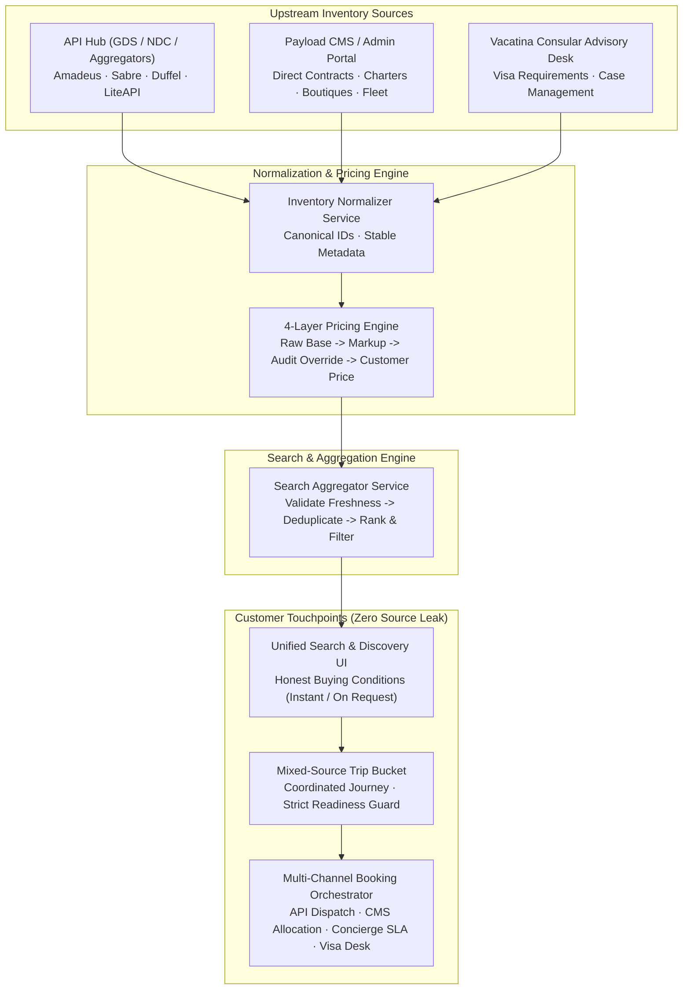
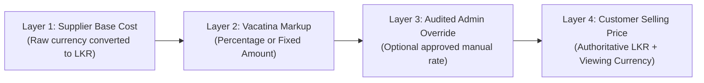
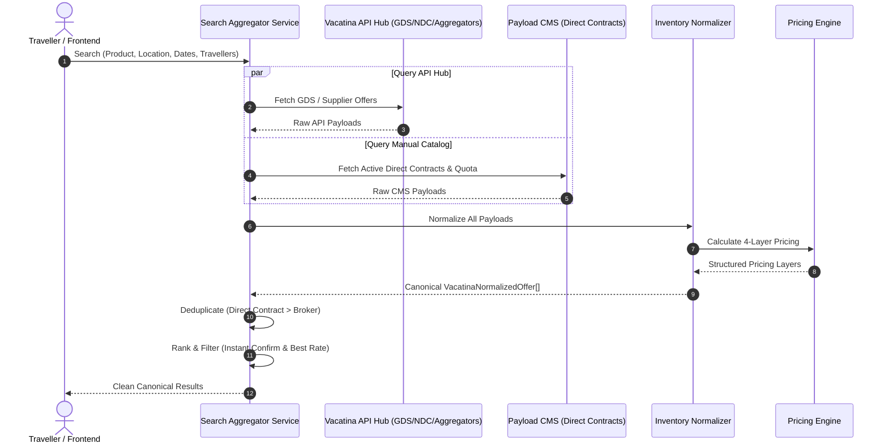
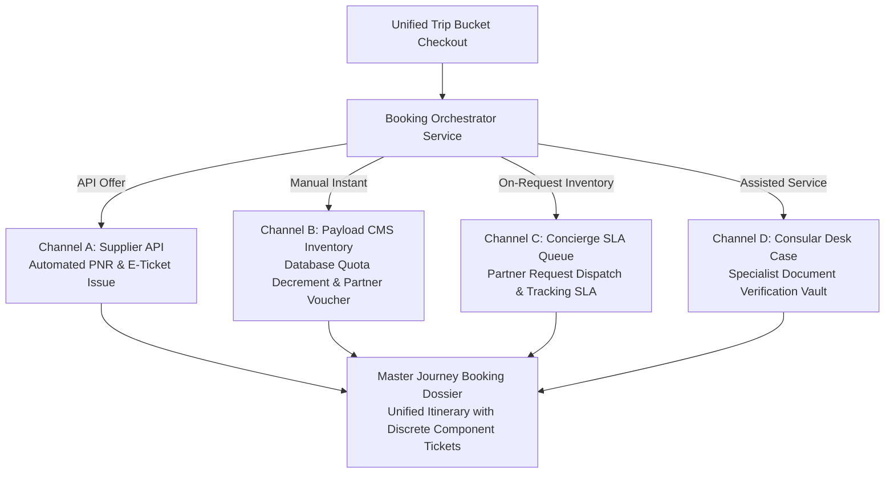

# Vacatina — Hybrid Inventory Strategy & Canonical Offer Architecture v1.0

> **Authority**: Vacatina Master Architecture Specification  
> **Status**: APPROVED & CANONICAL ARCHITECTURE  
> **Target Production Stack**: Nest.js API Hub + PostgreSQL / Drizzle ORM + Payload CMS Admin + Multi-Channel Booking Orchestrator  

---

## 1. Executive Summary & Inventory Model

Vacatina is **not** an API-only travel platform. 

A central commercial requirement of Vacatina is the **Hybrid Inventory Strategy**, enabling three canonical inventory sources to seamlessly coexist in the same discovery ecosystem, the same Search Command Center, and within a single unified **Trip Bucket** journey:

1. **`API` Inventory**: Dynamic inventory ingested in real-time or cached through Vacatina's internal API Hub from Global Distribution Systems (GDS) and aggregators (e.g., Amadeus, Sabre, Duffel NDC, LiteAPI, Hotelbeds).
2. **`MANUAL` Inventory**: Exclusive direct-contract and service inventory curated by Vacatina administrators via Payload CMS / Admin portal. This includes charter flights, contracted boutique resorts, curated holiday packages, private local chauffeur fleets, heritage tours, niche cruises, and consular visa assistance services.
3. **`HYBRID` Inventory**: Composite offerings that combine API and Manual components into a single coordinated product (e.g. a dynamic holiday package uniting an API scheduled flight with a direct-contract boutique overwater villa and private airport transfer).



---

## 2. Canonical Offer Model (`VacatinaNormalizedOffer`)

All inventory sources normalize into one universal Vacatina Offer structure before reaching customer-facing search results or the Trip Bucket.

```typescript
export interface VacatinaNormalizedOffer {
  offerId: string;                          // Stable canonical ID (e.g. 'vct-fl-amadeus-cmb-dxb-001')
  productType: TravelProductSlug;           // 'flights' | 'hotels' | 'visa' | 'packages' | 'cars' | ...
  sourceType: InventorySourceType;         // 'API' | 'MANUAL' | 'HYBRID'
  supplierId: string;                       // Supplier identifier ('AMADEUS', 'PAYLOAD_CMS', etc.)
  supplierName: string;                     // Human-readable supplier name
  supplierOfferId?: string;                 // Upstream GDS/API identifier
  manualListingId?: string;                 // Payload CMS document/listing ID
  title: string;                            // Canonical product title
  subtitle: string;                         // Secondary classification / itinerary hint
  location: StructuredLocation;             // City, country, IATA code, station code
  configurationRequirements: ConfigurationRequirements; // Dates, passengers, passport, room
  availabilityStatus: AvailabilityState;   // LIVE, CACHED, MANUAL_AVAILABLE, ON_REQUEST, ...
  confirmationMode: ConfirmationMode;       // INSTANT_CONFIRM, REQUEST_TO_CONFIRM, ASSISTED_SERVICE
  pricing: PricingLayers;                   // 4-Layer separate pricing structure
  freshness: PriceFreshness;                // Last checked, TTL seconds, expiration ISO
  cancellationTermsReference: string;       // Cancellation policy summary
  inclusions: string[];                     // Audited list of inclusions
  exclusions: string[];                     // Explicit exclusions
  sourceMetadata: Record<string, unknown>;  // Upstream metadata for revalidation
  revalidationCapability: {
    canRevalidateOnline: boolean;
    requiresSupplierPing: boolean;
    lastRevalidationResult?: 'UNCHANGED' | 'PRICE_CHANGED' | 'UNAVAILABLE';
  };
  fulfillmentRouting: BookingFulfillmentRouting; // Target booking workflow
}
```

> [!IMPORTANT]
> **No Display-Text Identifiers**: Never use display strings such as `"Dubai"` or `"London Deluxe Room"` as primary backend keys. Every offer has an immutable, machine-readable `offerId`.

---

## 3. Confirmation Modes & Customer Buying Conditions

Vacatina separates **internal source provenance** from **customer-facing buying conditions**. Normal B2C users are never subjected to confusing internal flags such as `"API Listing"` or `"Manual CMS Entry"`. Instead, travellers see the actual commercial buying condition:

| Confirmation Mode | Primary Use Cases | Customer-Facing Buying Condition | Booking Commitment |
| :--- | :--- | :--- | :--- |
| **`INSTANT_CONFIRM`** | GDS scheduled flights with live PNR, API hotels with instant block, Payload CMS manual inventory with active quota | **Instant Confirmation** | E-ticket / direct partner voucher issued immediately upon checkout. |
| **`REQUEST_TO_CONFIRM`** | Private aircraft charters, boutique villas on request, private chauffeur long-distance routes, scenic rail observation cars | **Request to Confirm** | Reservation request dispatched to partner desk; confirmed within stated SLA (e.g. 60–120 mins). |
| **`ASSISTED_SERVICE`** | Consular visa assistance, embassy document audits, biometric appointment booking | **Available / Assisted Service** | Case opened with Vacatina Consular Desk; secure bio-page document upload workflow initiated. |

---

## 4. Availability States

The platform enforces 8 technical availability states:

1. **`LIVE`**: Real-time verified from supplier or live CMS quota allocation.
2. **`CACHED`**: Cached from recent search query; requires price and inventory recheck before checkout.
3. **`MANUAL_AVAILABLE`**: Active listing in Payload CMS with confirmed remaining quota within date validity.
4. **`ON_REQUEST`**: Direct contract partner allocation on-demand; requires partner confirmation.
5. **`RECHECK_REQUIRED`**: Fare or tariff expired, or upstream inventory threshold tripped.
6. **`SOLD_OUT`**: Quota depleted (0 remaining).
7. **`UNAVAILABLE`**: Blackout dates, operational restrictions, or provider downtime.
8. **`EXPIRED`**: Booking window or flight departure has passed.

---

## 5. 4-Layer Pricing Architecture

A core invariant of the Vacatina commercial framework: **NEVER overwrite or destroy original supplier raw pricing**.



### Layer Details:
1. **Layer 1: Supplier Base Cost**  
   - `supplierRawBasePrice`: Original supplier cost in `supplierBaseCurrency` (e.g. USD 250.00).
   - `exchangeRateToBase`: Canonical currency rate to LKR.
   - `supplierBasePriceLkr`: Authoritative LKR cost (`supplierRawBasePrice * rate`).
2. **Layer 2: Vacatina Commercial Markup**  
   - Percentage (e.g. 6.5% on flights, 12% on hotels) or Fixed Amount (e.g. LKR 8,000 on transfers).
   - `vacatinaMarkup.amountLkr`: Exact calculated margin.
3. **Layer 3: Auditable Administrative Override**  
   - If an administrator adjusts pricing in Payload CMS:
     - `previousValueLkr`: Calculated price before override.
     - `newValueLkr`: Approved manual selling price.
     - `varianceLkr`: Difference in LKR.
     - `overrideReason`: Documented business rationale (e.g., `"Seasonal Promotional Campaign"`, `"Corporate Client Negotiated Rate"`).
     - `authorizedByUserId` & `authorizedByName`: Administrator ID.
     - `timestampIso`: Immutable audit timestamp.
4. **Layer 4: Customer Selling Price**  
   - `customerSellingPriceLkr`: Final authoritative price charged to traveller.
   - `customerSellingPriceDisplay`: Cleanly converted into user's active viewing currency (e.g. USD, EUR, AED).

> [!CAUTION]
> **B2C Transparency Firewall**: Internal supplier cost, exchange rate spread, and markup percentage are never exposed to travellers. B2C interfaces only display the final customer selling price and required tax/fee disclosures.

---

## 6. Search Aggregation & Deduplication Pipeline



### Deduplication Strategy:
When the same property or route appears through both a GDS/aggregator and a direct manual contract:
- **Direct Manual Contract Priority**: Vacatina prioritizes direct contracts over third-party brokers because direct contracts offer guaranteed accountability, lower supplier fees, and protected margins.
- **Price Match Optimization**: If both sources are of the same type, the platform presents the offer with the lower verified customer selling price.

---

## 7. Product Source Mapping

| Product | Primary Source | Secondary / Manual Role | Confirmation Profile |
| :--- | :--- | :--- | :--- |
| **Flights** | `API` (Duffel NDC, Amadeus GDS) | `MANUAL` Charter flights, AirTaxi floatplanes, group allocations | Instant for GDS; Request-to-confirm for charter |
| **Hotels** | `API` (LiteAPI, Hotelbeds) | `MANUAL` Contracted boutique resorts, eco-lodges, private villas | Instant for live blocks; Request for villas |
| **Visa Assistance** | `MANUAL` (Vacatina Consular Desk) | N/A (Never fake a live immigration authority API) | Assisted Service Case |
| **Holiday Packages** | `HYBRID` & `MANUAL` | Curated multi-day journeys + dynamic bundles (API flight + manual boutique stay) | Request-to-confirm / Instant |
| **Cars & Transfers** | `HYBRID` | API airport transfers + Vacatina dedicated private chauffeur fleet | Instant for airport; Request for 7-day chauffeur tours |
| **Rails** | `HYBRID` | Station-to-station API (Eurostar) + scenic observation rail (Swiss Glacier Express, Sri Lanka Blue Train) | Instant for Eurostar; Request for scenic observation class |
| **Cruises** | `HYBRID` | Major cruise line GDS broker + niche luxury expedition yachts | Request / Instant depending on stateroom lock |
| **Activities** | `HYBRID` | Supplier API activities + direct contracted safari and dive operators | Instant confirmation |
| **Sightseeing Tours**| `MANUAL` | Direct contracted licensed heritage guides and skip-the-line monument entries | Instant confirmation |
| **Travel Insurance** | `API` | Underwritten policy comparison via partner insurer API | Instant confirmation (Policy certificate issued) |

---

## 8. Mixed-Source Trip Bucket Architecture

A core strength of Vacatina is that a single Trip Bucket journey can hold items from any inventory source:

```
Example Coordinated Basket:
├── Item 1: Colombo -> London Flight [API · Amadeus · Instant Confirm]
├── Item 2: London Boutique Hotel     [MANUAL · Direct Contract · Instant Confirm]
├── Item 3: UK Visa Assistance       [MANUAL · Consular Desk · Assisted Service]
├── Item 4: Airport Luxury Transfer   [MANUAL · Dedicated Fleet · Instant Confirm]
└── Item 5: Thames River Dinner Cruise [API · Experiences Broker · Instant Confirm]
```

### Strict Readiness Invariants:
1. **Financial Rule**: ONLY items with `state === 'ready'` contribute to `readySubtotalLkr`.
2. **On-Request Guard**: Items with `confirmationMode === 'REQUEST_TO_CONFIRM'` **CANNOT** silently transition to `ready`. They remain in `needs_action` or `recheck_required` until partner allocation is explicitly confirmed.
3. **Assisted Service Staging**: Visa items remain in `needs_action` until required applicant details and passport copies are submitted for review.

---

## 9. Multi-Channel Booking Orchestration

Vacatina does **not** simulate a single monolithic API booking call for the entire basket. When a customer checks out, the booking engine partitions the items into discrete fulfillment channels:



---

## 10. Backend Integration Boundary (Nest.js & Payload CMS)

The contracts created in this architecture form the stable foundation for backend implementation:

- **Frontend Contracts**: Zero dependency on proprietary Amadeus/Sabre/LiteAPI XML/JSON formats. All UI components interact strictly with `VacatinaNormalizedOffer`.
- **API Hub (Nest.js)**: Responsible for ingesting third-party suppliers, translating to `VacatinaNormalizedOffer`, and providing endpoints for search and revalidation.
- **Payload CMS**: Provides the headless admin UI for managing direct contracts, blackout dates, charter quotas, manual pricing overrides, and consular visa case statuses.
- **PostgreSQL / Drizzle ORM**: Persists Trip Bucket items, pricing layer audits, booking dossiers, and customer traveler profiles.

---

## 11. Implemented Architecture Files

| File | Purpose |
| :--- | :--- |
| [`src/lib/domain/inventory-models.ts`](file:///C:/Users/Madhusanka/.gemini/antigravity/scratch/vacatina/src/lib/domain/inventory-models.ts) | Core types: `InventorySourceType`, `ConfirmationMode`, `AvailabilityState`, `PricingLayers`, `VacatinaNormalizedOffer`, `BookingFulfillmentRouting`. |
| [`src/lib/services/pricing-engine.service.ts`](file:///C:/Users/Madhusanka/.gemini/antigravity/scratch/vacatina/src/lib/services/pricing-engine.service.ts) | 4-layer pricing engine with raw supplier cost preservation, percentage/fixed markups, currency conversion, and audited overrides. |
| [`src/lib/services/inventory-normalizer.service.ts`](file:///C:/Users/Madhusanka/.gemini/antigravity/scratch/vacatina/src/lib/services/inventory-normalizer.service.ts) | Normalization service transforming API payloads, Payload CMS entries, and hybrid bundles into canonical offers. |
| [`src/lib/mock-data/hybrid-catalog.ts`](file:///C:/Users/Madhusanka/.gemini/antigravity/scratch/vacatina/src/lib/mock-data/hybrid-catalog.ts) | Seed catalog demonstrating all 10 products across API, MANUAL, and HYBRID inventory. |
| [`src/lib/services/search-aggregator.service.ts`](file:///C:/Users/Madhusanka/.gemini/antigravity/scratch/vacatina/src/lib/services/search-aggregator.service.ts) | Search aggregation engine with multi-source querying, deduplication, and ranking. |
| [`src/lib/services/booking-orchestrator.service.ts`](file:///C:/Users/Madhusanka/.gemini/antigravity/scratch/vacatina/src/lib/services/booking-orchestrator.service.ts) | Multi-channel booking orchestrator dispatching to API, CMS inventory, concierge on-request, and visa desk. |
| [`src/lib/services/trip-bucket.service.ts`](file:///C:/Users/Madhusanka/.gemini/antigravity/scratch/vacatina/src/lib/services/trip-bucket.service.ts) | Updated candidate engine supporting normalized offers, mixed-source baskets, and on-request readiness guards. |
| [`src/lib/adapters/supplier-adapters.ts`](file:///C:/Users/Madhusanka/.gemini/antigravity/scratch/vacatina/src/lib/adapters/supplier-adapters.ts) | Updated supplier adapter registry with explicit `inventorySourceMode` flags. |
