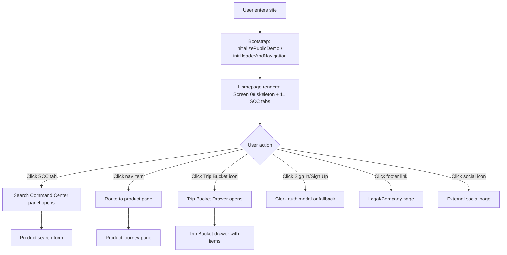
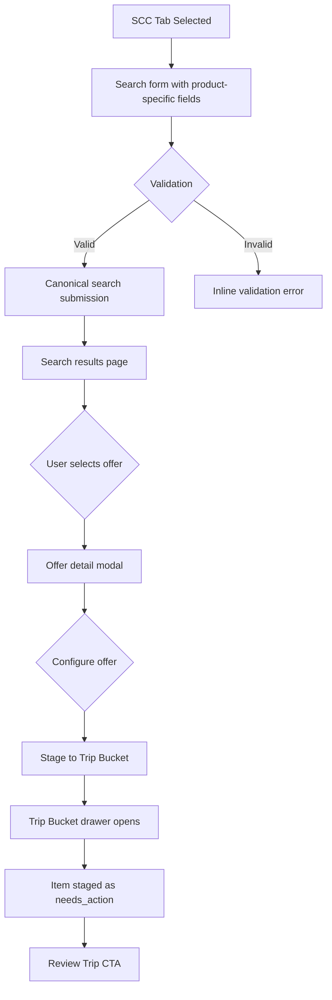
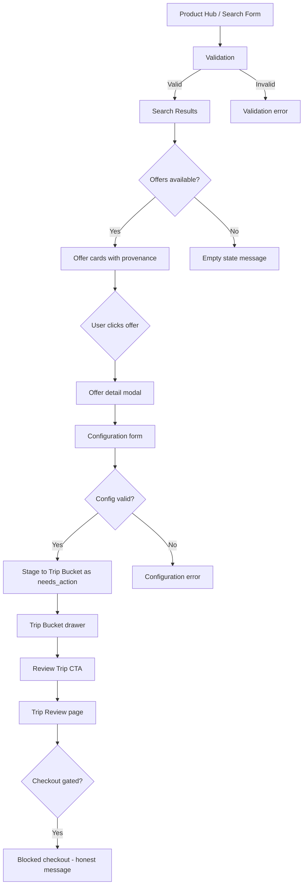
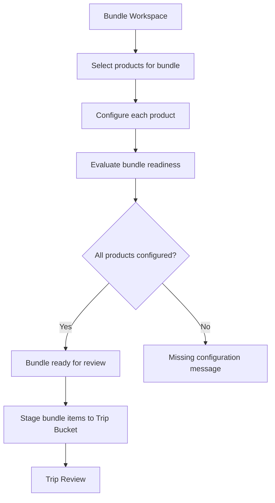
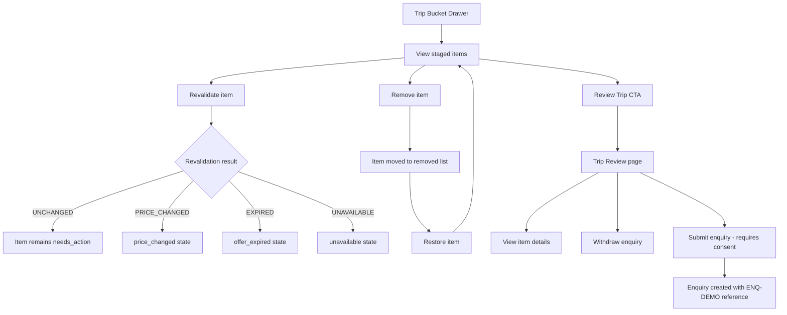
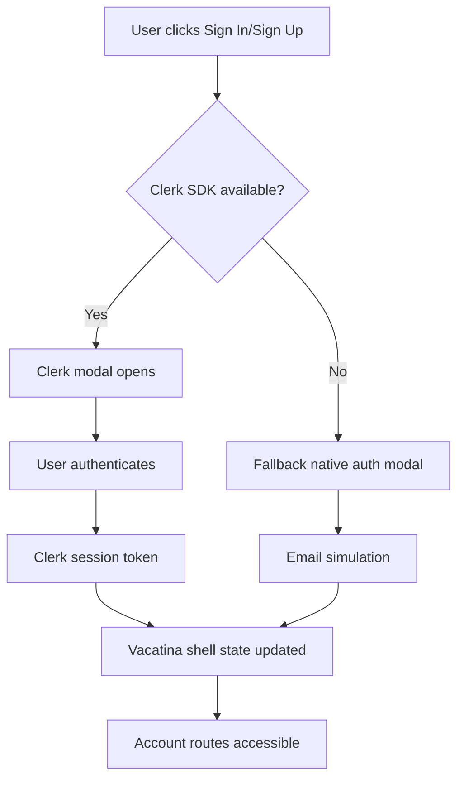
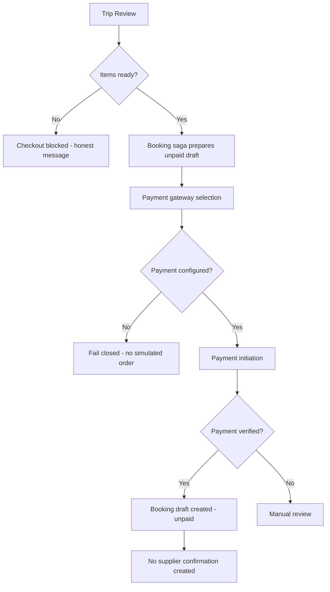
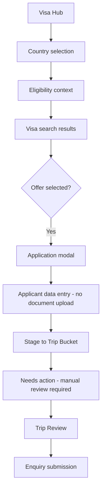
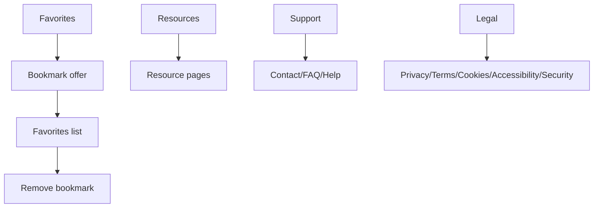
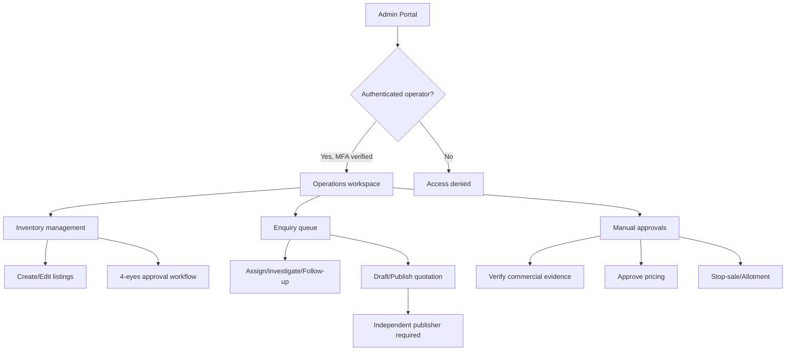

# Phase 18 — UX Flow Architecture and Click-to-Destination Inventory

## Purpose

This document maps the actual Vacatina user journey architecture. It is derived from direct source-code inspection of `release/b2c-product-journeys-v1` at commit `c0cf924`.

Every capability is classified as:

- `IMPLEMENTED_AND_VERIFIED` — code exists, tests pass, browser verified
- `IMPLEMENTED_NOT_VERIFIED` — code exists, tests may exist, not browser-verified
- `PARTIALLY_IMPLEMENTED` — code partially exists, incomplete
- `NOT_IMPLEMENTED` — no code exists
- `EXTERNAL_DEPENDENCY_REQUIRED` — requires external service/credential not available

---

## A. Global Navigation and Homepage

### Flow: Entry → Homepage → Navigation

### Capabilities

| Capability | Status | Evidence | Missing Work |
|---|---|---|---|
| Homepage renders (Screen 08 skeleton) | IMPLEMENTED_AND_VERIFIED | browser-verify.mjs Journey A | None |
| 11 SCC tabs (bundle, flights, hotels, visa, packages, cars, rails, cruises, activities, sightseeing, insurance) | IMPLEMENTED_AND_VERIFIED | unit.test.ts "exactly 10 Travel Products and 11 SCC Tabs" | None |
| Tab switching with roving tabindex | IMPLEMENTED_AND_VERIFIED | browser-verify.mjs Journey K | None |
| Mobile hamburger navigation | IMPLEMENTED_AND_VERIFIED | browser-verify.mjs P0 #2 | None |
| Locale (EN/SI/TA) and currency (LKR/USD) switching | IMPLEMENTED_AND_VERIFIED | browser-verify.mjs Journey I | None |
| Trip Bucket drawer open/close | IMPLEMENTED_AND_VERIFIED | browser-verify.mjs Journey H | None |
| Scroll-aware Trip dock hide/show | IMPLEMENTED_AND_VERIFIED | browser-verify.mjs Journey L | None |
| Legal/Cookie modals | IMPLEMENTED_AND_VERIFIED | browser-verify.mjs Delta Audit | None |
| Footer social links | IMPLEMENTED_AND_VERIFIED | browser-verify.mjs Delta Audit | None |
| Newsletter subscription | IMPLEMENTED_AND_VERIFIED | macro-stages.ts initNewsletterSubscription | None (local storage only) |
| Clerk auth SDK loading | IMPLEMENTED_NOT_VERIFIED | clerk-auth.service.ts | Fresh isolated credentials not available |
| SEO/Open Graph/JSON-LD | IMPLEMENTED_AND_VERIFIED | browser-verify.mjs Delta Audit | None |
| Cookie preferences | IMPLEMENTED_AND_VERIFIED | unit.test.ts | None |

---

## B. All 11 Search Command Center Tabs

### Flow: SCC Tab → Search → Results → Details → Trip Bucket

### Capabilities by Tab

| Tab | Product | Status | Evidence | Missing Work |
|---|---|---|---|---|
| Bundle | Build Your Bundle | IMPLEMENTED_AND_VERIFIED | browser-verify.mjs Journey C | None |
| Flights | Flights | IMPLEMENTED_AND_VERIFIED | browser-verify.mjs Journey M, Phase 5 gates | None |
| Hotels | Hotels | IMPLEMENTED_AND_VERIFIED | browser-verify.mjs Journey N, Phase 6 gates | None |
| Visa | Visa Assistance | IMPLEMENTED_AND_VERIFIED | browser-verify.mjs Journey O, Phase 7 gates | None |
| Packages | Holiday Packages | IMPLEMENTED_AND_VERIFIED | browser-verify.mjs Phase 8 | None |
| Cars | Cars & Transfers | IMPLEMENTED_AND_VERIFIED | browser-verify.mjs Phase 9 | None |
| Rails | Rail Journeys | IMPLEMENTED_AND_VERIFIED | browser-verify.mjs Phase 12 | None |
| Cruises | Cruises & Sea Voyages | IMPLEMENTED_AND_VERIFIED | browser-verify.mjs Phase 13 | None |
| Activities | Activities | IMPLEMENTED_AND_VERIFIED | browser-verify.mjs Phase 10 | None |
| Sightseeing | Sightseeing Tours | IMPLEMENTED_AND_VERIFIED | browser-verify.mjs Phase 11 | None |
| Insurance | Travel Insurance | IMPLEMENTED_AND_VERIFIED | browser-verify.mjs Phase 14 | None |

---

## C. All 10 Individual Product Journeys

### Common Flow Pattern

### Product-Specific Status

| Product | Hub | Search | Results | Details | Config | Stage | Review | Checkout Gate | Status |
|---|---|---|---|---|---|---|---|---|---|
| Flights | ✅ | ✅ | ✅ | ✅ | ✅ | ✅ | ✅ | ✅ | IMPLEMENTED_AND_VERIFIED |
| Hotels | ✅ | ✅ | ✅ | ✅ | ✅ | ✅ | ✅ | ✅ | IMPLEMENTED_AND_VERIFIED |
| Visa | ✅ | ✅ | ✅ | ✅ | ✅ | ✅ | ✅ | ✅ | IMPLEMENTED_AND_VERIFIED |
| Packages | ✅ | ✅ | ✅ | ✅ | ✅ | ✅ | ✅ | ✅ | IMPLEMENTED_AND_VERIFIED |
| Cars | ✅ | ✅ | ✅ | ✅ | ✅ | ✅ | ✅ | ✅ | IMPLEMENTED_AND_VERIFIED |
| Activities | ✅ | ✅ | ✅ | ✅ | ✅ | ✅ | ✅ | ✅ | IMPLEMENTED_AND_VERIFIED |
| Sightseeing | ✅ | ✅ | ✅ | ✅ | ✅ | ✅ | ✅ | ✅ | IMPLEMENTED_AND_VERIFIED |
| Rails | ✅ | ✅ | ✅ | ✅ | ✅ | ✅ | ✅ | ✅ | IMPLEMENTED_AND_VERIFIED |
| Cruises | ✅ | ✅ | ✅ | ✅ | ✅ | ✅ | ✅ | ✅ | IMPLEMENTED_AND_VERIFIED |
| Insurance | ✅ | ✅ | ✅ | ✅ | ✅ | ✅ | ✅ | ✅ | IMPLEMENTED_AND_VERIFIED |

All product journeys use canonical offers with source provenance, honest disclosure, and no fabricated prices or availability. All staging produces `needs_action` state (never `ready` without revalidation).

---

## D. Build Your Bundle

### Flow

### Capabilities

| Capability | Status | Evidence |
|---|---|---|
| Bundle workspace renders | IMPLEMENTED_AND_VERIFIED | browser-verify.mjs Journey C |
| Product selection for bundle | IMPLEMENTED_AND_VERIFIED | browser-verify.mjs |
| Bundle readiness evaluation | IMPLEMENTED_AND_VERIFIED | unit.test.ts "A bundle is never Ready from mere product presence" |
| Bundle staging to Trip Bucket | IMPLEMENTED_AND_VERIFIED | browser-verify.mjs |
| Bundle handoff to product search | IMPLEMENTED_AND_VERIFIED | product-journey-gates.mjs verifyGlobalIntegration |

---

## E. Trip Bucket and Trip Review

### Flow

### Capabilities

| Capability | Status | Evidence |
|---|---|---|
| 8-state Trip Bucket (ready, needs_action, refreshing_price, price_changed, offer_expired, unavailable, revalidation_failed, cancelled) | IMPLEMENTED_AND_VERIFIED | unit.test.ts "supports all 8 canonical Screen 04 Trip Bucket states" |
| Stage candidate as needs_action | IMPLEMENTED_AND_VERIFIED | All product journey tests |
| Remove/restore with revisions | IMPLEMENTED_AND_VERIFIED | phase18-integration.test.ts |
| Revalidation never promotes demo/manual to ready | IMPLEMENTED_AND_VERIFIED | flights-phase5-journey.test.ts Gate 7 |
| Trip Review renders all items | IMPLEMENTED_AND_VERIFIED | browser-verify.mjs |
| Checkout gating (disabled for unready items) | IMPLEMENTED_AND_VERIFIED | All product journey tests |
| Enquiry submission with consent | IMPLEMENTED_AND_VERIFIED | phase18-integration.test.ts |
| Persistent withdrawal | IMPLEMENTED_AND_VERIFIED | phase18-browser-verify.mjs |

---

## F. Authentication and Customer Accounts

### Flow

### Capabilities

| Capability | Status | Evidence | Missing Work |
|---|---|---|---|
| Clerk SDK integration | IMPLEMENTED_NOT_VERIFIED | clerk-auth.service.ts | Fresh isolated credentials not available (exposed ones unsuitable) |
| Clerk JWT validation | IMPLEMENTED_AND_VERIFIED | unit.test.ts "Clerk JWT validates signature..." | None (unit-level) |
| Guest session (signed, server-created) | IMPLEMENTED_AND_VERIFIED | unit.test.ts "Signed guest identity rejects tampering..." | None |
| Role-based authorization (RBAC) | IMPLEMENTED_AND_VERIFIED | unit.test.ts "Organization admin never acquires platform privileges" | None |
| MFA enforcement for operators | IMPLEMENTED_AND_VERIFIED | unit.test.ts "MFA requires verified second factor" | None |
| Account routes (overview, trips, visa, travelers, preferences, travel-credit) | IMPLEMENTED_NOT_VERIFIED | router.service.ts handleAccountRoute | Clerk auth not available in production |
| Travel Credit ledger | IMPLEMENTED_AND_VERIFIED | travel-credit-ledger.test.ts | None (unit-level) |
| Favorites service | IMPLEMENTED_AND_VERIFIED | unit.test.ts | None |

---

## G. Booking, Payment and Order Management

### Flow

### Capabilities

| Capability | Status | Evidence | Missing Work |
|---|---|---|---|
| Booking saga (unpaid preparation) | IMPLEMENTED_AND_VERIFIED | secure-booking-payments.test.ts | None (unit-level) |
| Payment gateway abstraction (Stripe, PayPal, PayHere) | IMPLEMENTED_AND_VERIFIED | secure-booking-payments.test.ts | Credentials not configured |
| Idempotent payment initiation | IMPLEMENTED_AND_VERIFIED | secure-booking-payments.test.ts | None |
| Price drift handling | IMPLEMENTED_AND_VERIFIED | secure-booking-payments.test.ts | None |
| Payment verification (trusted verifier) | IMPLEMENTED_AND_VERIFIED | secure-booking-payments.test.ts | None |
| Cancellation and refund | IMPLEMENTED_AND_VERIFIED | secure-booking-payments.test.ts | None |
| Travel Credit drawdown | IMPLEMENTED_AND_VERIFIED | travel-credit-ledger.test.ts | None |
| Supplier confirmation | NOT_IMPLEMENTED | N/A | Requires live supplier credentials and authorization |
| Duffel sandbox test orders | IMPLEMENTED_AND_VERIFIED | duffel-sandbox-phase16.test.ts | Requires Duffel test credentials |

---

## H. Visa Applications and Tracking

### Flow

### Capabilities

| Capability | Status | Evidence |
|---|---|---|
| Visa hub with country selection | IMPLEMENTED_AND_VERIFIED | browser-verify.mjs Journey O |
| Eligibility context validation | IMPLEMENTED_AND_VERIFIED | visa-phase7-journey.test.ts |
| Document checklist (no upload) | IMPLEMENTED_AND_VERIFIED | browser-verify.mjs "no uploads" |
| Visa staging as needs_action | IMPLEMENTED_AND_VERIFIED | visa-phase7-journey.test.ts |
| No fabricated visa approval | IMPLEMENTED_AND_VERIFIED | unit.test.ts Phase 14 |
| Consular desk queue | IMPLEMENTED_NOT_VERIFIED | customer-routes.ts | Requires operator auth |

---

## I. Favorites, Resources and Support

### Flow

### Capabilities

| Capability | Status | Evidence |
|---|---|---|
| Saved Favorites (isolated from Trip Bucket) | IMPLEMENTED_AND_VERIFIED | unit.test.ts "keeps Saved Favorites strictly isolated" |
| Favorites toggle service | IMPLEMENTED_AND_VERIFIED | hotels-phase6-journey.test.ts |
| Resource pages | IMPLEMENTED_NOT_VERIFIED | router.service.ts handleResourcesRoute | Content exists, not browser-tested |
| Support/Contact/FAQ | IMPLEMENTED_NOT_VERIFIED | router.service.ts handleSupportRoute | Content exists, not browser-tested |
| Legal pages | IMPLEMENTED_AND_VERIFIED | browser-verify.mjs Delta Audit |

---

## J. Admin and B2B Journeys

### Flow (Separate Application Domain)

### Capabilities

| Capability | Status | Evidence | Missing Work |
|---|---|---|---|
| Admin inventory CMS | IMPLEMENTED_AND_VERIFIED | admin-inventory-api.test.ts | None (unit-level) |
| 4-eyes approval workflow | IMPLEMENTED_AND_VERIFIED | admin-inventory-api.test.ts Gate 4 | None |
| Enquiry queue (tenant-scoped) | IMPLEMENTED_AND_VERIFIED | phase18-integration.test.ts | None (unit-level) |
| Quotation lifecycle (draft/publish/acknowledge) | IMPLEMENTED_AND_VERIFIED | phase18-integration.test.ts | None (unit-level) |
| Independent quote publication | IMPLEMENTED_AND_VERIFIED | phase18-integration.test.ts | None |
| Operator MFA enforcement | IMPLEMENTED_AND_VERIFIED | phase18-integration.test.ts | None |
| B2B partner portal | IMPLEMENTED_NOT_VERIFIED | router.service.ts openPartnerPortalModal | Not browser-tested |
| Admin browser UI | IMPLEMENTED_NOT_VERIFIED | admin-workspace.ts | Requires Clerk auth (not available) |

---

## Implementation Status Summary

### IMPLEMENTED_AND_VERIFIED (with evidence)

1. Homepage with 11 SCC tabs (browser-verify.mjs Journey A)
2. All 10 product journeys with search, results, details, config, staging (browser-verify.mjs Journeys M-O, Phase 5-14 gates)
3. Build Your Bundle (browser-verify.mjs Journey C)
4. Trip Bucket 8-state engine (unit.test.ts)
5. Trip Review with checkout gating (browser-verify.mjs)
6. Enquiry submission with consent and idempotency (phase18-integration.test.ts)
7. Remove/restore with revisions (phase18-integration.test.ts)
8. Customer → operator → publisher → customer flow (phase18-browser-verify.mjs)
9. Independent quote publication (phase18-integration.test.ts)
10. Quotation acknowledgement and expiry (phase18-integration.test.ts)
11. Owner/tenant isolation (phase18-integration.test.ts)
12. Operator MFA enforcement (phase18-integration.test.ts)
13. Search cache fingerprinting (phase18-integration.test.ts)
14. LiteAPI failure handling (phase18-integration.test.ts)
15. Duffel sandbox test orders (duffel-sandbox-phase16.test.ts)
16. Duffel stable intent recovery (duffel-sandbox-phase16.test.ts)
17. Admin inventory CMS with 4-eyes (admin-inventory-api.test.ts)
18. Payment gateway abstraction (secure-booking-payments.test.ts)
19. Travel Credit ledger (travel-credit-ledger.test.ts)
20. Favorites service (unit.test.ts)
21. Legal/cookie modals (browser-verify.mjs)
22. Mobile navigation (browser-verify.mjs)
23. Locale/currency switching (browser-verify.mjs)
24. Scroll-aware Trip dock (browser-verify.mjs)
25. Public demo build with safety gates (phase18-browser-verify.mjs)
26. Local file persistence with atomic writes (phase18-integration.test.ts)
27. File retry for transient EPERM/EBUSY (phase18-integration.test.ts)
28. Real adapter shape preservation (phase18-integration.test.ts)

### IMPLEMENTED_NOT_VERIFIED (code exists, not browser-verified or not hosted-verified)

1. Clerk authentication (code exists, credentials exposed, not available for hosted testing)
2. Account routes (code exists, not browser-tested)
3. B2B partner portal (code exists, not browser-tested)
4. Resource/Support pages (code exists, not browser-tested)
5. Consular desk queue (code exists, not browser-tested)
6. Travel Credit modal (code exists, not browser-tested in deployed environment)

### PARTIALLY_IMPLEMENTED

1. Duffel stable intent recovery — upstream reconciliation not implemented
2. A6 scenario/catalog breadth — two synthetic options per product tested, default catalogs not expanded
3. Actual browser-adapter planning projections — unit-tested for flight/hotel shapes, but not exhaustively browser-tested with all product configurations

### NOT_IMPLEMENTED

1. Supplier-confirmed bookings (requires live supplier credentials and authorization)
2. Real payment processing (requires payment gateway credentials)
3. Real notification sending (no sending worker activated)
4. Real document uploads (no upload service activated)
5. PostgreSQL persistence (no database provisioned)
6. Hosted authentication (no fresh isolated identity)

### EXTERNAL_DEPENDENCY_REQUIRED

1. PostgreSQL database (DATABASE_URL) — for durable persistence
2. Fresh Clerk credentials — for hosted authentication
3. Duffel API credentials — for real flight search
4. LiteAPI credentials — for real hotel search
5. Payment gateway credentials (Stripe, PayPal, PayHere) — for real payments
6. Backend readiness approval (writesEnabled, migrationApproved, clerkRotationConfirmed) — for production persistence
7. GitHub Pro plan (optional) — for environment-level secrets/variables on private repos
8. Vercel Pro plan (optional) — for commercial usage compliance

---

## Proposed UI/UX Screen Sequence for Owner Review

### Phase A — Core Discovery (Implemented)
1. Homepage with 11-tab SCC
2. Product hub pages (search forms)
3. Search results with canonical offers
4. Offer detail modals
5. Configuration forms

### Phase B — Trip Planning (Implemented)
6. Trip Bucket drawer (8 states)
7. Trip Review page
8. Enquiry submission
9. Request tracking (/requests)

### Phase C — Operations (Implemented locally, not hosted)
10. Operator enquiry queue
11. Assignment and investigation
12. Manual follow-up recording
13. Quotation drafting and independent publication
14. Customer acknowledgement

### Phase D — Account and Commercial (Partially Implemented)
15. Account overview (requires Clerk auth)
16. My Trips (requires booking data)
17. Travel Credit (requires payment data)
18. Favorites (implemented, not browser-tested deployed)

### Phase E — Admin (Implemented locally, not hosted)
19. Inventory CMS (requires operator auth)
20. 4-eyes approval workflow
21. Audit history
22. Stop-sale and allotment management

### Phase F — External Dependencies (Not Available)
23. Real supplier search (requires API credentials)
24. Real booking confirmation (requires supplier integration)
25. Real payment processing (requires gateway credentials)
26. Real notification sending (requires email/SMS service)
7. Real document uploads (requires file storage service)

---

## Missing Requirements Summary

### Infrastructure
- PostgreSQL database with provisioned schema and migration execution
- Fresh isolated Clerk identity provider (not the exposed credentials)
- Backend readiness approval (three explicit approvals)
- Supplier API credentials (Duffel, LiteAPI, Viator, Trainline, etc.)
- Payment gateway credentials (Stripe, PayPal, PayHere)
- Email/SMS notification service
- File storage service for document uploads

### Code Gaps
- Production-capable API handler (current is development-only)
- Production persistence adapter (current is file-based, loopback-only)
- Hosted authentication (current uses exposed Clerk credentials)
- Real supplier integration (current uses demo fixtures)
- Real payment processing (current uses test verifiers)
- Notification sending worker (current only queues PENDING commands)
- Document upload service (not implemented)

### UX Gaps
- Account routes not browser-tested in deployed environment
- B2B partner portal not browser-tested
- Resource/Support pages not browser-tested
- Consular desk queue not browser-tested
- Travel Credit modal not browser-tested in deployed environment
- Full accessibility audit not performed
- Comprehensive human UAT not performed

---

## Conclusion

The Vacatina application has a comprehensive frontend implementation with all 10 product journeys, 11 SCC tabs, Build Your Bundle, Trip Bucket (8 states), Trip Review, and a non-commercial enquiry/operations system. The frontend is deployed and functional for UI/UX testing. However, the actual backend is not operational on Vercel — it requires a PostgreSQL database, fresh authentication credentials, backend readiness approval, and supplier/payment credentials that are not available. The application is NOT production-ready and should not be treated as a customer-facing service. All commercial capabilities (bookings, payments, supplier orders, document uploads, notification sending) are disabled. The local development server (`npm run dev`) provides the full backend functionality for development and testing purposes.