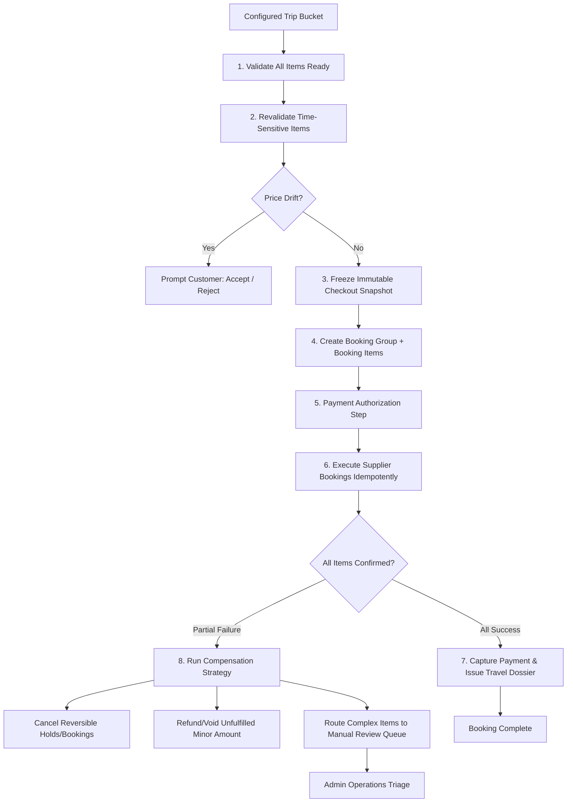

# ADR-005: Distributed Booking Saga & Compensation Orchestration

> **Status**: APPROVED & ADOPTED  
> **Date**: 2026-10-25  
> **Context**: Coordinating multi-product travel checkout across heterogeneous suppliers with partial failure handling.

---

## 1. Context & Problem Statement
A Vacatina customer bundle can contain flights (Duffel NDC), boutique hotels (LiteAPI), consular visa assistance (manual/advisory desk), and airport chauffeur transfers (direct fleet). Unlike simple e-commerce retail, a multi-product travel checkout cannot be wrapped in a single database transaction:
1. Different suppliers have different settlement lifecycles (some allow pre-payment holds; others require instant settlement).
2. A supplier API can time out or return out-of-stock after payment authorization.
3. If a flight succeeds but the hotel fails, blindly failing the entire transaction leaves the customer with an un-ticketed flight or dangling charges.

## 2. Decision
We implement a **Distributed Booking Saga Orchestrator** with independent per-item fulfillment and automated compensation:

### 2.1 Decoupled State Machines
The **Trip Bucket State Machine** and **Booking Fulfillment State Machine** are strictly decoupled:
- **Trip Bucket States (8)**: `Draft`, `Needs Action`, `Ready`, `Refreshing Price`, `Price Changed`, `Recheck Required`, `Offer Expired`, `Unavailable`.
- **Booking Fulfillment States (9)**: `pending_revalidation` $\rightarrow$ `booking` $\rightarrow$ `confirmed` | `partial_failure` | `failed` $\rightarrow$ `cancel_pending` $\rightarrow$ `cancelled` $\rightarrow$ `refund_pending` $\rightarrow$ `refunded` $\rightarrow$ `manual_review`.

### 2.2 Saga Execution Flow

### 2.3 Idempotency & Fault Tolerance
- Every supplier dispatch command carries an immutable `idempotency_key`.
- In the event of network timeouts, the orchestrator queries supplier status before attempting any retry. Blind retries are strictly forbidden.

## 3. Consequences
- Resilient multi-product booking experience.
- Partial failures produce clear status per item rather than customer confusion or ghost charges.
