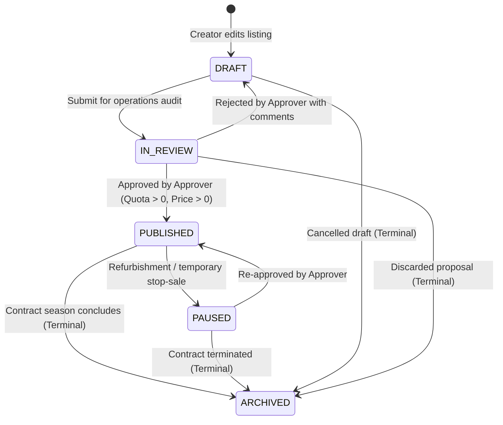

# ADR-008: Universal Canonical Offer Contract v2.0, Manual Listing Lifecycle Governance, B2C/B2B Distribution Scope & Provider Certification Gates

**Status**: APPROVED  
**Date**: 2026-10-25  
**Deciders**: Vacatina Chief Architect, Senior Platform Engineer, Commercial Operations Lead, B2B Distribution Director  
**Cross-References**: ADR-001 through ADR-007, `docs/12_UNIFIED_INVENTORY_AND_SUPPLIER_ARCHITECTURE.md`, `docs/13_SUPPLIER_INTEGRATION_READINESS_MATRIX.md`, `docs/14_CANONICAL_INVENTORY_TAXONOMY_AND_ADMIN_CMS_SCHEMA.md`

---

## 1. Context & Architectural Challenge

Following the ratification of [ADR-007](file:///C:/Users/Madhusanka/.gemini/antigravity/scratch/vacatina/docs/adr/ADR-007-orthogonal-inventory-dimensions-and-truthful-provider-matrix.md), which separated inventory into seven orthogonal dimensions (`inventorySource`, `listingKind`, `compositionType`, `fulfillmentMode`, `environmentClass`, `sellability`, `providerLifecycle`), technical review identified six remaining operational and commercial invariants necessary for a production-grade travel platform:

1. **Manual Listing Lifecycle Formalization**: A manual or direct contract listing cannot be treated as a single binary database record. It requires an auditable state machine (`DRAFT` ➔ `IN_REVIEW` ➔ `PUBLISHED` ➔ `PAUSED` ➔ `ARCHIVED`), editor vs approver separation, rate validity windows, quota/allotment tracking, and blackout dates.
2. **Direct Contract Fulfillment Truth**: Direct contracts must **not** default to `INSTANT` confirmation. If Vacatina does not possess committed atomic inventory allotment decrement capabilities, the fulfillment mode must truthfully be `ON_REQUEST` or `MANUAL_CONFIRMATION`.
3. **Canonical Offer Contract v2.0**: The universal handshake between backend normalization and consumer touchpoints requires immutable fields including stable IDs, taxes and fees breakdown, booking capabilities, validity bounds, and revalidation flags.
4. **Distribution / Channel Scope**: Vacatina serves both retail B2C consumers and B2B travel agency networks. The inventory layer must support channel isolation (`B2C_ONLY`, `B2B_ONLY`, `BOTH`, `INTERNAL_ONLY`) and separate B2B economics (net wholesale rates, agency markups, commissions, and customer-facing proposal pricing).
5. **System-Derived Customer Badges**: Customer-facing badges (`Live Availability`, `Instant Confirmation`, `Direct Rate`, `Exclusive Direct Deal`, `On Request`, `Vacatina Assisted`) must be programmatically derived from verified system state, never set as arbitrary marketing toggles.
6. **Unified Ranking Invariants**: Search ranking across mixed API, Direct Contract, and Manual inventory must guarantee that SEED data never ranks, unavailable/sold-out manual deals never beat valid live offers, and pinned deals require active publishing, valid dates, and auditable justifications.
7. **Explicit Provider Certification Gates**: Advancing an upstream provider from `PLANNED` to `PRODUCTION_LIVE` requires clearing 12 explicit, auditable engineering gates.

---

## 2. Decisions & Specifications

### Decision 1: Manual Listing Lifecycle State Machine
Manual and direct contract listings are governed by an auditable state machine enforced in `VacatinaStorageEngine.transitionManualListingStatus()`:



- **Publishing Safeguard**: A listing can transition to `PUBLISHED` only when:
  1. `approverUserId` is provided and distinct from the editor.
  2. `contractedNetCostMinor > 0` and `sellingPriceMinor > 0`.
  3. `availableQuota > 0` or `isUnlimitedQuota === true`.
  4. Explicit `cancellationPolicy` and validity dates are present.
- Any listing in `DRAFT`, `IN_REVIEW`, `PAUSED`, or `ARCHIVED` status has `sellability: 'DISCOVERY_ONLY'` and is strictly blocked from live search results and checkout.

### Decision 2: Direct Contract Non-Instant Fallback Rule
`DIRECT_CONTRACT` does **not** default to `INSTANT`.
- If a listing has `availableQuota > 0` AND `canAtomicallyReserve === true` (or `confirmationMode === 'INSTANT_CONFIRM'`), it derives `fulfillmentMode: 'INSTANT'` and `bookingCapability: 'INSTANT_RESERVATION'`.
- If allotment quota is zero, or partner confirmation is required, it strictly derives `fulfillmentMode: 'ON_REQUEST'` and `bookingCapability: 'REQUEST_TO_BOOK'`.
- Consular visa services strictly derive `fulfillmentMode: 'MANUAL_CONFIRMATION'`.

### Decision 3: Universal Canonical Offer Contract v2.0
All inventory sources (API, Direct Contract, Partner Manual, Internal Manual) normalize into the universal `CanonicalOfferEntity`:

```typescript
export interface CanonicalOfferEntity {
  canonicalOfferId: string;
  offerId: string;
  productType: TravelProductSlug;
  providerId: string;
  providerOfferId?: string;

  // 7 Orthogonal Dimensions
  inventorySource: InventorySource;
  listingKind: ListingKind;
  compositionType: CompositionType;
  fulfillmentMode: FulfillmentMode;
  environmentClass: EnvironmentClass;
  sellability: Sellability;
  providerLifecycle: ProviderLifecycle;

  // Publication & Distribution
  publicationStatus: PublicationStatus;
  distributionScope: DistributionScope;
  bookingCapability: BookingCapability;

  // Commercial & Financials
  pricing: PricingLayersEntity;
  taxesAndFees: TaxesAndFeesEntity;
  b2bPricing?: B2BDistributionPricingEntity;

  // Validity & Freshness
  freshness: PriceFreshnessEntity;
  validFrom: string;
  validUntil: string;
  expiresAt: string;
  lastCheckedAt: string;
  requiresRevalidation: boolean;

  // Merchandising & Governance
  inclusions: string[];
  exclusions: string[];
  cancellationPolicy: string;
  pinAboveApi: boolean;
  isExclusiveDeal?: boolean;
  pinAudit?: PinAuditEntity;
  deduplicationKey: string;
  isSandboxSimulated: boolean;
  integrationLifecycle: IntegrationLifecycleStatus;
  sourceMetadata: Record<string, unknown>;
}
```

### Decision 4: Distribution Scope & B2B/B2C Channel Separation
Inventory carries a mandatory `distributionScope`:
- `B2C_ONLY`: Visible exclusively in retail consumer search.
- `B2B_ONLY`: Visible exclusively to authenticated travel agencies and corporate portals.
- `BOTH`: Available in both channels.
- `INTERNAL_ONLY`: Restricted to internal concierge staff.

When queried via B2C, `B2B_ONLY` and `INTERNAL_ONLY` items are filtered out.
When queried via B2B, `B2C_ONLY` items are filtered out.
B2B items expose structured wholesale pricing in `b2bPricing`:
- `b2bNetPriceMinor`: Wholesale cost to agency.
- `agencyMarkupPercent`: Agent margin.
- `agencyCommissionPercent`: Platform commission payout.
- `clientFacingPriceMinor`: Selling price for agency quotation.

### Decision 5: Customer Badges Derived 100% from Verified State
Customer badges are generated by `deriveCustomerBadges(offer)` using deterministic rules:
- `Live Availability`: Strictly when `providerLifecycle === 'PRODUCTION_LIVE' && availabilityStatus === 'LIVE' && !freshness.isStale && environmentClass === 'PRODUCTION'`.
- `Instant Confirmation`: Strictly when `fulfillmentMode === 'INSTANT' && (bookingCapability === 'INSTANT_RESERVATION' || confirmationMode === 'INSTANT_CONFIRM')`.
- `Direct Rate`: Strictly when `inventorySource === 'DIRECT_CONTRACT'`.
- `Exclusive Direct Deal`: Strictly when `inventorySource === 'DIRECT_CONTRACT' && isExclusiveDeal === true && publicationStatus === 'PUBLISHED' && validUntil >= now`.
- `On Request`: Strictly when `fulfillmentMode === 'ON_REQUEST' || bookingCapability === 'REQUEST_TO_BOOK'`.
- `Vacatina Assisted`: Strictly when `inventorySource === 'MANUAL_INTERNAL' || listingKind === 'SERVICE'`.

### Decision 6: Unified Ranking Invariants
1. `SEED` items are filtered out prior to ranking and never appear in live search.
2. Available items rank strictly above sold out or rate-expired items.
3. An unavailable manual deal (`availabilityStatus === 'SOLD_OUT'` or `'RATE_EXPIRED'`) **can never beat a valid live offer**.
4. Pinned manual deals (`pinAboveApi: true`) override rank **only** when:
   - `publicationStatus === 'PUBLISHED'`.
   - `environmentClass === 'PRODUCTION'`.
   - `availabilityStatus !== 'SOLD_OUT'` and `availabilityStatus !== 'RATE_EXPIRED'`.
   - An auditable `pinReason` is provided.
   - Current time falls within `pinValidFrom` and `pinValidUntil`.

### Decision 7: The 12 Provider Certification Gates
Advancing an upstream supplier to `PRODUCTION_LIVE` requires clearing all 12 gates evaluated by `ProviderRegistryService.evaluateCertificationGates()`:
1. `credentialsConfigured`: Live production credentials authenticated.
2. `searchContractVerified`: Query payload mapping and canonical offer normalization verified.
3. `availabilityCheckVerified`: Real-time seat/room allotment confirmed.
4. `pricingIntegrityVerified`: Net cost and 4-layer pricing precedence validated in integer minor units.
5. `revalidationFlowVerified`: Pre-booking price and availability recheck functional.
6. `bookingSagaVerified`: Hold and confirmed ticket/voucher issuance executed.
7. `cancelChangePolicyVerified`: Upstream cancellation and penalty calculation verified.
8. `errorMappingVerified`: RFC 7807 problem details and retryable errors mapped.
9. `idempotencyLedgerVerified`: Idempotency-Key headers and transaction ledger active.
10. `webhooksReconciled`: Asynchronous event webhooks signature verified.
11. `monitoringTelemetryVerified`: Circuit breaker latency and failure telemetry active.
12. `rollbackDisableCapable`: Emergency circuit kill-switch and zero-downtime rollback ready.

---

## 3. Invariant Test Coverage

All rules are verified by automated tests in `tests/unit.test.ts` (**36/36 passing**):
- **Subtest 35**: Manual listing lifecycle transitions, approver validation, direct contract non-instant fallback, and Canonical Offer v2.0 field completeness.
- **Subtest 36**: B2C/B2B distribution scope isolation, state-derived customer badges, ranking tie-breaker invariants, and 12-gate certification evaluation.
