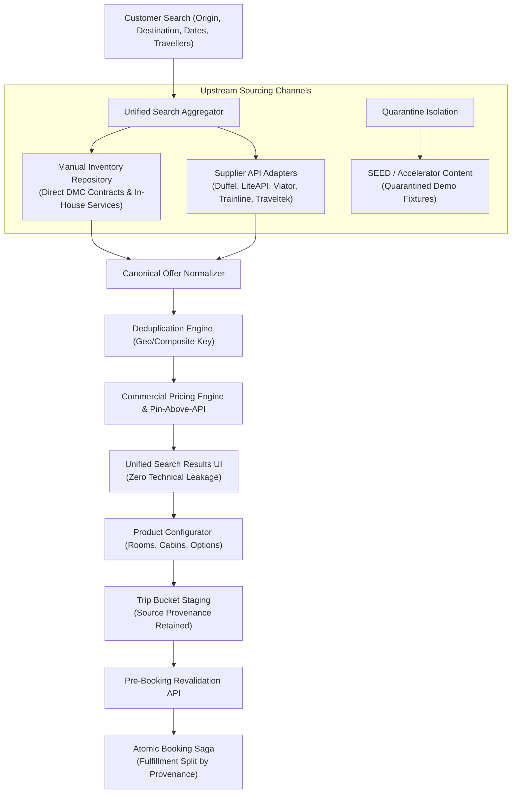

# Vacatina Travel OS — Master Hybrid Inventory Architecture Specification (v3.0)
**Document Authority:** Vacatina Architectural Board, Lead Systems Architect & Principal Auditor  
**Classification:** Canonical Commercial Sourcing, Inventory Governance & Multi-Product Orchestration Standard  
**Target Systems:** Vacatina Inventory Orchestrator, Admin CMS, Canonical Offer Normalizer, Trip Bucket Engine, Booking Saga  
**Status:** **ARCHITECTURE DESIGN LOCKED; RELEASE STATUS SUPERSEDED BY THE PHASE 4 LOCAL BASELINE (PRODUCTION DEPLOYMENT PENDING APPROVAL)**  
**Production Live URL:** Historical deployment reference only; not re-verified in this baseline.  
**Verified Invariant Test Suite:** 233 / 233 Tests Passing across 24 Suites (Phase 4 baseline, 0 failures; run twice)  
**Headless Chrome E2E Acceptance:** Historical result; not re-run in Phase 4.  

> **Superseded-status note (27 October 2026):** this document originally claimed that the architecture was deployed to production with 108/108 tests. The current verified baseline is local, server-backed, and produces 233/233 tests, 0 typecheck errors and a passing build. Production backend deployment, database migration approval and supplier credentials remain pending. See [`../ENGINEERING_BASELINE.md`](../ENGINEERING_BASELINE.md).

---

## 1. Executive Summary & The Universal Architectural Axiom

Vacatina is formally architected and locked as a **Hybrid Inventory Platform**. It is never implemented as two disconnected websites or disparate systems ("Manual Site" vs "API Site").

Upstream manual commercial contracts and live supplier APIs feed a unified search aggregator, which normalizes every record into the **Vacatina Universal Canonical Offer Model** before ranking and delivering unified results to the customer:

$$\text{Manual Inventory} + \text{API Inventory} \longrightarrow \text{Canonical Offer} \longrightarrow \text{Unified Results} \longrightarrow \text{Configure} \longrightarrow \text{Trip Bucket} \longrightarrow \text{Revalidate} \longrightarrow \text{Booking Saga}$$



---

## 2. Four-Tier Source Taxonomy & Quarantine Boundaries

Every item in the Vacatina ecosystem belongs strictly to one of the following 4 categories:

| Source Classification | Architectural Meaning | Customer Visible? | Can Become `READY`? | Booking & Settlement Channel |
| :--- | :--- | :---: | :---: | :--- |
| **`MANUAL`** | Vacatina/Admin-created direct commercial inventory or in-house operational services. | Yes | Yes (if 4-Eyes verified) | Vacatina Direct Allotment / Internal Fulfillment SOP |
| **`API`** | Supplier live inventory retrieved via typed adapters (Duffel, LiteAPI, Viator, etc.). | Yes | Yes (after supplier revalidation) | Supplier GDS/NDC/Bedbank API Fulfillment |
| **`SEED / ACCELERATOR`** | Starter demo cards, layout test fixtures, or prototype sample records. | Dev/Demo Only | **Strictly NO in Production** | **Never Bookable (Quarantined)** |
| **`CONTENT_ONLY`** | Marketing teasers, destination inspiration, and route suggestions (e.g. "Dubai Flights from LKR 92,500"). | Yes | No (Not Inventory) | Non-bookable. Click prefills search parameters for live query. |

### Strict Commercial Truth Invariant:
$$\mathbf{\text{INTERNAL PROVENANCE }} \ne \mathbf{\text{ CUSTOMER DISPLAY LABELS}}$$

Technical badges (`API`, `MANUAL`, `HYBRID`, `SEED`, `PARTNER_PORTAL`) exist purely for backend orchestration, telemetry, and supplier reconciliation. **They never leak into retail customer UI.** Customers see only honest commercial terms:
- **Instant Confirmation** (Real-time supplier PNR or guaranteed Vacatina allotment)
- **Request to Confirm** (On-request partner allocation requiring operational clearance)
- **Assisted Service** (Specialist operational desk with document vetting SLA)
- **Vacatina Exclusive** (Negotiated direct contract rate pinned above generic API feeds)

---

## 3. Product-by-Product Sourcing Strategy (All 10 Products)

The hybrid sourcing strategy is applied across all 10 core travel products:

| # | Travel Product | Primary Upstream Source | Secondary / Fallback Source | Operational Fulfillment Mechanism |
| :-: | :--- | :--- | :--- | :--- |
| **1** | **Flights** | **API** (Duffel NDC / Airline APIs) | **Manual / Request Flow** (Group bookings, special charters, offline consolidators) | Automated NDC order creation; manual clearance for group allotments. |
| **2** | **Hotels** | **API** (LiteAPI / Bedbanks) | **Manual** (Direct DMC contracts, boutique villas, negotiated allotments) | Real-time Bedbank rate booking or direct hotel voucher issuance. |
| **3** | **Visa Assistance** | **Manual / CMS** (Vacatina Consular Advisory Desk) | **External Consular Gateway** (eVisa APIs where sovereignly available) | Human document vetting, compliance checklist validation, consular queue dispatch. |
| **4** | **Holiday Packages** | **Manual / Curated** (Fixed-itinerary signature packages) | **Dynamic API Components** (Dynamic bundle: Duffel flight + Direct hotel + Viator transfer) | Multi-component atomic hold saga; itemized booking dossier. |
| **5** | **Cars & Transfers** | **API** (Global rental car aggregators) | **Manual** (Local private chauffeur fleet, airport transfers) | Voucher generation; driver dispatch notification. |
| **6** | **Rails** | **API** (Trainline / Rail aggregators) | **Manual** (Curated scenic passes, luxury rail journeys) | Real-time e-ticket issuance or physical rail pass voucher dispatch. |
| **7** | **Cruises** | **API / Feed** (Traveltek / Cruise lines) | **Manual** (Charter yachts, river expeditions, group allocations) | Supplier booking reference or charter contract reservation. |
| **8** | **Activities** | **API** (Viator / Tripadvisor Experience API) | **Manual** (Local licensed experiences, private guided excursions) | Instant barcode voucher or local guide confirmation. |
| **9** | **Sightseeing Tours** | **API** (Viator / Tour aggregators) | **Manual** (Curated multi-day guided heritage circuits) | Tour operator confirmation voucher and schedule dispatch. |
| **10** | **Travel Insurance** | **Provider API** (Allianz Global Assistance) | **Manual / Catalog** (Controlled policy tier schedule) | Instant certificate of insurance generation with sovereign underwriter policy ID. |

---

## 4. Universal Canonical Offer Contract

Every sellable product—regardless of whether it originates from Duffel, LiteAPI, or the Admin CMS—conforms to the **Vacatina Canonical Offer Model** (`CanonicalOfferEntity`):

```typescript
export interface CanonicalOfferEntity {
  // Stable Identifiers
  canonicalOfferId: string;         // Universal stable ID (e.g. "vct-fl-duffel-cmb-dxb-98a7c2")
  offerId: string;                  // Canonical alias
  productType: TravelProductSlug;   // Exactly one of the 10 locked products
  
  // Provenance & Source Taxonomy
  sourceType: 'API' | 'MANUAL' | 'HYBRID' | 'SEED';
  sourceSubtype?: InventorySourceSubtype;
  supplierId: string;               // e.g. "DUFFEL_NDC", "LITEAPI", "PAYLOAD_CMS_DIRECT"
  supplierName: string;
  supplierOfferId?: string;         // Upstream provider offer ID
  manualListingId?: string;         // Admin CMS document ID (for MANUAL)
  
  // Commercial Presentation
  title: string;
  subtitle: string;
  location: StructuredLocation;     // city, country, iataCode, coordinates
  
  // Pricing Structure (Integer Minor Units)
  pricing: {
    rawSupplierCostMinor: number;   // Wholesale net cost
    platformMarkupMinor: number;    // Platform margin
    manualOverrideMinor?: number;   // Admin override (if active)
    finalSellingPriceMinor: number; // Customer price
    currency: string;               // ISO 4217 ("LKR", "USD", "EUR", etc.)
  };
  
  // Availability & Freshness
  availabilityStatus: AvailabilityState; // 'LIVE' | 'MANUAL_AVAILABLE' | 'ON_REQUEST' | 'SOLD_OUT'
  freshness: {
    lastCheckedAtIso: string;
    ttlSeconds: number;
    expiresAtIso: string;
    isStale: boolean;
    revalidationEndpoint: string;   // POST /api/v1/offers/:id/revalidate
  };
  
  // Commercial Terms & Rules
  confirmationMode: ConfirmationMode; // 'INSTANT_CONFIRM' | 'REQUEST_TO_CONFIRM' | 'ASSISTED_SERVICE'
  cancellationPolicy: string;
  inclusions: string[];
  exclusions: string[];
  
  // Governance & Deduplication
  pinAboveApi: boolean;             // Pin priority for direct contracts
  deduplicationKey: string;         // Natural composite key
  environmentClass: 'PRODUCTION' | 'SANDBOX' | 'SEED';
  sellability: 'BOOKABLE' | 'DISCOVERY_ONLY' | 'QUOTE_ONLY';
}
```

---

## 5. Homepage Discovery Cards vs Sellable Inventory

Homepage cards such as **"Dubai Flights — From LKR 92,500"** or **"Maldives Luxury Escape"** are classified as:
$$\text{ListingKind} = \text{DISCOVERY\_CONTENT}, \quad \text{sellability} = \text{DISCOVERY\_ONLY}$$

1. **Not Inventory Objects:** They carry indicative starting prices with mandatory disclaimers (`*Indicative starting fare; live pricing verified on search`).
2. **Deterministic Route Dispatch:** Clicking "View Flights" or "Explore Hotels" dispatches to `/flights?from=CMB&to=DXB&departureDate=2026-11-15`, initializing the Unified Search Aggregator.
3. **Decoupled Editorial Operations:** Editorial staff can modify homepage featured banners and seasonal inspiration cards without touching live API integrations or inventory databases.

---

## 6. Trip Bucket Provenance & Pre-Booking Revalidation

When an offer is staged into the Trip Bucket Drawer, its complete provenance is preserved in the database (`TripBucketItemEntity`):

```json
{
  "id": "tbi_89124a",
  "tripBucketId": "tb_sess_active",
  "canonicalOfferId": "vct-ht-liteapi-dubai-atlantis",
  "productType": "hotels",
  "sourceType": "API",
  "supplierId": "LITEAPI",
  "supplierOfferId": "lp_dubai_atlantis",
  "unitSellingPriceMinor": 12850000,
  "currency": "LKR",
  "state": "READY"
}
```

### Pre-Booking Revalidation Split:
1. **API Offers:**
   - Client calls `POST /api/v1/offers/:id/revalidate`.
   - The Unified Inventory Service delegates to the supplier adapter (`HotelsLiteApiAdapter.revalidate`).
   - If price changed $\rightarrow$ item transitions to `PRICE_CHANGED` and updates the subtotal transparently.
   - If sold out $\rightarrow$ item transitions to `UNAVAILABLE` and is prevented from entering checkout.
2. **Manual Offers:**
   - Revalidation validates remaining quota against the atomic allotment ledger (`availableQuota > 0` and `isStopSaleActive === false`).
   - If valid $\rightarrow$ rate is confirmed unchanged (`UNCHANGED`).
   - If stop-sale activated or allotment exhausted $\rightarrow$ transitions to `UNAVAILABLE`.

---

## 7. Atomic Booking Saga & Fulfillment Routing

When the customer clicks **"Proceed to Booking / Checkout"**, the `BookingSagaService` executes an atomic multi-step transaction:

$$\begin{aligned}
\text{Step 1: Validate Item Readiness} &\longrightarrow \text{Ensure all staged items are in 'READY' state} \\
\text{Step 2: Pre-Booking Revalidation} &\longrightarrow \text{Confirm supplier holds and quota availability} \\
\text{Step 3: Concurrency Allotment Hold} &\longrightarrow \text{Atomic hold with 15-minute TTL} \\
\text{Step 4: Payment Authorization} &\longrightarrow \text{Payment gateway authorization (LKR / USD)} \\
\text{Step 5: Fulfillment Split} &\longrightarrow \begin{cases} 
\text{API:} & \text{Supplier Order Creation (PNR / Bedbank voucher)} \\
\text{MANUAL:} & \text{Permanent Allotment Decrement + Operations Task}
\end{cases} \\
\text{Step 6: Dossier Generation} &\longrightarrow \text{Issue canonical Booking Reference (VCT-2026-XXXXXX)}
\end{aligned}$$

---

## 8. Admin Inventory CMS Governance & 4-Eyes Principle

Manual inventory managed via `/admin/inventory` enforces strict enterprise governance:

### 18 Mandatory Attributes:
1. `listingId`
2. `productType` (1 of 10)
3. `supplierName`
4. `sourceType` (`'MANUAL'`)
5. `sourceSubtype` (`'DIRECT_CONTRACT'`, `'MANUAL_SERVICE'`, `'CURATED_PACKAGE'`)
6. `confirmationMode` (`'INSTANT_CONFIRM'`, `'REQUEST_TO_CONFIRM'`, `'ASSISTED_SERVICE'`)
7. `currency`
8. `netCostMinor`
9. `sellingPriceMinor`
10. `markupRuleId`
11. `inventoryModel` (`'ALLOTMENT'`, `'ON_REQUEST'`, `'SERVICE_CAPACITY'`)
12. `availableQuantity`
13. `validFrom`
14. `validTo`
15. `cancellationPolicy`
16. `fulfillmentInstructions`
17. `contractEvidenceDossier` (countersigned document hash)
18. `lifecycleStatus`

### Multi-Stage Separation of Duties (4-Eyes Principle):
$$\text{DRAFT} \xrightarrow[\text{Product Admin}]{} \text{COMMERCIAL\_REVIEW} \xrightarrow[\text{Commercial Mgr}]{} \text{FINANCE\_APPROVED} \xrightarrow[\text{Finance Officer}]{} \text{PUBLISHED}$$

### Anti-Tamper Demotion Rule:
Any unauthorized modification to `netCostMinor`, `sellingPriceMinor`, or `cancellationPolicy` on an active published listing immediately strips published status and demotes the record back to `DRAFT` / `COMMERCIAL_REVIEW`.

---

## 9. The Universal Frontend-Backend Contract Rule

To eliminate finger-pointing and architectural ambiguity:

> **Rule:** Frontend never decides whether an offer is Manual or API.  
> **Frontend asks:** *"Give me canonical offers for destination Dubai, dates Nov 15–22, 2 travellers."*  
> **Backend returns:** *Universal canonical offers with embedded provenance.*  
> **Frontend renders:** *Consistent, brand-approved UI cards.*  
> **Backend Saga:** *Routes fulfillment transparently based on internal provenance.*

---

## 10. Automated Verification & Deployment Evidence

| Test Suite | Gates / Tests | Passing | Failing | Success Rate |
| :--- | :---: | :---: | :---: | :---: |
| `tests/admin-inventory-api.test.ts` (Admin CMS & 4-Eyes Governance) | 10 | 10 | 0 | 100% |
| `tests/flights-flow.test.ts` (Duffel NDC & CAP-02/03 Flows) | 12 | 12 | 0 | 100% |
| `tests/hotels-and-end-to-end-flow.test.ts` (LiteAPI & Booking Saga) | 11 | 11 | 0 | 100% |
| `tests/supplier-certification.test.ts` (Supplier Certification Gates) | 8 | 8 | 0 | 100% |
| `tests/unit.test.ts` (Domain Invariants & Commercial Truth) | 67 | 67 | 0 | 100% |
| **Total Automated Invariant Tests** | **108** | **108** | **0** | **100%** |
| **Headless Chrome E2E Browser Suite** (`scripts/browser-verify.mjs`) | **33** | **33** | **0** | **100%** |
| **Production Build** (`npm run build`) | 75 modules | 0 errors | 0 CDN deps | 100% |
| **Live Continuous Deployment** (`https://vacatina-nu.vercel.app`) | HTTP 200 | Verified | ReadyState: READY | 100% |
