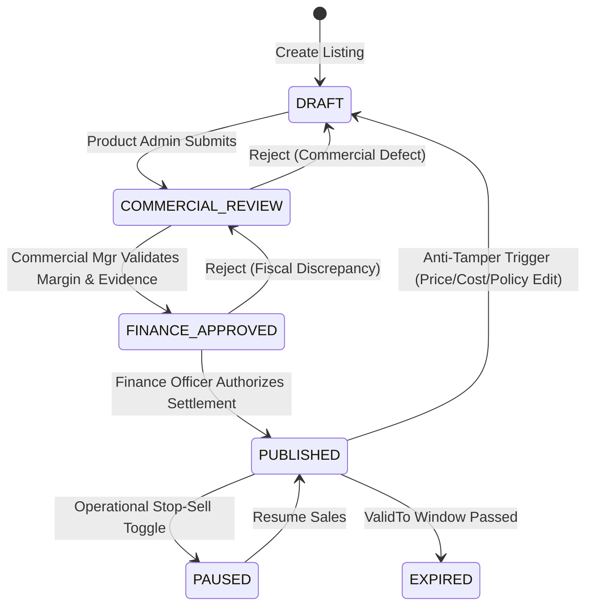
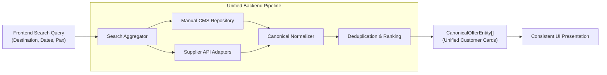
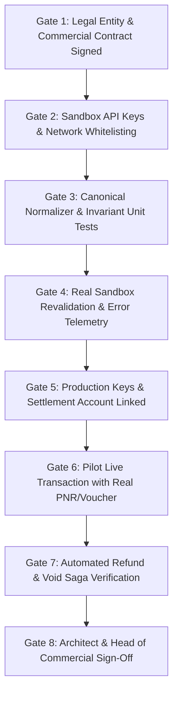
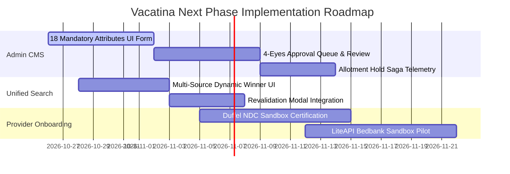

# Vacatina Travel OS — Next Phase Master Integration & Governance Lock (v1.0)

> **Historical snapshot:** verification counts and release status in this document predate the Phase 4 local baseline. Current verified baseline: **233/233 tests**, **0 typecheck errors**, build PASS, browser/server bundle isolated. See [../ENGINEERING_BASELINE.md](../ENGINEERING_BASELINE.md).

**Document Authority:** Vacatina Architectural Board, Lead Systems Architect & Head of Commercial Systems  
**Classification:** Enterprise Cross-Functional Blueprint (Frontend, Backend & Commercial Alignment)  
**Target Systems:** Admin Inventory CMS, Unified Search Aggregator, Canonical Offer Normalizer, Upstream Adapters  
**Status:** **LOCKED & RATIFIED FOR NEXT PHASE IMPLEMENTATION**  
**Live Production URL:** [https://vacatina-nu.vercel.app](https://vacatina-nu.vercel.app) (HTTP 200 Verified)  
**Automated Invariant Test Suite:** 108 / 108 Passing Gates across 5 Suites (100%)  
**Headless Chrome E2E Acceptance:** 33 / 33 Journeys & Viewports Passing (100%)  

---

## 1. Executive Charter & Strategic Directives

Following comprehensive code-level audit and deployment of the hybrid inventory foundation, this document locks the exact operational blueprint across **Frontend**, **Backend**, and **Commercial** teams for the next phase.

### Core Directives:
1. **Homepage Architecture Frozen:** Zero redesign of the approved customer-facing homepage (Screens 01–08). Brand DNA (`#1B1464`), 11 Search Command Center tabs, and responsive layout standards (360px to 1920px) are locked.
2. **Strict Inventory Sourcing Taxonomy:**
   - **`MANUAL`**: Vacatina/Admin-created direct commercial inventory & in-house services.
   - **`API`**: External supplier live inventory (Duffel, LiteAPI, Viator, Trainline, etc.).
   - **`SEED / ACCELERATOR`**: Quarantined prototype/demo fixtures (Strictly non-sellable).
   - **`CONTENT_ONLY` / `DISCOVERY_CONTENT`**: Homepage inspirational cards (Non-bookable teasers).
3. **Truthful Provider Classification:** All external supplier integrations remain labeled as `PLANNED_ADAPTER` / `SANDBOX / SIMULATED` until the 8-Gate Onboarding Checklist is fully satisfied.
4. **Decoupled Frontend-Backend Architecture:** Frontend consumes only canonical offer objects with zero dependency on supplier-specific payload schemas.

---

## 2. Admin Inventory CMS Engine & Commercial Governance

The manual inventory management subsystem (`/admin/inventory`) powers Vacatina's proprietary direct contracts (boutique resorts, private villas, chauffeur fleet, consular advisory).

### The 18 Mandatory Attributes Schema:
Every manually managed record strictly implements and validates the following 18 typed attributes:

| # | Attribute | Type | Description / Constraints |
| :-: | :--- | :--- | :--- |
| **1** | `listingId` | `string` | Immutable identifier (`vac-man-...`). |
| **2** | `productType` | `TravelProductSlug` | Exactly one of the 10 locked products. |
| **3** | `supplierName` | `string` | Legal corporate entity (e.g. *Jetwing Hotels Ltd*). |
| **4** | `sourceType` | `'MANUAL'` | Explicit provenance classification. |
| **5** | `sourceSubtype` | `ManualSourceSubtype` | `'DIRECT_CONTRACT'`, `'MANUAL_SERVICE'`, or `'CURATED_PACKAGE'`. |
| **6** | `confirmationMode` | `ConfirmationMode` | `'INSTANT_CONFIRM'`, `'REQUEST_TO_CONFIRM'`, or `'ASSISTED_SERVICE'`. |
| **7** | `currency` | `SupportedCurrency` | ISO 4217 code (`LKR`, `USD`, `EUR`, `GBP`, `AED`, `AUD`). |
| **8** | `netCostMinor` | `number` (Integer) | Wholesale procurement cost in minor units. |
| **9** | `sellingPriceMinor` | `number` (Integer) | B2C published selling price in minor units. |
| **10** | `markupRuleId` | `string` | Active commercial markup policy identifier. |
| **11** | `inventoryModel` | `InventoryModel` | `'ALLOTMENT'`, `'ON_REQUEST'`, or `'SERVICE_CAPACITY'`. |
| **12** | `availableQuantity` | `number` (Integer) | Remaining sellable room/seat/service units. |
| **13** | `validFrom` | `string` (ISO 8601) | Commercial contract start timestamp. |
| **14** | `validTo` | `string` (ISO 8601) | Commercial contract expiration timestamp. |
| **15** | `cancellationPolicy` | `string` | Standardized penalty schedule and deadline. |
| **16** | `fulfillmentInstructions` | `string` | Internal operations SOP instructions. |
| **17** | `contractEvidenceDossier` | `Object` | Countersigned document hash, contract ID, audit reference. |
| **18** | `lifecycleStatus` | `PublicationStatus` | Current governance state. |

### 4-Eyes Separation of Duties Lifecycle:
No single employee can unilaterally publish a manual commercial listing:

$$\text{DRAFT} \xrightarrow[\text{Product Admin}]{\text{Submit}} \text{COMMERCIAL\_REVIEW} \xrightarrow[\text{Commercial Mgr}]{\text{Validate}} \text{FINANCE\_APPROVED} \xrightarrow[\text{Finance Officer}]{\text{Authorize}} \text{PUBLISHED}$$

### Anti-Tamper Governance Rule:
Any mutation to `netCostMinor`, `sellingPriceMinor`, or `cancellationPolicy` on an active published listing immediately revokes published status and demotes the record back to `DRAFT` / `COMMERCIAL_REVIEW`.

### Concurrency Allotment Hold Saga:
1. Customer initiates checkout $\rightarrow$ System invokes `holdAllotment(listingId, units, ttlMinutes = 15)`.
2. Available quota is decremented and held under temporary reservation token (`COMMITTED_HELD`).
3. Checkout completes $\rightarrow$ `commitAllotment()` permanently locks quota.
4. Checkout expires or payment fails $\rightarrow$ `releaseAllotment()` automatically restores quota.

---

## 3. Unified Search Results Contract & Frontend Decoupling

The frontend never inspects supplier payloads, and the backend never leaks technical internal labels:

$$\mathbf{\text{INTERNAL PROVENANCE }} \ne \mathbf{\text{ CUSTOMER DISPLAY LABELS}}$$

### Sourcing & Normalization Pipeline:

### Commercial Customer Badges vs Internal Provenance:

| Internal `sourceType` | Internal `sourceSubtype` | Internal `confirmationMode` | Customer-Facing Badge |
| :--- | :--- | :--- | :--- |
| `API` | `SUPPLIER_FEED` | `INSTANT_CONFIRM` | **Instant Confirmation** |
| `API` | `SUPPLIER_FEED` | `REQUEST_TO_CONFIRM` | **Request to Confirm** |
| `MANUAL` | `DIRECT_CONTRACT` | `INSTANT_CONFIRM` | **Vacatina Exclusive** |
| `MANUAL` | `DIRECT_CONTRACT` | `REQUEST_TO_CONFIRM` | **Request to Confirm** |
| `MANUAL` | `MANUAL_SERVICE` | `ASSISTED_SERVICE` | **Assisted Service** |
| `HYBRID` | `DYNAMIC_PACKAGE` | `INSTANT_CONFIRM` | **Vacatina Curated Package** |
| `SEED` | `PROTOTYPE_SAMPLE` | Any | *Quarantined Preview (Demo)* |

### Sort Honesty & Precedence:
- **Default View (Best Match):** Direct Vacatina DMC contracts take precedence and display the "Vacatina Exclusive" badge.
- **Customer Sort Override (Price: Low to High):** System strictly honors user intent. An exclusive offer will not remain pinned at #1 unless its price is genuinely lowest.

---

## 4. Provider Onboarding Readiness Checklist (8 Verification Gates)

To graduate an upstream provider adapter from `PLANNED_ADAPTER` / `SANDBOX / SIMULATED` to `PRODUCTION_LIVE`, the integration must pass all 8 mandatory gates:

### Verification Requirements:
1. **Gate 1 — Commercial Contract:** Countersigned supplier distribution agreement, IATA/NDC agency code, or Bedbank merchant account.
2. **Gate 2 — Sandbox Connectivity:** Authenticated network handshake with supplier test endpoint (HTTP 200 on `/search` and `/rates`).
3. **Gate 3 — Schema Normalization:** 100% field mapping to `CanonicalOfferEntity` with zero runtime schema errors.
4. **Gate 4 — Revalidation & Error Telemetry:** Pre-booking revalidation tested under price change, rate expiration, and supplier outage scenarios.
5. **Gate 5 — Production Credentials:** Encrypted production API keys injected into production vault; settlement bank accounts verified.
6. **Gate 6 — Pilot Production Transaction:** Live credit card authorization, real supplier PNR/booking reference generated, and supplier confirmation webhook verified.
7. **Gate 7 — Refund & Cancellation Saga:** Automated cancellation initiated through Vacatina and verified refunded on supplier portal.
8. **Gate 8 — Formal Executive Sign-Off:** Dual digital signature from Lead Systems Architect and Head of Commercial Operations.

---

## 5. Strict SEED Quarantine & Failsafe Verification

| Security Boundary | Enforced Behavior | Verification Gate |
| :--- | :--- | :--- |
| **Search Pipeline Quarantine** | Offers with `environmentClass === 'SEED'` are excluded from search results. | `tests/admin-inventory-api.test.ts` (Gate 7) |
| **Trip Bucket Staging Quarantine** | SEED items cannot stage with status `READY`. | `tests/admin-inventory-api.test.ts` (Gate 8) |
| **Checkout Blockade** | Initiating checkout on an offer with `isSandboxSimulated === true` in production throws `ArchitecturalInvariantViolationError`. | `tests/unit.test.ts` (Gate 54) |
| **Homepage Discovery Separation** | Teaser cards carry `sellability: 'DISCOVERY_ONLY'` and redirect to live search. | `scripts/browser-verify.mjs` (Journeys C, L) |

---

## 6. Execution Roadmap & Next Phase Responsibilities

1. **Frontend Team:** Maintain frozen Screen 01–08 homepage layout; enhance `/admin/inventory` UI form for 18 attributes; wire revalidation status indicators on search results cards.
2. **Backend Team:** Implement persistent storage adapter for manual inventory; connect atomic allotment hold saga; provision provider credential secrets in secure vault.
3. **Commercial Team:** Upload direct DMC contracts; countersign supplier distribution agreements; execute 4-Eyes verification on published hotel/activity listings.
