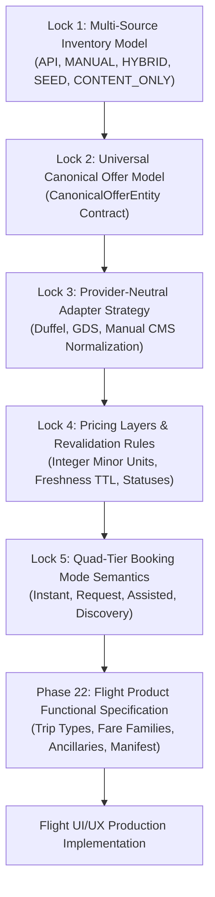
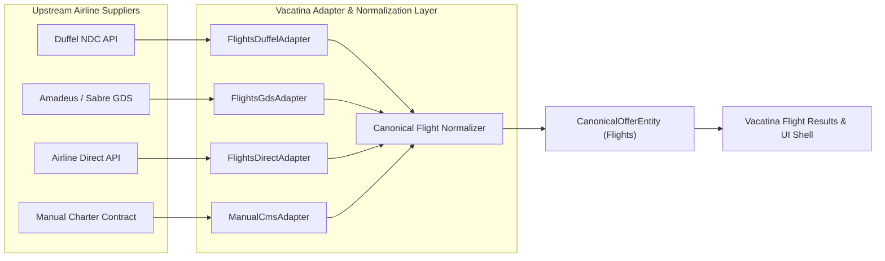

# Vacatina Travel OS — Canonical Offer & Flight Functional Architecture (v1.0)

> **Historical snapshot:** verification counts and release status in this document predate the Phase 4 local baseline. Current verified baseline: **233/233 tests**, **0 typecheck errors**, build PASS, browser/server bundle isolated. See [../ENGINEERING_BASELINE.md](../ENGINEERING_BASELINE.md).

**Document Authority:** Vacatina Architectural Board, Lead Systems Architect & Head of Product Design  
**Classification:** Canonical Commercial Data Model, Inventory Governance & Flight Product Functional Specification  
**Target Systems:** Vacatina Inventory Engine, Admin CMS, Duffel NDC Adapter, Search Aggregator, Flight UI/UX  
**Status:** **LOCKED & RATIFIED AS PREREQUISITE BEFORE FLIGHTS UI/UX IMPLEMENTATION**  
**Production Live URL:** [https://vacatina-nu.vercel.app](https://vacatina-nu.vercel.app) (HTTP 200 Verified)  
**Verified Test Gates:** 108 / 108 Tests Passing across 5 Suites (100%)  
**Headless Chrome E2E Suite:** 33 / 33 Acceptance Journeys & Viewports Passing (100%)  

---

## 1. Executive Summary & The 5 Foundational Locks Before Flights UI/UX

Before designing or styling Flights screens, five foundational architecture pillars are formally locked to eliminate ambiguities between Frontend, Backend, and Commercial teams:



---

## 2. Lock 1: Multi-Source Inventory Model

Every product record in the Vacatina ecosystem belongs to exactly one of the 5 canonical source classifications:

| Source Classification | Architectural Meaning | Customer Visible? | Can Become `READY`? | Booking & Settlement Channel |
| :--- | :--- | :---: | :---: | :--- |
| **`API`** | Real-time supplier inventory retrieved via typed adapters (e.g. Duffel NDC, LiteAPI, Viator). | Yes | Yes (after supplier revalidation) | Upstream Supplier GDS/NDC/Bedbank Order Creation |
| **`MANUAL`** | Vacatina/Admin-created direct commercial inventory (direct DMC contracts, private villa allotments, consular desk). | Yes | Yes (if 4-Eyes verified) | Vacatina Direct Allotment Ledger & Operations SOP |
| **`HYBRID`** | Multi-source dynamic bundle (e.g. Flight API + Direct Hotel Contract + Private Transfer). | Yes | Yes (when all parts pass) | Multi-Component Atomic Hold Saga |
| **`SEED / ACCELERATOR`** | Starter demo cards, layout test fixtures, or prototype sample records. | Dev/Demo Only | **Strictly NO in Production** | **Never Bookable (Strictly Quarantined)** |
| **`CONTENT_ONLY`** | Marketing teasers, destination inspiration, and route suggestions (e.g. "Dubai Flights from LKR 92,500"). | Yes | No (Not Inventory) | Non-bookable. Click prefills search parameters for live query. |

### Strict Customer UI Cleanliness Axiom:
$$\mathbf{\text{INTERNAL PROVENANCE }} \ne \mathbf{\text{ CUSTOMER DISPLAY LABELS}}$$

Technical badges (`API`, `MANUAL`, `HYBRID`, `SEED`, `DUFFEL_NDC`, `LITEAPI`) never leak into customer UI strings. Customers see only honest commercial terms:
- **Instant Confirmation** (Real-time supplier PNR or guaranteed Vacatina allotment)
- **Request to Confirm** (On-request partner allocation requiring operational clearance)
- **Assisted Service** (Specialist operational desk with document vetting SLA)
- **Vacatina Exclusive** (Negotiated direct contract rate pinned above generic API feeds)

---

## 3. Lock 2: Universal Canonical Offer Data Model

Every sellable product—regardless of whether it originates from Duffel, LiteAPI, or the Admin CMS—conforms to the **Vacatina Universal Canonical Offer Model** (`CanonicalOfferEntity`):

```typescript
export interface CanonicalOfferEntity {
  // Stable Universal Identifiers
  canonicalOfferId: string;         // Universal stable ID (e.g. "vct-fl-duffel-cmb-dxb-98a7c2")
  canonicalEntityId: string;        // Composite entity identifier (e.g. "FLT_CMB_DXB_EK651")
  offerId: string;                  // Canonical alias
  productType: TravelProductSlug;   // Exactly one of the 10 locked products
  
  // Provenance & Source Taxonomy
  sourceType: 'API' | 'MANUAL' | 'HYBRID' | 'SEED';
  sourceSubtype?: 'SUPPLIER_FEED' | 'DIRECT_CONTRACT' | 'MANUAL_SERVICE' | 'DYNAMIC_PACKAGE' | 'PROTOTYPE_SAMPLE';
  supplierId: string;               // e.g. "DUFFEL_NDC", "LITEAPI", "PAYLOAD_CMS_DIRECT"
  supplierName: string;             // Legal corporate trading name
  supplierOfferId?: string;         // Upstream provider offer ID
  manualListingId?: string;         // Admin CMS document ID (for MANUAL)
  
  // Commercial Presentation
  title: string;
  subtitle: string;
  location: StructuredLocation;     // city, country, iataCode, coordinates
  media: {
    heroImageUrl: string;
    galleryUrls: string[];
    airlineLogoUrl?: string;
  };
  
  // Pricing Structure (Integer Minor Units)
  pricing: {
    rawSupplierCostMinor: number;   // Wholesale net cost
    platformMarkupMinor: number;    // Platform margin
    manualOverrideMinor?: number;   // Admin override (if active)
    finalSellingPriceMinor: number; // Customer price
    currency: string;               // ISO 4217 ("LKR", "USD", "EUR", etc.)
  };
  taxesAndFees?: {
    totalTaxMinor: number;
    isTaxInclusive: boolean;
    vatMinor?: number;
    mandatoryLocalFeesText?: string;
  };
  
  // Availability & Freshness
  availabilityStatus: 'LIVE' | 'MANUAL_AVAILABLE' | 'ON_REQUEST' | 'SOLD_OUT' | 'UNAVAILABLE';
  freshness: {
    lastCheckedAtIso: string;
    ttlSeconds: number;
    expiresAtIso: string;
    isStale: boolean;
    revalidationEndpoint: string;   // POST /api/v1/offers/:id/revalidate
  };
  
  // Commercial Terms & Rules
  bookingMode: 'INSTANT_BOOK' | 'REQUEST_TO_BOOK' | 'ASSISTED_SERVICE' | 'INQUIRY_ONLY';
  confirmationMode: 'INSTANT_CONFIRM' | 'REQUEST_TO_CONFIRM' | 'ASSISTED_SERVICE';
  cancellationPolicy: string;
  inclusions: string[];
  exclusions: string[];
  configurationRequirements: Record<string, unknown>;
  
  // Governance & Deduplication
  pinAboveApi: boolean;             // Pin priority for direct contracts
  isExclusiveDeal?: boolean;        // Contractual exclusive rate badge eligibility
  deduplicationKey: string;         // Natural composite key
  environmentClass: 'PRODUCTION' | 'SANDBOX' | 'SEED';
  sellability: 'BOOKABLE' | 'DISCOVERY_ONLY' | 'QUOTE_ONLY';
}
```

---

## 4. Lock 3: Provider-Neutral Supplier Adapter Strategy

The frontend never inspects vendor-specific payloads, and backend adapters normalize all data upstream:



---

## 5. Lock 4: Pricing Layers & Real-Time Revalidation Rules

Customer prices are computed deterministically via the Commercial Pricing Engine:

$$\text{Final Customer Price} = \text{Raw Net Supplier Cost} + \text{Platform Markup} + \text{Aviation Taxes/Fees} - \text{Promotional Discounts}$$

### Pre-Booking Revalidation Lifecycle:
Every flight offer is subject to a 30-minute Time-to-Live (TTL). When staged into the Trip Bucket, the client or saga revalidates the offer via `POST /api/v1/offers/:id/revalidate`:

1. **`UNCHANGED`:** Supplier fare confirmed $\rightarrow$ Item maintains `READY` state.
2. **`PRICE_CHANGED`:** Upstream fare updated $\rightarrow$ Item transitions to `PRICE_CHANGED`. Displays transparent previous vs new price; requires customer confirmation before checkout.
3. **`UNAVAILABLE` / `SOLD_OUT`:** Seat bucket exhausted $\rightarrow$ Item transitions to `UNAVAILABLE`. Blocked from checkout; displays alternative route options.
4. **`OFFER_EXPIRED`:** Expiry TTL passed $\rightarrow$ Triggers background search to refresh options.

---

## 6. Lock 5: Quad-Tier Booking Mode Semantics

| Booking Mode | Applicable Products / Scenarios | Customer Action Button | Resulting Trip Bucket State |
| :--- | :--- | :--- | :--- |
| **`INSTANT_BOOK`** | Confirmed API flights, guaranteed direct hotel allotments. | **Select Flight / Add to Trip** | Stages as `READY` (upon valid selection). |
| **`REQUEST_TO_BOOK`** | Group charter flights, luxury yacht berths, on-request hotel suites. | **Request Availability** | Stages as `NEEDS_ACTION` / `RECHECK_REQUIRED`. |
| **`ASSISTED_SERVICE`** | Consular visa document vetting, VIP airport escort concierge. | **Start Application / Submit Details** | Stages as `NEEDS_ACTION` until applicant data submitted. |
| **`DISCOVERY_ONLY`** | Homepage route teasers, seasonal inspiration cards. | **Explore Options / Search Flights** | Prefills search criteria; never directly bookable. |

---

## 7. Phase 22 — Flight Product Functional Architecture Specification

With the 5 foundational locks solidified, the functional specification for the Flights product vertical is locked as follows:

### 7.1 The Commercial Customer Funnel
$$\begin{aligned}
\text{Discover (Homepage Teaser)} &\longrightarrow \text{Explore (Flight Hub)} \longrightarrow \text{Search (SCC Form)} \longrightarrow \text{Results (Unified Grid)} \\
&\longrightarrow \text{Flight Offer Details} \longrightarrow \text{Fare Family Configurator} \longrightarrow \text{Baggage & Ancillaries} \\
&\longrightarrow \text{Traveller Manifest Intake} \longrightarrow \text{Pre-Booking Revalidation} \longrightarrow \text{Trip Bucket (Ready)} \\
&\longrightarrow \text{Checkout Saga} \longrightarrow \text{Electronic Ticket Dossier (VCT-2026-XXXXXX)}
\end{aligned}$$

### 7.2 Search Form Parameters & Trip Types
- **Trip Types:**
  1. **Round Trip:** Origin, Destination, Departure Date, Return Date, Travellers, Cabin Class.
  2. **One Way:** Origin, Destination, Departure Date, Travellers, Cabin Class.
  3. **Multi-City:** Up to 6 independent flight legs with dynamic "+ Add Flight" / "Remove" controls.
- **Cabin Classes:**
  - `ECONOMY` (Default)
  - `PREMIUM_ECONOMY`
  - `BUSINESS`
  - `FIRST`
- **Passenger Composition:**
  - **Adults (12+ years):** Minimum 1, Maximum 9.
  - **Children (2–11 years):** Maximum 8 (must be accompanied by adult).
  - **Infants (<2 years):** Maximum 1 per adult (lap infant or seated).
- **Search Filters:**
  - Non-stop / Direct flights only.
  - Maximum stops (1 stop, 2+ stops).
  - Airline / Carrier filter (Emirates, Qatar Airways, SriLankan Airlines, Singapore Airlines, etc.).
  - Departure & Arrival time windows (Morning, Afternoon, Evening, Night).
  - Baggage included filter.

### 7.3 Multi-Carrier Deduplication & Matrix Winner Selection
When searching high-volume corridors (e.g. Colombo CMB $\rightarrow$ Dubai DXB):
1. **Grouping by Itinerary Signature:** Matching outbound/inbound flight numbers, departure timestamps, and operating carriers.
2. **Precedence Ranking:**
   - If Vacatina holds a direct negotiated allocation $\rightarrow$ displays with **"Vacatina Exclusive"** badge.
   - If sorted by **"Price: Low to High"** $\rightarrow$ strictly orders by lowest `finalSellingPriceMinor`.
3. **Fare Families & Brand Tiers:**
   - **Economy Light:** 7kg cabin baggage, non-refundable, seat fee applies.
   - **Economy Standard:** 23kg–30kg checked baggage, standard seat selection, date change with fee.
   - **Economy Flex:** 35kg checked baggage, free seat selection, free date changes, refundable with fee.

### 7.4 Traveller Manifest Intake (Mandatory for Flight Checkout)
Before entering `READY` state, each passenger must supply:
1. Full Name (Title, First Name, Last Name as in passport).
2. Date of Birth & Gender.
3. Nationality & Passport Number.
4. Passport Expiration Date (must be valid 6+ months from travel date).
5. Optional Frequent Flyer Number & Meal Request (Halal, Vegetarian, Diabetic, Child).

### 7.5 Upstream Sourcing Reality
- **Commercial Flights:** Sourced via `FlightsDuffelAdapter` (`DUFFEL_NDC`) in `SANDBOX / SIMULATED` state until live NDC credentials and IATA ticketing authority are linked.
- **Direct Charter / Group Flights:** Managed via `ManualCmsAdapter` (`PAYLOAD_CMS_DIRECT`) with 18 mandatory attributes and 4-Eyes governance.

---

## 8. Transition to Flights UI/UX Design

With all functional rules, data contracts, and sourcing invariants locked, the project is ready for the **Flight UI/UX Design System**:
1. **Flight Search Command Center Form:** Auto-complete airport dropdowns (IATA codes), passenger stepper, cabin selector, and multi-city leg builder.
2. **Unified Search Results Card:** Itemized flight segments, departure/arrival hubs, stopover duration, baggage allowance pill, commercial confirmation badge, and transparent pricing in integer minor units.
3. **Fare Family Modal:** Side-by-side comparison of Light, Standard, and Flex tiers with live price difference indicators.
4. **Traveller Manifest Modal:** Accessible passport intake form with compliance validation.
5. **Trip Bucket Drawer Integration:** Staging as `READY` only when passenger manifest and fare family are selected.
