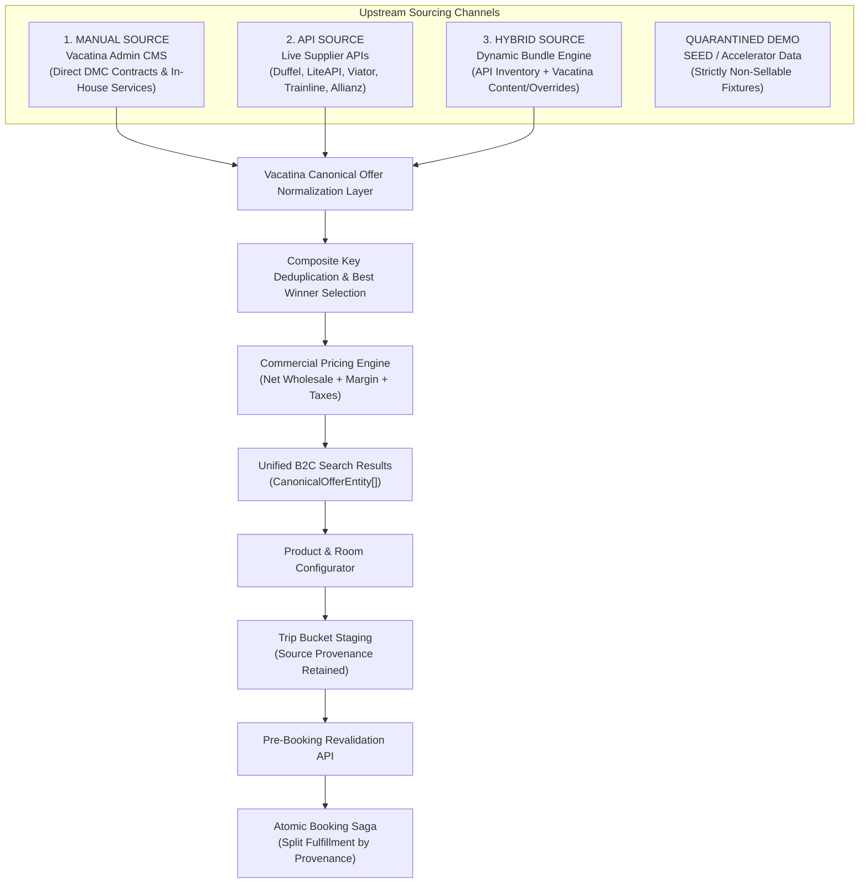
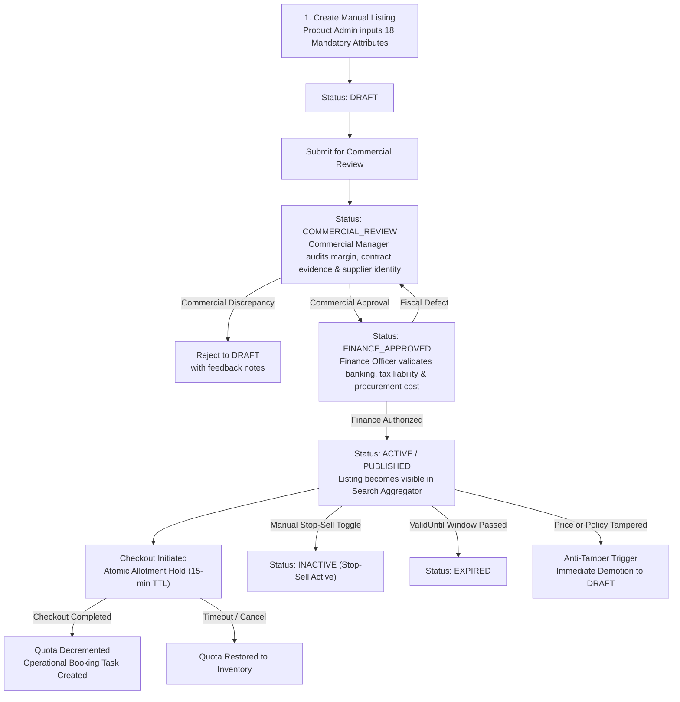
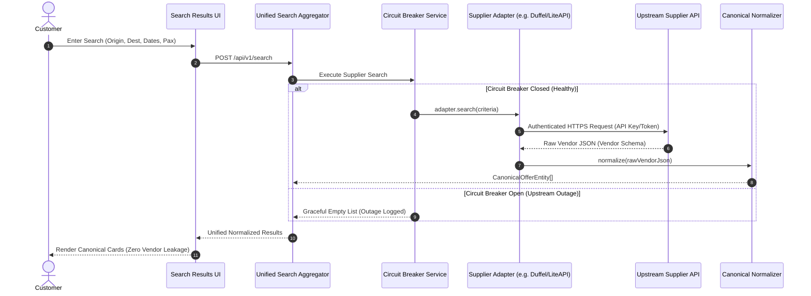
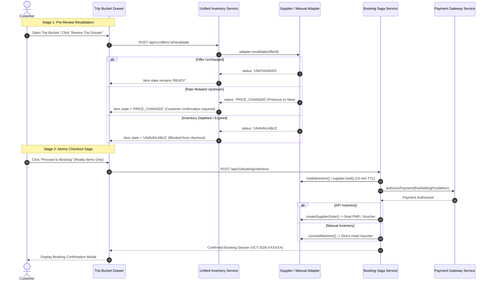
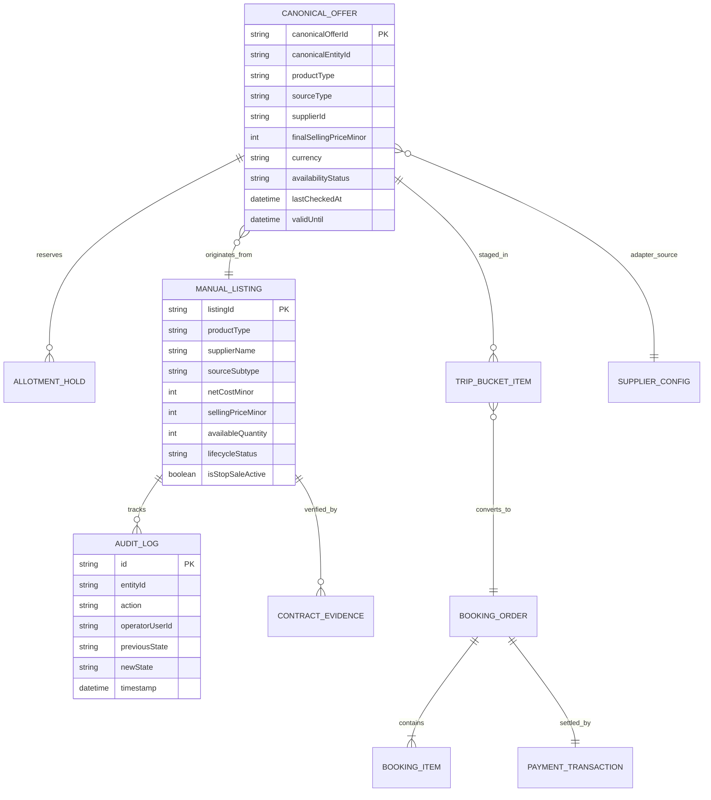

# Vacatina Travel OS — Supplier & Listing Architecture Specification (v1.0)

> **Historical snapshot:** verification counts and release status in this document predate the Phase 4 local baseline. Current verified baseline: **233/233 tests**, **0 typecheck errors**, build PASS, browser/server bundle isolated. See [../ENGINEERING_BASELINE.md](../ENGINEERING_BASELINE.md).

**Document Authority:** Vacatina Architectural Board, Lead Systems Architect & Head of Commercial Operations  
**Classification:** Enterprise Sourcing Engine, Canonical Offer Contract & Multi-Product Data Architecture  
**Target Systems:** Vacatina Inventory Orchestrator, Admin CMS, Supplier Adapters, Trip Bucket, Booking Saga  
**Status:** **LOCKED ARCHITECTURE SPECIFICATION (UI CHANGES FROZEN)**  
**Verified Baseline:** Git Commit [`8e4e463`](https://github.com/vacatina/vacatina/commit/8e4e463)  
**Production Live URL:** [https://vacatina-nu.vercel.app](https://vacatina-nu.vercel.app) (HTTP 200 Verified)  
**Automated Invariant Test Suite:** 108 / 108 Passing Gates across 5 Suites (100%)  
**Headless Chrome E2E Acceptance:** 33 / 33 Journeys & Viewports Passing (100%)  

---

## Deliverable A: Source-of-Truth Architecture

Vacatina unifies all travel commerce under a **Tri-Source Inventory Model** that decouples internal data provenance from customer presentation:

$$\mathbf{\text{INTERNAL PROVENANCE }} \ne \mathbf{\text{ CUSTOMER DISPLAY LABELS}}$$



### Source-of-Truth Authorities:
1. **`MANUAL` Listings:** The **Vacatina Database / Admin CMS** is the single source of truth for base cost, published selling price, allotment quotas, cancellation penalties, and validity dates.
2. **`API` Listings:** The **External Supplier API** is the single source of truth for seat/room availability, live net wholesale fares, flight schedules, and dynamic fare rules. Vacatina acts as a normalizing conduit.
3. **`HYBRID` Listings:** Governed by a **Split Authority Contract**:
   - *Supplier-Authoritative:* Net wholesale cost, live room/seat availability, carrier schedule, booking hold reference.
   - *Vacatina-Authoritative:* Commercial markup, B2C selling price, curated editorial content, complimentary inclusions, packaging rules.
4. **`SEED / PROTOTYPE` Data:** Strictly isolated from production commerce. Carries metadata `sourceType: 'seed'`, `isBookable: false`, `environment: 'prototype'`. It cannot enter checkout, cannot stage as `READY` in Trip Bucket, and cannot create live bookings.
5. **`CONTENT_ONLY / DISCOVERY_CONTENT`:** Teaser cards on homepage and guides. Non-inventory informational content that routes users to live search with prefilled criteria.

---

## Deliverable B: Canonical Vacatina Offer Schema

The frontend never inspects vendor-specific payloads. Every upstream record is normalized into the following strongly-typed schema:

```typescript
export type TravelProductSlug =
  | 'flights'
  | 'hotels'
  | 'visa'
  | 'packages'
  | 'cars'
  | 'rails'
  | 'cruises'
  | 'activities'
  | 'sightseeing'
  | 'insurance';

export type InventorySourceType = 'manual' | 'api' | 'hybrid';
export type OfferLifecycleStatus = 'draft' | 'active' | 'inactive' | 'expired';
export type OfferAvailabilityStatus = 'LIVE' | 'MANUAL_AVAILABLE' | 'ON_REQUEST' | 'SOLD_OUT' | 'UNAVAILABLE';
export type BookingMode = 'INSTANT_BOOK' | 'REQUEST_TO_BOOK' | 'ASSISTED_SERVICE' | 'INQUIRY_ONLY';

export interface StructuredLocation {
  city: string;
  country: string;
  countryCode?: string; // ISO 3166-1 alpha-2
  iataCode?: string;     // 3-letter IATA code for airports
  coordinates?: {
    latitude: number;
    longitude: number;
  };
}

export interface CanonicalOfferEntity {
  // 1. Identifiers
  offerId: string;                     // Universal stable ID (e.g. "vct-ht-liteapi-dubai-atlantis")
  canonicalEntityId: string;           // Physical entity ID for deduplication (e.g. "HOTEL_DUBAI_ATLANTIS")
  productType: TravelProductSlug;      // 1 of 10 locked products
  sourceType: InventorySourceType;     // 'manual' | 'api' | 'hybrid'
  supplierId: string;                  // e.g. "DUFFEL_NDC", "LITEAPI", "PAYLOAD_CMS_DIRECT"
  supplierOfferId?: string;            // Upstream provider offer ID (for API/Hybrid)
  manualListingId?: string;            // Admin CMS document ID (for Manual/Hybrid)

  // 2. Titles & Content
  title: string;                       // Customer-facing title
  subtitle?: string;                   // Secondary descriptive subtitle
  destinationId: string;               // Destination identifier / city name
  originId?: string;                   // Origin identifier (mandatory for flights, transfers, rails)
  location: StructuredLocation;        // Structured geographic location
  content: {
    description: string;               // Editorial description
    highlights: string[];              // Key feature bullet points
    importantNotes?: string[];         // Essential operational notices
  };
  images: {
    heroImageUrl: string;              // Primary editorial card image (100% unique)
    galleryUrls: string[];             // Secondary photography
    airlineLogoUrl?: string;           // Carrier branding (for flights)
  };

  // 3. Pricing & Currency (Integer Minor Units)
  price: number;                       // Customer-facing major unit display (e.g. 128500 LKR)
  currency: string;                    // ISO 4217 code ("LKR", "USD", "EUR", "AED", "GBP", "AUD")
  pricingLayers: {
    rawSupplierCostMinor: number;      // Net wholesale cost in minor units (cents/cents)
    platformMarkupMinor: number;       // Vacatina commercial margin in minor units
    manualOverrideMinor?: number;      // Administrative pricing override (if active)
    finalSellingPriceMinor: number;    // Calculated customer selling price in minor units
    currency: string;
  };
  taxesAndFees?: {
    totalTaxMinor: number;             // Total statutory taxes included or due
    isTaxInclusive: boolean;           // True if price includes all taxes
    mandatoryLocalFeesText?: string;   // e.g. "Tourism Dirham AED 20/night payable at property"
  };

  // 4. Availability & Freshness
  availabilityStatus: OfferAvailabilityStatus;
  lastCheckedAt: string;               // ISO 8601 timestamp of last availability confirmation
  validUntil: string;                  // ISO 8601 expiration timestamp (allotment end or rate TTL)
  freshness: {
    ttlSeconds: number;                // Cache freshness window (e.g. 1800s for flights)
    isStale: boolean;                  // True if now > lastCheckedAt + ttlSeconds
    revalidationEndpoint: string;      // POST /api/v1/offers/:id/revalidate
  };

  // 5. Commercial Inclusions, Terms & Rules
  inclusions: string[];                // What is included (e.g. "Breakfast buffet", "23kg baggage")
  exclusions: string[];                // What is excluded (e.g. "Airport visa on arrival fees")
  cancellationPolicy: {
    refundable: boolean;               // True if cancellable
    policySummary: string;             // Human-readable summary
    deadlineIso?: string;              // Free cancellation deadline
    penaltyRules?: string;             // Tiered penalty schedule
  };
  configurationRequirements: {
    requiresDates: boolean;            // Travel dates mandatory before checkout
    requiresTravellers: boolean;       // Passenger/guest count mandatory
    requiresPassportDetails: boolean;  // Biometric passport required (flights, visas)
    availableRoomOrSeatTiers?: Array<{
      id: string;
      name: string;
      deltaPriceMinor: number;
    }>;
  };
  bookingRequirements: {
    bookingMode: BookingMode;          // 'INSTANT_BOOK' | 'REQUEST_TO_BOOK' | 'ASSISTED_SERVICE'
    confirmationMode: 'INSTANT_CONFIRM' | 'REQUEST_TO_CONFIRM' | 'ASSISTED_SERVICE';
    minNoticeHours?: number;           // Minimum advance booking notice
  };

  // 6. Governance & Status
  pinAboveApi: boolean;                // Priority display badge ("Vacatina Exclusive")
  isExclusiveDeal?: boolean;           // Exclusive contract flag
  status: OfferLifecycleStatus;        // 'draft' | 'active' | 'inactive' | 'expired'
  metadata: Record<string, unknown>;    // Internal operations metadata (never exposed to client)
}
```

---

## Deliverable C: Manual Listing Workflow

Manual inventory represents legally contracted commercial allotments or internal service desks managed via `/admin/inventory`.



### The 18 Mandatory Attributes:
1. `listingId`
2. `productType` (1 of 10)
3. `supplierName`
4. `sourceType` (`'manual'`)
5. `sourceSubtype` (`'DIRECT_CONTRACT'`, `'MANUAL_SERVICE'`, `'CURATED_PACKAGE'`)
6. `confirmationMode` (`'INSTANT_CONFIRM'`, `'REQUEST_TO_CONFIRM'`, `'ASSISTED_SERVICE'`)
7. `currency`
8. `netCostMinor`
9. `sellingPriceMinor`
10. `markupRuleId`
11. `inventoryModel` (`'ALLOTMENT'`, `'ON_REQUEST'`, `'SERVICE_CAPACITY'`)
12. `availableQuantity`
13. `validFrom`
14. `validTo`
15. `cancellationPolicy`
16. `fulfillmentInstructions`
17. `contractEvidenceDossier` (countersigned PDF hash & contract ID)
18. `lifecycleStatus` (`draft`, `active`, `inactive`, `expired`)

---

## Deliverable D: API Listing Workflow

API listings represent dynamic supplier inventory retrieved through certified supplier adapters:



---

## Deliverable E: Hybrid Listing Workflow

A Hybrid listing combines an API-backed dynamic component with Vacatina-controlled commercial packaging or overrides:

### The Split Authority Matrix:
To prevent corrupting upstream supplier systems while preserving Vacatina commercial freedom, the system enforces strict field-level authority:

| Data Attribute | Field Authority | Vacatina Overridable? | Upstream Authoritative? | Governance Rule |
| :--- | :---: | :---: | :---: | :--- |
| **Wholesale Net Cost** | **Supplier** | **NO** | **YES** | Read-only wholesale price from supplier API rate plan. |
| **Platform Markup** | **Vacatina** | **YES** | **NO** | Managed via Vacatina Admin Commercial Pricing Rules. |
| **Final Customer Price** | **Calculated** | Derived | Derived | $\text{FinalPrice} = \text{SupplierCost} + \text{Markup} + \text{Taxes}$. |
| **Live Seat / Room Stock** | **Supplier** | **NO** | **YES** | Confirmed upstream; Vacatina cannot invent phantom stock. |
| **Marketing Title** | **Vacatina** | **YES** | NO | Can enhance generic supplier title (e.g. "Luxury Villa"). |
| **Hero & Gallery Images** | **Vacatina** | **YES** | NO | Vacatina may replace low-res vendor photos with curated images. |
| **Curated Inclusions** | **Vacatina** | **YES** | NO | Added amenities (e.g. "Complimentary VIP Chauffeur Transfer"). |
| **Carrier / Flight Schedule** | **Supplier** | **NO** | **YES** | Exact departure/arrival timestamps governed by airline. |
| **Cancellation Penalties** | **Supplier + Policy** | Conditional | **YES** | Vacatina can offer *stricter* terms, but never *looser* than supplier. |
| **Commercial Badge** | **Vacatina** | **YES** | NO | Can badge as "Vacatina Curated Package" or "Exclusive Deal". |

---

## Deliverable F: Supplier Adapter Interface

Every upstream provider adapter implements the standardized TypeScript contract:

```typescript
export interface BookingHoldResult {
  holdReference: string;
  expiresAtIso: string;
  guaranteedPriceMinor: number;
  currency: string;
}

export interface BookingConfirmationResult {
  bookingReference: string;
  supplierReference: string;
  status: 'CONFIRMED' | 'PENDING' | 'FAILED';
  issuanceTimestampIso: string;
  eTicketOrVoucherUrl?: string;
}

export interface BookingCancelResult {
  cancellationReference: string;
  refundAmountMinor: number;
  refundCurrency: string;
  status: 'CANCELLED';
}

export interface RevalidationResult {
  offerId: string;
  status: 'UNCHANGED' | 'PRICE_CHANGED' | 'UNAVAILABLE';
  updatedOffer?: CanonicalOfferEntity;
  previousPriceMinor?: number;
  newPriceMinor?: number;
  message?: string;
}

export interface ISupplierAdapter<TRawOffer = unknown> {
  readonly supplierId: string;
  readonly supplierName: string;
  readonly productType: TravelProductSlug;
  readonly environment: 'sandbox' | 'production';

  // Sourcing & Normalization
  search(criteria: SearchQueryCriteria): Promise<CanonicalOfferEntity[]>;
  getOffer(offerId: string): CanonicalOfferEntity | null;
  normalize(raw: TRawOffer): CanonicalOfferEntity;

  // Lifecycle & Integrity
  revalidate(supplierOfferId: string): Promise<RevalidationResult>;
  hold(offerId: string, quantity: number): Promise<BookingHoldResult>;
  createBooking(payload: Record<string, unknown>): Promise<BookingConfirmationResult>;
  cancelBooking(bookingRef: string, reason: string): Promise<BookingCancelResult>;
}
```

---

## Deliverable G: Revalidation and Booking Flow



---

## Deliverable H: Admin / CMS Requirements

1. **Dedicated Module Route:** `/admin/inventory` for inventory management and `/admin/integrations` for supplier telemetry.
2. **Role-Based Access Control (RBAC):**
   - `PRODUCT_ADMIN`: Can create and edit manual listings in `DRAFT`.
   - `COMMERCIAL_MANAGER`: Audits contract evidence, margin compliance, and advances to `COMMERCIAL_REVIEW`.
   - `FINANCE_OFFICER`: Authorizes procurement costs, banking settlement, and promotes to `FINANCE_APPROVED`.
   - `SUPER_ADMIN`: Master oversight, operational stop-sell override, and circuit breaker reset.
3. **Immutable Audit Ledger:** Every state transition, price change, or stop-sell toggle records:
   - `auditId`, `timestampIso`, `operatorUserId`, `operatorEmail`, `action`, `targetEntityId`, `previousState`, `newState`, `tamperDemotionReason`.
4. **Allotment Concurrency Monitor:** Real-time view of total rooms, committed held units (`COMMITTED_HELD`), and remaining available units.

---

## Deliverable I: 8-State Failure & Fallback Rules

| Failure State | Trigger Condition | System Behavior & Fallback Strategy | User-Facing Messaging |
| :--- | :--- | :--- | :--- |
| **`LOADING`** | Network request in flight. | Accessible skeleton cards with aria-live loading announcements. | "Searching verified live flights and direct boutique rates…" |
| **`NO_RESULTS`** | Zero offers match criteria. | Clean zero-state; offers date shift ($\pm 3$ days) or nearby airport filter. Never fabricate fake results. | "No available options found for selected dates. Try shifting dates or expanding filters." |
| **`SUPPLIER_ERROR`** | Upstream API returns 5xx error. | Circuit breaker trips; fails over to manual inventory or other healthy providers. Outage logged. | "Temporary connectivity delay with airline partner. Direct contracted rates remain available." |
| **`TIMEOUT`** | Upstream call exceeds 5000ms. | Aggregator terminates slow upstream call; serves results from fast providers and local contracts. | "Displaying verified options. Live partner response timed out." |
| **`PRICE_CHANGED`** | Revalidation detects mutated fare. | Trip Bucket item updates price; displays transparent previous vs new price; requires user confirmation. | "Price updated from LKR 92,000 to LKR 94,500. Please confirm to proceed." |
| **`UNAVAILABLE`** | Room/seat bucket sold out. | Staged item transitions to `UNAVAILABLE`; subtotal decrements; checkout blocked; suggests alternative. | "Selected room tier is now fully booked upstream. Please select an alternate room." |
| **`OFFER_EXPIRED`** | 30-min TTL expires in drawer. | Item transitions to `OFFER_EXPIRED`; one-click refresh button re-queries availability. | "Rate hold window has expired. Click 'Refresh Rates' to check current availability." |
| **`RETRY`** | Transient network drop. | Idempotent retry button with exponential backoff telemetry. | "Connection interrupted. Click to retry search." |

---

## Deliverable J: Product-by-Product Sourcing Strategy

The 10 product verticals are categorized into their primary upstream sourcing mechanisms:

| # | Product Vertical | Primary Source | Secondary / Fallback Source | Upstream Adapter Status | Production Status |
| :-: | :--- | :---: | :---: | :---: | :---: |
| **1** | **Flights** | **`API`** | `MANUAL` (Charters / Group Allocations) | `FlightsDuffelAdapter` (`DUFFEL_NDC`) | `SANDBOX / SIMULATED` |
| **2** | **Hotels** | **`HYBRID`** | `API` (Bedbank) & `MANUAL` (Direct DMC) | `HotelsLiteApiAdapter` (`LITEAPI`) | `SANDBOX / SIMULATED` |
| **3** | **Visa Assistance** | **`MANUAL`** | External Consular Gateways (Future eVisa) | `VisaConsularAdapter` (`VACATINA_CONSULAR_DESK`) | `OPERATIONAL_SERVICE_READY` |
| **4** | **Holiday Packages** | **`HYBRID`** | `MANUAL` (Fixed Curated Itineraries) | `PackagesBundlerAdapter` (`VACATINA_BUNDLER`) | `MANUAL_CURATION_READY` |
| **5** | **Cars & Transfers** | **`HYBRID`** | `API` (CarTrawler) & `MANUAL` (Chauffeur Fleet) | `CarsRentalAdapter` (`RENTALCARS`) | `SANDBOX / SIMULATED` |
| **6** | **Rails** | **`API`** | `MANUAL` (Scenic Rail Allocations) | `RailsTrainlineAdapter` (`TRAINLINE`) | `SANDBOX / SIMULATED` |
| **7** | **Cruises** | **`HYBRID`** | `API` (Traveltek) & `MANUAL` (Charter Yachts) | `CruisesTraveltekAdapter` (`TRAVELTEK`) | `SANDBOX / SIMULATED` |
| **8** | **Activities** | **`HYBRID`** | `API` (Viator) & `MANUAL` (Local Experiences) | `ActivitiesViatorAdapter` (`VIATOR`) | `SANDBOX / SIMULATED` |
| **9** | **Sightseeing Tours** | **`MANUAL`** | `API` (Tour Marketplace Aggregators) | `SightseeingViatorAdapter` (`VIATOR_TOURS`) | `SANDBOX / SIMULATED` |
| **10** | **Travel Insurance** | **`API`** | `MANUAL` (Underwriter Policy Catalog) | `InsuranceAllianzAdapter` (`ALLIANZ`) | `SANDBOX / SIMULATED` |

---

## Deliverable K: Backend API Contract

All backend endpoints strictly follow standard HTTP verbs and RFC 7807 Problem Details for errors:

```text
POST   /api/v1/search                       # Multi-product unified search
GET    /api/v1/offers/:id                   # Fetch detailed canonical offer dossier
POST   /api/v1/offers/:id/revalidate        # Pre-booking rate & availability revalidation
POST   /api/v1/inventory/hold               # Atomic 15-minute allotment hold
POST   /api/v1/inventory/release            # Release held allotment quota
GET    /api/v1/admin/listings               # Query manual & hybrid listings (Admin only)
POST   /api/v1/admin/listings               # Create new manual listing in DRAFT
PUT    /api/v1/admin/listings/:id           # Mutate listing (triggers anti-tamper if active)
POST   /api/v1/admin/listings/:id/lifecycle # 4-Eyes lifecycle transition
POST   /api/v1/booking/checkout             # Execute multi-source atomic booking saga
GET    /api/v1/bookings/:ref                # Retrieve confirmed booking dossier
POST   /api/v1/visa/applications            # Submit consular visa intake & document checklist
POST   /api/v1/support/tickets              # Submit support triage ticket
```

---

## Deliverable L: Database & Entity Model



---

## Deliverable M: Migration Path from Current Prototype Cards

To transition from the current 40 static prototype cards to live hybrid commerce **without breaking the approved homepage UI**:

1. **Step 1: Taxonomy Reclassification (Complete):**
   Current prototype cards carry `contentId` (e.g. `dsc_dxb_flight_01`), `sellability: 'DISCOVERY_ONLY'`, and `isLiveInventoryOffer: false`. They are strictly classified as `CONTENT_ONLY` / `DISCOVERY_CONTENT`.
2. **Step 2: Prefill Search Wiring (Complete):**
   Clicking a discovery card dispatches to its product hub with prefilled search parameters (`/flights?from=CMB&to=DXB&departureDate=2026-11-15`) rather than attempting a fake direct checkout.
3. **Step 3: Admin CMS Onboarding (Ready):**
   Commercial operations team uses `/admin/inventory` to input real contracted hotels (e.g. Jetwing Vil Uyana) and consular desk services, advancing through 4-Eyes verification into `PUBLISHED`.
4. **Step 4: Upstream API Key Injection (Pending Commercial Agreements):**
   When live production credentials for Duffel, LiteAPI, and Viator are provisioned, inject keys into the secure backend vault. Adapters will automatically switch from `SANDBOX / SIMULATED` to live authenticated queries.
5. **Step 5: Seamless UI Transition (Zero UI Redesign):**
   Because the search results cards consume the normalized `CanonicalOfferEntity`, switching from simulated sandbox responses to live API responses requires zero changes to the approved customer-facing HTML or CSS.

---

## Production UI Freeze Confirmation

Per explicit instructions:
- **No changes to production customer UI have been made.**
- **The approved customer-facing homepage architecture, Screen 01–08 layout, Brand DNA (`#1B1464`), and 11 Search Command Center tabs remain strictly preserved.**
