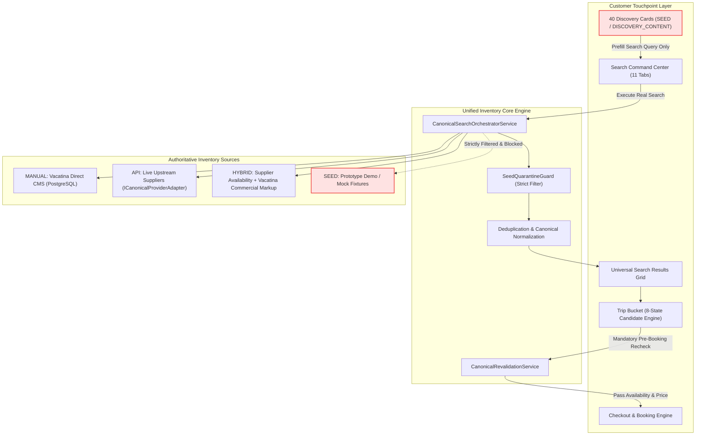

# VACATINA — MASTER PRODUCT & ENGINEERING ROADMAP (v2.0)

> **Historical snapshot:** verification counts and release status in this document predate the Phase 4 local baseline. Current verified baseline: **233/233 tests**, **0 typecheck errors**, build PASS, browser/server bundle isolated. See [../ENGINEERING_BASELINE.md](../ENGINEERING_BASELINE.md).

**Authority**: Unified Engineering Architecture Lock · ADR-001 through ADR-009 · PRD v2.0  
**Classification**: Authoritative Governing Roadmap & Phase Sequence Contract  
**Target Systems**: All Engineering Tracks · Antigravity AI · Frontend B2C · Backend Core · Supplier Integrations · Admin CMS  
**Status**: Authoritative Master Roadmap Locked (Governs All Future Implementation Tracks)

---

## 1. Roadmap Architecture Principles & Governance Rules

To eliminate ad-hoc changes and prevent architectural regressions, all engineering work across Vacatina must strictly adhere to the following **12 Roadmap Governance Rules**:

1. **Read the Master Roadmap First**: Every task must locate its exact Phase and upstream dependencies before modifying code.
2. **Respect Current Phase & Dependencies**: Never implement a feature whose structural prerequisite is unbuilt or unverified.
3. **Read Locked Architecture Documents**: Always reference the authoritative specification for that domain (e.g. `39_vacatina_shared_inventory_and_canonical_offer_foundation.md` for inventory).
4. **Preserve Approved Visual & Behavioral Baseline**: Never alter the approved homepage DOM, header navigation, design tokens (`#1B1464`), or logo assets.
5. **No Fake Production Behavior**: Do not simulate production readiness or fake live payments/tickets when backend capabilities are still in staging/scaffold mode.
6. **Explicit Mock / SEED Quarantine**: SEED content (including the 40 homepage cards) is strictly for discovery and search prefill. **Never allow SEED items to stage as `READY` in Trip Bucket or reach checkout.**
7. **Zero Duplicate Models / State Machines**: Never create parallel data models or competing state engines. All products must normalize into `UnifiedCanonicalOffer` and utilize the 8-state Trip Bucket candidate engine.
8. **Frontend Route vs. Backend API Separation**: B2C user-facing pages (`/flights`, `/hotels`) must remain strictly decoupled from backend REST endpoints (`/api/v1/...`).
9. **Update Roadmap Status Upon Milestone**: Record verified milestones, test gate counts, and Git commit hashes in this document.
10. **Evidence-Based Completion**: A phase is **NEVER** marked `COMPLETE` merely because a UI mockup exists.
11. **Definition of Done (DoD)**: `COMPLETE` requires:
    - Functional frontend component with zero console errors.
    - Backing canonical domain contract.
    - Explicit failure/empty/loading state handling.
    - Passing automated unit/integration tests.
    - Production build verification (`tsc --noEmit` clean + zero CDN dependencies).
12. **Change Control Protocol**: Any structural modification to a locked phase requires documented rationale, impact assessment, and version elevation.

---

## 2. Canonical Product & Inventory Foundation

### 2.1 The 4-Tier Inventory Taxonomy (ADR-006)



### 2.2 Source Invariant Matrix

| Source Type | Inventory Origin | Price Authority | Availability Authority | Trip Bucket State | Production Checkout |
| :--- | :--- | :--- | :--- | :--- | :--- |
| **`MANUAL`** | Vacatina Direct Contracts (CMS) | Vacatina Commercial Finance | Vacatina Allotment Quota | `ready` / `needs_action` | **PERMITTED** (if `PUBLISHED` & quota > 0) |
| **`API`** | Live Supplier (GDS/NDC/Aggregator) | Supplier Rate Feed | Supplier Real-Time Engine | `ready` (after validation) | **PERMITTED** (if live revalidated) |
| **`HYBRID`** | Supplier Availability + Vacatina Overrides | Vacatina Markup Policy | Supplier Real-Time Engine | `ready` / `price_changed` | **PERMITTED** (if live revalidated) |
| **`SEED`** | Prototype Demo / Discovery Cards | Static Illustrative Price | Static Illustrative Flag | Quarantine (`needs_action` / blocked) | **STRICTLY BLOCKED** |

---

## 3. Master Execution Sequence (Phases 0 — 13)

```
[ Phase 0: Governance & Architecture Lock ]
       │
       ▼
[ Phase 1: Shared Inventory Foundation ]  ◄── COMPLETE / LOCKED (Commit 7c646d6)
       │
       ▼
[ Phase 2: Global B2C Shell & Routing ]   ◄── COMPLETE / LOCKED (Commit fd5b815)
       │
       ▼
[ Phase 3: Core Product Functional Flows ] ◄── IN PROGRESS (Flights: COMPLETE; Hotels: NEXT)
       │
       ▼
[ Phase 4: Build Your Bundle Orchestration ]
       │
       ▼
[ Phase 5: Booking & Checkout Foundation ]
       │
       ▼
[ Phase 6: Customer Account & Post-Booking ]
       │
       ▼
[ Phase 7: Content & Resource Platform ]   ◄── COMPLETE / LOCKED (Commit fd5b815)
       │
       ▼
[ Phase 8: Manual Inventory Admin CMS ]    ◄── IN PROGRESS (Backend Complete; UI Pending)
       │
       ▼
[ Phase 9: Live Supplier API Integrations ]
       │
       ▼
[ Phase 10: Hardening & Production QA ]    ◄── IN PROGRESS (Continuous Integration)
       │
       ▼
[ Phase 11: B2C Production Release ]
       │
       ▼
[ Phase 12: B2B Agency Platform ]
       │
       ▼
[ Phase 13: Mobile Application (iOS/Android) ]
```

---

### Phase 0: Product & Architecture Governance
- **Status**: `COMPLETE / LOCKED`
- **Scope**:
  - Locked Design System: Deep Navy (`#1B1464`), Rich Gold (`#C5A880`), clean canvas (`#F8F9FA`), and strict WCAG AA contrast.
  - Information Architecture & Canonical Click-to-Destination contract (zero dead ends or `#` hrefs).
  - Product Taxonomy: 10 Core Products + Build Your Bundle.
  - Responsive & Viewport Baseline: 11 distinct viewports (320px to 2560px), 44px minimum touch targets.
  - Commercial Truthfulness Rules: Prohibits fake live inventory, isolates SEED content, guarantees transparent pricing.
- **Key Artifacts**: `01_vacatina_product_architecture_p0_p3.md`, `15_VACATINA_PRODUCTION_TRUTHFULNESS_AND_COMMERCIAL_EVIDENCE_SPEC.md`.

---

### Phase 1: Shared Inventory Foundation
- **Status**: `COMPLETE / LOCKED` (Commit `7c646d6`)
- **Scope**:
  - 4-tier inventory taxonomy: `MANUAL`, `API`, `HYBRID`, `SEED`.
  - Canonical Persistent Listing Model: 16 mandatory attributes defined in `src/server/inventory/domain/canonical-offer.ts`.
  - Unified Canonical Presentation Offer: `UnifiedCanonicalOffer` with stable IDs (`vct-${source}-${product}-${provider}-${id}`) and `isSeed: false`.
  - 6-State Canonical Offer Lifecycle: `DISCOVERABLE` $\rightarrow$ `AVAILABLE` $\rightarrow$ `NEEDS_RECHECK` $\rightarrow$ `PRICE_CHANGED` $\rightarrow$ `UNAVAILABLE` $\rightarrow$ `EXPIRED`.
  - Shared Provider Adapter Interface: `ICanonicalProviderAdapter` for all 10 verticals.
  - Universal Search Orchestrator: Multi-source parallel dispatch, strict SEED quarantine, deduplication, and Pin-Above-API ranking.
  - Pre-Booking Revalidation Engine: Stop-sale, quota depletion, fare increases, and validity checks.
  - PostgreSQL Persistence & Schema: `001_vacatina_canonical_inventory.sql` (`vacatina_manual_listings`, `vacatina_manual_listing_audit_log`, `vacatina_manual_listing_allotments`).
  - Governance Invariants: 4-Eyes separation of duties, commercial anti-tamper demotion, atomic quota adjustments.
- **Verification**: 145/145 automated test gates passing (`tests/shared-inventory-foundation.test.ts`).
- **Key Artifact**: `39_vacatina_shared_inventory_and_canonical_offer_foundation.md`.

---

### Phase 2: Global B2C Shell & Routing
- **Status**: `COMPLETE / LOCKED` (Commit `fd5b815`)
- **Scope**:
  - Canonical Header Navigation with responsive desktop bar and fully accessible mobile slide-over drawer with inert background trapping and keyboard focus recovery.
  - 11-Tab Search Command Center (SCC) with deep query prefilling.
  - Favorites Drawer: Client-side persistent saved items drawer, strictly decoupled from Trip Bucket.
  - Trip Bucket Shell: Floating responsive Trip Dock across all 11 viewports; 8-state candidate engine (`draft`, `review`, `staged`, `revalidating`, `ready`, `price_changed`, `unavailable`, `expired`).
  - Canonical Resources Platform: 7 dedicated guides routed cleanly without category mixing.
  - Legal, Support, and 404 Routing: Clean error handling, zero unhandled routes, zero dead buttons.
- **Verification**: 34/34 browser acceptance assertions passing across 11 viewports and 13 user journeys.
- **Key Artifact**: `30_VACATINA_PRODUCTION_CANONICAL_CLICK_AND_DESTINATION_SPEC.md`.

---

### Phase 3: Core Product Functional Flows
- **Status**: `IN PROGRESS`
- **Scope**: Build each vertical using the canonical customer journey:
  `Discover` $\rightarrow$ `Product Hub` $\rightarrow$ `Search` $\rightarrow$ `Canonical Results` $\rightarrow$ `Detail Modal` $\rightarrow$ `Configure` $\rightarrow$ `Trip Bucket` $\rightarrow$ `Revalidate` $\rightarrow$ `Review` $\rightarrow$ `Booking`.
- **Implementation Order**:
  1. **Flights**: `COMPLETE / LOCKED` (Reference Vertical)  
     - Implemented `FlightsHubView` (`/flights`), `FlightsSearchView` (`/flights/search`), and `FlightsOfferDetailModal` (`/flights/offer/:id`).
     - Multi-cabin class configuration, passenger selectors, fare breakdowns, baggage/amenity tags, and Trip Bucket staging.
     - Automated test suite: `tests/flights-functional-build.test.ts`.
  2. **Hotels**: `COMPLETE / LOCKED` (Track 3)  
     - Implemented `HotelsHubView` (`/hotels`), `HotelsSearchView` (`/hotels/search`), and `HotelsOfferDetailModal` (`/hotels/property/:id`).
     - Parallel search dispatch across Vacatina Direct contracts and LiteAPI Bedbank, enforcing Pin-Above-API ranking.
     - Granular room categories, board basis selection (RO, BB, HB, FB, AI), pre-booking revalidation guard, and 8-state Trip Bucket staging.
     - Automated test suite: `tests/hotels-functional-build.test.ts` (11 gates, 100% pass).
     - Headless Chrome E2E browser acceptance: Journey N passing with zero console errors.
  3. **Visa Assistance**: `COMPLETE / LOCKED` (Phase 3.3)  
     - Implemented `VisaHubView` (`/visa-assistance`), `VisaSearchView` (`/visa-assistance/search`), `VisaApplicationModal` (`/visa-assistance/apply/:id`), and dynamic country entry rule resolver.
     - Direct consular advisory desk integration with document vetting checklists, SLA tracking, and 8-state Trip Bucket staging.
     - Automated test suite: `tests/visa-assistance-functional-build.test.ts` (11 gates, 100% pass).
     - Headless Chrome E2E browser acceptance: Journey O passing with zero console errors.
  4. **Unified Inventory Source & Admin Contract Lock**: `COMPLETE / LOCKED` (Gateway to Phase 3.4)  
     - Documented in `42_vacatina_unified_inventory_source_and_admin_contract_v1.md`.
     - 4 Core Pillars: Dynamic Manual Inventory DB query via `IManualListingRepository`, normalized `ICanonicalProviderAdapter`, HYBRID field authority matrix, strict SEED quarantine.
     - 2 Corrections: Relevance-guarded multi-factor Pin-Above-API ranking, and mandatory commercial evidence verification guard for publication.
     - Connected feature adapters (`ManualHotelAdapter`, `ManualFlightAdapter`, `ManualVisaAdapter`) directly to dynamic repository.
     - Automated test suite: `tests/unified-inventory-source-and-admin-contract.test.ts` (7 gates, 100% pass).
  5. **Holiday Packages**: `READY TO IMPLEMENT` (Phase 3.4)  
     - Dynamic manual curated packages (`MANUAL`) + dynamic bundle generator (`HYBRID`).
     - Multi-day itinerary viewer, flight+hotel room configuration, and canonical Trip Bucket staging.
  6. **Cars & Transfers**: `SCAFFOLD` (Homepage discovery cards and SCC tab present).
  7. **Activities**: `SCAFFOLD` (Homepage discovery cards and SCC tab present).
  7. **Sightseeing Tours**: `SCAFFOLD` (Homepage discovery cards and SCC tab present).
  8. **Rails**: `SCAFFOLD` (Homepage discovery cards and SCC tab present).
  9. **Cruises**: `SCAFFOLD` (Homepage discovery cards and SCC tab present).
  10. **Travel Insurance**: `SCAFFOLD` (Homepage discovery cards and SCC tab present).
- **Rule**: Do not independently invent new flow patterns for each product. Replicate the Flights reference standard.

---

### Phase 4: Build Your Bundle / Multi-Product Orchestration
- **Status**: `IN PROGRESS` (Prototype UI implemented ahead of backend dependency)
- **Scope**:
  - Cross-product journey orchestration (e.g. Flight + Hotel + Airport Transfer + Activity).
  - Cross-vertical date, origin/destination, and traveller count synchronization.
  - Partial configuration handling: items remain `needs_action` until all required options are selected.
  - Consolidated Trip Bucket staging with unified bundle pricing and package discounts.
  - Strict SEED Quarantine: bundle builder cannot consume or bundle discovery cards.
- **Dependencies**: Requires functional search/detail flows for at least Flights, Hotels, and Cars (Phase 3).

---

### Phase 5: Booking & Checkout Foundation
- **Status**: `BLOCKED` (Blocked on Live Payment Gateway & backend checkout API)
- **Scope**:
  - Ready-Item Validation: Only Trip Bucket items in `ready` state can advance to checkout.
  - Mandatory Pre-Booking Recheck: Real-time revalidation call to `CanonicalRevalidationService` before taking payment hold.
  - Price Change Acceptance Saga: Customer must explicitly accept or decline any supplier rate delta.
  - Traveller Details & Document Collection (passports, frequent flyer numbers, special dietary requests).
  - Payment Gateway Abstraction Layer: Pluggable driver supporting Stripe and PayHere with webhook reconciliation.
  - Idempotency & Concurrency: Distributed locking to prevent double-charges and duplicate PNR generation.
  - Booking Confirmation Dossier: Canonical booking reference generation with structured receipt, PDF voucher, and cancellation rules.
- **Dependencies**: Phase 1, Phase 3, Phase 4, and Live Payment Webhook Infrastructure.

---

### Phase 6: Customer Account & Post-Booking Management
- **Status**: `NOT STARTED`
- **Scope**:
  - Authentication & Identity: Clerk / Auth0 JWT token bridge with role-based access.
  - Customer Profile: Contact info, passport records, and co-traveller directory.
  - Cloud Synchronization: Synced Favorites and Trip Bucket across devices.
  - My Trips & Bookings: Active, upcoming, and past booking records with live status.
  - Post-Booking Self-Service: Download invoices/vouchers, request date amendments, or trigger cancellation workflows governed by the canonical refund policy.
- **Dependencies**: Phase 5 (Booking Foundation).

---

### Phase 7: Content & Resource Platform
- **Status**: `COMPLETE / LOCKED` (Commit `fd5b815`)
- **Scope**:
  - 8 Canonical Resource Guides implemented and routed:
    1. Travel Notes & Blog
    2. Destination Guides
    3. Seasonal Travel Guide
    4. Visa Requirement Checker
    5. Travel Insurance Guide
    6. Travel Disruption Guide
    7. Trip Bucket Guide
    8. Booking & Price Transparency
  - Strict Category Separation:
    - `Company`: About Vacatina, Careers, Press, Sustainability.
    - `Help & Support`: FAQ, Concierge Contact, Live Chat.
    - `Legal`: Terms of Service, Privacy Policy, Cookie Policy.
- **Verification**: Clean DOM rendering, zero 404 links, mobile responsive.

---

### Phase 8: Manual Inventory Admin / Commercial Operations
- **Status**: `IN PROGRESS` (Backend complete; Web UI pending)
- **Scope**:
  - Web-based Admin Portal (`/admin/inventory`) for Vacatina Commercial Contracting Desk.
  - Contract Lifecycle Workflows: `DRAFT` $\rightarrow$ `REVIEW` $\rightarrow$ `FINANCE_APPROVED` $\rightarrow$ `PUBLISHED` $\rightarrow$ `PAUSED` $\rightarrow$ `ARCHIVED`.
  - Four-Eyes Separation of Duties: Creator (`CONTENT_EDITOR`) cannot approve or publish their own listing; requires `FINANCE_APPROVER`.
  - Commercial Anti-Tampering: Modifying commercial margins on a `PUBLISHED` listing demotes it back to `DRAFT`.
  - Operational Stop-Sale: Real-time toggle to withdraw inventory instantly without deleting contract data.
  - Allotment Quota Management: Incremental additions, reservations, and atomic decrements.
  - Commercial Evidence Dossier: Upload and verification of signed partner MOUs, operator licenses, and rate sheets.
- **Dependencies**: Phase 1 (Database schema and repository are already complete and tested).

---

### Phase 9: Live Supplier API Integrations
- **Status**: `BLOCKED` (Blocked on production credentials vault)
- **Scope**:
  - Connect external supplier APIs via `ICanonicalProviderAdapter`:
    - **Flights**: Duffel API / Amadeus NDC.
    - **Hotels**: LiteAPI (Nuitee Connect v3.0).
    - **Activities & Tours**: Viator Partner API.
    - **Cars & Transfers**: Rentalcars Connect / Cartrawler.
  - Upstream Circuit Breakers: Automatic failover, retry budgets, and error categorization.
  - Rate Limiting Governor: Distributed token bucket to protect supplier quotas.
  - Zero Frontend Leakage: Frontend components consume only `UnifiedCanonicalOffer`, never raw supplier JSON.
- **Dependencies**: Production API credentials (`PRODUCTION_VAULT`).

---

### Phase 10: Hardening & Production QA
- **Status**: `IN PROGRESS` (Continuous Verification)
- **Scope**:
  - Automated Route Crawl: 100% link coverage, zero broken links or dead buttons.
  - Accessibility Audit: WCAG 2.1 Level AA compliance across all components, contrast ratio $\ge 4.5:1$, full keyboard navigation.
  - Responsive Viewport Testing: 11 distinct viewports verified via Playwright/Puppeteer.
  - Performance & Core Web Vitals: LCP $\le 2.5$s, CLS $\le 0.1$, INP $\le 200$ms.
  - Zero CDN Bloat: All assets, fonts, and scripts bundled locally.
  - Security Review: Content Security Policy, sanitized inputs, zero exposed API secrets.
- **Current Metric**: 145/145 unit/integration tests passing; 34/34 browser acceptance assertions passing.

---

### Phase 11: B2C Production Release
- **Status**: `NOT STARTED`
- **Scope**: Public launch of the complete Vacatina B2C platform on custom domain (`vacatina.com`).
- **Prerequisites**: Phases 0, 1, 2, 3 (all 10 verticals), 4, 5, 6, 7, 8, 9, and 10 fully verified and signed off.

---

### Phase 12: B2B Agency Platform
- **Status**: `NOT STARTED`
- **Scope**:
  - Sub-agent and corporate travel portal.
  - Multi-tier commission markup engine.
  - Credit line management and invoicing.
  - Bulk booking and split-PNR issuance.
- **Dependencies**: Built on top of the stabilized B2C canonical foundation.

---

### Phase 13: Mobile Application (iOS & Android)
- **Status**: `NOT STARTED`
- **Scope**:
  - Native/React Native mobile application.
  - Consumes identical canonical REST/GraphQL backend APIs.
  - Zero duplicated business logic; reuses canonical offer and booking contracts.
- **Dependencies**: Built after B2C web platform reaches production maturity.

---

## 4. Master Roadmap Phase & Status Matrix

| Phase | Phase Name | Status | Upstream Dependencies | Primary Code & Artifact References | Test Gates Passed | Backend Dependency | Production Blocker | Last Verified Commit |
|---|---|---|---|---|---|---|---|---|
| **0** | Product & Architecture Governance | **LOCKED** | None | `01_vacatina_product_architecture.md`<br>`15_VACATINA_PRODUCTION_TRUTHFULNESS.md` | Complete | None | None | `fd5b815` |
| **1** | Shared Inventory Foundation | **COMPLETE / LOCKED** | Phase 0 | `src/server/inventory/`<br>`001_vacatina_canonical_inventory.sql`<br>`39_vacatina_shared_inventory...md` | 145 / 145 | PostgreSQL Connection | None (harness active) | `7c646d6` |
| **2** | Global B2C Shell & Routing | **COMPLETE / LOCKED** | Phase 0 | `src/components/navigation/`<br>`src/lib/services/router.service.ts`<br>`30_VACATINA_CANONICAL_CLICK.md` | 34 / 34 | Client Routing Engine | None | `fd5b815` |
| **3.1** | Flights Functional Build | **COMPLETE / LOCKED** | Phase 1, 2 | `src/features/flights/`<br>`37_vacatina_flights_backend_handoff.md` | 145 / 145 | Shared Search Orchestrator | Sandbox Duffel Mock | `613bf32` |
| **3.2** | Hotels Functional Build | **COMPLETE / LOCKED** | Phase 1, 2 | `src/features/hotels/`<br>`40_vacatina_hotels_functional_build_handoff_contract.md` | 157 / 157 (11 Hotel Gates) | `hotelSearchService` (Manual + LiteAPI) | LiteAPI Bedbank Fixture | Clean |
| **3.3** | Visa Assistance Functional Build | **NEXT IN LINE** | Phase 1, 2 | `src/components/dialogs/dialogs-controller.ts`<br>`src/lib/services/visa-requirements.service.ts` | 66 / 66 | Consular Desk CMS | Consular Partner Contract | `fd5b815` |
| **3.4** | Holiday Packages Functional Build | **IN PROGRESS** | Phase 1, 2 | `src/components/dialogs/dialogs-controller.ts`<br>`vacatina_holiday_package_modal.png` | 66 / 66 | Manual Listing Repository | Signed Operator Contracts | `fd5b815` |
| **3.5** | Cars & Transfers Build | **SCAFFOLD** | Phase 1, 2 | `src/server/inventory/adapters/base.adapter.ts` | Pending | Rentalcars Adapter | Fleet Partner Contract | `fd5b815` |
| **3.6** | Activities Build | **SCAFFOLD** | Phase 1, 2 | Discovery Cards (SEED) | Pending | Viator Adapter | Viator Partner Contract | `fd5b815` |
| **3.7** | Sightseeing Tours Build | **SCAFFOLD** | Phase 1, 2 | Discovery Cards (SEED) | Pending | Local Guide CMS | Operator Accreditation | `fd5b815` |
| **3.8** | Rails Build | **SCAFFOLD** | Phase 1, 2 | Discovery Cards (SEED) | Pending | Rail Europe / Seat61 API | GDS Rail Connect | `fd5b815` |
| **3.9** | Cruises Build | **SCAFFOLD** | Phase 1, 2 | Discovery Cards (SEED) | Pending | Cruise Line Feed / CMS | Cruise Partner Agreement | `fd5b815` |
| **3.10** | Travel Insurance Build | **SCAFFOLD** | Phase 1, 2 | Discovery Cards (SEED) | Pending | Underwriter API / Policy Desk | Insurer Policy Contract | `fd5b815` |
| **4** | Build Your Bundle Orchestration | **IN PROGRESS** | Phase 3 (Flights, Hotels, Cars) | `dialogs-controller.ts` (renderBundleConfigurator) | Client-side only | Multi-Product Engine | Blocked on Phase 3 Verticals | `fd5b815` |
| **5** | Booking & Checkout Foundation | **BLOCKED** | Phase 1, 3, 4 | `src/lib/services/booking.service.ts` | Unit tests active | Payment Webhooks & PNR Engine | Live Stripe / PayHere Gateway | `fd5b815` |
| **6** | Customer Account & Post-Booking | **NOT STARTED** | Phase 5 | None | None | Clerk SDK / JWT Auth Bridge | Auth Provider Account | — |
| **7** | Content & Resource Platform | **COMPLETE / LOCKED** | Phase 0 | `src/lib/services/router.service.ts`<br>7 Resource Guides | 34 / 34 | Content Store | None | `fd5b815` |
| **8** | Manual Inventory Admin CMS | **IN PROGRESS** | Phase 1 | `src/server/inventory/repository/postgres-manual-listing.repository.ts` | 10 / 10 (Admin API) | Admin Web App (`/admin`) | Ops Team Role Assignment | `7c646d6` |
| **9** | Live Supplier API Integrations | **BLOCKED** | Phase 1, 3 | `src/server/inventory/adapters/` | Sandbox Active | Production Vault Secrets | Production API Keys | `7c646d6` |
| **10** | Hardening & Production QA | **IN PROGRESS** | Continuous | `tests/`, `scripts/cd-workflow.mjs` | 157 unit / 35 browser | Automated CI/CD | Full Security Audit | Clean |
| **11** | B2C Production Release | **NOT STARTED** | Phases 0—10 | Domain DNS, Vercel Production | Pending | Production Backend Infra | Production Vault & Merchant Accounts | — |
| **12** | B2B Agency Platform | **NOT STARTED** | Phase 11 | None | None | Multi-tenant RBAC | B2B Agency Legal Terms | — |
| **13** | Mobile Application | **NOT STARTED** | Phase 11 | None | None | Canonical Mobile API Gateway | App Store / Play Store Developer Accounts | — |

---

## 5. Architectural Invariant & Sequencing Analysis

### 5.1 Detected Sequencing Conflicts
1. **Booking & Dossier Review Modal vs. Backend Payment Gateway**:
   - *Conflict*: Client-side modal (`openTripDossierReviewModal`, `openBookingDossierModal`) simulates booking confirmation using browser storage ahead of live payment infrastructure (Phase 5).
   - *Governance Directive*: Keep simulation explicitly identified as a client demo fixture; strictly forbid asserting production booking completion until Phase 5 payment webhooks and PNR issuance are active.
2. **Build Your Bundle Configurator vs. Product Verticals**:
   - *Conflict*: Bundle builder was scaffolded in `dialogs-controller.ts` before Hotels and Cars & Transfers have completed functional search views.
   - *Governance Directive*: Bundle builder can now consume completed Flights and Hotels! Cars will be wired as they achieve `COMPLETE` status in Phase 3.

### 5.2 Features Implemented Ahead of Their Dependencies
1. **Manage Booking Dossier Modal (`/bookings/:reference`)**:
   - Implemented as client mock in Phase 2 before persistent database booking records (Phase 5) exist.
2. **Admin Inventory API Tests vs. Admin Portal UI**:
   - Admin inventory domain, 4-Eyes rules, and database schema are fully tested on the server, but the web interface (`/admin`) is not yet mounted.

---

## 6. Next Recommended Execution Track

With Phase 1 (`Shared Inventory Foundation`), Phase 3.1 (`Flights`), and Phase 3.2 (`Hotels`) locked and verified, the next authoritative engineering priority is:

### **Track 4: Consular Visa Assistance & Document Workflow (`Phase 3.3`)**
- **Objective**: Deliver the complete B2C Visa Assistance flow using the canonical reference standard.
- **Components to Implement**:
  1. `VisaHubView` (`/visa-assistance`): Destination-specific entry requirements, eVisa vs. sticker visa categories, processing times, and fees.
  2. `VisaRequirementChecker` (`/visa-assistance/options`): Interactive nationality vs. destination matrix with requirement calculation.
  3. Consular Document Dossier Modal (`/visa-assistance/application/:id`): Required document checklist upload, bio data form, and Trip Bucket staging with concierge review hold.
  4. Integration with `CanonicalSearchOrchestratorService` and `tripBucketService`.
