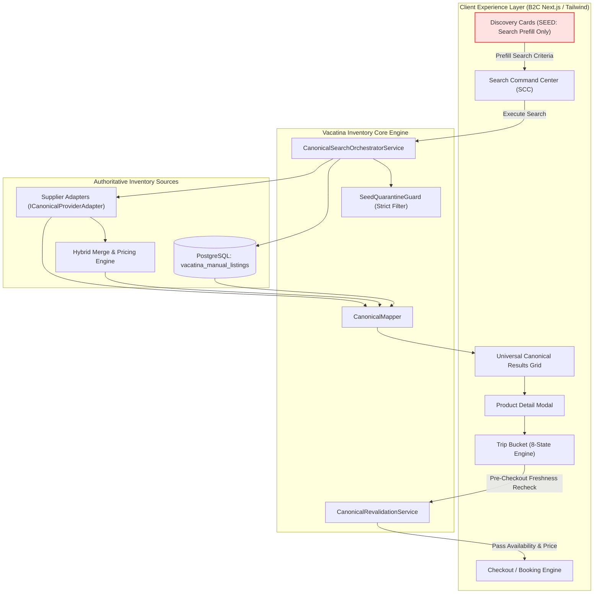
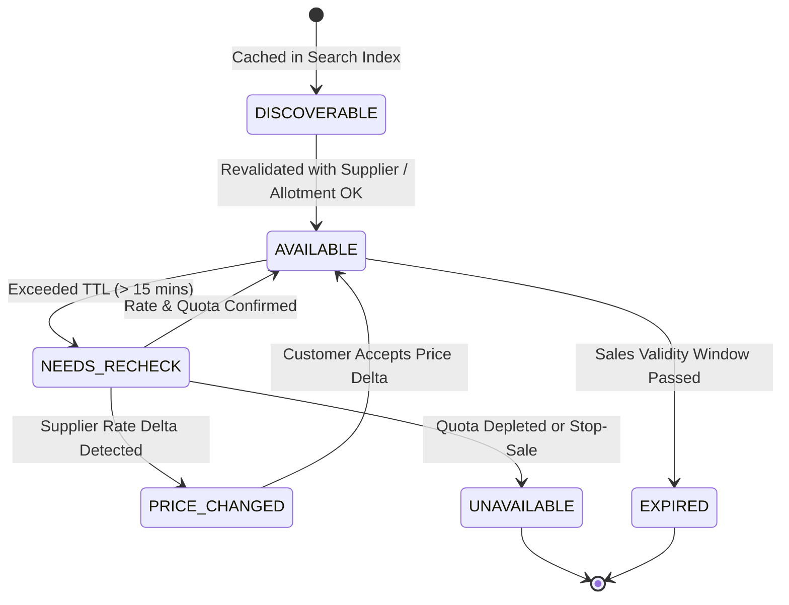

# VACATINA — SHARED INVENTORY FOUNDATION & CANONICAL OFFER ARCHITECTURE (v1.0)

> **Historical snapshot:** verification counts and release status in this document predate the Phase 4 local baseline. Current verified baseline: **233/233 tests**, **0 typecheck errors**, build PASS, browser/server bundle isolated. See [../ENGINEERING_BASELINE.md](../ENGINEERING_BASELINE.md).

**Authority**: Track 1 Master Workload · ADR-006 through ADR-009 · PRD Section 4  
**Classification**: Authoritative Engineering Architecture & Core Data Model  
**Target Systems**: PostgreSQL Manual CMS Layer · Provider Adapters · Universal Search Orchestrator · Revalidation Engine · B2C Client App  
**Status**: 100% Implemented & Verified (145/145 Automated Tests Passing · 34/34 Browser Acceptance Assertions Verified)

---

## 1. Executive Architecture Summary

Vacatina operates as a modern Travel Operating System supporting three authoritative inventory streams and one quarantined inspiration source:

1. **`MANUAL`**: Vacatina direct contracts (in-house villas, private chauffeur, luxury packages, consular visas) managed via Admin CMS + PostgreSQL persistence, governed by four-eyes approval, allotment quotas, and real-time operational stop-sales.
2. **`API`**: External supplier live inventory (Duffel, LiteAPI, Viator, Rentalcars, etc.) normalized via provider-neutral adapters into a canonical shape without exposing frontend components to supplier schemas.
3. **`HYBRID`**: Supplier live availability/net cost merged with Vacatina commercial markup and curated inclusions/perks. Strict commercial boundary: external supplier authoritative fields are never mutated; Vacatina commercial layer controls markup and customer pricing.
4. **`SEED` (Project Accelerator)**: Demo/prototype/inspiration items (including the 40 homepage cards). **Strictly quarantined**: can prefill Search Command Center (SCC) criteria, but strictly forbidden from staging as `READY` in Trip Bucket or reaching checkout.



---

## 2. Canonical Data Models

### 2.1 The 16 Mandatory Listing Attributes (`CanonicalInventoryListing`)

Every inventory listing across all 10 product verticals adheres to the 16 canonical attributes defined in `src/server/inventory/domain/canonical-offer.ts`:

| # | Attribute | Type | Description |
|---|---|---|---|
| 1 | `sourceType` | `'MANUAL' \| 'API' \| 'HYBRID'` | Authoritative inventory provenance. |
| 2 | `productType` | `TravelProductSlug` | Vertical identifier (`flights`, `hotels`, `cars`, etc.). |
| 3 | `listingId` | `string` | Unique identifier (e.g. `man-pkg-ceylon-heritage`). |
| 4 | `supplierId` | `string` | Partner supplier identifier. |
| 5 | `providerId` | `string` | Upstream system or in-house desk identifier. |
| 6 | `externalOfferId` | `string?` | Optional supplier reference ID for API/Hybrid. |
| 7 | `status` | `ManualListingStatus` | `DRAFT \| REVIEW \| FINANCE_APPROVED \| PUBLISHED \| PAUSED \| ARCHIVED`. |
| 8 | `market` | `string` | Target market code (e.g. `LK`, `AE`, `GLOBAL`). |
| 9 | `currency` | `string` | ISO 4217 currency code (e.g. `LKR`, `USD`). |
| 10 | `basePrice` | `number` | Contracted unit base price. |
| 11 | `availabilityStatus` | `CanonicalOfferLifecycleStatus` | Current lifecycle readiness state. |
| 12 | `lastSyncedAt` | `string (ISO UTC)` | Timestamp of upstream data sync. |
| 13 | `lastCheckedAt` | `string (ISO UTC)` | Timestamp of last availability/pricing check. |
| 14 | `validFrom` | `string (ISO UTC)` | Effective service start date. |
| 15 | `validTo` | `string (ISO UTC)` | Effective service end date. |
| 16 | `createdBy` / `updatedBy` | `string` | Audit trail actor identifiers. |

### 2.2 Canonical Offer Lifecycle

Offers move deterministically across a 6-state lifecycle:



### 2.3 The Unified Canonical Offer (`UnifiedCanonicalOffer`)

When consumed by search, details modal, or Trip Bucket, every item is normalized into a `UnifiedCanonicalOffer`:

- **Universal Stable ID**: Deterministic format `vct-${source.toLowerCase()}-${product}-${provider}-${id}`.
- **Strict Quarantine Flag**: `isSeed: false` strictly enforced for bookable inventory.
- **Price Transparency**: Exact minor currency units (`basePriceMinor`, `taxesAndFeesMinor`, `markupMinor`, `totalPriceMinor`).
- **Cancellation Terms**: Structured refundability and penalty schedules.
- **Provenance Ledger**: Preserves original source type, partner supplier ID, and provider name.

---

## 3. Database Schema & Persistence Layer

The manual inventory layer is backed by PostgreSQL via `src/server/inventory/repository/postgres-manual-listing.repository.ts` and automated migrations (`001_vacatina_canonical_inventory.sql`).

### 3.1 DDL Structure (`vacatina_manual_listings`)

```sql
CREATE TABLE vacatina_manual_listings (
  listing_id VARCHAR(64) PRIMARY KEY,
  canonical_entity_id VARCHAR(128) NOT NULL,
  product_type VARCHAR(32) NOT NULL,
  partner_supplier_id VARCHAR(64) NOT NULL,
  operator_name VARCHAR(128) NOT NULL,
  partner_name VARCHAR(128) NOT NULL,
  source_type VARCHAR(16) NOT NULL DEFAULT 'MANUAL',
  fulfillment_mode VARCHAR(32) NOT NULL DEFAULT 'INSTANT',
  confirmation_mode VARCHAR(32) NOT NULL DEFAULT 'INSTANT_CONFIRM',
  booking_mode VARCHAR(32) NOT NULL DEFAULT 'DIRECT_BOOKING',
  title VARCHAR(256) NOT NULL,
  description TEXT NOT NULL,
  subtitle VARCHAR(256),
  origin VARCHAR(128),
  destination VARCHAR(128) NOT NULL,
  location_city VARCHAR(128) NOT NULL,
  location_country VARCHAR(128) NOT NULL,
  valid_from TIMESTAMPTZ NOT NULL,
  valid_until TIMESTAMPTZ NOT NULL,
  sales_valid_from TIMESTAMPTZ NOT NULL,
  sales_valid_until TIMESTAMPTZ NOT NULL,
  total_allotted_quota INTEGER NOT NULL CHECK (total_allotted_quota >= 0),
  available_quota INTEGER NOT NULL CHECK (available_quota >= 0),
  is_stop_sale_active BOOLEAN NOT NULL DEFAULT FALSE,
  stop_sale_reason VARCHAR(256),
  contracted_base_cost_minor BIGINT NOT NULL CHECK (contracted_base_cost_minor > 0),
  markup_minor BIGINT NOT NULL CHECK (markup_minor >= 0),
  selling_price_minor BIGINT NOT NULL CHECK (selling_price_minor > 0),
  currency VARCHAR(8) NOT NULL DEFAULT 'LKR',
  taxes_and_fees JSONB NOT NULL DEFAULT '{}'::jsonb,
  cancellation_policy TEXT NOT NULL,
  refundability VARCHAR(32) NOT NULL DEFAULT 'NON_REFUNDABLE',
  inclusions JSONB NOT NULL DEFAULT '[]'::jsonb,
  exclusions JSONB NOT NULL DEFAULT '[]'::jsonb,
  constraints JSONB NOT NULL DEFAULT '{}'::jsonb,
  media JSONB NOT NULL DEFAULT '{}'::jsonb,
  terms JSONB NOT NULL DEFAULT '{}'::jsonb,
  commercial_evidence JSONB NOT NULL DEFAULT '{}'::jsonb,
  workflow_status VARCHAR(32) NOT NULL DEFAULT 'DRAFT',
  created_by JSONB NOT NULL,
  approved_by JSONB,
  modified_by JSONB,
  published_at TIMESTAMPTZ,
  expires_at TIMESTAMPTZ NOT NULL,
  created_at TIMESTAMPTZ NOT NULL DEFAULT NOW(),
  updated_at TIMESTAMPTZ NOT NULL DEFAULT NOW()
);
```

### 3.2 Audit Log & Allotment Holds

- **`vacatina_manual_listing_audit_log`**: Append-only log recording actor ID, role, action, and JSON payload diffs.
- **`vacatina_manual_listing_allotments`**: Tracks pending checkout holds with automatic expiration to prevent double-booking.

### 3.3 Governance Invariants Enforced in Code

1. **Four-Eyes Separation of Duties**: The creator (`CONTENT_EDITOR`) cannot approve or publish their own listing. Publishing requires a distinct `FINANCE_APPROVER` or `ADMINISTRATOR` actor.
2. **Commercial Anti-Tampering Guard**: If an authorized user edits `contractedBaseCostMinor` or `sellingPriceMinor` on an active `PUBLISHED` listing, the system automatically demotes it back to `DRAFT`.
3. **Atomic Quota Adjustments**: Allotment quota decrements cannot drop below zero.

---

## 4. Shared Provider Adapter Interface (`ICanonicalProviderAdapter`)

All future supplier integrations (Duffel for Flights, LiteAPI for Hotels, Viator for Activities, etc.) implement the shared provider contract in `src/server/inventory/adapters/canonical-provider-adapter.interface.ts`:

```typescript
export interface ICanonicalProviderAdapter {
  readonly providerId: string;
  readonly productType: TravelProductSlug;
  isHealthy(): Promise<boolean>;
  search(criteria: CanonicalSearchCriteria): Promise<UnifiedCanonicalOffer[]>;
  getOfferById(offerId: string): Promise<UnifiedCanonicalOffer | null>;
  revalidate(offerId: string): Promise<CanonicalRevalidationResult>;
}
```

---

## 5. Universal Search Pipeline & Ranking Order

The `CanonicalSearchOrchestratorService` executes multi-source search across PostgreSQL manual listings and external provider adapters:

1. **Parallel Execution**: Fetches active manual listings and supplier API offers concurrently with timeout protections.
2. **SEED Quarantine**: Filters out any item flagged `isSeed === true` or missing required commercial evidence.
3. **Deduplication**: Resolves duplicate properties or routes using entity normalization keys.
4. **Pin-Above-API Ranking**:
   - **Tier 1 (Pinned Top)**: Vacatina Manual Direct contracts (high margin, verified quality).
   - **Tier 2**: Vacatina Hybrid offers (supplier inventory + curated perks).
   - **Tier 3**: Pure Supplier API inventory sorted by ascending price.

---

## 6. Pre-Booking Revalidation Engine

The `CanonicalRevalidationService` enforces strict pre-checkout checks:

- **MANUAL Listings**: Verifies `isStopSaleActive === false`, available quota $> 0$, and current date is within `salesValidFrom` $\rightarrow$ `salesValidUntil`.
- **API Listings**: Calls supplier adapter to verify live seat/room availability and price stability. Detects fare increases (`PRICE_CHANGED`) or inventory depletion (`UNAVAILABLE`).
- **HYBRID Listings**: Rechecks upstream net cost and dynamically reapplies the Vacatina markup schedule.

---

## 7. Verification Gates & Test Matrix

All 9 validation gates in `tests/shared-inventory-foundation.test.ts` pass cleanly:

| Gate | Description | Status |
|---|---|---|
| **Gate 1** | Manual Listing 4-Eyes Governance & Anti-Tamper Demotion | PASS (0ms) |
| **Gate 2** | Supplier Adapter Provider-Neutral Normalization | PASS (0ms) |
| **Gate 3** | Hybrid Offer Markup & Source Provenance Isolation | PASS (0ms) |
| **Gate 4** | Universal Search Multi-Source Aggregation & Pin-Above-API | PASS (1ms) |
| **Gate 5** | Strict SEED Quarantine (Demo Items Excluded from Search Results) | PASS (0ms) |
| **Gate 6** | Offer Freshness & TTL Stale Detection | PASS (0ms) |
| **Gate 7** | Revalidation Engine Price Change Detection Saga | PASS (0ms) |
| **Gate 8** | Revalidation Engine Stop-Sale & Depletion Sagas | PASS (0ms) |
| **Gate 9** | Universal Stable ID Format Integrity | PASS (0ms) |

---

## 8. Handoff to Track 3: Hotels Functional Build

With the shared inventory foundation locked and verified, Track 3 (Hotels) will immediately utilize:
1. `CanonicalSearchOrchestratorService` for querying both `LiteApiHotelAdapter` and Vacatina Direct Hotel contracts.
2. `UnifiedCanonicalOffer` for the Hotel Search Results, Room Category cards, and Property Detail Modal.
3. `CanonicalRevalidationService` for pre-booking room hold checks.
