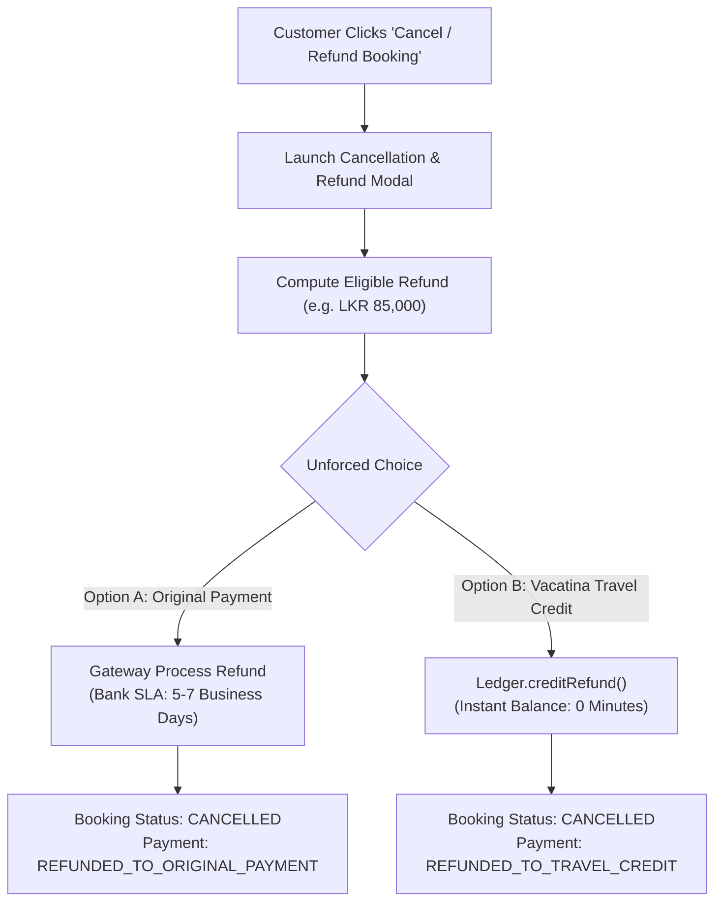

# Vacatina Travel Credit & Closed-Loop Ledger Architecture Specification v1.0

> **Historical snapshot:** verification counts and release status in this document predate the Phase 4 local baseline. Current verified baseline: **233/233 tests**, **0 typecheck errors**, build PASS, browser/server bundle isolated. See [../ENGINEERING_BASELINE.md](../ENGINEERING_BASELINE.md).

## Authority & Compliance Lock
- **Document ID**: `VAC-ARCH-43-TRAVEL-CREDIT-LEDGER-V1`
- **Regulatory Framework**: Central Bank of Sri Lanka (CBSL) Payment & Settlement Systems Act / Electronic Fund Transfers / Stored-Value Guidance
- **Design System**: DESIGN v4 (B2C Travel Operating System)
- **Status**: **LOCKED ARCHITECTURE CONTRACT**

---

## 1. Executive Summary & Legal/Regulatory Mandates

### 1.1 Customer-Facing Naming & Compliance Mandate
- **Strict Canonical Term**: **"Vacatina Travel Credit"**
- **UX & Risk Guidance**: The customer-facing term "Vacatina Travel Credit" is maintained across all B2C surfaces to clearly reflect its nature as a commercial travel loyalty and refund credit mechanism.
- **Compliance Disclaimer**: *This architecture is designed to remain a closed-loop commercial credit mechanism; final regulatory classification must be validated by Vacatina’s legal/compliance advisers.* CBSL evaluations examine the substantive economic function and transactional mechanics of the facility rather than user-facing terminology alone.

### 1.2 Phase 1 Closed-Loop Boundaries
Vacatina Travel Credit is strictly a **closed-loop commercial loyalty and refund credit mechanism**:
1. **NO Cash Top-Ups**: Customers cannot load money, perform debit/credit card top-ups, or deposit fiat funds into their travel credit balance (`attemptCashTopUp()` throws `CLOSED_LOOP_RESTRICTION`).
2. **NO Peer-to-Peer (P2P) Transfers**: Customers cannot transfer credits to other individuals or accounts (`attemptP2PTransfer()` throws `CLOSED_LOOP_RESTRICTION`).
3. **NO Bank Cash-Out / Withdrawal**: Customers cannot withdraw, cash-out, or request monetary payout of their credit balance to commercial bank accounts (`attemptCashWithdrawal()` throws `CLOSED_LOOP_RESTRICTION`).
4. **Permissible Origins**: Balances originate exclusively from:
   - **Refund Credit**: Cancellations or schedule disruptions of paid bookings.
   - **Promotional Credit**: Marketing campaign incentives with explicit expiry dates.
   - **Service Credit**: Concierge/admin goodwill compensation requiring mandatory staff identity and reason.
5. **Permissible Usage**: Usable exclusively toward eligible Vacatina travel bookings across the **10 canonical travel verticals**:
   1. **Flights**
   2. **Hotels**
   3. **Visa Assistance**
   4. **Holiday Packages**
   5. **Cars & Transfers** (incorporating car rental and chauffeured transfers)
   6. **Rails**
   7. **Cruises**
   8. **Activities**
   9. **Sightseeing Tours**
   10. **Travel Insurance**
   *(Note: eSIM is not a canonical product; Car Rental is incorporated within Cars & Transfers).*

### 1.3 Per-Offer Travel Credit Eligibility Governance
Travel credit application is governed at the canonical offer level rather than blindly applied to every supplier rate:
- `travelCreditEligible`: Boolean flag per offer.
- `applicableCreditTypes`: Specific credit buckets accepted (e.g. some restricted supplier airfares may accept `REFUND_CREDIT` but exclude `PROMOTIONAL_CREDIT`).
- `maximumCreditApplicationMinor`: Optional commercial ceiling on credit application per order.
- `travelCreditExclusionReason`: Transparent disclosure when credit application is restricted (e.g. "Direct non-refundable supplier fare excludes promotional credits").

---

## 2. Multi-Bucket Balance & FIFO Drawdown Hierarchy

### 2.1 Multi-Bucket Taxonomy
To prevent financial breakage and ensure accurate accounting, balances are segregated into 3 distinct buckets:

| Bucket Type | Origin | Expirable? | Longevity & Policy |
| :--- | :--- | :--- | :--- |
| **`REFUND_CREDIT`** | Disrupted/Cancelled bookings | No (Permanent) | Derived from real money paid by the traveler; highest commercial longevity. |
| **`PROMOTIONAL_CREDIT`** | Campaign bonuses / incentives | Yes (Explicit ISO date) | Marketing campaign allocation; highest drawdown priority. |
| **`SERVICE_CREDIT`** | Admin / Concierge courtesy gestures | Policy configurable | Staff-issued goodwill compensation; requires staff audit trail. |

### 2.2 Checkout Drawdown Algorithm (FIFO Order)
When a customer redeems travel credit at checkout, the engine executes priority drawdown:
1. **`PROMOTIONAL_CREDIT`** is consumed first so travelers do not lose expirable campaign bonuses.
2. **`SERVICE_CREDIT`** is consumed second.
3. **`REFUND_CREDIT`** is consumed last, preserving customer-funded refund credit.

### 2.3 Partial Payment Settlement Equation
At checkout review:
$$\text{Applied Credit} = \min(\text{Order Total}, \text{Available Credit}, \text{Requested Amount})$$
$$\text{Remaining Balance Due} = \max(0, \text{Order Total} - \text{Applied Credit})$$

- If $\text{Remaining Balance Due} = 0$: Order settles 100% via Travel Credit.
- If $\text{Remaining Balance Due} > 0$: Traveler pays the remaining balance via Card / Bank Gateway.

---

## 3. Double-Entry Append-Only Ledger Integrity

### 3.1 Prohibited Operations
- Direct balance writing (`balance = 100000` or `balance += X`) is architecturally blocked.
- Balances are derived dynamically from the chronological replay of immutable ledger transaction rows:
$$\text{Balance} = \sum_{\text{CREDIT}} \text{Amount} - \sum_{\text{DEBIT}} \text{Amount}$$

### 3.2 Canonical Transaction Schema
```typescript
export interface TravelCreditTransaction {
  transactionId: string;              // Unique prefix vct-tx-*
  walletAccountId: string;            // Closed-loop account reference
  customerId: string;                 // Verified user email / ID
  direction: 'CREDIT' | 'DEBIT';      // Inflow or outflow
  creditType: TravelCreditBucketType; // REFUND_CREDIT | PROMOTIONAL_CREDIT | SERVICE_CREDIT
  transactionKind: TravelCreditTransactionKind;
  amountMinor: number;                // Smallest currency unit (cents/cents equivalent)
  currency: string;                   // Canonical LKR (with optional fxBasis)
  balanceAfterMinor: number;          // Running balance after atomic application
  status: 'PENDING' | 'AVAILABLE' | 'USED' | 'EXPIRED' | 'REVERSED';
  description: string;
  referenceId: string;                // Booking reference, campaign code, or ticket ID
  staffActor?: StaffAuditActor;       // Mandatory for SERVICE_CREDIT and reversals
  expiresAtIso?: string;              // Promotional credit expiry
  createdAtIso: string;
}
```

---

## 4. Booking Cancellation & Refund Wizard (Unforced Customer Choice)

In compliance with fair consumer practices, Vacatina never forces customers into a wallet-only refund trap. When cancelling a confirmed booking from `/bookings/:reference`, the Manage Booking cancellation wizard provides a transparent, unforced choice:



---

## 5. UI Surface Placements

1. **Desktop Shell Header**:
   - Travel Credit is placed inside the `My Account` dropdown with a live balance badge (e.g. `LKR 83,000`).
   - NOT placed as an independent top-level product tab (respects product-vertical navigation hierarchy).
2. **Mobile Drawer**:
   - Rendered under the Account section with one-touch access to the Travel Credit statement modal.
3. **Standalone Dedicated Route (`/account/travel-credit`)**:
   - Deep-linkable URL intercepted by `RouterService` to present statement modal with 3-bucket breakdown and live transaction table.
4. **Checkout Dossier Review (`openTripDossierReviewModal`)**:
   - Integrated Travel Credit payment card with dynamic checkbox, applied credit, and remaining gateway balance due.
5. **Manage Booking (`openBookingDossierModal`)**:
   - Self-service cancellation wizard launching the unforced refund destination choice.
6. **Operations Backoffice (`renderAdminPortalHtml`)**:
   - Admin KPI counter, 3-bucket balance overview, CBSL compliance notice, and privileged `+ Issue Service Credit` capability with mandatory staff identity and reason.

---

## 6. Verification & Audit Metrics
- **Automated Tests**: 194/194 unit and domain invariants passing across 12 test suites.
- **Ledger Invariants**: 17 dedicated tests covering multi-bucket calculation, FIFO drawdown, CBSL closed-loop boundaries, unforced refund choices, and REST API Problem Details.
- **Browser E2E**: 36 browser viewport and journey assertions validated with zero console errors.
