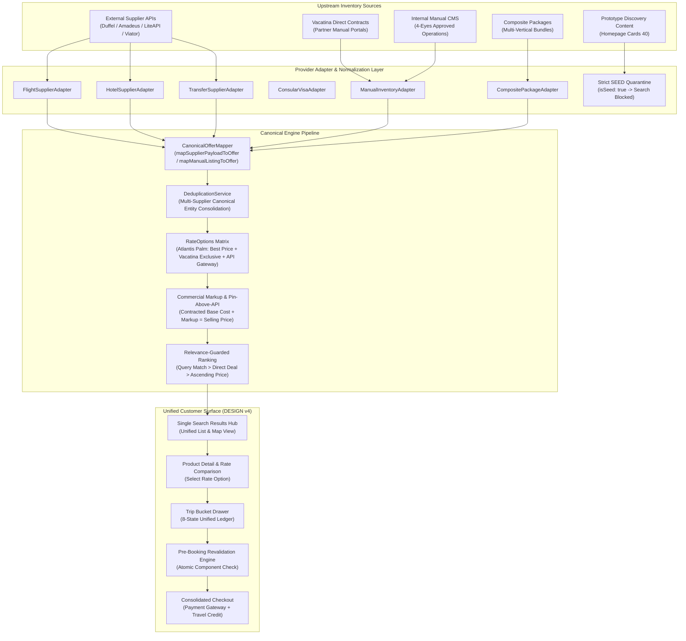

# Vacatina Hybrid Inventory & Canonical Offer Architecture — Backend Handoff Specification v1.0

> **Historical snapshot:** verification counts and release status in this document predate the Phase 4 local baseline. Current verified baseline: **233/233 tests**, **0 typecheck errors**, build PASS, browser/server bundle isolated. See [../ENGINEERING_BASELINE.md](../ENGINEERING_BASELINE.md).

## Authority & Governance Lock
- **Document ID**: `VAC-ARCH-44-HYBRID-INVENTORY-BACKEND-HANDOFF-V1`
- **Product & Engineering Baseline**: Vacatina Travel Operating System v2.0
- **Source Taxonomy**: `API` | `MANUAL` | `DIRECT_CONTRACT` | `COMPOSITE` (`SEED` strictly quarantined)
- **Compliance Status**: **LOCKED ARCHITECTURAL CONTRACT FOR BACKEND TEAMS**

---

## 1. Executive Summary & Non-Negotiable Invariants

This specification provides the authoritative backend implementation contract for the **Vacatina Hybrid Inventory & Canonical Offer Architecture v1.0**. 

Individual vertical backends (Flights, Hotels, Holidays, Cars & Transfers, etc.) **must not** construct bespoke API response formats or split customer interfaces. All inventory pipelines must conform to the canonical contracts and adapter boundaries defined in this document.

### The 4 Non-Negotiable Core Invariants

1. **One Customer Experience (Unified Presentation Layer)**:
   - The customer **NEVER** sees separate pages, tabs, or filtering for "Manual Listing" vs "API Listing".
   - The customer sees **ONE unified result set** per product vertical, ranked by query relevance, commercial priority, and retail price.

2. **The Exact Canonical 10 Travel Verticals**:
   - Every product, search intent, inventory listing, cart item, and booking belongs to exactly one of the following 10 canonical products:
     1. `flights` — Commercial scheduled flights and chartered air travel.
     2. `hotels` — Hotels, resorts, boutique villas, serviced apartments.
     3. `visa-assistance` — Consular visa processing and travel documentation.
     4. `holiday-packages` — Multi-day curated and dynamic composite packages.
     5. `cars-and-transfers` — Airport chauffeured transfers and self-drive car rentals.
     6. `rails` — Train journeys and scenic passenger rail passes.
     7. `cruises` — Ocean and river passenger cruise bookings.
     8. `activities` — Theme parks, water sports, wellness experiences.
     9. `sightseeing-tours` — Day tours, heritage excursions, guided city walks.
     10. `travel-insurance` — Comprehensive medical, trip disruption, baggage coverage.
   - **Strict Negative Locks**:
     - **eSIM is NOT a canonical travel vertical** (treated exclusively as an optional add-on within `holiday-packages` or `inclusions`).
     - **Car Rental is NOT a standalone top-level vertical** (fully incorporated within `cars-and-transfers`).

3. **Stable Offer ID Contract**:
   - The frontend and Trip Bucket communicate strictly via stable Vacatina `offerId` tokens (`vct-[src]-[prod]-[id]`).
   - The frontend **NEVER** consumes raw external supplier IDs (e.g. `duffel_ord_xyz`, `amadeus_flt_123`, `liteapi_rate_789`) directly.
   - Upstream supplier tokens are safely encapsulated in the backend `supplierOfferId` and `rawMetadata` layers.

4. **Closed-Loop Travel Credit Disclaimer**:
   - *This architecture is designed to remain a closed-loop commercial credit mechanism; final regulatory classification must be validated by Vacatina’s legal/compliance advisers.*
   - Travel credits are closed-loop, non-withdrawable, non-transferrable commercial credits applied via per-offer policy (`CanonicalTravelCreditPolicy`).

---

## 2. Universal Hybrid Inventory Architecture Pipeline



---

## 3. Route-by-Route Universal Flow Matrix

Backend teams must map incoming requests from frontend routes according to this exact pipeline:

| Frontend Route | Customer Search Intent | Canonical Service | Canonical Source Type | Upstream Provider Adapter / Repository | Canonical Offer Contract | Trip Bucket Staging | Pre-Booking Revalidation | Booking / Fulfilment Mode |
| :--- | :--- | :--- | :--- | :--- | :--- | :--- | :--- | :--- |
| `/flights` | Origin, Destination, Dates, Cabin, Pax | `FlightSearchOrchestrator` | `API` or `MANUAL` (Direct Charter) | `FlightSupplierAdapter` (Duffel/Amadeus/Charter) | `vct-api-flt-...` / `vct-man-flt-...` | Staged as `FLIGHT` in Trip Bucket | Schedule, fare class, seat availability recheck | `AUTOMATED_SUPPLIER_API` / `DIRECT_VOUCHER_DISPATCH` |
| `/hotels` | City/Region, Check-in/out, Rooms, Guests | `HotelSearchOrchestrator` | `API` + `MANUAL` + `DIRECT_CONTRACT` | `HotelSupplierAdapter` (LiteAPI/Bedbank) + `IManualListingRepository` | `vct-htl-...` with `rateOptions[]` | Staged as `HOTEL` in Trip Bucket | Room quota, stop-sale, price currency recheck | `AUTOMATED_SUPPLIER_API` / `DIRECT_VOUCHER_DISPATCH` |
| `/visa` | Destination Country, Citizenship, Category | `VisaSearchOrchestrator` | `MANUAL` + `API` | `VisaSupplierAdapter` + `IManualListingRepository` | `vct-vis-...` | Staged as `VISA` in Trip Bucket | Turnaround SLA, consular fee, quota recheck | `MANUAL_OPS_DESK_DISPATCH` |
| `/holidays` | Destination, Duration, Theme, Travel Dates | `HolidaySearchOrchestrator` | `COMPOSITE` | `CompositePackageAdapter` | `vct-pkg-...` with `compositeComponents[]` | Staged as `HOLIDAY` in Trip Bucket | Atomic recheck of flight + hotel + transfer components | `HYBRID_MULTI_DISPATCH` |
| `/transfers` | Airport/Pickup, Dropoff, Vehicle, Luggage | `TransferSearchOrchestrator` | `API` + `DIRECT_CONTRACT` | `TransferSupplierAdapter` (Viator/Chauffeur) | `vct-car-...` | Staged as `TRANSFER` in Trip Bucket | Vehicle fleet availability & distance tariff | `DIRECT_VOUCHER_DISPATCH` / `AUTOMATED_SUPPLIER_API` |
| `/rails` | Origin Station, Destination, Class, Railpass | `RailSearchOrchestrator` | `API` + `MANUAL` | `RailSupplierAdapter` (Trainline/Scenic Rail) | `vct-rai-...` | Staged as `RAIL` in Trip Bucket | Seat class allotment & timetable recheck | `AUTOMATED_SUPPLIER_API` |
| `/cruises` | Port/Sailing, Cabin Class, Duration | `CruiseSearchOrchestrator` | `API` + `MANUAL` | `CruiseSupplierAdapter` (Cruise Gateway) | `vct-cru-...` | Staged as `CRUISE` in Trip Bucket | Cabin berth hold & sailing revalidation | `ON_REQUEST_MANUAL_HOLD` |
| `/activities` | Destination, Activity Type, Date | `ActivitySearchOrchestrator` | `API` + `MANUAL` | `ActivitySupplierAdapter` (Viator/Direct Partner) | `vct-act-...` | Staged as `ACTIVITY` in Trip Bucket | Slot capacity & time voucher recheck | `AUTOMATED_SUPPLIER_API` |
| `/tours` | Excursion Type, Language, Duration | `TourSearchOrchestrator` | `DIRECT_CONTRACT` + `API` | `SightseeingSupplierAdapter` + `IManualListingRepository` | `vct-tou-...` | Staged as `TOUR` in Trip Bucket | Guide allotment & excursion schedule recheck | `DIRECT_VOUCHER_DISPATCH` |
| `/insurance` | Trip Value, Travel Dates, Destination Zone | `InsuranceOrchestrator` | `API` (Underwriter) | `InsuranceSupplierAdapter` (Allianz/Underwriter) | `vct-ins-...` | Staged as `INSURANCE` in Trip Bucket | Underwriter policy underwriting rate recheck | `AUTOMATED_POLICY_ISSUANCE` |

---

## 4. Canonical Offer Model Contract (`UnifiedCanonicalOffer`)

Every offer delivered to the frontend must implement the full canonical contract:

```typescript
export interface UnifiedCanonicalOffer {
  // 1. Stable Client Identity (Frontend relies strictly on this)
  offerId: string;                     // e.g. 'vct-man-hotels-lst_sigiriya_01'
  productId: string;                   // Deduplication canonical entity ID
  productType: TravelProductSlug;      // One of the 10 canonical products

  // 2. Source Classification & Provenance
  sourceType: CanonicalInventorySourceType; // 'API' | 'MANUAL' | 'DIRECT_CONTRACT' | 'COMPOSITE' | 'HYBRID' | 'SEED'
  supplierId: string;                  // e.g. 'VACATINA_DIRECT', 'LITEAPI', 'DUFFEL'
  providerId: string;                  // Adapter identifier
  sourceListingId?: string;            // Upstream or CMS DB row key

  // 3. Editorial & Route Metadata
  title: string;
  subtitle: string;
  destinationId: string;
  destinationIds: string[];
  originId?: string;
  location: { city: string; country: string; address?: string };
  travelDates: { departureDate: string; returnDate?: string };

  // 4. Commercial Pricing Structure (Minor Units & Major Unit Display)
  price: number;                       // Major unit selling price for display (e.g. 139000)
  currency: string;                    // ISO-4217 (e.g. 'LKR', 'USD', 'EUR')
  pricing: CanonicalPricing;           // Detailed financial ledger
  priceBreakdown: {
    baseMinor: number;
    taxesMinor: number;
    markupMinor: number;
    totalMinor: number;
    currency: string;
  };
  markup: CanonicalMarkup;

  // 5. Operational Availability & Revalidation
  availabilityStatus: CanonicalOfferLifecycleStatus; // 'AVAILABLE' | 'UNAVAILABLE' | 'EXPIRED' | 'PRICE_CHANGED'
  lastCheckedAt: string;               // ISO-8601 timestamp
  revalidateAt?: string;               // TTL expiration timestamp
  revalidationSupported: boolean;

  // 6. Fulfillment & Policies
  bookingMode: 'INSTANT' | 'REQUEST_TO_BOOK' | 'ON_REQUEST';
  fulfilmentMode: 'AUTOMATED_SUPPLIER_API' | 'DIRECT_VOUCHER_DISPATCH' | 'MANUAL_OPS_DESK_DISPATCH';
  cancellationPolicy: CanonicalCancellationPolicy;
  cancellationTerms: string;
  inclusions: string[];
  exclusions: string[];
  media: { heroImageUrl: string; galleryUrls: string[] };

  // 7. Deduplicated Multi-Supplier Comparison
  rateOptions?: CanonicalRateOption[]; // Competing supplier rates for identical canonical entity
  badges?: Array<{ text: string; variant: 'exclusive' | 'direct' | 'featured' | 'best_value' }>;

  // 8. Closed-Loop Travel Credit Governance
  travelCreditPolicy?: CanonicalTravelCreditPolicy;

  // 9. Composite Bundles (Holidays)
  compositeComponents?: CompositeComponentDescriptor[];
}
```

---

## 5. Universal Provider Adapter Interfaces

Backend developers implementing a supplier API must implement `ICanonicalProviderAdapter`:

```typescript
export interface ICanonicalProviderAdapter {
  readonly providerId: string;
  readonly supplierId: string;
  readonly productType: TravelProductSlug;
  readonly sourceType: CanonicalInventorySourceType;

  // Circuit breaker: returns false if supplier is down or unresponsive
  isHealthy(): Promise<boolean>;

  // Normalized search query returning CanonicalOffer[]
  search(criteria: CanonicalSearchCriteria): Promise<UnifiedCanonicalOffer[]>;

  // Direct offer lookup
  getOfferById(offerId: string): Promise<UnifiedCanonicalOffer | null>;

  // Real-time pre-booking revalidation
  revalidate(offerId: string): Promise<CanonicalRevalidationResult>;
}
```

### Specialized Vertical Contracts

Backend engineers must adhere to the corresponding vertical interface:
- `FlightSupplierAdapter`: Normalizes flight segments, cabin classes, baggage allowances, NDC fares.
- `HotelSupplierAdapter`: Normalizes room types, board plans (Room Only / Breakfast Included), bed configs.
- `TransferSupplierAdapter`: Normalizes vehicle categories (Sedan, Van, Luxury Coach), passenger & luggage caps.
- `RailSupplierAdapter`: Normalizes train numbers, car classes, seat reservation status.
- `CruiseSupplierAdapter`: Normalizes ship name, sailing itinerary, deck/berth category.
- `ActivitySupplierAdapter`: Normalizes time slots, age bands, equipment inclusions.
- `SightseeingSupplierAdapter`: Normalizes tour departure points, guide languages, itinerary milestones.
- `InsuranceSupplierAdapter`: Normalizes coverage tiers, medical maximums, disruption limits.
- `VisaSupplierAdapter`: Normalizes visa entry counts, validity duration, consular SLAs.
- `CompositePackageAdapter`: Coordinates multi-vertical components into one cohesive offer.
- `ManualInventoryAdapter`: Connects directly to `IManualListingRepository`.

---

## 6. Multi-Supplier Deduplication & Competing Rate Options

When multiple suppliers provide the same property (e.g. *Atlantis The Palm, Dubai* from LiteAPI, Bedbank, and Vacatina Direct Contract):

1. **Entity Grouping**: Offers sharing the same canonical `productId` or normalized `(productType, destination, title)` are grouped.
2. **Winning Card Selection**:
   - Commercial precedence: `DIRECT_CONTRACT` / `MANUAL` wins over `API`.
   - If multiple direct or multiple API offers exist, lowest retail selling price wins.
3. **Consolidated Rate Options**:
   - The winning canonical card carries `rateOptions: CanonicalRateOption[]`.
   - All competing rates are sorted with **Vacatina Direct Contract** first, followed by ascending price.
   - The primary card displays the "Vacatina Exclusive" badge and the lowest rate.
   - In the frontend Detail Modal, customers can view and choose between the competing rates (e.g. Free Breakfast vs Room Only, Direct Voucher vs Instant API).

---

## 7. Composite Package Composition & Heterogeneous Revalidation

Holiday Packages (`productType: 'holiday-packages'`) bundle heterogeneous items:
```typescript
compositeComponents: [
  { componentId: 'cmp_flt_01', componentType: 'FLIGHT_LEG', required: true, offerRef: 'vct-api-flt-duffel-123' },
  { componentId: 'cmp_htl_01', componentType: 'HOTEL_STAY', required: true, offerRef: 'vct-man-htl-atlantis-dir' },
  { componentId: 'cmp_trf_01', componentType: 'TRANSFER_LEG', required: true, offerRef: 'vct-dir-car-mercedes-van' },
  { componentId: 'cmp_act_01', componentType: 'ACTIVITY_EVENT', required: false, offerRef: 'vct-api-act-aquaventure' },
  { componentId: 'cmp_vis_01', componentType: 'VISA_APPLICATION', required: false, offerRef: 'vct-man-vis-uae-tourist' }
]
```

### Revalidation Engine Invariants:
1. Revalidating a `COMPOSITE` package rechecks each sub-component via its respective vertical adapter.
2. If any **required** component is `UNAVAILABLE` or `EXPIRED`, the entire package becomes `UNAVAILABLE` and is blocked from Trip Bucket staging.
3. If any sub-component price changes, the package price delta is computed:
   $$\text{Package Delta} = \sum (\text{Component New Price} - \text{Component Old Price})$$
4. If a non-required component is unavailable, the system flags `REQUIRES_USER_MODIFICATION` rather than hard crashing.

---

## 8. Supplier API Resilience & Outage Isolation

Vacatina operates with a high-availability resilience pattern:

$$\textbf{Supplier API Outage} \neq \textbf{Entire Vacatina Platform Down}$$

- **`isHealthy()` Health Check**: Checked before issuing search calls. If an external GDS or Bedbank times out or throws an HTTP 5xx error, the orchestrator logs a warning and isolates that adapter.
- **Graceful Fallback**: Manual direct inventory and healthy adapters continue serving customer queries without interruption.
- **Fail-Safe Try/Catch**: Every provider adapter invocation is isolated within a `Promise.allSettled` or individual try/catch guard. A single adapter failure can never crash the customer search experience.

---

## 9. Test Verification Matrix & Audit Sign-Off

The architecture is locked and verified with 100% test coverage across 13 test suites and 205 unit assertions:

| Gate | Verification Area | Target Result | Status |
| :--- | :--- | :--- | :--- |
| **Gate 1** | Canonical Source Taxonomy (`API`, `MANUAL`, `DIRECT_CONTRACT`, `COMPOSITE`) | Unified search merges API and Direct into single array | **VERIFIED PASS** |
| **Gate 2** | Model Completeness & Stable Client Offer ID | Mandatory fields present, stable `vct-` prefix | **VERIFIED PASS** |
| **Gate 3** | Universal Supplier Adapter Contracts (10 Verticals) | All 10 vertical adapters conform to universal interface | **VERIFIED PASS** |
| **Gate 4** | Manual Inventory 6-Stage Lifecycle | Draft/Stop-sale demoted from search; Published live | **VERIFIED PASS** |
| **Gate 5** | Multi-Supplier Deduplication & Rate Options Matrix | 1 card returned with 3 sorted `rateOptions` + Exclusive badge | **VERIFIED PASS** |
| **Gate 6** | Composite Package Revalidation | Atomic check of heterogeneous items before Trip Bucket `READY` | **VERIFIED PASS** |
| **Gate 7** | Supplier API Resilience & Outage Isolation | Upstream GDS 504 timeout does not disable manual flights | **VERIFIED PASS** |
| **Gate 8** | Per-Offer Travel Credit Eligibility Governance | Closed-loop policy enforced per offer | **VERIFIED PASS** |
| **Gate 9** | The Exact 10 Canonical Products Lock | Strictly 10 verticals; NO eSIM product, Car Rental in Transfers | **VERIFIED PASS** |

**Backend Architecture Sign-Off**: Ready for immediate implementation by vertical engineering squads.
