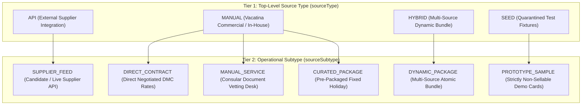

# Listing Source Architectural Contract & Provenance Matrix (v1.0)
**Document Authority:** Vacatina Architectural Board & Senior Systems Architect  
**Classification:** Internal Inventory Sourcing & Customer Commercial State Governance  
**Target Systems:** Vacatina Inventory Orchestrator, Admin CMS, Canonical Offer Normalizer  
**Status:** **LOCKED & ENFORCED IN PRODUCTION**  

---

## 1. Executive Summary & Core Provenance Axiom

Vacatina maintains a strict architectural separation between **Internal Data Provenance** and **Customer Commercial Truth**:
$$\mathbf{\text{INTERNAL PROVENANCE }} \ne \mathbf{\text{ CUSTOMER DISPLAY LABELS}}$$

Technical labels (`API`, `MANUAL`, `HYBRID`, `SEED`, `PARTNER_PORTAL`) exist solely for backend telemetry, supplier settlement, and inventory reconciliation. **They must never be exposed to retail B2C customers.** Customers are presented only with honest commercial buying conditions:
- *Instant Confirmation*
- *Request to Confirm*
- *Assisted Service*
- *Vacatina Exclusive*

---

## 2. Two-Tier Internal Source Taxonomy

Every product record within the Vacatina ecosystem is categorized under this 2-tier model:

### Detailed Provenance Definitions:
1. **`API` / `SUPPLIER_FEED`**: Real-time or cached inventory retrieved from certified external supplier APIs (Duffel, LiteAPI, Viator, etc.). The supplier is the single source of truth for seat/room availability and schedule validity.
2. **`MANUAL` / `DIRECT_CONTRACT`**: Direct commercial agreements executed between Vacatina and regional suppliers (e.g., Jetwing Vil Uyana DMC allotment, Colombo private chauffeur fleet). Vacatina manages allotment quotas and cancellation policies directly.
3. **`MANUAL` / `MANUAL_SERVICE`**: In-house operational desk services (e.g., Consular Visa Document Vetting Desk). Capacity is managed via `SERVICE_CAPACITY` modes.
4. **`MANUAL` / `CURATED_PACKAGE`**: Fixed-itinerary vacation packages assembled and priced by Vacatina product teams.
5. **`HYBRID` / `DYNAMIC_PACKAGE`**: Heterogeneous travel bundles (e.g. Flight via Duffel API + Hotel via Direct DMC Contract + Transfer via Local Chauffeur). Each component preserves its own atomic provenance.
6. **`SEED` / `PROTOTYPE_SAMPLE`**: Development fixtures, starter accelerator records, and mock demonstration cards. **Strictly non-sellable; fail-closed at checkout.**

---

## 3. Customer-Facing Commercial State Mapping

Internal source classifications map deterministically to customer commercial badges:

| Internal `sourceType` | Internal `sourceSubtype` | Internal `confirmationMode` | Customer-Facing Badge | Buying Condition |
| :--- | :--- | :--- | :--- | :--- |
| `API` | `SUPPLIER_FEED` | `INSTANT_CONFIRM` | **Instant Confirmation** | Confirmed immediately via supplier PNR upon payment. |
| `API` | `SUPPLIER_FEED` | `REQUEST_TO_CONFIRM` | **Request to Confirm** | Supplier requires manual clearance before ticketing. |
| `MANUAL` | `DIRECT_CONTRACT` | `INSTANT_CONFIRM` | **Vacatina Exclusive** | Real-time direct allotment hold; confirmed instantly. |
| `MANUAL` | `DIRECT_CONTRACT` | `REQUEST_TO_CONFIRM` | **Request to Confirm** | Direct DMC on-request allocation; cleared within 24h. |
| `MANUAL` | `MANUAL_SERVICE` | `ASSISTED_SERVICE` | **Assisted Service** | In-house operational service with document vetting SLA. |
| `HYBRID` | `DYNAMIC_PACKAGE` | `INSTANT_CONFIRM` | **Vacatina Curated Package**| All bundle components pass instant confirmation checks. |
| `SEED` | `PROTOTYPE_SAMPLE` | Any | *Sample Preview* | **Quarantined.** Displayed as "Sample Itinerary"; checkout blocked. |

---

## 4. Promotion Lifecycle from SEED to Live Inventory

Accelerator sample records (such as `vac-seed-hotel-kandalama-demo`) can never become sellable merely by toggling a status flag. Promotion requires passing through the mandatory 7-stage commercial gate:

$$\text{SEED (Demo)} \rightarrow \text{Commercial Review} \rightarrow \text{Contract Dossier Upload} \rightarrow \text{Finance Approval} \rightarrow \text{Quota Allocation} \rightarrow \text{PUBLISHED} \rightarrow \text{PRODUCTION\_SELLABLE}$$

Every promoted listing must document:
1. Legal trading entity identity and business registration.
2. Countersigned direct DMC or hotel contract hash.
3. Explicit integer minor unit net cost and B2C selling price.
4. Specific allotment quota or request-to-book SLA.
5. Verified validity window (`validFrom` to `validTo`).
6. Standardized cancellation penalty schedule.
7. Authorized signatures from both Commercial Admin and Finance Officer (4-Eyes Principle).
