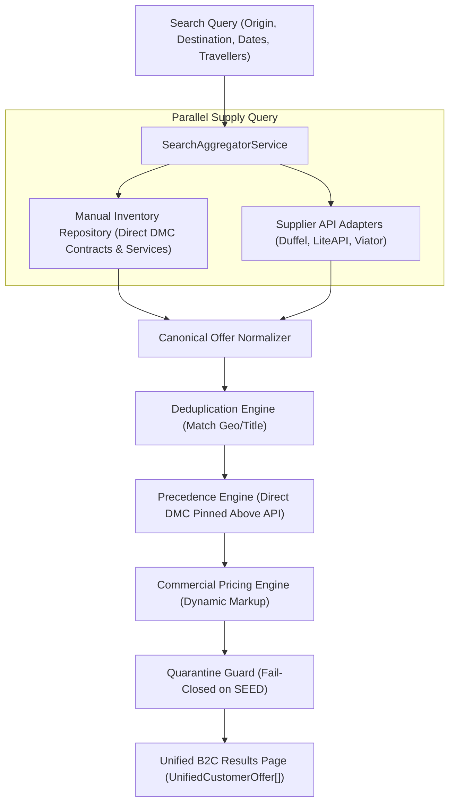

# Manual & API Inventory Hybrid Architecture (v1.0)
**Document Authority:** Vacatina Architectural Board & Senior Systems Architect  
**Classification:** Hybrid Inventory Engine, Concurrency & Governance Standard  
**Target Systems:** Vacatina Inventory Orchestrator, Admin CMS, Deduplication Engine  
**Status:** **LOCKED & ENFORCED IN PRODUCTION**  

---

## 1. Architectural Mandate: Two Sources, One Platform

Vacatina is **never** implemented as two disconnected websites ("Manual Site" vs "API Site").
Manual and API inventories represent two upstream supply mechanisms feeding a single, unified search aggregator and canonical offer normalizer.

---

## 2. Manual Inventory CMS: The 18 Mandatory Attributes

Every manually contracted product or service managed via `/admin/inventory` enforces the following 18 strictly typed attributes:

1. `listingId`: Immutable string identifier (`vac-man-...`).
2. `productType`: Exactly one of the 10 locked product types.
3. `supplierName`: Legal commercial trading entity (e.g. `Jetwing Hotels Ltd`, `Vacatina Consular Desk`).
4. `sourceType`: Explicitly `'MANUAL'`.
5. `sourceSubtype`: `'DIRECT_CONTRACT'`, `'MANUAL_SERVICE'`, or `'CURATED_PACKAGE'`.
6. `confirmationMode`: `'INSTANT_CONFIRM'`, `'REQUEST_TO_CONFIRM'`, or `'ASSISTED_SERVICE'`.
7. `currency`: 3-letter ISO code (`LKR`, `USD`, `EUR`, `GBP`, `AUD`, `AED`).
8. `netCostMinor`: Base procurement cost in integer minor units.
9. `sellingPriceMinor`: B2C published selling price in integer minor units.
10. `markupRuleId`: Reference to active commercial pricing rule or override.
11. `inventoryModel`: `'ALLOTMENT'`, `'ON_REQUEST'`, `'SERVICE_CAPACITY'`, or `'UNLIMITED_NON_INVENTORY'`.
12. `availableQuantity`: Available units or room allotments.
13. `validFrom`: Validity window start timestamp (ISO 8601).
14. `validTo`: Validity window end timestamp (ISO 8601).
15. `cancellationPolicy`: Standard cancellation rules (`FREE_CANCELLATION`, `TIERED_PENALTY`, `NON_REFUNDABLE`).
16. `fulfillmentInstructions`: Operational SOP guidelines for internal operations staff.
17. `contractEvidenceDossier`: Mandatory commercial proof object (contract ID, document hash, countersigned date).
18. `lifecycleStatus`: `'DRAFT'`, `'COMMERCIAL_REVIEW'`, `'FINANCE_APPROVED'`, `'PUBLISHED'`, `'SUSPENDED'`, or `'EXPIRED'`.

---

## 3. 4-Eyes Separation of Duties

A manual listing cannot be unilaterally published by a single user:
$$\text{DRAFT} \xrightarrow[\text{Product Admin}]{\text{Submit}} \text{COMMERCIAL\_REVIEW} \xrightarrow[\text{Commercial Admin}]{\text{Review}} \text{FINANCE\_APPROVED} \xrightarrow[\text{Finance Officer}]{\text{Approve}} \text{PUBLISHED}$$

### Anti-Tamper Rule:
Any mutation to `netCostMinor`, `sellingPriceMinor`, or `cancellationPolicy` on an active listing immediately demotes the record back to `COMMERCIAL_REVIEW`.

---

## 4. Allotment Concurrency Protection (Atomic Hold Saga)

To prevent double-booking of the last available room during concurrent customer checkouts:
1. When customer clicks "Review Trip Dossier / Checkout", the system calls `holdAllotment(listingId, units, ttlMinutes = 15)`.
2. The remaining quota is decremented in memory and held under a temporary reservation token (`COMMITTED_HELD`).
3. If checkout completes within 15 minutes $\rightarrow$ `commitAllotment` decrements available quota permanently.
4. If checkout expires or payment fails $\rightarrow$ `releaseAllotment` restores the held units automatically.

---

## 5. Deduplication & Pin-Above-API Precedence

When a destination is returned by both an API supplier and a direct DMC contract:
1. **Deduplication:** Properties are matched via normalized name and coordinate distance ($\le 100\text{m}$).
2. **Precedence:** The **Direct Vacatina Contract** takes the primary position and displays the "Vacatina Exclusive" badge.
3. **Price Parity:** The API supplier rate is recorded internally for rate parity auditing but suppressed from customer view to avoid choice paralysis.
4. **Sort Honesty:** If the customer explicitly selects "Price: Low to High", an exclusive offer cannot remain pinned at #1 unless its price is genuinely lowest.
