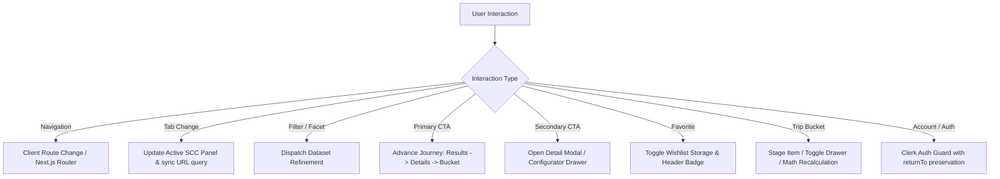
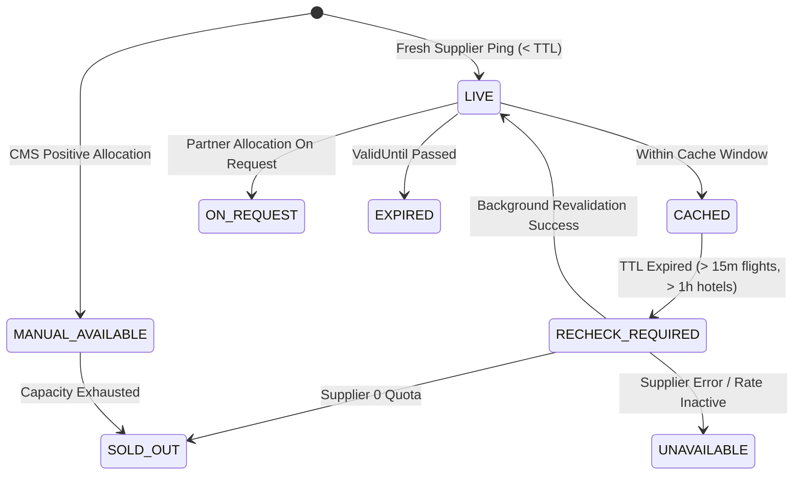
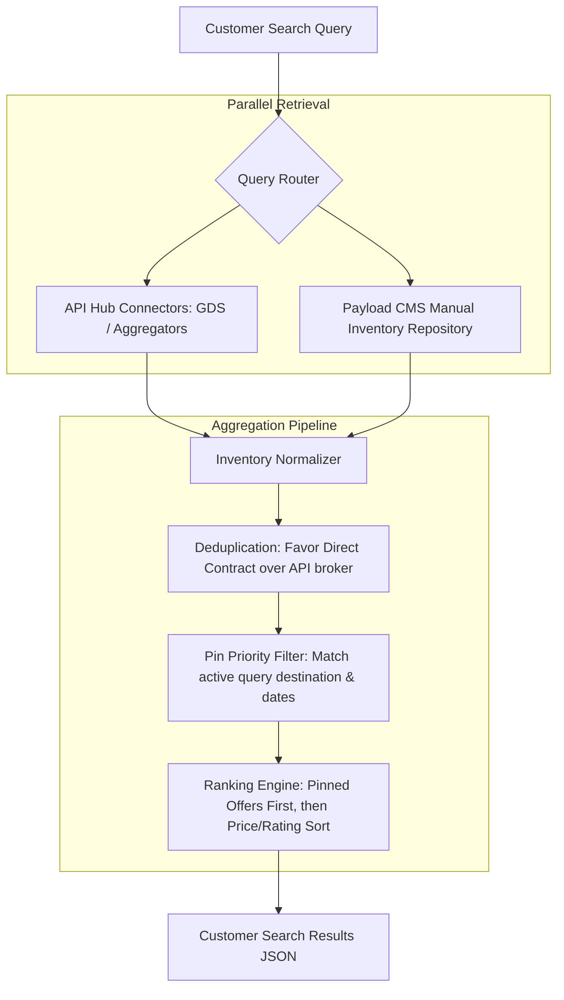
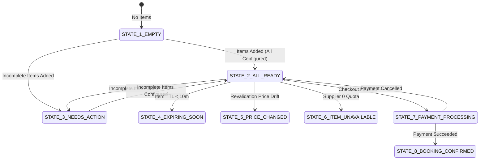
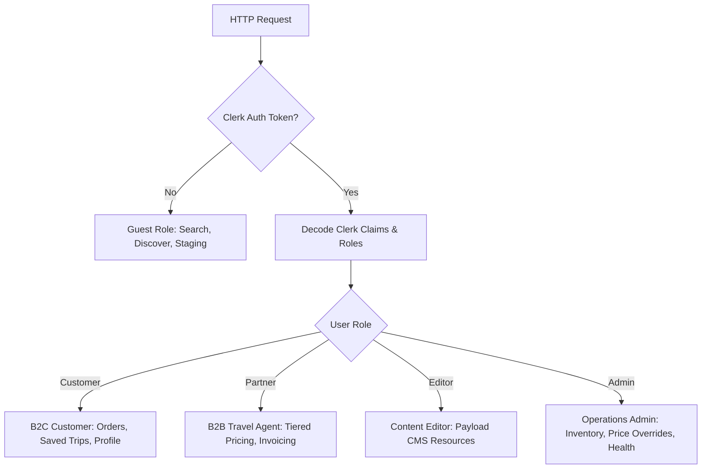

# Vacatina — Frontend to Backend Handoff Contract & Architectural Specification v1.0

> **Target Systems**: Next.js 14 Frontend · Nest.js API Hub · PostgreSQL / Drizzle ORM · Payload CMS Admin · Multi-Provider GDS/NDC Connectors  
> **Authority**: Vacatina Engineering Master Instruction  
> **Status**: RATIFIED & ARCHITECTURE LOCKED  

---

## 1. Canonical Frontend Routes & Parameter Bindings

Vacatina enforces an explicit, zero-dead-end canonical routing table. Every URL corresponds to an active route handler or view state.

### 1.1 Product Hubs & Landing Pages
| Route | Product / View | Primary Purpose | Query Parameters Supported |
| :--- | :--- | :--- | :--- |
| `/` | Homepage & Command Center | Central discovery, 11-tab Search Command Center, curated showcases | `?tab={slug}#search`, `?currency={CUR}`, `?lang={LOC}` |
| `/flights` | Flights Hub | Flight search defaults, route showcases, airline deals | `?origin={IATA}&dest={IATA}&depart={DATE}` |
| `/hotels` | Hotels Hub | Accommodation search defaults, featured destinations | `?city={NAME}&checkin={DATE}&checkout={DATE}` |
| `/visa-assistance` | Visa Assistance Hub | Consular requirements, visa types, appointment desk | `?country={ISO}&nationality={ISO}` |
| `/holiday-packages` | Holiday Packages Hub | Curated multi-day itineraries, seasonal getaways | `?dest={NAME}&duration={DAYS}&theme={THEME}` |
| `/cars-transfers` | Cars & Transfers Hub | Airport transfers, intercity chauffeur, car rentals | `?pickup={LOC}&dropoff={LOC}&date={DATE}` |
| `/activities` | Activities Hub | Day activities, tickets, excursions, sports | `?dest={LOC}&date={DATE}&category={CAT}` |
| `/sightseeing-tours` | Sightseeing Tours Hub | Guided historical, cultural, and scenic tours | `?dest={LOC}&date={DATE}&duration={HOURS}` |
| `/rails` | Rails Hub | Train schedules, scenic routes, rail passes | `?from={STATION}&to={STATION}&date={DATE}` |
| `/cruises` | Cruises Hub | Ocean, river, and boutique sailing voyages | `?dest={REGION}&port={PORT}&nights={MIN-MAX}` |
| `/travel-insurance` | Travel Insurance Hub | Medical, cancellation, baggage travel protection | `?dest={REGION}&days={DAYS}&travellers={COUNT}` |

### 1.2 Search Results Endpoints
| Route | SCC Tab Trigger | Backend Search API Endpoint | Parameter Bindings |
| :--- | :--- | :--- | :--- |
| `/trip-builder/results` | Build Your Bundle | `POST /api/v1/search/bundle` | `dest`, `start`, `end`, `pax`, `products[]` |
| `/flights/search` | Flights | `POST /api/v1/search/flights` | `origin`, `dest`, `depart`, `return`, `pax`, `class` |
| `/hotels/search` | Hotels | `POST /api/v1/search/hotels` | `city`, `checkin`, `checkout`, `rooms`, `guests` |
| `/visa-assistance/options` | Visa Assistance | `GET /api/v1/visa/requirements` | `destination`, `nationality`, `residence`, `purpose` |
| `/holiday-packages/search` | Holiday Packages | `GET /api/v1/packages/search` | `dest`, `month`, `budget`, `duration`, `theme` |
| `/cars-transfers/search` | Cars & Transfers | `POST /api/v1/search/cars` | `pickup`, `dropoff`, `pickupDate`, `pickupTime`, `passengers` |
| `/rails/search` | Rails | `POST /api/v1/search/rails` | `origin`, `destination`, `date`, `class`, `passengers` |
| `/cruises/search` | Cruises | `GET /api/v1/cruises/search` | `destination`, `duration`, `departureMonth`, `cabins` |
| `/activities/search` | Activities | `GET /api/v1/activities/search` | `location`, `date`, `category`, `participants` |
| `/sightseeing-tours/search` | Sightseeing Tours | `GET /api/v1/tours/search` | `location`, `date`, `language`, `groupSize` |
| `/travel-insurance/quote` | Travel Insurance | `POST /api/v1/insurance/quote` | `destination`, `departDate`, `returnDate`, `ages[]`, `tier` |

### 1.3 Details & Configuration Flows
| Route Pattern | Product | Backend Detail API | Mandatory Configuration Before Bucket |
| :--- | :--- | :--- | :--- |
| `/flights/booking` | Flights | `GET /api/v1/flights/offers/{id}` | Passenger names, DOB, passport details, seat selection |
| `/hotels/{id}` | Hotels | `GET /api/v1/hotels/properties/{id}` | Room type, board basis, guest names, special requests |
| `/visa-assistance/apply` | Visa Assistance | `POST /api/v1/visa/applications` | Passport copy, photograph, itinerary upload, biometrics date |
| `/holiday-packages/{id}` | Packages | `GET /api/v1/packages/{id}` | Departure date, rooming configuration, activity add-ons |
| `/cars-transfers/reserve` | Cars & Transfers | `GET /api/v1/cars/vehicles/{id}` | Flight number, luggage count, child seat count |
| `/rails/itinerary` | Rails | `GET /api/v1/rails/trips/{id}` | Seat preference, passenger DOB, compartment selection |
| `/cruises/cabin` | Cruises | `GET /api/v1/cruises/sailings/{id}` | Cabin tier, dining preference, passenger manifest |
| `/activities/{id}` | Activities | `GET /api/v1/activities/{id}` | Timeslot, participant ages, waiver consent |
| `/sightseeing-tours/{id}` | Tours | `GET /api/v1/tours/{id}` | Pickup hotel, preferred tour guide language |
| `/travel-insurance/coverage` | Travel Insurance | `GET /api/v1/insurance/policies/{id}` | Primary insured, pre-existing condition declarations |

### 1.4 Commerce, Utility & Account Routes
- `/trip-bucket`: Multi-product staged cart drawer & full page.
- `/favorites`: Saved wishlist items (strictly isolated from checkout calculations).
- `/booking/{bookingId}`: Specific booking confirmation and itinerary management.
- `/manage-booking`: Direct lookup for unauthenticated or authenticated travelers using PNR/Booking Ref + Surname.
- `/auth/sign-in`: Authenticated login (Clerk) with URL preservation `?returnTo=/path`.
- `/auth/sign-up`: Account creation with URL preservation.

### 1.5 Resources, Company, Support & Legal
- **Resources**: `/resources/travel-guides`, `/resources/flight-tracker`, `/resources/baggage-calculator`, `/resources/currency-converter`, `/resources/destination-finder`, `/resources/travel-checklist`, `/resources/faq`.
- **Company**: `/about`, `/careers`, `/corporate-travel`, `/sustainability`, `/press`.
- **Help & Support**: `/support`, `/manage-booking`, `/support/visa`, `/help/faq`, `/policies/cancellations`, `/contact`.
- **Legal**: `/legal/terms`, `/legal/privacy`, `/legal/cookies`, `/legal/accessibility`, `/legal/security`, `/legal/booking-conditions`.

---

## 2. Clickable Destination & Action Matrix

All 322 clickable elements in the Vacatina client map to one of 8 standardized, non-dead-end behaviors:



### 2.1 Behavior Standard
1. **Navigation Link**: Valid Next.js route or verified external URL (e.g. social platforms with `target="_blank" rel="noopener noreferrer"`).
2. **Tab Control**: Transitions tab view state and updates URL hash/query without page reload (`/?tab=flights#search`).
3. **Filter**: Updates client/server search facet criteria.
4. **Primary CTA**: Advances customer to next logical journey stage. Cards never jump directly to checkout when mandatory configuration (room, dates, travellers) is missing.
5. **Secondary CTA**: Opens high-fidelity configuration or specifications modal.
6. **Favorite**: Saves item ID to `localStorage` favorites store and updates badge count.
7. **Trip Bucket**: Stages item, re-runs financial math, and updates drawer state.
8. **Auth Action**: Launches Clerk authentication modal or redirects to sign-in, carrying `returnTo` parameter.

---

## 3. Canonical Offer Schema (`VacatinaNormalizedOffer`)

All upstream inventory (API, Direct Contract, Manual CMS, Dynamic Bundle) normalizes into this stable TypeScript interface before rendering in search or entering the Trip Bucket:

```typescript
export interface VacatinaNormalizedOffer {
  // Stable Identifiers
  offerId: string;                          // Format: vct-{product}-{source}-{uuid}
  slug: string;                             // URL-friendly slug
  productType: TravelProductSlug;           // 'flights' | 'hotels' | 'visa' | 'packages' | 'cars' | ...
  sourceType: InventorySourceType;         // 'API' | 'DIRECT_CONTRACT' | 'MANUAL' | 'CURATED_PACKAGE' | 'HYBRID' | 'SEED'
  supplierId: string;                       // 'AMADEUS' | 'SABRE' | 'LITEAPI' | 'PAYLOAD_CMS' | 'DIRECT_VENDOR'
  supplierName: string;                     // Human-readable supplier/partner name
  supplierOfferId?: string;                 // Upstream API reference (e.g., Amadeus Offer ID)
  manualListingId?: string;                 // Payload CMS document ID

  // Descriptive Details
  title: string;                            // Canonical title (e.g. "Colombo to London Heathrow")
  subtitle: string;                         // Secondary classification (e.g. "SriLankan Airlines · Direct Flight")
  location: StructuredLocation;             // City, country, IATA code, station code, coordinates
  configurationRequirements: ConfigurationRequirements; // Passenger, room, luggage, passport requirements
  inclusions: string[];                     // Audited list of inclusions
  exclusions: string[];                     // Explicit exclusions
  sourceMetadata: Record<string, unknown>;  // Upstream metadata for revalidation/booking

  // Inventory & Buying Conditions
  availabilityStatus: AvailabilityState;   // 'LIVE' | 'CACHED' | 'MANUAL_AVAILABLE' | 'ON_REQUEST' | ...
  confirmationMode: ConfirmationMode;       // 'INSTANT_CONFIRM' | 'REQUEST_TO_CONFIRM' | 'ASSISTED_SERVICE'
  bookingMode: BookingMode;                 // 'INSTANT_BOOK' | 'REQUEST_TO_BOOK' | 'REQUEST_AVAILABILITY' | 'INQUIRY_ONLY'
  remainingUnits?: number;                  // Remaining quota (seats, rooms, slots)
  isSeedContent?: boolean;                  // Explicit flag: seed cards cannot enter checkout as Ready
  pinPriority?: number;                     // 0 = natural rank; > 0 = pinned above API results
  featured?: boolean;                       // Featured deal flag
  exclusiveOffer?: boolean;                 // Vacatina exclusive contract flag

  // Operational Timing & Policies
  validFrom?: string;                       // ISO date
  validUntil?: string;                      // ISO date
  freshness: PriceFreshness;                // Last checked timestamp, TTL seconds, expiration ISO
  cancellationTermsReference: string;       // Human-readable summary
  cancellationPolicy?: 'FREE_CANCELLATION' | 'PARTIAL_REFUND' | 'NON_REFUNDABLE';
  changePolicy?: 'CHANGES_ALLOWED' | 'CHANGES_WITH_FEE' | 'NO_CHANGES';

  // Financial Pricing
  pricing: PricingLayers;                   // 4-Layer pricing breakdown

  // Lifecycle & Fulfillment
  revalidationCapability: {
    canRevalidateOnline: boolean;
    requiresSupplierPing: boolean;
    lastRevalidationResult?: 'UNCHANGED' | 'PRICE_CHANGED' | 'UNAVAILABLE';
  };
  fulfillmentRouting: BookingFulfillmentRouting; // Target fulfillment channel
}
```

---

## 4. API Adapter Contract (`SupplierAdapter`)

Every external GDS/NDC or inventory provider is encapsulated by a backend adapter implementing the universal `SupplierAdapter` interface:

```typescript
export interface SupplierAdapter<TSearchParams, TRawResult> {
  supplierId: string;
  supportedProducts: TravelProductSlug[];

  // 1. Search & Ingestion
  search(params: TSearchParams): Promise<VacatinaNormalizedOffer[]>;

  // 2. Offer Inspection
  getOfferDetails(supplierOfferId: string): Promise<VacatinaNormalizedOffer>;

  // 3. Price & Availability Revalidation
  revalidate(offerId: string, upstreamMetadata: Record<string, unknown>): Promise<RevalidationResult>;

  // 4. Temporary Inventory Hold
  createHold(offerId: string, passengers: PassengerManifest[]): Promise<SupplierHoldResult>;

  // 5. Booking Confirmation & Payment Capture
  confirmBooking(holdToken: string, paymentConfirmation: PaymentProof): Promise<SupplierBookingResult>;

  // 6. Cancellation & Refunds
  cancelBooking(bookingReference: string, reason: string): Promise<SupplierCancellationResult>;
}
```

### 4.1 Expected Adapter Implementations
- **`AmadeusFlightAdapter`**: Flight search, Fare_MasterPricerTravel, PNR creation, ticketing.
- **`SabreGdsAdapter`**: Secondary flight and rail GDS connector.
- **`DuffelNdcAdapter`**: Direct airline NDC connectivity for ancillary and seat selection.
- **`LiteApiHotelAdapter`**: Hotel mapping, rates, and instant room reservations.
- **`ViatorTourAdapter`**: Sightseeing tours and activity bookings.
- **`ConsularVisaAdapter`**: Consular submission tracking and appointment orchestration.

---

## 5. Manual Listing Schema & Payload CMS Collection Contracts

Manual listings are managed by Vacatina administrators via Payload CMS. The schema directly maps to the `manual_listings` PostgreSQL table:

```typescript
export interface PayloadManualListingDocument {
  id: string;                               // PostgreSQL UUID
  manualListingId: string;                 // Format: vct-man-{product}-{code}
  slug: string;                             // URL-safe unique slug
  productType: TravelProductSlug;
  status: ManualListingStatus;              // 'DRAFT' | 'REVIEW' | 'PUBLISHED' | 'PAUSED' | 'EXPIRED' | 'ARCHIVED'
  
  // Commercial Metadata
  title: string;
  subtitle?: string;
  destinationId: string;
  locationDetails: {
    city: string;
    country: string;
    iataCode?: string;
    coordinates?: { lat: number; lng: number };
  };

  // Inventory Allotment & Constraints
  inventoryType: 'FIXED_SEATS' | 'ROOM_ALLOTMENT' | 'CHARTER_FLIGHT' | 'CUSTOM_PACKAGE' | 'VEHICLE_FLEET';
  totalCapacity: number;
  availableCapacity: number;
  cutoffDays: number;                       // Minimum days prior to departure for booking
  validFrom: string;                        // ISO date
  validUntil: string;                       // ISO date

  // 4-Layer Pricing Controls
  pricing: {
    rawCostAmount: number;                  // Base cost from vendor/partner
    currency: string;                       // Base currency (e.g. LKR, USD, AED)
    markupType: 'PERCENTAGE' | 'FIXED';
    markupValue: number;                    // e.g. 12 (%) or 15000 (LKR)
    manualOverrideAmount?: number;          // Admin forced selling price
    overrideReason?: string;
  };

  // Operational Rules
  confirmationMode: ConfirmationMode;       // 'INSTANT_CONFIRM' | 'REQUEST_TO_CONFIRM' | 'ASSISTED_SERVICE'
  bookingMode: BookingMode;                 // 'INSTANT_BOOK' | 'REQUEST_TO_BOOK' | 'REQUEST_AVAILABILITY' | 'INQUIRY_ONLY'
  pinPriority: number;                     // 0 = default, 100 = Pin Above API Results
  featured: boolean;
  exclusiveOffer: boolean;

  // Policies & Content
  inclusions: string[];
  exclusions: string[];
  cancellationPolicy: 'FREE_CANCELLATION' | 'PARTIAL_REFUND' | 'NON_REFUNDABLE';
  cancellationTerms: string;
  itinerarySchedule?: Array<{ day: number; title: string; description: string }>;

  // Audit Log
  auditTrail: Array<{
    timestamp: string;
    adminUserId: string;
    action: string;
    previousState?: unknown;
    newState?: unknown;
    reason: string;
  }>;
}
```

---

## 6. Source Types & Behavioral Boundaries

Vacatina recognizes 6 explicit inventory source modes:

| Source Type | Description | Upstream Origin | Seed Guard | Customer Label |
| :--- | :--- | :--- | :--- | :--- |
| **`API`** | Dynamic GDS/NDC/Aggregator rates | Amadeus, Sabre, LiteAPI | False | None (Supplier Hidden) |
| **`DIRECT_CONTRACT`** | Direct negotiated rates with dedicated allotment | Contracted resorts, local fleets | False | "Vacatina Direct Partner" |
| **`MANUAL`** | Vacatina internal specialty inventory | Payload CMS manual listings | False | "Vacatina Exclusive" |
| **`CURATED_PACKAGE`** | Multi-day bundled experiences | Vacatina Holiday Desk | False | "Curated Itinerary" |
| **`HYBRID`** | Dynamic combination (e.g., API flight + Direct Hotel) | Multi-Adapter Orchestrator | False | "Vacatina Bundle" |
| **`SEED`** | Design-accelerator discovery samples | Static catalog / Mock data | **TRUE** (Blocked from checkout) | "Demo Sample" |

---

## 7. Booking Modes & Truthful Customer CTAs

Vacatina strictly aligns customer-facing button copy with the true backend booking capability:

| Booking Mode | Required Customer CTA | Customer Expectation | Fulfillment Workflow |
| :--- | :--- | :--- | :--- |
| **`INSTANT_BOOK`** | **"Book Now"** / **"Instant Confirmation"** | Immediate ticket/voucher issue | Automated PNR ticketing / API confirmation |
| **`REQUEST_TO_BOOK`** | **"Request Booking"** | Reserved hold pending partner confirmation (< 2 hours) | Partner reservation desk notification & hold SLA |
| **`REQUEST_AVAILABILITY`** | **"Check Availability"** / **"Request Availability"** | Date & quota inquiry prior to payment | Consular/charter desk allocation verification |
| **`INQUIRY_ONLY`** | **"Contact Vacatina"** / **"Custom Inquiry"** | Tailored quotation and bespoke itinerary design | Vacatina concierge consultation dispatch |

---

## 8. Availability States & Cache Invalidation

Every offer carries an availability state that governs customer interaction and cache invalidation:



- **`LIVE`**: Verified in real-time with upstream API.
- **`CACHED`**: Within active freshness window.
- **`MANUAL_AVAILABLE`**: Positive quota verified in Payload CMS.
- **`ON_REQUEST`**: Partner reservation desk confirmation required.
- **`RECHECK_REQUIRED`**: TTL expired; client triggers silent revalidation before booking.
- **`SOLD_OUT`**: Zero available seats, rooms, or slots.
- **`UNAVAILABLE`**: Inactive or discontinued inventory.
- **`EXPIRED`**: Fare quote or promotion has expired.

---

## 9. 4-Layer Pricing & Markup Architecture

To protect supplier relationships and enforce financial auditability, pricing is computed across 4 distinct layers:

```
[Layer 1: Base Supplier Cost] (Raw net cost from GDS / CMS cost sheet)
             ↓
[Layer 2: Vacatina Markup]    (+ Percentage rule OR fixed fee, Rule ID tagged)
             ↓
[Layer 3: Manual Override]    (Admin promotional markdown or margin adjustment)
             ↓
[Layer 4: Customer Price]     (Rounded customer selling price in display currency)
```

```typescript
export interface PricingLayers {
  baseSupplierCost: {
    amount: number;                         // e.g. 180000.00
    currency: string;                       // e.g. "USD", "LKR", "EUR"
  };
  vacatinaMarkup: {
    markupRuleId: string;                   // Audit reference (e.g. "DEFAULT_FLIGHT_5PCT")
    markupType: 'PERCENTAGE' | 'FIXED';
    markupRate: number;                     // 5.0 (%) or 7500.00 (LKR)
    calculatedMarkupAmount: number;         // 9000.00
  };
  manualOverride?: {
    overrideApplied: boolean;
    adminUserId: string;
    adjustedAmount: number;
    reason: string;
    timestamp: string;
  };
  customerSellingPrice: {
    amount: number;                         // e.g. 189000.00
    currency: string;                       // Customer display currency (LKR, USD, etc.)
    formattedDisplay: string;               // "LKR 189,000"
  };
}
```

---

## 10. Search Aggregation & "Pin Above API Results" Flow

When a customer executes a search, the backend runs a parallel aggregation query:



### 10.1 "Pin Above API Results" Rules
1. Admin sets `pinPriority` (e.g. 100) on a manual listing in Payload CMS.
2. The search aggregator queries active manual listings matching the customer's route/destination.
3. Matching manual listings with `pinPriority > 0` are placed at index 0..N of the results array.
4. If an offer has both an API representation and a direct contract manual listing, the deduplication engine retains the direct contract representation.

---

## 11. Revalidation Rules & Price Freshness TTLs

To prevent booking failures and pricing drift, inventory must revalidate at designated journey checkpoints:

| Product Category | Cache TTL | Revalidation Checkpoint | Acceptable Price Variance |
| :--- | :--- | :--- | :--- |
| **Flights** | 15 Minutes (900s) | Results → Details, Details → Bucket, Checkout Pre-Flight | 0% (Must prompt user on any change) |
| **Hotels** | 60 Minutes (3600s) | Details → Bucket, Checkout Pre-Flight | < 2% automatic accept (configurable) |
| **Holiday Packages** | 4 Hours (14400s) | Details → Bucket, Checkout Pre-Flight | 0% |
| **Cars & Transfers** | 12 Hours (43200s) | Add to Bucket, Checkout Pre-Flight | 0% |
| **Activities & Tours**| 12 Hours (43200s) | Add to Bucket, Checkout Pre-Flight | 0% |
| **Manual Listings** | 24 Hours (86400s) | Nightly or on CMS update | Managed via CMS |

If revalidation detects a price increase, the frontend presents an explicit prompt: **"Price Updated: The supplier rate changed from LKR 180,000 to LKR 184,500. Do you wish to proceed?"**

---

## 12. Trip Bucket Contract & 8-State Synchronization

The Trip Bucket manages mixed-source, multi-product journeys. The backend cart service must enforce the 8 canonical states:



### 12.1 Financial Math Invariant
$$\text{readySubtotalLkr} = \sum_{i \in \text{Ready Items}} \text{sellingPrice}(i)$$
- Items flagged as `draft`, `needsAction`, `on_request` (without partner hold), `expired`, or `isSeedContent` **MUST NOT** contribute to `readySubtotalLkr`.
- The checkout button is disabled unless `readyCount > 0` AND `needsActionCount == 0`.

---

## 13. Stable Canonical IDs Strategy

All entities utilize immutable, machine-readable canonical identifiers. Never use display names or user inputs as primary database keys:

| Entity | Pattern | Example |
| :--- | :--- | :--- |
| **Flight Offer** | `vct-fl-{supplier}-{origin}-{dest}-{flight_no}` | `vct-fl-amadeus-cmb-lhr-ul503` |
| **Hotel Property** | `vct-ht-{source}-{city}-{property_code}` | `vct-ht-direct-colombo-galle-face-hotel` |
| **Package** | `vct-pkg-{slug}` | `vct-pkg-maldives-luxury-escape-4n` |
| **Visa Requirement** | `vct-vs-{country}-{visa_type}` | `vct-vs-uae-30d-tourist` |
| **Manual Listing** | `vct-man-{product}-{unique_code}` | `vct-man-fl-charter-cmb-mle-01` |
| **Booking Reference** | `VCT-{YEAR}-{RANDOM6}` | `VCT-2026-X8K92M` |

---

## 14. Frontend Error & Failure State Expectations

The frontend expects structured JSON error payloads conforming to RFC 7807:

```json
{
  "type": "https://vacatina.com/errors/inventory-unavailable",
  "title": "Inventory Unavailable",
  "status": 409,
  "detail": "The selected room at Heritance Kandalama is no longer available for the requested dates.",
  "instance": "/api/v1/hotels/properties/vct-ht-kandalama/reserve",
  "code": "ROOM_SOLD_OUT",
  "suggestedAlternatives": [
    {
      "offerId": "vct-ht-cinnamon-lodge-habarana",
      "title": "Cinnamon Lodge Habarana",
      "price": 42000
    }
  ]
}
```

### 14.1 Key Failure Modes
1. **`RATE_CHANGED`**: Returns updated price, previous price, and re-confirmation token.
2. **`INVENTORY_EXPIRED`**: Staged hold timed out; requires user refresh.
3. **`SUPPLIER_TIMEOUT`**: Graceful fallback to cached rates with `isStale: true` notice.
4. **`PARTIAL_HOLD_FAILURE`**: In a bundle checkout, if flight succeeds but hotel fails, the booking orchestrator initiates an auto-rollback or provides a 30-minute replacement window.

---

## 15. Admin Capabilities Required (Nest.js & Payload CMS)

The backend and CMS admin must provide:
1. **Manual Listing Manager**: Full CRUD on direct contracts, charters, and custom packages with draft/review/publish workflow.
2. **Dynamic Pricing & Markup Engine**: UI to configure global markup percentages, product-specific rules, and seasonal fee overrides.
3. **Manual Price Override Tool**: Ability to adjust individual listing prices with mandatory reason capture for audit compliance.
4. **Pin Priority Manager**: Direct control to boost manual listings above API aggregations for specific search queries.
5. **Supplier Health Dashboard**: Live latency, error rate, and availability monitoring across all GDS/NDC adapters.

---

## 16. Content & Resources Contract

Payload CMS manages dynamic marketing and educational resources accessed via canonical routes:
- **`TravelGuides`**: Slug, title, destination, hero image, rich text content, recommended hotels/activities.
- **`BaggageRules`**: Airline code, allowance tables, excess baggage fees, cabin baggage specs.
- **`CurrencyRates`**: Daily exchange rates against LKR, USD, EUR, GBP, AED, SGD.
- **`DestinationFinder`**: Tags (beach, culture, luxury, adventure), budget tiers, best months to visit.
- **`ChecklistTemplates`**: Pre-trip packing lists by travel style (family, backpacking, business).
- **`FaqCollection`**: Categorized Q&As with search keyword tags.

---

## 17. Authentication & Clerk RBAC Integration

Authentication is handled via Clerk with role-based access control (RBAC):



### 17.1 Return URL Preservation
All auth prompts append `?returnTo=${encodeURIComponent(currentPath)}`. Upon successful authentication, Clerk redirects the user back to their active configuration or checkout step without data loss.

---

## 18. Telemetry & Analytics Event Names

Standardized analytics events dispatched across frontend, API hub, and booking pipeline:

| Event Name | Trigger Stage | Payload Parameters |
| :--- | :--- | :--- |
| `scc_tab_changed` | User clicks SCC tab | `tab`, `previousTab` |
| `search_executed` | Search form submitted | `product`, `origin`, `destination`, `dates`, `pax` |
| `offer_impression` | Search result card renders | `offerId`, `productType`, `sourceType`, `rankPosition`, `isPinned` |
| `offer_clicked` | Search result card clicked | `offerId`, `productType`, `sourceType`, `sellingPrice` |
| `trip_bucket_item_added` | Item staged in Trip Bucket | `offerId`, `productType`, `price`, `confirmationMode` |
| `trip_bucket_item_removed`| Item removed from Bucket | `offerId`, `productType`, `reason` |
| `trip_bucket_drawer_opened`| Drawer opened | `readyCount`, `needsActionCount`, `readySubtotalLkr` |
| `revalidation_requested` | Price/availability check | `offerId`, `supplierId`, `cachedPrice` |
| `revalidation_completed` | Price check finished | `offerId`, `result` (`UNCHANGED`, `PRICE_CHANGED`, `SOLD_OUT`) |
| `checkout_initiated` | Customer clicks Checkout | `readyCount`, `totalAmountLkr`, `productTypes[]` |
| `booking_hold_created` | Supplier hold locked | `bookingReference`, `holdExpiresAt` |
| `booking_confirmed` | Payment verified & issued | `bookingReference`, `totalAmountLkr`, `paymentGateway` |
| `favorite_toggled` | Heart icon clicked | `offerId`, `isFavorited` |
| `currency_switched` | Currency dropdown changed | `newCurrency`, `previousCurrency` |
| `language_switched` | Language selector changed | `newLanguage`, `previousLanguage` |
| `admin_pin_impression` | Pinned manual listing viewed | `manualListingId`, `pinPriority`, `searchQuery` |
| `admin_pin_clicked` | Pinned manual listing clicked | `manualListingId`, `pinPriority` |

---

## 19. Architecture Verification Sign-Off

This document serves as the binding architectural contract between the Vacatina frontend application and upcoming Nest.js / Payload CMS / PostgreSQL backend microservices. All TypeScript models, endpoint schemas, pricing layers, and routing paths defined herein are locked and authoritative.
